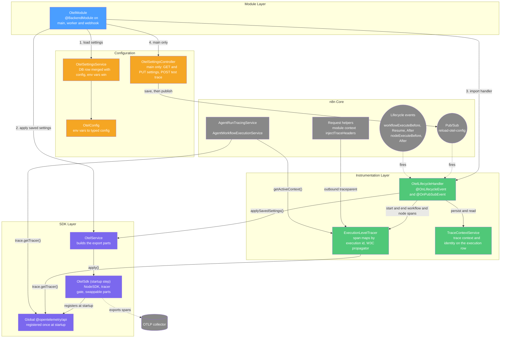

## Workflow level OTEL
This module enables workflow level telemetry

The module plugs into n8n to add tracing. The process-wide OTel setup lives outside the module, in `packages/cli/src/observability/`.

It is based upon and an extension of the work done in the community by:
@gabrielhmsantos - https://github.com/gabrielhmsantos/n8n-tracekit

### Testing
Given OTEL often involves events triggered from elsewhere within the n8n system integration testing is preferred.

### Attributes
All attributes are listed in `otel.constants.ts`

### Global API ownership

n8n sets up OTel once, in `bin/n8n`, after Sentry and before the command module loads. The
startup step (`observability/observability-boot.ts`) runs in every `bin/n8n` process, also when
OTel is off and when this module does not load. The task runner has no OTel.

- Sentry does not set up OTel. It does not trace a request that runs with OTel tracing
  suppressed, such as n8n's own OTLP export.
- `OtelSdk` starts `NodeSDK`. NodeSDK registers the tracer provider, the
  `AsyncLocalStorageContextManager` and the propagator. Nothing replaces or disables these
  globals. At exit, `NodeSDK.shutdown()` flushes the exporter.
- NodeSDK gets no metric readers and no log processors. It still registers an empty logger
  provider. Nothing leaves through it.
- The tracer gate gives each library a no-op tracer, unless its tracer name is on:

| Tracer name                                             | On when                                        |
| ------------------------------------------------------- | ---------------------------------------------- |
| `n8n-workflow`, `@n8n/agents`, `n8n-expression-runtime` | always                                         |
| `''` (Daytona)                                          | `N8N_DAYTONA_TRACING_ENABLED=true`             |
| `@microsoft/agents-telemetry`, `Agent365Sdk`            | `N8N_MICROSOFT_AGENT_365_TRACING_ENABLED=true` |

  n8n's own tracers check their own setting before they make spans. To add a library, add one
  entry to `OtelSdk`. The gate reads the env vars once at startup, so a change needs a restart.
- `OTEL_SDK_DISABLED=true` turns off all of OTel. n8n logs one warning.
- When another OTel setup is already registered at startup, for example with
  `NODE_OPTIONS=--require @opentelemetry/auto-instrumentations-node/register`, n8n does not
  start its own setup and does not gate that setup's tracers. n8n logs one warning. Workflow
  spans then go to that setup, and the n8n OTel settings have no effect.
- When the startup step fails, n8n logs the error and starts with tracing off.
- A save never fails because the old exporter cannot flush. n8n logs one warning.

The setup starts with three no-op parts: the span processors, the sampler and the propagator.
`OtelService` builds these parts from the saved settings and gives them to `OtelSdk.apply()`. It
does this at module init, on each settings save and on `reload-otel-config`. With OTel off, it
applies the no-op parts again.

- The span processors add the execution identity and send batches to the OTLP exporter.
- The export step merges `service.name`, `service.version`, `n8n.instance.id` and
  `n8n.instance.role` into the resource of each span. The other resource attributes stay. A
  saved service name applies without a restart.
- The global propagator sends and reads W3C `traceparent` only when OTel is on and
  `N8N_OTEL_TRACES_INJECT_OUTBOUND` is true. It never sends `baggage`.

`OTEL_*` env vars: an n8n setting wins where one exists. `OTEL_*` fills the rest and never locks
a UI field.

- n8n ignores `OTEL_SERVICE_NAME`, `OTEL_TRACES_SAMPLER`, `OTEL_TRACES_EXPORTER`,
  `OTEL_PROPAGATORS`, `OTEL_METRICS_EXPORTER` and `OTEL_LOGS_EXPORTER`.
- These apply: `OTEL_RESOURCE_ATTRIBUTES`, `OTEL_NODE_RESOURCE_DETECTORS`, the
  `OTEL_EXPORTER_OTLP_*` certificate, timeout and compression variables, `OTEL_BSP_*`, extra
  header keys from `OTEL_EXPORTER_OTLP_HEADERS`, and `OTEL_LOG_LEVEL`. OTel diagnostics go to the
  n8n logger at the `OTEL_LOG_LEVEL` level, with `warn` as the default.

Consequences:

- Workflow root spans start on `ROOT_CONTEXT`. They never join a trace that is active in the
  process, such as a Sentry request span. An inbound `traceparent` header still sets the parent.
- Persisted trace context and n8n's outbound headers always use the W3C `traceparent` and
  `tracestate` format.
- A library that starts its own OTel setup cannot register next to n8n's setup. Examples are
  Daytona with `DAYTONA_OTEL_ENABLED` and Microsoft's own exporter mode.

### Execution identity

Workflow and node spans carry `n8n.execution.id`, `n8n.workflow.id`, `n8n.workflow.name`,
`n8n.project.id` and `n8n.project.name`. Only team projects get a name, because a personal
project name holds the user's name and email.

- `ExecutionLevelTracer` builds the identity once for each execution segment and puts it in
  the parent context under a private context key.
- `ExecutionIdentitySpanProcessor` copies the identity from that key to each span at start.
  It never reads baggage: a caller can send `n8n.*` entries in an inbound `baggage` header,
  but cannot write the private key.
- The tracer never makes this context active. `getActiveContext` returns the span only.
- Each segment of an execution builds the identity from the current workflow name and
  project, because a workflow can be renamed or moved during a wait. A later segment runs
  the workflow saved at the start, so it reads the current name from the database.
- The identity is saved as an object in `tracingContext.identity`. A resume reads it only
  when the project lookup fails. A reconstructed crash span reads it, so it shows the
  identity of the last segment.

This key is n8n's single source of truth for the execution identity. Inbound and outbound
baggage (GOV-143) decides what it reads from this key and what it adds to baggage.

### Start marker spans

A span leaves n8n only when it ends. A marker span tells a trace backend that an execution
or a node started, before the real span ends.

| Environment variable                       | Default | Marker                                       |
| ------------------------------------------ | ------- | -------------------------------------------- |
| `N8N_OTEL_TRACES_EMIT_WORKFLOW_START_SPAN` | `false` | `workflow.execute.started` under each workflow span |
| `N8N_OTEL_TRACES_EMIT_NODE_START_SPAN`     | `false` | `node.execute.started` under each node span   |

- A marker is a child of the span that it announces. Its duration is 0 ms.
- A marker has the start attributes of its parent and the execution identity. The node
  marker does not have node custom tags, because n8n sets them when the node ends.
- Each `workflow.execute` span gets one workflow marker. A resume after a Wait node starts a
  new segment with its own `workflow.execute` span.
- In queue mode, main and the worker each send a `workflow.execute` span for each segment,
  so each segment gets two workflow markers. The marker from main shows when main queued the
  execution. The marker from the worker shows when the worker started it. The resource
  attribute `n8n.instance.role` (`main` or `worker`) tells them apart.
- The node marker follows the rules of `node.execute`. With
  `N8N_OTEL_TRACES_INCLUDE_NODE_SPANS=false`, no node marker exists. The node flag doubles
  the number of node spans.
- Both flags follow `N8N_OTEL_TRACES_PRODUCTION_ONLY`. Set them on workers too.
- A marker that fails logs a warning. It does not stop the real span or the execution.

### Custom attribute prefixes

n8n adds a prefix to the keys of custom telemetry tags: `n8n.project.custom.`,
`n8n.workflow.custom.` and `n8n.node.custom.`. `N8N_OTEL_TRACES_CUSTOM_ATTRIBUTE_PREFIXES`
replaces them with a JSON object, for example `{"project":"","node":""}`.

- An empty string removes the prefix for that level. A level that is left out keeps its default.
- An invalid value logs a warning, and n8n uses the default prefixes.
- When keys collide, the more specific level wins: node, then workflow, then project.
- n8n compares the key after it adds the prefix. If that key matches a built-in key in `ATTR`, n8n drops it and keeps the built-in value.
- Node metadata from the Tools Agent (`ai.agent.*`) uses the node prefix too.
- Set the same value on main, workers and webhook processes.

### Module architecture


#### Manual validation
1. Create docker-compose files and start them `docker-compose up -d`
	 `docker-compose.yml`
```yaml
services:
  jaeger:
    image: jaegertracing/jaeger:latest
    ports:
      - "16686:16686" # UI
      - "4317:4317"   # OTLP gRPC
      - "4318:4318"   # OTLP HTTP
    command: ["--config", "/etc/jaeger/config.yaml"]
    volumes:
      - ./jaeger-config.yaml:/etc/jaeger/config.yaml:ro
```

`jaeger-config.yaml`
```yaml
service:
  extensions: [jaeger_storage, jaeger_query]
  pipelines:
    traces:
      receivers: [otlp]
      exporters: [jaeger_storage_exporter]

extensions:
  jaeger_storage:
    backends:
      memory:
        memory:
          max_traces: 1000
  jaeger_query:
    storage:
      traces: memory
    ui:
      config_file: ""

receivers:
  otlp:
    protocols:
      grpc:
        endpoint: 0.0.0.0:4317
      http:
        endpoint: 0.0.0.0:4318

exporters:
  jaeger_storage_exporter:
    trace_storage: memory
```

Start n8n & point it at the jaeger instance
```
cd packages/cli
N8N_OTEL_ENABLED=true N8N_OTEL_EXPORTER_OTLP_ENDPOINT=http://127.0.0.1:4318 pnpm run dev
```

### Wire protocol (OTLP/HTTP vs OTLP/gRPC)

`N8N_OTEL_EXPORTER_OTLP_PROTOCOL` selects how spans are delivered. It mirrors the
upstream `OTEL_EXPORTER_OTLP_PROTOCOL` spec and accepts:

| Value                     | Exporter                                   | Conventional port |
| ------------------------- | ------------------------------------------ | ----------------- |
| `http/protobuf` (default) | `@opentelemetry/exporter-trace-otlp-proto` | 4318              |
| `grpc`                    | `@opentelemetry/exporter-trace-otlp-grpc`  | 4317              |

```
cd packages/cli
N8N_OTEL_ENABLED=true \
  N8N_OTEL_EXPORTER_OTLP_PROTOCOL=grpc \
  N8N_OTEL_EXPORTER_OTLP_ENDPOINT=http://127.0.0.1:4317 \
  pnpm run dev
```

Notes:

- Pick `grpc` only when the collector requires it (or for high span volume through
  infrastructure that passes HTTP/2 through cleanly). `http/protobuf` traverses
  proxies and firewalls more reliably and is easier to debug.
- The endpoint scheme controls TLS for **both** protocols: `https://` uses TLS,
  `http://` does not. There is no `grpc://` scheme.
- Because the scheme is load-bearing, `N8N_OTEL_EXPORTER_OTLP_ENDPOINT` must be an
  `http://` or `https://` URL. n8n logs a warning and uses the default endpoint if
  the value has another scheme or no scheme, e.g. `localhost:4318`. The scheme is
  matched case-insensitively, and n8n lowercases it before it reaches the exporter.
- gRPC endpoints take **no URL path**, so `N8N_OTEL_EXPORTER_OTLP_TRACING_PATH` is
  ignored when the protocol is `grpc`.
- `N8N_OTEL_EXPORTER_OTLP_HEADERS` entries are sent as gRPC metadata. Keys are
  lowercased (gRPC metadata keys are lowercase ASCII); an entry grpc-js rejects is
  skipped with a warning instead of failing startup.
- The startup connectivity check waits for a grpc-js channel to become ready for
  `grpc` (an HTTP `HEAD` request is meaningless against an HTTP/2-only server).
  The channel dials the host and port of the endpoint, so readiness proves TCP,
  the TLS handshake for `https://`, and an HTTP/2 connection. It is not proof that
  OTLP/gRPC is served there — use "Send test trace" in Settings → OpenTelemetry
  for the real check.
- An endpoint without a port dials the grpc-js default port 443, not 4317. Always
  give the port, e.g. `http://127.0.0.1:4317`.
- The check uses the default TLS trust store. It does not use the certificate
  material that the exporter reads from `OTEL_EXPORTER_OTLP_CERTIFICATE`,
  `OTEL_EXPORTER_OTLP_CLIENT_KEY` and `OTEL_EXPORTER_OTLP_CLIENT_CERTIFICATE`, so a
  collector behind a private CA, or one that needs mTLS, can fail the check and
  still receive spans.
- n8n has no setting for a custom CA or mTLS. Use the upstream
  `OTEL_EXPORTER_OTLP_*` certificate variables above, or `NODE_EXTRA_CA_CERTS`.
