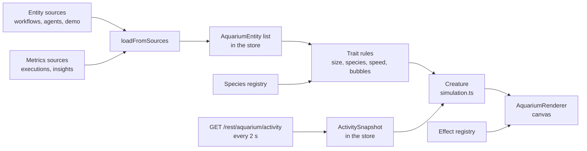

# @n8n/frontend-module-aquarium

A pixel-art aquarium. Each workflow and each agent is a sea creature:

- **Size and species** come from complexity (node count) and average run time.
- **Swim speed** is a resting speed from the execution count, plus a live boost from the runs
  per second right now.
- Busy creatures blow **bubbles**.
- Creatures that fail more than 20% of the time are **sick**: they blink green and swim at 40% of
  their speed.

The backend module (`../backend`) is on by default. When you turn it off with
`N8N_DISABLED_MODULES=aquarium`, the sidebar link and the `/aquarium` page are hidden.

Open **Aquarium** at the bottom of the main sidebar, or go to `/aquarium`. Add `?demo=true`, or
turn on **Demo data**, to fill the tank with fixed fake entities and fake live activity. Use this
when your instance has no workflows or no traffic.

## How it works



The slow data (entities and metrics) loads once and goes through the trait rules. The live data
(activity) arrives every 2 seconds and goes straight to `Creature.activity`, without the trait
rules.

| Layer | File | What it does |
| --- | --- | --- |
| Data | `src/sources/` | Loads entities and metrics from the REST API. A failed source does not stop the others. |
| Mapping | `src/engine/scaling.ts` | Pure functions: metrics to complexity score, size tier and speed. |
| Traits | `src/engine/traits.ts` | A pipeline of `TraitRule` functions that turn an entity into `CreatureTraits`. |
| Species | `src/species/` | Pixel-art sprites as text, one file for each creature. |
| Motion | `src/engine/simulation.ts` | Moves creatures. No DOM, so you can test it. |
| Drawing | `src/engine/renderer.ts`, `src/engine/effects.ts` | Draws the tank on a canvas at 1 logical pixel = `PIXEL_SIZE` CSS pixels. |
| UI | `src/components/AquariumTank.vue`, `src/views/AquariumView.vue` | Frame loop and popup. Hover shows the popup. A click pins it, with an **Open** button. A click on the water or Esc closes it. |

## Zoom

The tank is a world that grows with its creatures: their sprites cover about 10%
(`ZOOM.creatureCoverage`) of it. With few creatures, the world is the size of the screen at the
default zoom, so nothing changes. With many, the world is bigger than the screen, and the camera
opens zoomed out to show all creatures.

- The mouse wheel zooms around the pointer. Drag to pan. A drag does not pin a popup.
- The buttons at the bottom right zoom in, zoom out, and show all creatures.
- The zoom goes from the zoom that shows the whole world (at least `ZOOM.min`, 0.5) to
  `ZOOM.max` (12). After you zoom or pan, a new world size keeps your view.
- The camera maths is in `src/engine/camera.ts`. The renderer draws only what the camera shows.

## Data sources

| Source | Gives | Limits |
| --- | --- | --- |
| `workflows` | Workflows and their node count (sticky notes excluded) | The 200 most recently updated |
| `agents` | Agents, with skill count as complexity | No run stats yet |
| `executions` | Execution count, failures and run time | Only the last 300 executions |
| `insights` | The same metrics, but complete | Needs the insights dashboard license |

`insights` comes after `executions`, so its values win when both are available.

## Data sets

**Load data set** in the page header reads a JSON file, for example a scrape of another instance.
The file stays in the browser: it is not uploaded or stored, and a reload clears it. While a data
set is loaded, it replaces the live and the demo entities, and the page sends no requests.

- The format is `{ meta?, entities: [...] }`. Each entity has `id`, `kind` (`workflow` or `agent`),
  `name` and `metrics`, as in `AquariumEntity`. Other fields are ignored. `null` metrics become 0.
- `meta.instance` is shown in the label. `meta.executionWindow` (`approxHours`, or `from` and `to`)
  says how long the execution counts cover. Without it, the counts are taken as one week.
- The tank shows up to `DATASET_MAX_WORKFLOWS` (2000) workflows and `DATASET_MAX_AGENTS` (500)
  agents, the most-run first. These limits keep the drawing fast.
- Live activity is simulated from each workflow's real rate: execution count over the window, with
  a wave between 0.4 and 1.6 times that rate. "Running now" is the rate times the average run time.
- Entities from a data set have no route, so their popup has no **Open** button.

The parser is `src/sources/dataset.ts`.

## Live activity

The store polls `GET /rest/aquarium/activity` every 2 seconds while the page is open and the tab
is visible. For each workflow with recent runs it gives:

| Field | Meaning |
| --- | --- |
| `running` | Runs that started and did not end yet. In queue mode this includes queued runs. |
| `started`, `succeeded`, `failed` | Counts for the last `windowSeconds` (60). |
| `startedPerSecond` | Starts in each full second of the window, oldest first. |
| `lastEventAt` | Time of the last start or end. |

### Speed

`targetSpeedOf()` in `src/engine/simulation.ts` adds two parts:

- **Resting speed** (`SWIM_SPEED`, up to 14): from the execution count of the period.
- **Live boost** (`LIVE_SPEED`, up to 36): from the mean starts per second over the last 5 full
  seconds, on a log scale. For example, 5 runs per second gives about 16 and 15 runs per second
  gives about 25.

Sick creatures multiply the sum by `SICK_SPEED_FACTOR` (0.4).

The creature eases toward the target speed (`SPEED_EASING_SECONDS`), so it does not jump at each
poll. After a change in traffic, the speed settles in about 6 to 8 seconds: up to 5 seconds for the
rate window, up to 2 seconds for the poll, and the easing.

The backend counts every run of the main instance that serves the request: production, manual and
sub-workflow runs, saved or not. Read `../backend/README.md` for the limits.

## Extend the aquarium

Read [AGENTS.md](AGENTS.md). It gives the steps to add a creature, a metric, an effect, a data
source or an entity kind, and the rules that keep the tank fast and crisp.

## Checks

```bash
pnpm turbo typecheck --filter=@n8n/frontend-module-aquarium
pnpm turbo lint --filter=@n8n/frontend-module-aquarium
pnpm turbo test --filter=@n8n/frontend-module-aquarium
```

Use turbo, not `pnpm --filter <pkg> typecheck`. This package is used from source, and turbo builds
its platform dependencies first. See `packages/@n8n/module-cli/frontend-module-guide.md` for the
module rules.
