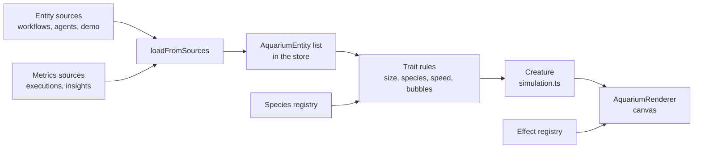

# @n8n/frontend-module-aquarium

A pixel-art aquarium. Each workflow and each agent is a sea creature:

- **Size and species** come from complexity (node count) and average run time.
- **Swim speed** comes from the execution count.
- Busy creatures blow **bubbles**.

Open **Aquarium** at the bottom of the main sidebar, or go to `/aquarium`. Add `?demo=true`, or turn on
**Demo data**, to fill the tank with fixed fake entities. Use this when your instance has no
workflows.

## How it works



| Layer | File | What it does |
| --- | --- | --- |
| Data | `src/sources/` | Loads entities and metrics from the REST API. A failed source does not stop the others. |
| Mapping | `src/engine/scaling.ts` | Pure functions: metrics to complexity score, size tier and speed. |
| Traits | `src/engine/traits.ts` | A pipeline of `TraitRule` functions that turn an entity into `CreatureTraits`. |
| Species | `src/species/` | Pixel-art sprites as text, one file for each creature. |
| Motion | `src/engine/simulation.ts` | Moves creatures. No DOM, so you can test it. |
| Drawing | `src/engine/renderer.ts`, `src/engine/effects.ts` | Draws the tank on a canvas at 1 logical pixel = `PIXEL_SIZE` CSS pixels. |
| UI | `src/components/AquariumTank.vue`, `src/views/AquariumView.vue` | Frame loop, hover tooltip, click to open the workflow or agent. |

## Data sources

| Source | Gives | Limits |
| --- | --- | --- |
| `workflows` | Workflows and their node count (sticky notes excluded) | The 200 most recently updated |
| `agents` | Agents, with skill count as complexity | No run stats yet |
| `executions` | Execution count, failures and run time | Only the last 300 executions |
| `insights` | The same metrics, but complete | Needs the insights dashboard license |

`insights` comes after `executions`, so its values win when both are available.

## Extend the aquarium

Read [AGENTS.md](AGENTS.md). It gives the steps to add a creature, a metric, an effect, a data
source or an entity kind, and the rules that keep the tank fast and crisp.

## Checks

```bash
pnpm turbo typecheck --filter=@n8n/frontend-module-aquarium
pnpm turbo lint --filter=@n8n/frontend-module-aquarium
pnpm turbo test --filter=@n8n/frontend-module-aquarium
```

Use turbo, not `pnpm --filter <pkg> typecheck`. This package is used from source, and turbo builds
its platform dependencies first. See `packages/@n8n/module-cli/frontend-module-guide.md` for the
module rules.
