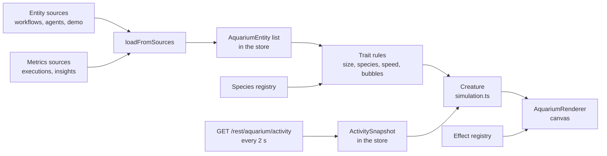

# @n8n/frontend-module-aquarium

A pixel-art aquarium. Each workflow and each agent is a sea creature:

- **Size and species** come from complexity (node count) and average run time.
- **Swim speed** is a resting speed from the execution count, plus a live boost from the runs
  per second right now.
- Busy creatures blow **bubbles**.
- **Old workflows are turtles**: at least 90 days old and among the oldest 2% of the workflows
  shown (`OLD_WORKFLOW`). In a young instance nothing is old. A large or huge old workflow is a
  bigger turtle.
- Creatures that fail more than 20% of the time are **sick**: they blink green and swim at 40% of
  their speed.

The backend module (`../backend`) is on by default. When you turn it off with
`N8N_DISABLED_MODULES=aquarium`, the sidebar link and the `/aquarium` page are hidden.

Open **Aquarium** at the bottom of the main sidebar, or go to `/aquarium`. Add `?demo=true`, or
turn on **Demo data**, to fill the tank with fixed fake entities and fake live activity. Use this
when your instance has no workflows or no traffic.

## How it works



The slow data (entities and metrics) loads once and goes through the trait rules. The live data
(activity) arrives every 2 seconds and goes straight to `Creature.activity`, without the trait
rules.

| Layer | File | What it does |
| --- | --- | --- |
| Data | `src/sources/` | Loads entities and metrics from the REST API. A failed source does not stop the others. |
| Mapping | `src/engine/scaling.ts` | Pure functions: metrics to complexity score, size tier and speed. |
| Traits | `src/engine/traits.ts` | A pipeline of `TraitRule` functions that turn an entity into `CreatureTraits`. |
| Species | `src/species/` | Pixel-art sprites as text, one file for each creature. |
| Motion | `src/engine/simulation.ts` | Moves creatures. No DOM, so you can test it. |
| Drawing | `src/engine/renderer.ts`, `src/engine/effects.ts` | Draws the tank on a canvas at 1 logical pixel = `PIXEL_SIZE` CSS pixels. |
| UI | `src/components/AquariumTank.vue`, `src/views/AquariumView.vue` | Frame loop and popup. Hover shows the popup. A click pins it, with an **Open** button. A click on the water or Esc closes it. |

## Project view

**By project** in the page header shows one tank for each project. **One tank** shows all creatures
together. The choice is in the URL (`?view=projects`).

- Each tank grows with the sprite area of its creatures, like the single tank, from a minimum size
  (`PROJECT_TANK`). The biggest creature always fits.
- `packTanks()` in `src/engine/layout.ts` fills a wall with the shape of the free screen area, like
  a treemap, so the wall has no holes. Each tank gets a cell with the area that it needs. The wall
  is cut in two again and again, at a weight between 40% and 60%, in the direction that keeps the
  halves closest to square. Groups of up to 5 tanks are searched fully, so they do not get slivers.
- The order is shuffled by project id, so big and small tanks mix, and the wall is the same after a
  reload. Tank shapes vary between wide and tall. Entities without a project share a "No project"
  tank.
- Each project tank has a pixel-art frame: wood, riveted steel, a porthole, stone, brass or coloured
  glass, in colour variants. The project id picks the frame. Frames are in `src/engine/frames.ts`.
- All tanks are drawn on one canvas, and zoom and pan work on the whole wall. A tank label shows
  when the tank is at least `PROJECT_LABEL_MIN_WIDTH` CSS pixels wide on screen.
- "Show all" fits the tanks below the page header. Personal projects show the name without the
  email address.

### Small projects

When there are more than `SMALL_PROJECTS.maxTanks` (50) projects, project view hides projects with
fewer than `SMALL_PROJECTS.minCreatures` (3) creatures. Workflows and agents both count. The header
shows how many projects are hidden. `hideSmallProjects()` in `src/engine/projects.ts` does this
after the **My projects** filter, so a short list of member projects shows in full. One tank view
shows all creatures.

### My projects

**My projects** shows only the projects that the account is a direct member of: a project role,
not only a global role that lets an admin see every project. It works in both views and is in the
URL (`?mine=true`). The switch shows only when the data has membership:

- Live: the store asks `GET /rest/projects/my-projects` and keeps projects with a `project:…` role.
- Data sets: each project in `projects` can have `isMember`.
- Demo: the demo account is a member of Sales and Operations.

## Zoom

The tank is a world that grows with its creatures: their sprites cover about 10%
(`ZOOM.creatureCoverage`) of it. With few creatures, the world is the size of the screen at the
default zoom, so nothing changes. With many, the world is bigger than the screen, and the camera
opens zoomed out to show all creatures.

- The mouse wheel zooms around the pointer. Drag to pan. A drag does not pin a popup.
- The buttons at the bottom right zoom in, zoom out, and show all creatures.
- The zoom goes from the zoom that shows the whole world (at least `ZOOM.min`, 0.1) to
  `ZOOM.max` (12). After you zoom or pan, a new world size keeps your view.
- Below `ZOOM.detail`, one canvas pixel is one device pixel and the renderer scales the drawing
  (`canvasResolutionFor()`). Small sprites stay sharp on a high-density screen, and zooming out
  does not make the canvas bigger than the screen.
- The camera maths is in `src/engine/camera.ts`. The renderer draws only what the camera shows.
- Below `ZOOM.detail` (1.5), plants and the water surface stop moving: each tank draws them from a
  cached image. A one-pixel sway is hard to see at that size, and drawing it pixel by pixel in
  hundreds of tanks was the main cost of a frame.
- Below `ZOOM.detail`, the water dither has one cell for each CSS pixel, not for each logical
  pixel. A pattern of logical pixels shrunk below 1:1 aliases into large checks. The water is
  painted again at the new zoom `ZOOM.settleMs` after the zoom stops changing.

## Data sources

| Source | Gives | Limits |
| --- | --- | --- |
| `workflows` | Workflows and their node count (sticky notes excluded) | The 200 most recently updated |
| `agents` | Agents, with skill count as complexity | No run stats yet |
| `executions` | Execution count, failures and run time | Only the last 300 executions |
| `insights` | The same metrics, but complete | Needs the insights dashboard license |
| `security` | Security risks: unprotected webhooks, expressions in SQL queries, Execute Command and SSH nodes | Needs the `aquarium` backend module. Checks only the workflows that the user can read |

`insights` comes after `executions`, so its values win when both are available.

## Data sets

**Load data set** in the page header reads a JSON file, for example a scrape of another instance.
The file stays in the browser: it is not uploaded or stored, and a reload clears it. While a data
set is loaded, it replaces the live and the demo entities, and the page sends no requests.

- The format is `{ meta?, entities: [...] }`. Each entity has `id`, `kind` (`workflow` or `agent`),
  `name` and `metrics`, as in `AquariumEntity`. Other fields are ignored. `null` metrics become 0.
- `meta.instance` is shown in the label. `meta.executionWindow` (`approxHours`, or `from` and `to`)
  says how long the execution counts cover. Without it, the counts are taken as one week.
- The tank shows up to `DATASET_MAX_WORKFLOWS` (2000) workflows and `DATASET_MAX_AGENTS` (500)
  agents, the most-run first. These limits keep the drawing fast.
- Live activity is simulated from each workflow's real rate: execution count over the window, with
  a wave between 0.4 and 1.6 times that rate. "Running now" is the rate times the average run time.
- Entities from a data set have no route, so their popup has no **Open** button.

The parser is `src/sources/dataset.ts`.

## Workflow build and waiting

Each workflow has a `design` (`WorkflowDesign`), read from its nodes and settings by
`analyzeWorkflow()` in `src/engine/design.ts`. The live list asks for `nodes` and `settings`. Data
sets carry the same `design`, made by the same function.

| Data | Where | Meaning |
| --- | --- | --- |
| `design.hasErrorWorkflow` | Workflow settings | A workflow runs when this one fails. |
| `design.waitNodeCount` | Nodes | Wait and Form nodes, and nodes that send and wait for a reply. The workflow pauses by design. |
| `metrics.waitingCount` | Executions sample | Runs that are paused now. |
| `metrics.finishedCount` | Executions sample, insights | Runs that ended. Compare paused runs with this, not with `executionCount`. |
| `allRunsWaiting(metrics, activity)` | Computed | Every recent run is paused and none has ended. Live activity decides when it has runs. |
| `activity.waiting`, `activity.paused` | Live endpoint | Runs paused now, and pauses in the last minute. |
| `maintainabilityOf(design)` | Computed | A score from 0 to 100, and the factors that cost points. |

A paused run is not a failure. `failureRateOf()` counts only `error` and `crashed`, and
`waitingShareOf()` gives the share of paused runs, so a workflow that waits a lot is not shown as
sick.

The maintainability score starts at 100. `MAINTAINABILITY_RULES` takes points off, each up to a
maximum:

| Factor | Counts | Free | Points for each one more | Max |
| --- | --- | --- | --- | --- |
| `size` | Nodes, only when the workflow calls no sub-workflow | 20 | 1 | 25 |
| `code` | Code, Function and AI code nodes | 1 | 4 | 20 |
| `duplicates` | Nodes with the same type and parameters as an earlier node | 0 | 5 | 20 |
| `disabled` | Disabled nodes | 0 | 3 | 15 |
| `branching` | If, Switch and Merge nodes | 3 | 2 | 20 |

The popup shows the score, its main issue, the error workflow, paused runs, and "All runs
paused, not broken" when every run waits.

## Live activity

The store polls `GET /rest/aquarium/activity` every 2 seconds while the page is open and the tab
is visible. For each workflow with recent runs it gives:

| Field | Meaning |
| --- | --- |
| `running` | Runs that started and did not end yet. In queue mode this includes queued runs. |
| `started`, `succeeded`, `failed` | Counts for the last `windowSeconds` (60). |
| `startedPerSecond` | Starts in each full second of the window, oldest first. |
| `lastEventAt` | Time of the last start or end. |

### Speed

`targetSpeedOf()` in `src/engine/simulation.ts` adds two parts:

- **Resting speed** (`SWIM_SPEED`, up to 14): from the execution count of the period.
- **Live boost** (`LIVE_SPEED`, up to 36): from the mean starts per second over the last 5 full
  seconds, on a log scale. For example, 5 runs per second gives about 16 and 15 runs per second
  gives about 25.

Sick creatures multiply the sum by `SICK_SPEED_FACTOR` (0.4).

The creature eases toward the target speed (`SPEED_EASING_SECONDS`), so it does not jump at each
poll. After a change in traffic, the speed settles in about 6 to 8 seconds: up to 5 seconds for the
rate window, up to 2 seconds for the poll, and the easing.

### Depth

Each creature has a home depth, spread evenly over the middle 80% of the tank, and wanders a
little above and below it. About 12% of creatures are in the top fifth, 25% in each of the three
middle fifths, and 12% in the bottom fifth. Sometimes it makes a quick trip to the top or the bottom, then goes home. Random targets
anywhere in the tank would pull the creatures into the middle. The numbers are in `WANDER`.

The backend counts every run of the main instance that serves the request: production, manual and
sub-workflow runs, saved or not. Read `../backend/README.md` for the limits.

## Extend the aquarium

Read [AGENTS.md](AGENTS.md). It gives the steps to add a creature, a metric, an effect, a data
source or an entity kind, and the rules that keep the tank fast and crisp.

## Checks

```bash
pnpm turbo typecheck --filter=@n8n/frontend-module-aquarium
pnpm turbo lint --filter=@n8n/frontend-module-aquarium
pnpm turbo test --filter=@n8n/frontend-module-aquarium
```

Use turbo, not `pnpm --filter <pkg> typecheck`. This package is used from source, and turbo builds
its platform dependencies first. See `packages/@n8n/module-cli/frontend-module-guide.md` for the
module rules.
