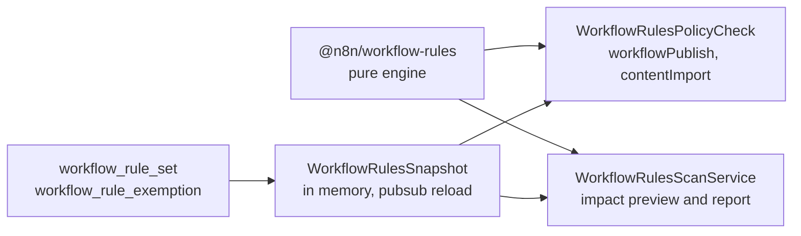

# @n8n/backend-module-workflow-rules

Workflow Rules: admin-defined rules on workflow content. The module is opt-in
while it is built. Turn it on with `N8N_ENABLED_MODULES=workflow-rules` on every
process, including workers and one-off CLI commands.

- **Rule sets:** one for the instance and at most one for each project. Saves use
  optimistic locking: a stale `version` gets 409.
- **Enforcement:** blocking findings refuse a publish of a new version and an
  import. Saves are never checked, because the editor autosaves drafts. Runs are
  never checked, and a republish (restart, leader change, settings-only save)
  is never refused, so a new rule cannot stop a live workflow.
- **Projects:** a project can make any instance rule stricter. It can lower or
  turn off an instance rule only when the instance marks it adjustable. Project
  admins can exempt workflows only from rules they could relax.
- **Settings rules:** error workflow, timeout and caller policy are live settings.
  A settings-only save re-publishes the same version, so these rules apply at the
  next real publish.
- **Imports:** a source-control pull skips a refused workflow and reports it. A
  package import or promotion refuses the whole package.

Do not import from `packages/cli` or the `n8n` package. Keep the entrypoint in
the `./module` export.
