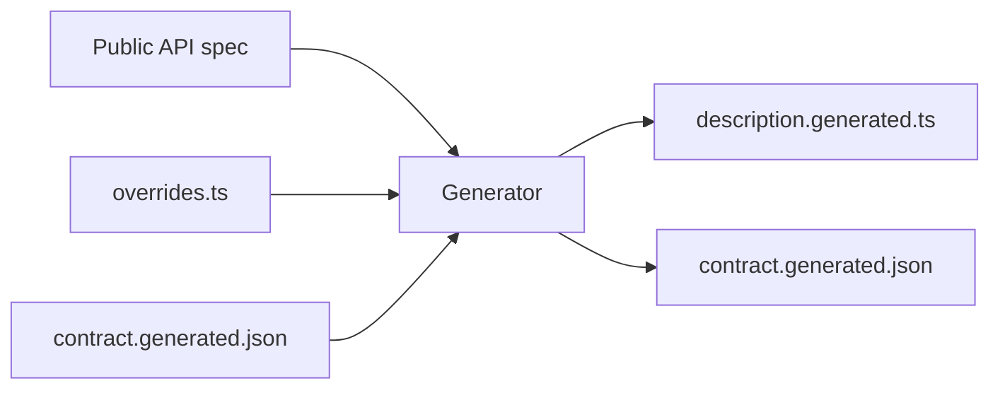

# n8n node v2

Version 2 of the n8n node is generated from the public API spec. You do not
edit the node description by hand. You edit one file, `overrides.ts`, and you
run the generator.

## Files

| File | Who writes it | What it is |
|---|---|---|
| `overrides.ts` | you | All decisions about the node: what to include, names, labels, field types |
| `methods.ts` | you | Functions that `overrides.ts` refers to, for example a list of roles from the API |
| `define-overrides.ts` | rarely changed | Types and helpers for `overrides.ts` |
| `generated/description.generated.ts` | the generator | The node description that n8n loads. Do not edit |
| `generated/contract.generated.json` | the generator | The names, places, formats and defaults of all node parameters. Do not edit |
| `N8nV2.node.ts` | rarely changed | The node class |

The generator is the `@n8n/n8n-node-codegen` package. It reads the spec
fragments in `packages/cli/src/public-api/v1` and does not change them.



## Commands

You usually do not run a command. The root build runs the generator after it
builds the cli package, then it rebuilds nodes-base:

```bash
pnpm build
```

Commit the changed files in `generated/` with your change.

To run only the generator:

```bash
pnpm --filter @n8n/n8n-node-codegen generate
```

To fail when the generated files are out of date:

```bash
pnpm --filter @n8n/n8n-node-codegen generate --check
```

To also compare the node with a release, and fail when a change breaks saved
workflows:

```bash
pnpm --filter @n8n/n8n-node-codegen generate --check --base <release tag>
```

## The one rule

A saved workflow stores the values of the node parameters by name. When a
workflow keeps the default value, it does not store a value at all. So after a
release, these things are part of the contract:

- the resource and operation names, for example `project:addUser`
- the parameter names, for example `userId`
- the place of a parameter: at the top level, in **Options** or in
  **Additional Fields**
- the stored format: text, number, boolean, list or object
- the default value

You can change these freely before a release. After a release, a change to them
needs a new node version.

Labels are not part of the contract. You can always change `displayName`,
`description`, `placeholder`, the order of fields, and hints.

## Scenarios

### I added an endpoint to the public API

You do not need to know about the node. Run `pnpm build`.

- While `include` is in `overrides.ts`, the generator does not add your
  endpoint. Its summary shows it as "not included yet". Nothing fails.
- Without `include`, the generator adds your endpoint to the node with a default
  name. Commit the changed files in `generated/`.

Look at the diff of `contract.generated.json`. It shows the new operation:

```json
"tag:merge": { "api": "mergeTag", "params": { ... } }
```

If the name is good, you are done. If not, see the next scenario. If the
endpoint must not be in the node, exclude it:

```ts
exclude: {
	mergeTag: 'Only for the admin UI. Not useful as a workflow step.',
},
```

### A name in the node is bad

First check if the bad name is a label or a name.

- **A label** is the text that users see: "Get Many". You can change it at
  any time.

  ```ts
  operations: {
  	'execution:getAll': { displayName: 'Get Executions', action: 'Get executions' },
  },
  ```

  For a parameter label, use `param()`:

  ```ts
  operations: {
  	'execution:get': { params: { executionId: { use: param({ displayName: 'Execution' }) } } },
  },
  ```

- **A name** is the key in the contract: `execution:getAll`, `executionId`.
  Before a release, you can change it. Bind the new name to the API name. The
  first line gives `addUsersToProject` the name `project:addUser`. The second
  line names the parameter `id` in the node:

  ```ts
  operations: {
  	'project:addUser': { api: 'addUsersToProject' },
  	'execution:get': { params: { id: { api: 'path:executionId' } } },
  },
  ```

  After a release, do not change a name. Change the label instead.

### I renamed something in the API

If you renamed a path parameter or an `operationId`, API clients do not see a
change. Saved workflows do. The release check fails and tells you the line to
add:

```text
- execution:retry: parameter "executionId" was removed. If the API renamed it,
  add to packages/nodes-base/nodes/N8n/v2/overrides.ts:
  operations: { 'execution:retry': { params: { executionId: { api: 'path:id' } } } }.
```

Add the line. The node keeps the old name and sends the value to the new API
name.

### I want a list instead of a text field

Write the function in `methods.ts`. Refer to the function, not to its name:

```ts
const projectRole = param(
	{ displayName: 'Role Name or ID', type: 'options', default: 'project:viewer' },
	{ loadOptions: getProjectRoles },
);
```

Use it for one parameter, or for all parameters with the same API name:

```ts
rules: [{ api: 'body:role', resource: 'project', use: projectRole }],
```

A list from the API, a static list and a text field all store text. So this
change is safe after a release, if you keep the same default.

### I want to pick a record with search, URL or ID

Use a resource locator, for example `workflowIdLocator` with the
`searchWorkflows` function from `../shared/WorkflowLocator`.

A resource locator stores an object, not text. After a release, this change
needs a new node version.

### I want to allow or block expressions

All fields accept expressions by default. To block expressions, set
`noDataExpression`:

```ts
operations: {
	'execution:getAll': { params: { status: { use: param({ noDataExpression: true }) } } },
},
```

To allow expressions again, remove the line. Both changes are safe after a
release.

### I want a field at the top level, or in Additional Fields

Set the place:

```ts
operations: {
	'execution:get': { params: { includeData: { placement: 'root' } } },
},
```

The values are `root`, `options` (query parameters) and `additionalFields`
(body fields). The generator keeps the place of a field when the API makes it
required or optional. So the place changes only when you change it. After a
release, a change of place needs a new node version.

### The API sends a list of objects, but users add one item at a time

Flatten the list. The fields of one item move to the top level, and the node
sends a list with one item:

```ts
operations: {
	'project:addUser': { api: 'addUsersToProject', flatten: 'relations' },
},
```

### I want to change the default value

Set it with `param()`. Before a release, this is safe. After a release, saved
workflows that kept the old default get the new one. The release check fails.

### I want to add a new resource to the node

While the node is rolled out step by step, `include` lists what is in the node.
Add the resource, or one operation:

```ts
include: ['project', 'user', 'tag:create'],
```

Run the generator and check the operations of the resource in a real n8n
instance. When the lint rules for nodes find problems in the generated
descriptions, fix the descriptions in the API spec or in `overrides.ts`.

## What the generator does by itself

- Cursor pagination becomes **Return All** and **Limit**.
- An empty response becomes `{ "success": true }`.
- A list of simple objects becomes a list of fields that users can add.
- The query values `'true'` and `'false'` become a boolean field.
- A field that the generator cannot show in a better way becomes a JSON field.
- Deprecated operations, and operations with file uploads or file downloads, are
  excluded. The reason is in `contract.generated.json`.
- The API key scope of each operation shows in its description.

## A new node version

When a breaking change is necessary:

1. Copy `v2/` to `v3/`. Register `N8nV3` in `../N8n.node.ts`.
2. Set `NODE_DIR` in `packages/@n8n/n8n-node-codegen/src/paths.ts` to
   `packages/nodes-base/nodes/N8n/v3`.
3. Make the breaking change in `v3/overrides.ts` and run `pnpm build`.

The generator then writes only to `v3/`. Saved workflows that use version 2
keep the description that was released. Keep `methods.ts` and
`define-overrides.ts` in `v2/`, because the released node uses them at run
time. The generator imports its types from `v2/define-overrides.ts`. Keep
`v3/define-overrides.ts` compatible, or change the type imports too.
