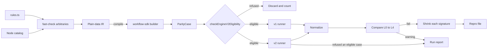

# @n8n/engine-parity

Finds behavior differences between engine v1 and engine v2. The harness
generates random workflows from a grammar, runs each workflow on both engines
in one process, and compares the results.



## Run it

The parity tests need a container runtime, because engine v2 stores its state in
Postgres. Build the workspace first (`pnpm build`).

```bash
cd packages/quality/testing/engine-parity
pnpm test                        # unit tests, no containers
pnpm test:parity                 # parity runs and the runner tests
PARITY_RULES=smoke,loops PARITY_SEED=1 PARITY_RUNS=500 pnpm test:parity
pnpm parity:replay parity-failures/smoke/L2.merge-merge.items.json
```

With Podman, point Testcontainers at the Podman socket:

```bash
export DOCKER_HOST=unix://$(podman machine inspect --format '{{.ConnectionInfo.PodmanSocket.Path}}')
export TESTCONTAINERS_RYUK_DISABLED=true
```

| Variable | Default | Meaning |
|---|---|---|
| `PARITY_RULES` | `smoke` | Rule sets to run, separated by commas. See `src/grammar/rules.ts`. |
| `PARITY_SEED` | random | fast-check seed. The report prints it. |
| `PARITY_RUNS` | `200` | Cases for each rule set. |
| `PARITY_PATH` | none | Runs only this fast-check path, for example the `path` of a repro file. |
| `PARITY_SHRINK_MS` | `120000` | Time limit to shrink one failure signature. |
| `PARITY_CASE_TIMEOUT_MS` | `10000` | Time limit for one case on one engine. |
| `PARITY_OUT_DIR` | `parity-failures` | Where repro files and reports go. |
| `TEST_IMAGE_POSTGRES` | `postgres:18-alpine` | The Postgres image for engine v2. |

## How it works

1. **Grammar** (`src/grammar`). fast-check generates a structure tree of
   combinators (`chain`, `branch`, `switch`, `fanOut`, `merge`, `loop`,
   `errorOutput`) with node parameter drafts from the
   catalog. fast-check shrinks this tree. `toIr` lowers it to the plain-data IR
   (`ir.ts`) and fills expression holes with the names of upstream nodes.
   Every shape is valid by construction: each block has one way in and one way
   out, and only `merge` joins branches.
2. **Compile** (`src/compile/to-sdk.ts`). The IR goes through
   `@n8n/workflow-sdk` with `connect()` and `regenerateNodeIds()`, so the same
   seed gives byte-identical JSON.
3. **Eligibility.** `checkEngineV2Eligibility` runs on the workflow. The
   harness discards a case that the check refuses, and counts
   the reason.
4. **Runners** (`src/runners`). Both runners use one node registry, one
   expression evaluator, and one set of additional data, so a difference comes
   from the engine.
   - v1: `WorkflowExecute` in `trigger` mode. The fired trigger passes the
     trigger items through.
   - v2: one Postgres container and one engine runtime for each worker. The
     workflow goes through `V1WorkflowConverter`. The result comes back through
     `toV1RunExecutionData`.
5. **Oracle** (`src/oracle`). Both results become one `Outcome`, without
   timings, IDs and metadata.

| Level | Comparison | Severity |
|---|---|---|
| L0 | Status, failing node, error class | Fail |
| L1 | Terminal output (nodes with no outgoing connection), as a multiset | Fail |
| L2 | Items for each node, run and output, as a multiset | Fail |
| L3 | Item order and run order | Warning (fail for nodes with `orderSensitive`) |
| L4 | `pairedItem` lineage | Warning |
| E | The check accepts the case, but an engine refuses it or times out, or the converter drops an edge | Finding |

A refusal or a timeout fails the run. The other findings show in the summary
only.

When both runs fail, and the order of branches decides which node fails first,
L0 to L2 differences become L3: engine v1 runs branches one after another, and
engine v2 can run them in parallel. Items of a node that ran on both engines
must still be equal.

6. **Report** (`src/report`). Nothing stops the run at the first failure. Each
   failure signature (level, node type, combinator, diff kind) keeps the first
   case that showed it. Then each signature shrinks on its own and writes
   `parity-failures/<rule set>/<signature>.json`, with the seed, the fast-check
   path, the shrunk IR, the workflow JSON, the SDK code, both outcomes and the
   diff. `summary.md` and `summary.json` hold the coverage: cases, node and
   combinator counts, discard reasons, findings and warnings.

## Known divergences

`src/oracle/known-divergences.ts` lists the intended gaps between the engines.
The oracle ignores a difference that matches an entry. Each entry links its
Linear ticket. Remove the entry in the PR that closes the gap.

## Add a node to the catalog

1. Add a file in `src/grammar/catalog/` that exports a `CatalogEntry`.
2. Register it in `src/grammar/catalog/index.ts`.
3. Add the node class to `src/runners/node-registry.ts`.
4. Add the catalog ID to the rule sets that use it.

## CI

`.github/workflows/test-engine-parity-reusable.yml` runs the PR job with a fixed
seed when engine code changes, or when a PR has the `force-engine-parity`
label. A failure uploads the repro files as the `engine-parity-repros`
artifact. Start the workflow by hand for a larger run with a random seed.
