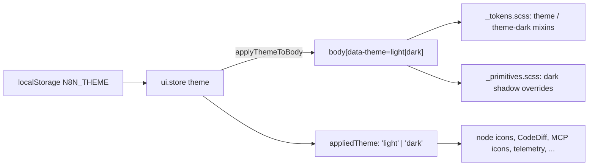

# Plan: switch between two hard-coded themes (Catppuccin Latte and Mocha)

Source: [Themes and visual customization in n8n](https://app.notion.com/p/n8n/Themes-and-visual-customization-in-n8n-4135b6e0c94f808aba95ca381c47f9e0)
(Hackmation, 2026 Nov). This plan covers ask #5, "Personal theme presets", with the
one-day scope that the doc recommends: **Catppuccin Latte** (light) and **Catppuccin Mocha** (dark).
It also adds the theme switch to Cmd+K, as the page comment asks.

## Status

Last update: 2026-11-18, after `ad100c39b9b`. All work is committed on the `themes` branch, and the
branch is in sync with `origin/themes`.

| Commit | Author | What |
|---|---|---|
| `128ff955100` | Ragnar | This plan |
| `2e38933fb18` | Ragnar | Catppuccin Latte, end to end |
| `ad100c39b9b` | Jeroen | Dracula, Cmd+K group with live preview, account menu submenu, View Transition fade, pop-out sync, high contrast palettes (not selectable) |

**Selectable themes now:** System, Light, Dark, Catppuccin Latte, Dracula. **Catppuccin Mocha is not
built.** Dracula took the dark-preset slot. See the open questions.

**Where the user picks a theme:**

- **Settings → Personal → Theme**.
- **Account menu** (the avatar in the sidebar) → **Theme** submenu. This is new, and not in the
  original plan.
- **Cmd+K → "Change theme…"**. Each theme is a child item. A highlighted item previews its theme
  live. Enter saves it. If the user closes the bar or moves away, the saved theme comes back.
- All three menus read one list, `useThemeOptions()`. A new `ThemeOption` does not compile until it
  has a label and an icon there.

**Done since the last update (Jeroen, `ad100c39b9b`):**

- Dracula preset (`dracula` → dark mode). It remaps the neutral and accent ramps, the alpha steps,
  and the syntax colors. The solid button uses the purple accent with dark text.
- Live preview: `N8nCommandBar` has a new `highlight` emit (this was the stretch goal). The new
  `useThemePreview` composable listens to it in `AppCommandBar.vue`. A preview changes only the body
  attributes. The store and localStorage keep the saved theme.
- `applyThemeWithTransition` in `ui.utils.ts` cross-fades a theme change with the View Transitions
  API (`_theme-transition.scss`). It applies at once without the API or with reduced motion. Boot
  still uses `applyThemeToBody`, so there is no fade on load.
- `applyThemeToBody` writes only the attributes that change, in one block, so a preset-to-preset
  switch has no frame without a palette.
- Pop-out log window: it copies and observes `data-palette` too (step 6 is done).
- `high-contrast-dark` and `high-contrast-light` blocks in `_palettes.scss`. They are not in
  `ThemePreset` or the menus, so nothing selects them yet.

**Checks on the current branch (run 2026-11-18, after the pull):**

- Passed: editor-ui `ui.utils`, `ui.store`, `SettingsPersonalView`, every `commandBar` test,
  the `execution/logs/composables` tests and the `MainSidebar*` tests (26 files, 451 tests).
  design-system `N8nCommandBar` and `sassDeprecations` (47 tests). Biome and oxlint are clean on the
  changed TS and Vue files. The one oxlint warning, in `Interface.ts`, was already there.
- **Failed: stylelint**, one error. `_palettes.scss:270` `#333333` must be `#333`
  (`color-hex-length`, in `$high-contrast-light`). `stylelint --fix` fixes it.
- Not run: the editor-ui typecheck. CI runs it.
- **No new tests** came with `ad100c39b9b`. The existing tests pass, but nothing covers Dracula,
  the preview, the transition, the account menu or the pop-out sync. See the Tests section.

**Not verified in a browser:** neither Latte nor Dracula, the preview nor the fade. This machine
has no Chrome and no Playwright browsers. The first task of the next session is a visual pass
(step 7).

**Next:**

1. Fix the stylelint error.
2. Visual pass on Latte and Dracula, with the Cmd+K preview (step 7).
3. Decide on Mocha (see the open questions). If we keep it, follow the Dracula block, not the Latte
   block. See "Dark presets" below.
4. Add the missing tests.

### Local dev notes

- The repo pins pnpm 12.4.2. The global pnpm is 12.21.0, which rejects the lockfile
  (`yaml` catalog mismatch). Run pnpm as `npx -y pnpm@12.4.2 …`, or run `corepack enable`.
- The build was 3 weeks old. A full `pnpm build` took about 1.5 minutes.
- `pnpm dev:be` does not rebuild the backend dependencies (`n8n-workflow`, `n8n-core`, `@n8n/db`,
  ...). It uses their `dist`. After a pull or a branch switch, run
  `pnpm turbo run build --filter='n8n^...'` first. Turbo's cache makes this fast when nothing
  changed. The theme work so far touches only frontend packages that the editor reads from source,
  so `ad100c39b9b` does not need a build.
- Run the backend with `pnpm dev:be` (port 5678) and the editor with `pnpm dev:fe:editor`
  (http://localhost:8080). The logs are in `/tmp/n8n-dev-be.log` and `/tmp/n8n-dev-fe.log`.
  Stop both with `pkill -f "turbo run dev"`.
- The editor resolves `@n8n/design-system/css/*` to `src`, so changes to `_palettes.scss` hot
  reload. Reload the page after changes to `en.json`.
- The local owner is `ragnar.hardarson+local-direct@n8n.io` in `~/.n8n/database.sqlite`.

## Goal

- A user picks one of five themes: System, Light, Dark, Catppuccin Latte, Catppuccin Mocha.
  (Built so far: System, Light, Dark, Catppuccin Latte, Dracula. See the Status section.)
- The user can pick the theme in **Personal settings** and in the **command bar (Cmd+K)**. The
  command bar applies the theme at once, so the user sees it on the screen they are on.
- The selection persists in the browser (localStorage), like the current light/dark setting.
- The main app surfaces (sidebar, lists, canvas, NDV, modals, buttons) use the palette.

## Out of scope

- Instance branding, the environment indicator, and admin-level settings (asks #1–#4, #7, #8).
- A high-contrast theme, custom or user-defined themes, and more presets. Note: `ad100c39b9b` went
  past this. It added the Dracula preset and two high contrast palettes (not selectable).
- Server-side persistence. The theme stays per browser, as today.
- Full contrast and accessibility testing. Catppuccin is a style preset, not an accessibility mode.

## How theming works today



- `editor-ui/src/Interface.ts`: `AppliedThemeOption = 'light' | 'dark'`, `ThemeOption = AppliedThemeOption | 'system'`.
- `editor-ui/src/app/stores/ui.utils.ts`: `applyThemeToBody`, `isValidTheme`, `getThemeOverride`.
- `editor-ui/src/app/stores/ui.store.ts`: `theme` (localStorage), `appliedTheme`, `setTheme`.
- `@n8n/design-system/src/css/_primitives.scss`: color ramps (`--color--neutral-*`, `--color--pink-*`, ...) on `:root`.
- `@n8n/design-system/src/css/_tokens.scss`: semantic tokens. They are included on `:root` and again
  on `[data-theme='light' | 'dark']` (the body).
- `[data-theme='dark']` is also a selector in `tailwind.config.js`, `Sticky.vue` and `markdown.scss`.
- `usePopOutWindow.ts` copies `data-theme` to the log pop-out window.

## Design

### Keep `light | dark` as the "mode", add a preset on top

A preset is a palette on top of a base mode. Latte uses light mode. Mocha uses dark mode.

- `appliedTheme` keeps the type `'light' | 'dark'`. It returns the base mode of the preset.
  The ~15 consumers (themed node icons, `CodeDiff`, MCP icons, telemetry, ...) do not change.
- The body keeps `data-theme="light|dark"`. All existing `[data-theme='dark']` selectors and
  Tailwind `dark:` classes keep working.
- The body gets a new attribute, `data-palette="<preset>"`. Only the palette CSS reads it.

As built:

```ts
// Interface.ts
export type AppliedThemeOption = 'light' | 'dark'; // unchanged: the base mode
export type ThemePreset = 'catppuccin-latte' | 'dracula'; // add 'catppuccin-mocha'?
export type ThemeOption = AppliedThemeOption | 'system' | ThemePreset;

// app/stores/ui.utils.ts. Only this file reads the map, so it lives here, not in app/constants.
const THEME_PRESET_MODES: Record<ThemePreset, AppliedThemeOption> = {
	'catppuccin-latte': 'light',
	dracula: 'dark',
};
```

To add a preset, change these places: `ThemePreset`, `THEME_PRESET_MODES`, a
`body[data-palette='…']` block in `_palettes.scss`, `THEME_OPTION_DISPLAY` and
`THEME_OPTION_ORDER` in `useThemeOptions.ts`, an i18n label, and the keywords of the Cmd+K
group in `useGenericCommands.ts`.

### Override the primitive ramps, not each semantic token

Most semantic tokens point to a primitive ramp (`--background--surface: var(--color--neutral-900)`).
If we remap the ramps, most of the UI changes with a small file.

This works because of how the tokens are scoped. A custom property resolves its `var()` on the
element that declares it. A token that is declared only on `:root` resolves against the `:root`
ramps, and the body inherits the result. So a palette changes a token only if the token is
declared again on the body.

- **Light presets:** `[data-theme='light']` includes the full `theme` mixin on the body, so every
  token follows the remapped ramps. The Latte block needs nothing more.
- **Dark presets:** `[data-theme='dark']` includes only `theme-dark`, which holds the dark
  overrides. The tokens that only `theme` declares stay on `:root` and keep the n8n colors. A dark
  preset must declare all tokens again:

  ```scss
  @use './tokens';
  body[data-palette='dracula'] {
    // … ramps …
    @include tokens.theme;
    @include tokens.theme-dark;
  }
  ```

  Jeroen found this while he built Dracula. A Mocha block must do the same.
- **Shadows:** `_primitives.scss` declares `--shadow--*` on `:root`. Only dark mode declares them
  again on the body. A light preset that changes shadow colors must declare the shadow tokens
  again (see `high-contrast-flat`).

New file `@n8n/design-system/src/css/_palettes.scss`, loaded in `index.scss` after `tokens.scss`.
As built:

- Each preset has a Sass map of its hex values (`$latte`, `$dracula`, `$high-contrast-*`). Add a
  `$mocha` map in the same form.
- `@mixin alpha-ramp($name, $accent, $steps)` (added with Dracula) builds the
  `--color--<name>-alpha-<step>` steps. Latte does not use it yet.
- `@mixin ramp($name, $accent, $light, $dark)` builds steps 50–950 with `color.mix` at compile
  time. Steps 50–400 mix toward `$light`, 500 is the accent, and 600–950 mix toward `$dark`.
  The weights are in `$tint-weights` and `$shade-weights`.
- The Latte block uses `$light: base` and `$dark: #000`. For Mocha, try `$dark: crust` and check
  the light steps against the dark surfaces.
- Quote the ramp names (`ramp('pink', …)`). Sass reads `pink` and `red` without quotes as colors,
  and prints a warning.
- The `@n8n/css-var-naming` rule cannot read interpolated names (`--color--#{$name}-#{$step}`).
  A `stylelint-disable` / `stylelint-enable` pair wraps only the mixin. `_tokens.scss` uses the
  same pattern.

| n8n ramp | Latte color | Mocha color (to do) |
|---|---|---|
| pink (brand) | mauve `#8839ef` | mauve `#cba6f7` |
| orange | peach `#fe640b` | peach `#fab387` |
| red | red `#d20f39` | red `#f38ba8` |
| green | green `#40a02b` | green `#a6e3a1` |
| yellow | yellow `#df8e1d` | yellow `#f9e2af` |
| blue | blue `#1e66f5` | blue `#89b4fa` |
| purple | lavender `#7287fd` | lavender `#b4befe` |
| mint | teal `#179299` | teal `#94e2d5` |

Latte does not remap `gold`, `slate`, the `*-alpha-*` steps, or `black-alpha` / `white-alpha`.
Borders and hover states use the alpha steps, so they stay neutral gray. Dracula also remaps `gold`
(the warning tokens read it) and the orange, green, purple, red and gold alpha steps. Consider the
same for Latte after the visual pass.

Dracula mapping, as built: brand `pink` → Dracula purple `#bd93f9`, `purple` → Dracula pink
`#ff79c6`, `blue` → cyan `#8be9fd`, `gold` and `orange` → orange `#ffb86c`. Green, red and yellow
use the Dracula colors of the same name. The neutral ramp runs from foreground `#f8f8f2` through
comment `#6272a4` and current line `#44475a` to background `#282a36` and darker `#191a21`. It
also sets the `--code-tags--*` syntax colors.

The selector `body[data-palette=…]` has specificity (0,1,1). It is higher than `[data-theme=…]`
(0,1,0), and the file loads last. Use Sass `color.mix` with hex literals, not `color-mix()` at
runtime. `_primitives.scss` notes that Lightning CSS has limits with some color functions.

Neutral mapping. Latte is as built. Mocha is the starting point. Tune both by eye:

| n8n neutral | Latte (light mode, built) | Mocha (dark mode, to do) |
|---|---|---|
| white | base `#eff1f5` | text `#cdd6f4` |
| 50 | mix(base, mantle) | text `#cdd6f4` |
| 100 | mantle `#e6e9ef` | text `#cdd6f4` |
| 125 | mix(mantle, crust) | subtext1 `#bac2de` |
| 150 | crust `#dce0e8` | subtext1 `#bac2de` |
| 200 | surface0 `#ccd0da` | subtext1 `#bac2de` |
| 250 | mix(surface0, surface1) | subtext1 `#bac2de` |
| 300 | surface1 `#bcc0cc` | subtext0 `#a6adc8` |
| 400 | surface2 `#acb0be` | overlay2 `#9399b2` |
| 500 | overlay0 `#9ca0b0` | overlay1 `#7f849c` |
| 600 | subtext0 `#6c6f85` | overlay0 `#6c7086` |
| 700 | subtext1 `#5c5f77` | surface2 `#585b70` |
| 750 | mix(subtext1, text) | mix(surface2, surface0) |
| 800 | text `#4c4f69` | surface0 `#313244` |
| 850 | text `#4c4f69` | mix(surface0, base) |
| 900 | text `#4c4f69` | base `#1e1e2e` |
| 950 | text `#4c4f69` | mantle `#181825` |
| black | not changed | crust `#11111b` |

The primary button text uses `--color--neutral-white`, so in Latte it becomes base `#eff1f5` on
mauve. In Mocha, `neutral-white` becomes the light text color, and the brand is a light mauve.
Check the contrast of the brand button text in Mocha.

If a ramp step looks wrong on one surface, add a small semantic override (for example
`--background--surface`, `--menu--color--background`, the canvas background) in the same block. Do
not edit `_tokens.scss`.

### Store and utils

- `ui.utils.ts`
  - `applyThemeToBody(theme)`: for a preset, set `data-theme` to its mode and set `data-palette`
    to the preset. For other values, remove `data-palette`, then keep today's behavior.
  - `isValidTheme`: accept `'light' | 'dark'` and the preset keys, so that localStorage and the
    boot path restore a preset. Return `ThemeOption` without `'system'`.
  - Add `getThemeMode(theme: Exclude<ThemeOption, 'system'>): AppliedThemeOption` and
    `isThemePreset`. `isThemePreset` uses `Object.hasOwn`, so `'toString'` is not a preset.
  - `applyThemeToBody` computes both attributes and writes only the ones that change.
  - `applyThemeWithTransition(theme)` (added with Dracula) wraps `applyThemeToBody` in
    `document.startViewTransition`. A new call skips a running transition, and calls never queue.
    Use it only for a user action, not at boot.
- `ui.store.ts`
  - `appliedTheme` uses `getThemeMode`. Its type does not change.
  - `setTheme` calls `applyThemeWithTransition`.
  - Not added: `appliedPreset`. The menus mark the current theme with `uiStore.theme`, so it is not
    needed.
- The module-level boot code in `ui.store.ts` already calls `getThemeOverride()` and
  `applyThemeToBody()` before mount, so a preset applies without a flash of the wrong theme.

### Settings UI

As built: `app/composables/useThemeOptions.ts` holds the label, icon and order of every theme.
Three menus read it:

- `SettingsPersonalView.vue`: the Theme select.
- `MainSidebarAccountMenu.vue`: a Theme submenu with a check on the current theme.
- `useGenericCommands.ts`: the Cmd+K group.

i18n keys in `@n8n/i18n/src/locales/en.json`:

- `settings.personal.theme.catppuccinLatte`: "Catppuccin Latte" (done)
- `settings.personal.theme.dracula`: "Dracula" (done)
- `settings.personal.theme.catppuccinMocha`: "Catppuccin Mocha" (only if we keep Mocha)

### Command bar (Cmd+K)

As built (`ad100c39b9b`):

- `useGenericCommands.ts` has one parent item, **"Change theme…"** (section General, icon
  `palette`, keywords `theme`, `dark`, `light`, `catppuccin`, `latte`, `dracula`, `appearance`).
  Its `children` hold one `ThemeCommandBarItem` for each option. The current theme has the
  description "Current theme" and a `check` icon. Each child calls `uiStore.setTheme(value)`.
- `ThemeCommandBarItem` (in `commandBar/types.ts`) adds a `theme: ThemeOption` field to
  `CommandBarItem`.
- Live preview (this was the stretch goal):
  - `N8nCommandBar` emits `highlight` with the row that the user moved to, by keyboard or pointer.
    It emits `null` for the default selection, and when the bar closes, the query changes, or the
    tab or the breadcrumb changes.
  - `useThemePreview()` in `AppCommandBar.vue` applies the theme of a highlighted
    `ThemeCommandBarItem` with `applyThemeWithTransition`. It changes only the body attributes.
  - On `null`, it waits one animation frame and then applies `uiStore.theme` again, so the saved
    theme does not flash between two previews. After Enter, the store already holds the new theme,
    so the restore keeps it.
- `_theme-transition.scss` makes the cross-fade use `--duration--snappy`. It turns off pointer
  events on the transition layers, so the command bar list keeps hover and click during a fade.

### Other places that read the theme

- `usePopOutWindow.ts` (done): it copies `data-palette` when it opens, and the `MutationObserver`
  watches `data-theme` and `data-palette`.
- Telemetry (`app/plugins/telemetry/index.ts`): `theme` stays the base mode. Optional: add the
  preset as a property. If we add it, follow the `n8n:telemetry` skill.

## Steps

1. [x] Types: `ThemePreset`, wider `ThemeOption`, `THEME_PRESET_MODES` (Latte, Dracula).
   - [ ] Mocha, if we keep it (see the open questions).
2. [x] `ui.utils.ts` and `ui.store.ts` changes. Unit tests cover Latte only.
3. [x] `_palettes.scss` for Latte and Dracula, plus high contrast dark and light (not selectable).
   - [ ] Mocha, if we keep it. Copy the Dracula structure: include `tokens.theme` and
     `tokens.theme-dark` again.
   - [ ] Fix the stylelint error at `_palettes.scss:270` (`#333333` → `#333`).
4. [x] Settings option and i18n for Latte and Dracula, through `useThemeOptions`.
   - [x] Account menu Theme submenu (not in the original plan).
5. [x] Command bar "Change theme…" group, with live preview on highlight and a View Transition fade.
6. [x] Pop-out window sync.
7. [ ] Visual pass in a browser: Latte, Dracula, the Cmd+K preview and the fade. Check the workflow
   list, the canvas, the NDV, the settings and a modal. Fix the gaps with semantic overrides in
   `_palettes.scss`. Nothing has been checked in a browser yet.
8. [ ] Audit hard-coded colors that skip the tokens. These are expected gaps:
   `rg -n "#[0-9a-fA-F]{3,8}\b|rgb\(|oklch\(" packages/frontend/editor-ui/src --glob '*.{vue,scss}'`.
   Likely areas: canvas background and edges, CodeMirror themes, sticky note colors, charts.
   Fix only the ones on the demo path.
9. [ ] remove themes selection box from user profile side bar

## Tests

- [x] `ui.utils.test.ts` (new, 13 tests)
  - `applyThemeToBody('catppuccin-latte')` sets `data-theme="light"` and
    `data-palette="catppuccin-latte"`.
  - `applyThemeToBody('light' | 'dark' | 'system')` removes `data-palette`.
  - `getThemeMode` maps a preset to its mode.
  - `isValidTheme` accepts the presets and rejects `null`, `''`, `'system'`, `'toString'` and
    unknown presets.
  - [ ] Add Dracula cases (`data-theme="dark"`, `data-palette="dracula"`).
  - [ ] A switch between two presets writes only the changed attributes.
  - [ ] For Mocha, if we keep it: add the cases, and remove `'catppuccin-mocha'` from the reject
    list.
- [ ] `applyThemeWithTransition` (no tests): it applies at once without
  `document.startViewTransition` or with reduced motion. It returns early when the theme is
  already applied or pending. A second call skips the first one.
- [ ] `ui.store.test.ts`: `appliedTheme` returns `light` for Latte and `dark` for Dracula. A preset
  in localStorage is restored at boot. The existing tests pass, but there are no preset cases yet.
- [ ] `useThemeOptions`: the order, and a label and an icon for each option.
- [ ] `SettingsPersonalView` test: the select shows every option, and choosing a preset calls
  `setTheme`. The existing tests pass, but there are no preset cases yet.
- [ ] `MainSidebarAccountMenu`: the Theme submenu marks the current theme and calls `setTheme`.
- [ ] `useGenericCommands`: the theme group has one child for each option, marks the current one,
  and each child calls `setTheme`.
- [ ] `useThemePreview`: a theme item previews without a change to the store. `null` restores the
  saved theme after one frame. A new highlight within that frame cancels the restore. Scope
  disposal restores.
- [ ] `N8nCommandBar`: `highlight` fires on arrow keys and hover, and fires `null` on close, a new
  query, a new tab and a new breadcrumb. It does not fire for the default selection.
- [ ] `usePopOutWindow` test: `data-palette` is copied and kept in sync.
- Run with `pnpm test <file> --maxWorkers=1` in `packages/frontend/editor-ui`.
- Manual: switch themes with Cmd+K on the workflow list, the canvas, the NDV and settings. Reload
  the page and check that the preset stays and does not flash.

## Files

| File | Change | Status |
|---|---|---|
All paths are under `packages/frontend/`.

| File | Change | Status |
|---|---|---|
| `editor-ui/src/Interface.ts` | `ThemePreset`, wider `ThemeOption` | Latte, Dracula |
| `editor-ui/src/app/stores/ui.utils.ts` | `THEME_PRESET_MODES`, apply and validate, `getThemeMode`, `applyThemeWithTransition` | Done |
| `editor-ui/src/app/stores/ui.utils.test.ts` | New. Unit tests | Latte only |
| `editor-ui/src/app/stores/ui.store.ts` | `appliedTheme` through `getThemeMode`, `setTheme` with transition | Done |
| `editor-ui/src/app/composables/useThemeOptions.ts` | New. Shared label, icon and order | Done, no tests |
| `editor-ui/src/features/core/auth/views/SettingsPersonalView.vue` | Select reads `useThemeOptions` | Done |
| `editor-ui/src/app/components/MainSidebarAccountMenu.vue` | Theme submenu | Done, no tests |
| `editor-ui/src/features/shared/commandBar/composables/useGenericCommands.ts` | "Change theme…" group | Done, no tests |
| `editor-ui/src/features/shared/commandBar/composables/useThemePreview.ts` | New. Preview on highlight | Done, no tests |
| `editor-ui/src/features/shared/commandBar/types.ts` | `ThemeCommandBarItem` | Done |
| `editor-ui/src/app/components/app/AppCommandBar.vue` | Wires `@highlight` to `useThemePreview` | Done |
| `editor-ui/src/features/execution/logs/composables/usePopOutWindow.ts` | Sync `data-palette` | Done, no tests |
| `@n8n/design-system/src/components/N8nCommandBar/CommandBar.vue` | `highlight` emit | Done, no tests |
| `@n8n/design-system/src/components/N8nCommandBar/CommandBar.stories.ts` | Logs `highlight` | Done |
| `@n8n/design-system/src/css/_palettes.scss` | New. Latte, Dracula, high contrast dark and light | Done, 1 stylelint error |
| `@n8n/design-system/src/css/_theme-transition.scss` | New. Cross-fade timing, no pointer events | Done |
| `@n8n/design-system/src/css/index.scss` | `@use` palettes and theme-transition | Done |
| `@n8n/i18n/src/locales/en.json` | Latte and Dracula labels, three `commandBar.theme.*` strings | Done |

## Risks

- **Hard-coded colors** skip the ramps. They stay in n8n colors. This is acceptable for a demo.
  Step 8 lists them for follow-up work.
- **Remapped ramps change meaning.** For example, `pink` becomes mauve everywhere, also where pink
  is used as a decoration and not as the brand. Check the brand button, links and the node creator.
- **Status colors** (success, warning, danger) must stay easy to tell apart. Catppuccin
  green/yellow/red are close in lightness in Mocha, so check the toasts and execution states.
- **Embed and OEM customers** set legacy `--color-primary` overrides. Presets are opt-in per user,
  so the default themes do not change.
- **Dark presets re-declare every token.** The Dracula block includes `tokens.theme` and
  `tokens.theme-dark` again, so it also overrides any token that an embed customer sets on
  `:root` or `body`. This is acceptable while presets are opt-in.
- **View Transitions:** a browser without `document.startViewTransition` switches at once. While
  a fade runs, the transition layers do not take pointer events. Check that a fast Cmd+K arrow-key
  scroll does not stutter.
- **Untested commit.** `ad100c39b9b` has no tests and nobody has checked it in a browser.

## Open questions

- Ship behind a PostHog flag, or keep it on the Hackmation branch only?
- **Mocha or Dracula?** The plan (and the Notion page) chose Catppuccin Latte + Mocha. Jeroen built
  Dracula as the dark preset. Options: keep Dracula only, add Mocha as a third preset, or swap
  Dracula for Mocha. Decide this before more palette work.
- **High contrast:** the two palettes exist but nothing selects them, and the plan put high
  contrast out of scope. Add them to the menus, or remove them from this branch until they get a
  real accessibility check?
- **Account menu:** keep the Theme submenu in the avatar menu? It is a third entry point, and the
  plan had only Settings and Cmd+K.
- Decided: Cmd+K uses one "Change theme…" item with children (built that way in `ad100c39b9b`).
- Should "System" also support a preset pair (for example Latte by day, a dark preset by night), as
  Postman does? It is not in scope for now, but the mode map allows it later.
