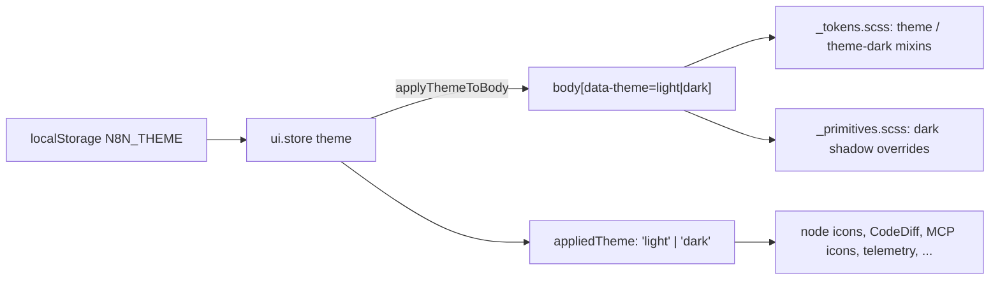

# Plan: switch between two hard-coded themes (Catppuccin Latte and Mocha)

Source: [Themes and visual customization in n8n](https://app.notion.com/p/n8n/Themes-and-visual-customization-in-n8n-4135b6e0c94f808aba95ca381c47f9e0)
(Hackmation, 2026 Nov). This plan covers ask #5, "Personal theme presets", with the
one-day scope that the doc recommends: **Catppuccin Latte** (light) and **Catppuccin Mocha** (dark).
It also adds the theme switch to Cmd+K, as the page comment asks.

## Status

Last update: 2026-11-18. The changes are not committed. They are in the working tree on the
`themes` branch.

**Done: Catppuccin Latte, end to end.**

- The user can select "Catppuccin Latte" in **Settings → Personal → Theme**. The theme applies at
  once, persists in localStorage, and loads before the app mounts.
- The body gets `data-theme="light"` and `data-palette="catppuccin-latte"`. `appliedTheme` stays
  `'light'`, so the consumers of the theme do not change.
- `_palettes.scss` remaps the neutral ramp and eight accent ramps for Latte.
- Checks that passed: `ui.utils.test.ts` (new, 13 tests), `ui.store.test.ts`,
  `SettingsPersonalView.test.ts` (83 tests in total), `sassDeprecations.test.ts`, stylelint, biome
  and oxlint on the changed files. The editor-ui typecheck was not run locally. CI runs it.

**Not verified:** nobody has looked at Latte in a browser yet. This machine has no Chrome and no
Playwright browsers, so no screenshot was taken. The first task of the next session is a visual
pass (step 7).

**Next:** Mocha (steps 1, 3 and 4 for the second preset), then Cmd+K (step 5).

### Local dev notes

- The repo pins pnpm 12.4.2. The global pnpm is 12.21.0, which rejects the lockfile
  (`yaml` catalog mismatch). Run pnpm as `npx -y pnpm@12.4.2 …`, or run `corepack enable`.
- The build was 3 weeks old. A full `pnpm build` took about 1.5 minutes.
- Run the backend with `pnpm dev:be` (port 5678) and the editor with `pnpm dev:fe:editor`
  (http://localhost:8080). The logs are in `/tmp/n8n-dev-be.log` and `/tmp/n8n-dev-fe.log`.
  Stop both with `pkill -f "turbo run dev"`.
- The editor resolves `@n8n/design-system/css/*` to `src`, so changes to `_palettes.scss` hot
  reload. Reload the page after changes to `en.json`.
- The local owner is `ragnar.hardarson+local-direct@n8n.io` in `~/.n8n/database.sqlite`.

## Goal

- A user picks one of five themes: System, Light, Dark, Catppuccin Latte, Catppuccin Mocha.
- The user can pick the theme in **Personal settings** and in the **command bar (Cmd+K)**. The
  command bar applies the theme at once, so the user sees it on the screen they are on.
- The selection persists in the browser (localStorage), like the current light/dark setting.
- The main app surfaces (sidebar, lists, canvas, NDV, modals, buttons) use the palette.

## Out of scope

- Instance branding, the environment indicator, and admin-level settings (asks #1–#4, #7, #8).
- A high-contrast theme, custom or user-defined themes, and more presets.
- Server-side persistence. The theme stays per browser, as today.
- Full contrast and accessibility testing. Catppuccin is a style preset, not an accessibility mode.

## How theming works today



- `editor-ui/src/Interface.ts`: `AppliedThemeOption = 'light' | 'dark'`, `ThemeOption = AppliedThemeOption | 'system'`.
- `editor-ui/src/app/stores/ui.utils.ts`: `applyThemeToBody`, `isValidTheme`, `getThemeOverride`.
- `editor-ui/src/app/stores/ui.store.ts`: `theme` (localStorage), `appliedTheme`, `setTheme`.
- `@n8n/design-system/src/css/_primitives.scss`: color ramps (`--color--neutral-*`, `--color--pink-*`, ...) on `:root`.
- `@n8n/design-system/src/css/_tokens.scss`: semantic tokens. They are included on `:root` and again
  on `[data-theme='light' | 'dark']` (the body).
- `[data-theme='dark']` is also a selector in `tailwind.config.js`, `Sticky.vue` and `markdown.scss`.
- `usePopOutWindow.ts` copies `data-theme` to the log pop-out window.

## Design

### Keep `light | dark` as the "mode", add a preset on top

A preset is a palette on top of a base mode. Latte uses light mode. Mocha uses dark mode.

- `appliedTheme` keeps the type `'light' | 'dark'`. It returns the base mode of the preset.
  The ~15 consumers (themed node icons, `CodeDiff`, MCP icons, telemetry, ...) do not change.
- The body keeps `data-theme="light|dark"`. All existing `[data-theme='dark']` selectors and
  Tailwind `dark:` classes keep working.
- The body gets a new attribute, `data-palette="catppuccin-latte|catppuccin-mocha"`. Only the
  palette CSS reads it.

As built (Mocha is not added yet):

```ts
// Interface.ts
export type AppliedThemeOption = 'light' | 'dark'; // unchanged: the base mode
export type ThemePreset = 'catppuccin-latte'; // add 'catppuccin-mocha'
export type ThemeOption = AppliedThemeOption | 'system' | ThemePreset;

// app/stores/ui.utils.ts. Only this file reads the map, so it lives here, not in app/constants.
const THEME_PRESET_MODES: Record<ThemePreset, AppliedThemeOption> = {
	'catppuccin-latte': 'light',
	// 'catppuccin-mocha': 'dark',
};
```

### Override the primitive ramps, not each semantic token

Most semantic tokens point to a primitive ramp (`--background--surface: var(--color--neutral-900)`).
If we remap the ramps, most of the UI changes with a small file.

This works because of how the tokens are scoped. A custom property resolves its `var()` on the
element that declares it. When a theme is pinned, `_tokens.scss` declares the semantic tokens again
on `body[data-theme]`. So they resolve against the ramps on the body, which the palette overrides.
A preset always pins `data-theme`, so this is always true for presets.

New file `@n8n/design-system/src/css/_palettes.scss`, loaded in `index.scss` after `tokens.scss`.
As built:

- A `$latte` Sass map holds the Catppuccin hex values. Add a `$mocha` map in the same form.
- `@mixin ramp($name, $accent, $light, $dark)` builds steps 50–950 with `color.mix` at compile
  time. Steps 50–400 mix toward `$light`, 500 is the accent, and 600–950 mix toward `$dark`.
  The weights are in `$tint-weights` and `$shade-weights`.
- The Latte block uses `$light: base` and `$dark: #000`. For Mocha, try `$dark: crust` and check
  the light steps against the dark surfaces.
- Quote the ramp names (`ramp('pink', …)`). Sass reads `pink` and `red` without quotes as colors,
  and prints a warning.
- The `@n8n/css-var-naming` rule cannot read interpolated names (`--color--#{$name}-#{$step}`).
  A `stylelint-disable` / `stylelint-enable` pair wraps only the mixin. `_tokens.scss` uses the
  same pattern.

| n8n ramp | Latte color | Mocha color (to do) |
|---|---|---|
| pink (brand) | mauve `#8839ef` | mauve `#cba6f7` |
| orange | peach `#fe640b` | peach `#fab387` |
| red | red `#d20f39` | red `#f38ba8` |
| green | green `#40a02b` | green `#a6e3a1` |
| yellow | yellow `#df8e1d` | yellow `#f9e2af` |
| blue | blue `#1e66f5` | blue `#89b4fa` |
| purple | lavender `#7287fd` | lavender `#b4befe` |
| mint | teal `#179299` | teal `#94e2d5` |

Not remapped: `gold`, `slate`, the `*-alpha-*` steps, and `black-alpha` / `white-alpha`. Borders
and hover states use the alpha steps, so they stay neutral gray.

The selector `body[data-palette=…]` has specificity (0,1,1). It is higher than `[data-theme=…]`
(0,1,0), and the file loads last. Use Sass `color.mix` with hex literals, not `color-mix()` at
runtime. `_primitives.scss` notes that Lightning CSS has limits with some color functions.

Neutral mapping. Latte is as built. Mocha is the starting point. Tune both by eye:

| n8n neutral | Latte (light mode, built) | Mocha (dark mode, to do) |
|---|---|---|
| white | base `#eff1f5` | text `#cdd6f4` |
| 50 | mix(base, mantle) | text `#cdd6f4` |
| 100 | mantle `#e6e9ef` | text `#cdd6f4` |
| 125 | mix(mantle, crust) | subtext1 `#bac2de` |
| 150 | crust `#dce0e8` | subtext1 `#bac2de` |
| 200 | surface0 `#ccd0da` | subtext1 `#bac2de` |
| 250 | mix(surface0, surface1) | subtext1 `#bac2de` |
| 300 | surface1 `#bcc0cc` | subtext0 `#a6adc8` |
| 400 | surface2 `#acb0be` | overlay2 `#9399b2` |
| 500 | overlay0 `#9ca0b0` | overlay1 `#7f849c` |
| 600 | subtext0 `#6c6f85` | overlay0 `#6c7086` |
| 700 | subtext1 `#5c5f77` | surface2 `#585b70` |
| 750 | mix(subtext1, text) | mix(surface2, surface0) |
| 800 | text `#4c4f69` | surface0 `#313244` |
| 850 | text `#4c4f69` | mix(surface0, base) |
| 900 | text `#4c4f69` | base `#1e1e2e` |
| 950 | text `#4c4f69` | mantle `#181825` |
| black | not changed | crust `#11111b` |

The primary button text uses `--color--neutral-white`, so in Latte it becomes base `#eff1f5` on
mauve. In Mocha, `neutral-white` becomes the light text color, and the brand is a light mauve.
Check the contrast of the brand button text in Mocha.

If a ramp step looks wrong on one surface, add a small semantic override (for example
`--background--surface`, `--menu--color--background`, the canvas background) in the same block. Do
not edit `_tokens.scss`.

### Store and utils

- `ui.utils.ts`
  - `applyThemeToBody(theme)`: for a preset, set `data-theme` to its mode and set `data-palette`
    to the preset. For other values, remove `data-palette`, then keep today's behavior.
  - `isValidTheme`: accept `'light' | 'dark'` and the preset keys, so that localStorage and the
    boot path restore a preset. Return `ThemeOption` without `'system'`.
  - Add `getThemeMode(theme: Exclude<ThemeOption, 'system'>): AppliedThemeOption` and
    `isThemePreset`. `isThemePreset` uses `Object.hasOwn`, so `'toString'` is not a preset.
- `ui.store.ts`
  - `appliedTheme` uses `getThemeMode`. Its type does not change.
  - `setTheme` does not change.
  - Not added: `appliedPreset`. The settings select reads `uiStore.theme`, so it is not needed
    yet. Add it if the Cmd+K list must mark the active preset.
- The module-level boot code in `ui.store.ts` already calls `getThemeOverride()` and
  `applyThemeToBody()` before mount, so a preset applies without a flash of the wrong theme.

### Settings UI

`SettingsPersonalView.vue`: add two items to `themeItems` with the icon `palette`.
Add i18n keys in `@n8n/i18n/src/locales/en.json`:

- `settings.personal.theme.catppuccinLatte`: "Catppuccin Latte" (done)
- `settings.personal.theme.catppuccinMocha`: "Catppuccin Mocha" (to do)

### Command bar (Cmd+K)

In `useGenericCommands.ts`, add one parent item **"Change theme…"** (section General, keywords
`theme`, `dark`, `light`, `catppuccin`, `appearance`). It uses `children` (the type already supports
nested items) with one child for each `ThemeOption`. Each child calls `uiStore.setTheme(value)`.
Mark the active theme with a `check` icon or a description.

Stretch: preview on highlight. `N8nCommandBar` does not emit the highlighted item today. This needs
a new `highlight` emit in the design system. Apply the theme on highlight, and restore the saved
theme on close without a selection.

### Other places that read the theme

- `usePopOutWindow.ts`: copy `data-palette` as well, and add it to the `MutationObserver` `attributeFilter`.
- Telemetry (`app/plugins/telemetry/index.ts`): `theme` stays the base mode. Optional: add the
  preset as a property. If we add it, follow the `n8n:telemetry` skill.

## Steps

1. [x] Types: `ThemePreset`, wider `ThemeOption`, `THEME_PRESET_MODES` (Latte only).
   - [ ] Add `'catppuccin-mocha'` to `ThemePreset` and `THEME_PRESET_MODES`.
2. [x] `ui.utils.ts` and `ui.store.ts` changes, with unit tests.
3. [x] `_palettes.scss` for Latte.
   - [ ] Add the `$mocha` map and the `body[data-palette='catppuccin-mocha']` block.
4. [x] Settings option and i18n for Latte.
   - [ ] Add the Mocha option and its label.
5. [ ] Command bar "Change theme…" group.
6. [ ] Pop-out window sync. Today the pop-out copies only `data-theme`, so it shows plain light
   for Latte.
7. [ ] Visual pass on the main surfaces in both presets. Fix the gaps with semantic overrides in
   `_palettes.scss`. Latte has not been checked in a browser yet.
8. [ ] Audit hard-coded colors that skip the tokens. These are expected gaps:
   `rg -n "#[0-9a-fA-F]{3,8}\b|rgb\(|oklch\(" packages/frontend/editor-ui/src --glob '*.{vue,scss}'`.
   Likely areas: canvas background and edges, CodeMirror themes, sticky note colors, charts.
   Fix only the ones on the demo path.

## Tests

- [x] `ui.utils.test.ts` (new, 13 tests)
  - `applyThemeToBody('catppuccin-latte')` sets `data-theme="light"` and
    `data-palette="catppuccin-latte"`.
  - `applyThemeToBody('light' | 'dark' | 'system')` removes `data-palette`.
  - `getThemeMode` maps a preset to its mode.
  - `isValidTheme` accepts the presets and rejects `null`, `''`, `'system'`, `'toString'` and
    unknown presets.
  - [ ] For Mocha: add the Mocha cases, and remove `'catppuccin-mocha'` from the reject list.
- [ ] `ui.store.test.ts`: `appliedTheme` returns `light` for Latte and `dark` for Mocha. A preset in
  localStorage is restored at boot. The existing tests pass, but there are no preset cases yet.
- [ ] `SettingsPersonalView` test: the select shows five options, and choosing a preset calls
  `setTheme`. The existing tests pass, but there are no preset cases yet.
- [ ] `useGenericCommands`: the theme group has five children, and each one calls `setTheme`.
- [ ] `usePopOutWindow` test: `data-palette` is copied and kept in sync.
- Run with `pnpm test <file> --maxWorkers=1` in `packages/frontend/editor-ui`.
- Manual: switch themes with Cmd+K on the workflow list, the canvas, the NDV and settings. Reload
  the page and check that the preset stays and does not flash.

## Files

| File | Change | Status |
|---|---|---|
| `packages/frontend/editor-ui/src/Interface.ts` | `ThemePreset`, wider `ThemeOption` | Latte done |
| `packages/frontend/editor-ui/src/app/stores/ui.utils.ts` | `THEME_PRESET_MODES`, preset-aware apply and validate, `getThemeMode` | Latte done |
| `packages/frontend/editor-ui/src/app/stores/ui.utils.test.ts` | New. Unit tests | Latte done |
| `packages/frontend/editor-ui/src/app/stores/ui.store.ts` | `appliedTheme` through `getThemeMode` | Done |
| `packages/frontend/@n8n/design-system/src/css/_palettes.scss` | New. Catppuccin ramps | Latte done |
| `packages/frontend/@n8n/design-system/src/css/index.scss` | `@use './palettes.scss'` after tokens | Done |
| `packages/frontend/editor-ui/src/features/core/auth/views/SettingsPersonalView.vue` | Two options | Latte done |
| `packages/frontend/@n8n/i18n/src/locales/en.json` | Two labels, command bar strings | Latte label done |
| `packages/frontend/editor-ui/src/features/shared/commandBar/composables/useGenericCommands.ts` | "Change theme…" group | To do |
| `packages/frontend/editor-ui/src/features/execution/logs/composables/usePopOutWindow.ts` | Sync `data-palette` | To do |

## Risks

- **Hard-coded colors** skip the ramps. They stay in n8n colors. This is acceptable for a demo.
  Step 8 lists them for follow-up work.
- **Remapped ramps change meaning.** For example, `pink` becomes mauve everywhere, also where pink
  is used as a decoration and not as the brand. Check the brand button, links and the node creator.
- **Status colors** (success, warning, danger) must stay easy to tell apart. Catppuccin
  green/yellow/red are close in lightness in Mocha, so check the toasts and execution states.
- **Embed and OEM customers** set legacy `--color-primary` overrides. Presets are opt-in per user,
  so the default themes do not change.

## Open questions

- Ship behind a PostHog flag, or keep it on the Hackmation branch only?
- One "Change theme…" item with children, or five top-level Cmd+K items (`Theme: Catppuccin Mocha`)?
  Top-level items are found faster by search, but they add noise to the default list.
- Should "System" also support a preset pair (Latte by day, Mocha by night), as Postman does? It is
  not in scope for now, but the `{ mode }` map allows it later.
