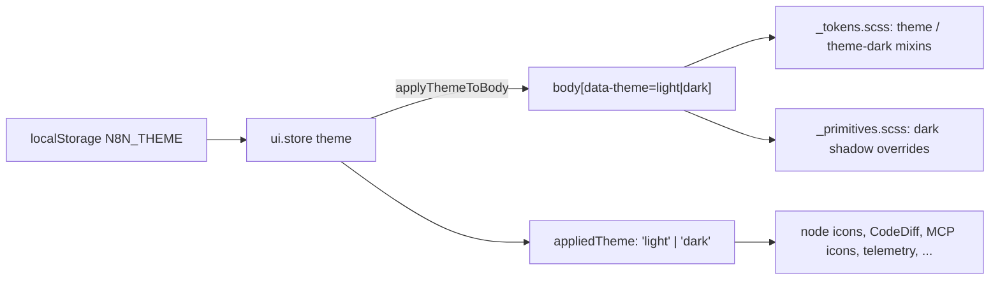

# Plan: switch between two hard-coded themes (Catppuccin Latte and Mocha)

Source: [Themes and visual customization in n8n](https://app.notion.com/p/n8n/Themes-and-visual-customization-in-n8n-4135b6e0c94f808aba95ca381c47f9e0)
(Hackmation, 2026 Nov). This plan covers ask #5, "Personal theme presets", with the
one-day scope that the doc recommends: **Catppuccin Latte** (light) and **Catppuccin Mocha** (dark).
It also adds the theme switch to Cmd+K, as the page comment asks.

## Goal

- A user picks one of five themes: System, Light, Dark, Catppuccin Latte, Catppuccin Mocha.
- The user can pick the theme in **Personal settings** and in the **command bar (Cmd+K)**. The
  command bar applies the theme at once, so the user sees it on the screen they are on.
- The selection persists in the browser (localStorage), like the current light/dark setting.
- The main app surfaces (sidebar, lists, canvas, NDV, modals, buttons) use the palette.

## Out of scope

- Instance branding, the environment indicator, and admin-level settings (asks #1–#4, #7, #8).
- A high-contrast theme, custom or user-defined themes, and more presets.
- Server-side persistence. The theme stays per browser, as today.
- Full contrast and accessibility testing. Catppuccin is a style preset, not an accessibility mode.

## How theming works today



- `editor-ui/src/Interface.ts`: `AppliedThemeOption = 'light' | 'dark'`, `ThemeOption = AppliedThemeOption | 'system'`.
- `editor-ui/src/app/stores/ui.utils.ts`: `applyThemeToBody`, `isValidTheme`, `getThemeOverride`.
- `editor-ui/src/app/stores/ui.store.ts`: `theme` (localStorage), `appliedTheme`, `setTheme`.
- `@n8n/design-system/src/css/_primitives.scss`: color ramps (`--color--neutral-*`, `--color--pink-*`, ...) on `:root`.
- `@n8n/design-system/src/css/_tokens.scss`: semantic tokens. They are included on `:root` and again
  on `[data-theme='light' | 'dark']` (the body).
- `[data-theme='dark']` is also a selector in `tailwind.config.js`, `Sticky.vue` and `markdown.scss`.
- `usePopOutWindow.ts` copies `data-theme` to the log pop-out window.

## Design

### Keep `light | dark` as the "mode", add a preset on top

A preset is a palette on top of a base mode. Latte uses light mode. Mocha uses dark mode.

- `appliedTheme` keeps the type `'light' | 'dark'`. It returns the base mode of the preset.
  The ~15 consumers (themed node icons, `CodeDiff`, MCP icons, telemetry, ...) do not change.
- The body keeps `data-theme="light|dark"`. All existing `[data-theme='dark']` selectors and
  Tailwind `dark:` classes keep working.
- The body gets a new attribute, `data-palette="catppuccin-latte|catppuccin-mocha"`. Only the
  palette CSS reads it.

```ts
// Interface.ts
export type AppliedThemeOption = 'light' | 'dark'; // unchanged: the base mode
export type ThemePreset = 'catppuccin-latte' | 'catppuccin-mocha';
export type ThemeOption = AppliedThemeOption | 'system' | ThemePreset;

// app/constants (new)
export const THEME_PRESETS: Record<ThemePreset, { mode: AppliedThemeOption }> = {
	'catppuccin-latte': { mode: 'light' },
	'catppuccin-mocha': { mode: 'dark' },
};
```

### Override the primitive ramps, not each semantic token

Most semantic tokens point to a primitive ramp (`--background--surface: var(--color--neutral-900)`).
If we remap the ramps, most of the UI changes with a small file.

This works because of how the tokens are scoped. A custom property resolves its `var()` on the
element that declares it. When a theme is pinned, `_tokens.scss` declares the semantic tokens again
on `body[data-theme]`. So they resolve against the ramps on the body, which the palette overrides.
A preset always pins `data-theme`, so this is always true for presets.

New file `@n8n/design-system/src/css/_palettes.scss`, loaded in `index.scss` after `tokens.scss`:

```scss
@use 'sass:color';

// Builds a 50–950 ramp from one accent at compile time (no runtime color-mix).
@mixin ramp($name, $accent, $light, $dark) { /* --color--#{$name}-50 … -950 via color.mix */ }

body[data-palette='catppuccin-latte'] {
	--color--neutral-white: #eff1f5; // base
	// … neutral ramp mapping (table below)
	@include ramp(pink, #8839ef, #eff1f5, #4c4f69);   // brand → mauve
	@include ramp(orange, #fe640b, …);                // peach
	@include ramp(green, #40a02b, …);
	@include ramp(red, #d20f39, …);
	@include ramp(yellow, #df8e1d, …);
	@include ramp(blue, #1e66f5, …);
	@include ramp(purple, #7287fd, …);                // lavender
}

body[data-palette='catppuccin-mocha'] { /* same, with Mocha values */ }
```

The selector `body[data-palette=…]` has specificity (0,1,1). It is higher than `[data-theme=…]`
(0,1,0), and the file loads last. Use Sass `color.mix` with hex literals, not `color-mix()` at
runtime. `_primitives.scss` notes that Lightning CSS has limits with some color functions.

Starting neutral mapping (tune it by eye during the day):

| n8n neutral | Latte (light mode) | Mocha (dark mode) |
|---|---|---|
| white | base `#eff1f5` | text `#cdd6f4` |
| 50 / 100 | mantle `#e6e9ef` | text `#cdd6f4` |
| 150 | crust `#dce0e8` | subtext1 `#bac2de` |
| 200 / 250 | surface0 `#ccd0da` | subtext1 `#bac2de` |
| 300 | surface1 `#bcc0cc` | subtext0 `#a6adc8` |
| 400 | surface2 `#acb0be` | overlay2 `#9399b2` |
| 500 | overlay0 `#9ca0b0` | overlay1 `#7f849c` |
| 600 | subtext0 `#6c6f85` | overlay0 `#6c7086` |
| 700 | subtext1 `#5c5f77` | surface2 `#585b70` |
| 800 | text `#4c4f69` | surface0 `#313244` |
| 900 | text `#4c4f69` | base `#1e1e2e` |
| 950 | text `#4c4f69` | mantle `#181825` |
| black | text `#4c4f69` | crust `#11111b` |

If a ramp step looks wrong on one surface, add a small semantic override (for example
`--background--surface`, `--menu--color--background`, the canvas background) in the same block. Do
not edit `_tokens.scss`.

### Store and utils

- `ui.utils.ts`
  - `applyThemeToBody(theme)`: for a preset, set `data-theme` to its mode and set `data-palette`
    to the preset. For other values, remove `data-palette`, then keep today's behavior.
  - `isValidTheme`: accept `'light' | 'dark'` and the preset keys, so that localStorage and the
    boot path restore a preset. Return `ThemeOption` without `'system'`.
  - Add `getThemeMode(theme: ThemeOption, systemMode): AppliedThemeOption` and `isThemePreset`.
- `ui.store.ts`
  - `appliedTheme` uses `getThemeMode`. Its type does not change.
  - Add `appliedPreset: ThemePreset | null` for the UI that shows the current selection.
  - `setTheme` does not change.
- The module-level boot code in `ui.store.ts` already calls `getThemeOverride()` and
  `applyThemeToBody()` before mount, so a preset applies without a flash of the wrong theme.

### Settings UI

`SettingsPersonalView.vue`: add two items to `themeItems` (icon `palette`, or a small swatch).
Add i18n keys in `@n8n/i18n/src/locales/en.json`:

- `settings.personal.theme.catppuccinLatte`: "Catppuccin Latte"
- `settings.personal.theme.catppuccinMocha`: "Catppuccin Mocha"

### Command bar (Cmd+K)

In `useGenericCommands.ts`, add one parent item **"Change theme…"** (section General, keywords
`theme`, `dark`, `light`, `catppuccin`, `appearance`). It uses `children` (the type already supports
nested items) with one child for each `ThemeOption`. Each child calls `uiStore.setTheme(value)`.
Mark the active theme with a `check` icon or a description.

Stretch: preview on highlight. `N8nCommandBar` does not emit the highlighted item today. This needs
a new `highlight` emit in the design system. Apply the theme on highlight, and restore the saved
theme on close without a selection.

### Other places that read the theme

- `usePopOutWindow.ts`: copy `data-palette` as well, and add it to the `MutationObserver` `attributeFilter`.
- Telemetry (`app/plugins/telemetry/index.ts`): `theme` stays the base mode. Optional: add the
  preset as a property. If we add it, follow the `n8n:telemetry` skill.

## Steps

1. Types and constants: `ThemePreset`, `THEME_PRESETS`, widen `ThemeOption`.
2. `ui.utils.ts` and `ui.store.ts` changes, with unit tests.
3. `_palettes.scss` with the Mocha ramps first (dark mode has the most custom surfaces), then Latte.
4. Settings options and i18n.
5. Command bar "Change theme…" group.
6. Pop-out window sync.
7. Visual pass on the main surfaces in both presets. Fix the gaps with semantic overrides in
   `_palettes.scss`.
8. Audit hard-coded colors that skip the tokens. These are expected gaps:
   `rg -n "#[0-9a-fA-F]{3,8}\b|rgb\(|oklch\(" packages/frontend/editor-ui/src --glob '*.{vue,scss}'`.
   Likely areas: canvas background and edges, CodeMirror themes, sticky note colors, charts.
   Fix only the ones on the demo path.

## Tests

- `ui.utils.test.ts`
  - `applyThemeToBody('catppuccin-mocha')` sets `data-theme="dark"` and `data-palette="catppuccin-mocha"`.
  - `applyThemeToBody('light')` and `('system')` remove `data-palette`.
  - `isValidTheme` accepts the presets and rejects unknown strings.
- `ui.store.test.ts`: `appliedTheme` returns `light` for Latte and `dark` for Mocha. A preset in
  localStorage is restored at boot.
- `SettingsPersonalView` test: the select shows five options, and choosing a preset calls `setTheme`.
- `useGenericCommands`: the theme group has five children, and each one calls `setTheme`.
- `usePopOutWindow` test: `data-palette` is copied and kept in sync.
- Run with `pnpm test <file> --maxWorkers=1` in `packages/frontend/editor-ui`.
- Manual: switch themes with Cmd+K on the workflow list, the canvas, the NDV and settings. Reload
  the page and check that the preset stays and does not flash.

## Files

| File | Change |
|---|---|
| `packages/frontend/editor-ui/src/Interface.ts` | `ThemePreset`, wider `ThemeOption` |
| `packages/frontend/editor-ui/src/app/constants/*` | `THEME_PRESETS` |
| `packages/frontend/editor-ui/src/app/stores/ui.utils.ts` | Preset-aware apply and validate, `getThemeMode` |
| `packages/frontend/editor-ui/src/app/stores/ui.store.ts` | `appliedTheme` through `getThemeMode`, `appliedPreset` |
| `packages/frontend/@n8n/design-system/src/css/_palettes.scss` | New. Catppuccin ramps |
| `packages/frontend/@n8n/design-system/src/css/index.scss` | `@use './palettes.scss'` after tokens |
| `packages/frontend/editor-ui/src/features/core/auth/views/SettingsPersonalView.vue` | Two options |
| `packages/frontend/@n8n/i18n/src/locales/en.json` | Two labels, command bar strings |
| `packages/frontend/editor-ui/src/features/shared/commandBar/composables/useGenericCommands.ts` | "Change theme…" group |
| `packages/frontend/editor-ui/src/features/execution/logs/composables/usePopOutWindow.ts` | Sync `data-palette` |

## Risks

- **Hard-coded colors** skip the ramps. They stay in n8n colors. This is acceptable for a demo.
  Step 8 lists them for follow-up work.
- **Remapped ramps change meaning.** For example, `pink` becomes mauve everywhere, also where pink
  is used as a decoration and not as the brand. Check the brand button, links and the node creator.
- **Status colors** (success, warning, danger) must stay easy to tell apart. Catppuccin
  green/yellow/red are close in lightness in Mocha, so check the toasts and execution states.
- **Embed and OEM customers** set legacy `--color-primary` overrides. Presets are opt-in per user,
  so the default themes do not change.

## Open questions

- Ship behind a PostHog flag, or keep it on the Hackmation branch only?
- One "Change theme…" item with children, or five top-level Cmd+K items (`Theme: Catppuccin Mocha`)?
  Top-level items are found faster by search, but they add noise to the default list.
- Should "System" also support a preset pair (Latte by day, Mocha by night), as Postman does? It is
  not in scope for now, but the `{ mode }` map allows it later.
