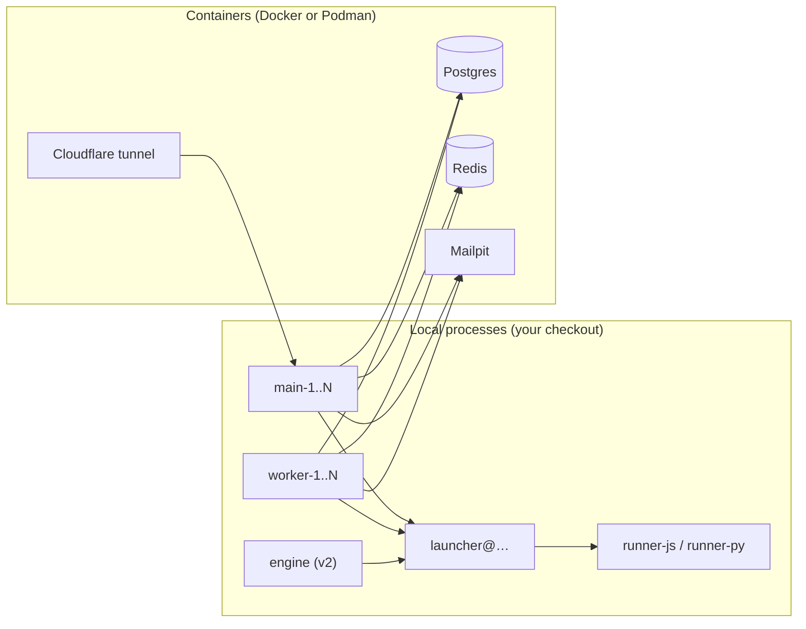

# rig

`rig` creates and runs local n8n environments. n8n runs as local processes
from your checkout or worktree. Services run in containers.



| Topology option | Values |
|---|---|
| Database | SQLite, Postgres |
| Execution mode | Regular, queue |
| Processes | One or more mains, workers |
| Task runners | Through the launcher, or `direct` |
| Engine v2 | Off, in-process (regular mode only), remote (also queue mode, optional mutual TLS) |
| Extras | Public HTTPS URL, Mailpit, a stored [license](#licenses) |

## Setup

| Requirement | Note |
|---|---|
| Docker or Podman | For Postgres, Redis, tunnels, and Mailpit |
| Node | |
| Build of the repository | `pnpm build` |
| [`uv`](https://docs.astral.sh/uv/) | Only for the Python runner |
| Go | Only to build the launcher: on macOS, or with `launcher.path` |

`pnpm rig doctor` checks all of them.

Run `pnpm rig` from the repository root. In a package directory, use
`pnpm -w rig`.

### First-run choices

`rig` asks for these values the first time it needs them. It saves the
answers in the global config.

| Setting | Asked when | Options | Change it |
|---|---|---|---|
| `container.runtime` | Docker and Podman are both installed | `docker`, `podman` | `pnpm rig config set container.runtime podman` |
| `browser` | `rig` opens a URL | `default`, a listed id, a macOS app name | `pnpm rig config set browser firefox` |
| `editor` | `rig` opens a file | `env` (`$VISUAL`/`$EDITOR`), a listed id, a command line | `pnpm rig config set editor "code-insiders --wait"` |

- Set the runtime for one command: `RIG_CONTAINER_RUNTIME=docker pnpm rig up`.
- Stop the services (`pnpm rig stop`) before you change the runtime. `rig`
  manages only the containers of the set runtime.
- Podman on macOS needs a running machine (`podman machine start`) and a
  compose provider (`docker-compose` or `podman-compose`).
- GUI editors from the list open with `--wait`. When you close the file,
  `rig` offers a restart.
- `rig` runs `$VISUAL`, `$EDITOR`, and a command line as you give them. For a
  GUI editor, add its wait flag, for example `code --wait`. Without it, `rig`
  offers the restart before you close the file.

### Task runner launcher

External task runners need the
[task runner launcher](https://github.com/n8n-io/task-runner-launcher).

| Source | How |
|---|---|
| Default | The version in `LAUNCHER_VERSION` of `docker/images/runners/Dockerfile.debian`. Linux: download and SHA-256 check. macOS: build from source with Go, once |
| Other release | `pnpm rig config set launcher.version 1.5.1` |
| Own checkout | `pnpm rig config set launcher.path ~/work/task-runner-launcher`. `rig` runs `make build` when the Go code changes |

`rig` caches releases in `~/.cache/rig/launcher/<version>/`.

### Checkout

`rig` runs n8n from the checkout or worktree of the current directory. To pin
one environment to another checkout, set `source: repo:<path>` in its
`env.yaml`.

To run `rig` from a subdirectory, use `pnpm -w rig`, or add an alias:

```bash
alias rig='pnpm -w rig'
```

## Quick start

```bash
pnpm rig create                        # wizard: pick a preset or "custom"
pnpm rig create mm --preset multi-main
pnpm rig up                            # services and all components, merged logs
pnpm rig clone <env> <new>             # copy an environment with fresh data
```

| Preset | Topology |
|---|---|
| `sqlite` | SQLite, regular mode, 1 main |
| `postgres` | Postgres, regular mode, 1 main |
| `queue` | Postgres, queue mode, 1 main, 1 worker |
| `multi-main` | Postgres, queue mode, 2 mains, 1 worker |
| `enginev2-local` | Postgres, regular mode, 1 main, engine v2 in the main |
| `enginev2-remote` | Postgres, queue mode, 1 main, 1 worker, engine v2 as a separate process |

The last line of `rig up` and `rig run` shows the state of each component:

| Symbol | State |
|---|---|
| `●` | Ready |
| `◌` | Starting |
| `✖` | Exited |
| `⟳` | Env drift |

| Key | Action |
|---|---|
| `o` | Open the editor in the browser |
| `p` | Open the [public URL](#public-https-url) |
| `m` | Open the [Mailpit UI](#email) |
| `r` / `R` | Restart the components with changed env vars / all components |
| `1`–`9` | Show or hide the logs of that component |
| `0` | Show the logs of all components |
| `?` | Show the keys |
| `q` | Stop the components of this terminal. The containers keep running |

With `N8N_LOG_FORMAT=json`, the terminal shows readable lines. The log files
keep the raw lines. `rig logs --raw` shows them.

## Components

| Topology | Components |
|---|---|
| Regular mode | `main-1`, `launcher@main-1` |
| Queue mode | `main-N`, `worker-N`, `launcher@worker-N` |
| Engine v2 remote | The components of the mode, plus `engine` and `launcher@engine` |
| `runners.via: direct` | No launchers. `runner-js@<host>` and `runner-py@<host>` for each process that runs tasks |

- In queue mode, mains send manual executions to the workers, so mains get no
  launcher. `rig` sets `OFFLOAD_MANUAL_EXECUTIONS_TO_WORKERS=true` in every
  environment. Set it to `false` on a main to give that main a launcher.
- With engine v2, each main runs a control plane server on its port block
  `+6` (`main-1`: `5684`). The engine connects to `main-1`. Workers run the
  legacy engine only.
- Use `runners.via: direct` (`--runners direct`) to debug a runner or to see
  its logs separately. `rig` gets the grant token from the broker, as the
  launcher does. A restart of a process also restarts its runners.

### Separate terminals

```bash
pnpm rig run main-1    # terminal 1: main-1 and launcher@main-1
pnpm rig run worker    # terminal 2: all workers and their launchers
pnpm rig up --split    # one tmux pane for each n8n process
```

| Missing dependency | Behavior |
|---|---|
| Default | `rig run` asks: start it in the background, or wait |
| `--yes` | Start it in the background |
| `--wait-deps` | Wait for another terminal to start it |

`--split` adds a window in tmux. Outside tmux, it creates and attaches the
session `rig-<env>`.

To use another terminal multiplexer, get the panes from `rig panes`. Run the
`prepare` command once, then open one pane for each entry of `panes`. Each
pane runs `argv` in `cwd`, with `env` added to the env of the user.

```bash
pnpm rig panes                  # JSON
pnpm rig panes --format shell   # one command line for each pane
pnpm rig panes --inspect        # the same flags as `rig up --split`
```

### Scripts and editor integrations

`pnpm rig status --format json` prints the services, the components, and the
URLs of an environment:

| Field | Content |
|---|---|
| `schemaVersion` | `1`. A new version removes or changes a field. New fields keep the version |
| `env`, `topology`, `slot` | The name of the environment, a summary of its topology, and its port slot |
| `source` | The checkout that a start from the current directory uses |
| `urls` | `editor`, `mail`, and `public`. `null` when the environment does not have it |
| `services[]` | `name`, `state` (`stopped` when there is no container), `health` (`null` without a health check), `ports`, `address` |
| `components[]` | `name`, `kind`, `role`, `state` (`stopped`, `starting`, `ready`), `pid`, `ports`, `inspectPort`, `url` (mains), `startedAt`, `owner` (`null` in the background), `drift`, `source` |

`rig panes --format json` has a `schemaVersion` too.

### Debugging

```bash
pnpm rig run main-1 --inspect          # inspector on port block +5, for example 127.0.0.1:5683
pnpm rig run worker-1 --inspect-brk    # wait for the debugger before the first line
pnpm rig print main-1 --format vscode  # launch and attach configurations for .vscode/launch.json
```

Attach from `chrome://inspect` or with the attach configuration. A restart
keeps the inspector. `rig status` shows the port.

## Public HTTPS URL

A Cloudflare tunnel gives `main-1` a public HTTPS URL, for webhooks and OAuth
callbacks. Turn it on with `--tunnel`, in the wizard, or in `env.yaml`.

| Tunnel | URL | `env.yaml` |
|---|---|---|
| Quick | Random `https://<words>.trycloudflare.com`. No account. Changes after `pnpm rig stop` | `tunnel: cloudflare` |
| Named | Your hostname. Does not change | See below |

```yaml
tunnel:
  provider: cloudflare
  hostname: n8n-dev.example.com   # needs CLOUDFLARE_TUNNEL_TOKEN in secrets.env
  target: main-1                  # optional, the main to expose
```

For a named tunnel:

1. Create the tunnel in the Cloudflare dashboard.
2. Point its public hostname at `http://host.docker.internal:<port>`. Use
   the HTTP port of the target main. For `main-1` in slot `0`, the port is
   `5678`. `pnpm rig status` shows the ports.
3. Put the token in secrets.env: `pnpm rig env edit --on secrets`.

| Effect | Detail |
|---|---|
| Env vars | `N8N_WEBHOOK_URL` is the public URL. `N8N_PROXY_HOPS=1`. OAuth callback URLs use the public URL |
| Editor | Stays on localhost |
| New URL | Running components show drift |
| Token | In the container env, not in the compose file or `ps`. `docker inspect rig-<env>-tunnel` shows it |
| Show / open | `pnpm rig status` / `pnpm rig open --public` |

## Email

[Mailpit](https://mailpit.axllent.org/) catches every email that n8n sends,
for example invites and password resets. No email leaves your machine. Turn it
on with `--mail`, in the wizard, or in `env.yaml`:

```yaml
mail: mailpit
# or, with custom ports:
mail:
  provider: mailpit
  smtpPort: 1025   # optional, SMTP port on the host
  uiPort: 8025     # optional, UI and API port
```

| Item | Value |
|---|---|
| n8n config | `rig` sets `N8N_EMAIL_MODE=smtp` and the `N8N_SMTP_*` vars of mains and workers |
| UI | `m` in `rig up`, or `pnpm rig open --mail` (default `http://127.0.0.1:8025`) |
| SMTP credential for the Send Email node | Host `127.0.0.1`, port `1025`, SSL/TLS off, any user and password |
| Data | Stays after `stop`. `reset` and `destroy` delete it |
| Ports | `pnpm rig status` |

## Licenses

`rig` stores n8n licenses in `~/.config/rig/licenses/<name>.env`. An
environment uses one license, with `license: <name>` in its `env.yaml`.

| License kind | Env vars |
|---|---|
| Activation key | `N8N_LICENSE_ACTIVATION_KEY`, `N8N_LICENSE_TENANT_ID` |
| Cert | `N8N_LICENSE_CERT`, `N8N_LICENSE_TENANT_ID` |

Each license can also have a `N8N_LICENSE_SERVER_URL`, for example for a
staging license server.

```bash
pnpm rig license add prod                       # asks for the values
pbpaste | pnpm rig license add stage --tenant-id 1 --server-url https://…
pnpm rig license ls                             # licenses, their default, and the environments that use them
pnpm rig license use prod                       # use a license in this environment
pnpm rig license off                            # use no license in this environment
pnpm rig license default prod                   # the license for new environments
pnpm rig license rm stage
```

- `license add` asks for the activation key or the cert with a masked prompt,
  or reads it from stdin. `rig` finds the kind from the format: a UUID is an
  activation key, and a base64 value is a cert. For a value with neither
  format, `rig` asks for the kind. Without a terminal, give `--activation-key`
  or `--cert`. These flags also override the format. The tenant ID is required. The prompt and the
  `--tenant-id` flag use `1` when you give no value.
- `rig` checks the values: the activation key must be a UUID, the cert must
  be base64, the tenant ID must be a positive integer, and the server URL must
  be an `http` or `https` URL. When a check fails, `rig` asks if you want to
  add the license anyway, so you can test an invalid license. Without a
  terminal, add `--force`.
- `rig` encrypts every value of a license file. With the `off` secrets
  backend, the values are in plaintext. See
  [Secrets encryption](#secrets-encryption).
- The first license that you add becomes the default. `license add --default`
  or `license default <name>` changes it. `license.default` in the global
  config holds it.

### License of an environment

| How | License |
|---|---|
| Wizard | A step after Email. It selects the default license. You can also add a new license there |
| `create --license <name>` | The given license |
| `create` without `--license` | The default license |
| `create --no-license` | No license |
| `clone` | The license of the source environment |

- `create` writes the name of the license into `env.yaml`. A later change of
  the default does not change existing environments.
- After you change a stored license, restart the components that use it.
- The license layer is after the global secrets and before the profiles. A
  profile or a layer of the environment can override a value of the license.
  See [Env vars](#env-vars).
- n8n gets the env vars of all layers. When the license has an activation
  key and another layer sets `N8N_LICENSE_CERT`, or the reverse, `rig` shows a
  warning at start.
- `rig doctor` shows a license that does not exist or is not valid.

## Parallel environments

Each environment has a port slot (`slot` in `env.yaml`, default `0`).
Environments with different slots run at the same time.

| Ports | Offset for slot `k` |
|---|---|
| n8n | `+1000 × k` |
| Engine | `+10 × k` |
| Postgres, Redis, tunnel, Mailpit | `+k` |

`rig create --slot auto` and `rig clone` pick a free slot. When another
environment uses a port, `rig` names it and suggests a free slot.

## Engine TLS

`engineTls: true` (`--engine-tls`) turns on mutual TLS between the main and
the engine in `engine: remote`. `rig` uses openssl to create a CA and one
certificate for each plane in `engine-tls/`. It renews them before they
expire.

## Env vars

A later layer wins. A more specific layer always wins over a less specific
one:

```mermaid
flowchart LR
  A["1. rig defaults<br/>(ports, DB, Redis, engine)"] --> B["2. Global secrets<br/>~/.config/rig/secrets.env"]
  B --> L["3. License<br/>~/.config/rig/licenses/&lt;name&gt;.env"]
  L --> C["4. Profiles<br/>(in order)"]
  C --> D["5. secrets.env<br/>of the environment"]
  D --> E["6. env/shared.env"]
  E --> F["7. env/&lt;role&gt;.env<br/>main, worker, engine, launcher"]
  F --> G["8. env/&lt;component&gt;.env<br/>e.g. worker-2"]
  G --> H["9. rig run -e K=V<br/>(not saved)"]
```



- Both `secrets.env` files have mode 0600. `rig` encrypts their values, and
  the values of sensitive keys such as `OPENAI_API_KEY` in every layer. See
  [Secrets encryption](#secrets-encryption).
- A secret can be in any layer. For example, put `OPENAI_API_KEY` in the
  global secrets, and a different key in `env/worker-2.env`.
- When a layer value overrides a secret that `rig` generated, for example
  `N8N_ENCRYPTION_KEY`, `rig env set` warns and asks first.
- In older versions of `rig`, `secrets.env` won over all layers. `rig doctor`
  warns when a layer overrides a value of `secrets.env`.
- `rig env set` refuses a secret value on the command line, for example
  `OPENAI_API_KEY=sk-…`, because the shell history and the process list keep
  it. Give only the key: `rig env set OPENAI_API_KEY`. `rig` then asks for the
  value with a masked prompt, or reads one value from stdin. This applies to
  sensitive keys in every layer, and to every key in the secrets layers.
- Runners of a launcher get `env/runner-js.env` or `env/runner-py.env`, then
  `env/runner-js@<host>.env`.
- After a change, `rig` lists the affected running components and offers a
  restart. Their terminal also shows drift.

| Task | Command |
|---|---|
| Browse and edit interactively | `pnpm rig env browse [--on <layer>]` |
| Set for one role | `pnpm rig env set N8N_LOG_LEVEL=debug --on worker` |
| Set for one component | `pnpm rig env set N8N_LOG_LEVEL=debug --on worker-2` |
| Set for JS runners | `pnpm rig env set NODE_FUNCTION_ALLOW_EXTERNAL=lodash --on runner-js` |
| Edit a layer in your editor | `pnpm rig env edit --on main` |
| Show the resolved env and sources | `pnpm rig env ls worker-1` |
| Show every layer that sets a key | `pnpm rig env explain N8N_LOG_LEVEL --on worker-2` |
| Compare two components | `pnpm rig env diff main-1 worker-1` (also `<env>:<component>`) |
| Set a secret of this environment (asks for the value) | `pnpm rig env set MY_API_KEY --secret` |
| Set a secret for all environments | `pnpm rig env set OPENAI_API_KEY --on global-secrets` |
| Set a secret from the clipboard | `pbpaste \| pnpm rig env set OPENAI_API_KEY` |

### Profiles

A profile is a reusable env file in `~/.config/rig/profiles/<name>.env`.

```bash
pnpm rig env set N8N_LOG_LEVEL=debug --on profile:debug   # create the profile
pnpm rig profile on debug                                 # use it in this environment
pnpm rig profile ls
pnpm rig profile off debug
```

### Interactive editor

`pnpm rig env browse` lists every env var that n8n reads, from the `@Env`
declarations of your checkout. It shows descriptions, types, defaults, and
allowed values.

| Input | Behavior |
|---|---|
| Type | Search names, descriptions, and config groups. Vars set in the layer come first |
| Pick a var | Show details and the value of each component |
| Enum, boolean | List of options |
| List of enums (for example `N8N_LOG_OUTPUT`) | Checkboxes |
| Other types | Text field. Empty input unsets the var |
| Secrets (sensitive keys, secrets layers) | Masked field. To remove a value, pick `Unset` |
| `⇄ Change layer` | Switch between `shared`, roles, and components |
| `+ Other variable…` | Set a name that n8n does not declare |
| Ctrl+C in a value prompt | Go back to the search |
| `✓ Done`, Ctrl+C in the search | End, and offer a restart |

The first run reads the source with the TypeScript compiler and takes a few
seconds. Later runs use a cache until the commit or a scanned file changes.
`--refresh` reads the source again.

## Secrets encryption

`rig` encrypts values with AES-256-GCM:

- Every value in both `secrets.env` files and in the [license](#licenses)
  files.
- The values of sensitive keys in every other env file: the layers in `env/`
  and the profiles. A key is sensitive when its name ends in one of these:
  `KEY`, `PASS`, `PASSWORD`, `PASSWD`, `PASSWORD_HASH`, `SECRET`, `TOKEN`,
  `LICENSE_CERT`, `OVERWRITE_DATA`. For example, `OPENAI_API_KEY`,
  `VERCEL_AI_GATEWAY_API_KEY`, `N8N_AI_ANTHROPIC_KEY`, `N8N_SMTP_PASS`, and
  `CREDENTIALS_OVERWRITE_DATA` are sensitive. `N8N_ENCRYPTION_KEY_FILE`,
  `N8N_REDIS_KEY_PREFIX`, and `AWS_ACCESS_KEY_ID` are not, because the name
  does not end in one of these. Some matches are not secrets, for example
  `N8N_SSL_KEY` (a path). `rig` encrypts and masks them too.

The key names stay readable. One random key encrypts all values:

```
N8N_ENCRYPTION_KEY=enc:v1:hDz3yjBDGQNXbhqbZlUPv17sM2BY…
```

A sensitive key can have a different value in each layer, for example one
API key in a profile and another one in `env/worker-2.env`. `env ls`,
`env explain`, `env diff`, and `env browse` mask sensitive values in every
layer. `env ls`, `env explain`, and `env diff` show them with
`--show-secrets`. Values that `rig` sets itself, for example
`DB_POSTGRESDB_PASSWORD=postgres` for the local Postgres, always show. When
you override such a value in a layer, `rig` masks it.

The key is in the OS keystore. `rig` picks the backend on the first use and
saves it in `secrets.backend` in the global config:

| Backend | Used when | Key |
|---|---|---|
| `keychain` | macOS | Login keychain, item `n8n-rig` |
| `secret-service` | Linux with `secret-tool` and an unlocked keyring (GNOME Keyring, KWallet) | Secret Service, service `n8n-rig` |
| `file` | No OS keystore, for example over SSH or in WSL. `rig` shows a warning | `~/.config/rig/secrets.key`, mode 0600 |
| `off` | Only when you set it | No key. Values are in plaintext |

- `rig` reads the key once for each command. Components get the decrypted
  values in their env.
- `rig env edit` decrypts a file with encrypted values into a private temp
  file. It opens that file in your editor, then encrypts the result and
  deletes the copy. The copy is in `$XDG_RUNTIME_DIR` when that directory
  exists, which is usually in memory on Linux. Otherwise it is in the temp
  directory of the system. Every `secrets.env` file uses the temp copy.
- `rig` must know when the editor closes the copy. It knows this only for the
  editors that it lists (`vi` too): when you pick one in the editor prompt,
  and in `$EDITOR` or a command line for a listed terminal editor such as
  `vim` or `nano`, or for a listed GUI editor with `--wait` or `-w`. For all
  other editors, `rig` asks before it deletes the copy, and it needs a
  terminal for this question.
- When an env file has plaintext values that must be encrypted, for example
  after a manual edit, `rig` encrypts them the next time it reads the file.
- A file without encrypted or sensitive values does not need the key.
- The launcher reads the runner env from `launcher/<host>.json`. That file can
  hold decrypted values, so it has mode 0600.
- If you lose the key, you cannot decrypt the values. n8n then cannot read the
  credentials that it encrypted with `N8N_ENCRYPTION_KEY`. Keep a backup of
  the key: `pnpm rig secrets export-key`.
- The encryption protects the files, for example in backups, dotfile syncs,
  or screen shares. It does not protect against programs that run as your
  user.
- With the `file` backend, the key is in the same directory as the global
  `secrets.env`. A backup or sync of that directory has the key too.

| Task | Command |
|---|---|
| Show the backend, the key, and each file | `pnpm rig secrets status` |
| Switch the backend. `rig` copies the key to the new backend. Delete the old copy yourself | `pnpm rig secrets use <keychain\|secret-service\|file\|off>` |
| Encrypt all plaintext values now | `pnpm rig secrets encrypt` |
| Back up the key | `pnpm rig secrets export-key` |
| Restore the key, for example on a new machine | `pnpm rig secrets import-key` (asks for the key, or reads stdin) |

`RIG_SECRETS_BACKEND` overrides the saved backend for one command.

## Commands

| Command | Function |
|---|---|
| `create`, `ls`, `use`, `reset`, `destroy`, `clone` | Manage environments |
| `up`, `run`, `stop`, `restart`, `status`, `logs`, `open` | Run components. `status --format json` is for scripts |
| `panes` | Print the panes of `up --split` for another terminal multiplexer |
| `services up\|down` | Start or stop only the containers |
| `env browse\|set\|unset\|edit\|ls\|explain\|diff` | Read and change env vars |
| `profile ls\|on\|off` | Turn profiles on or off |
| `license ls\|add\|rm\|use\|off\|default` | Manage the stored [licenses](#licenses) and the license of the environment |
| `secrets status\|encrypt\|use\|export-key\|import-key` | Manage the [encryption of secrets](#secrets-encryption) |
| `exec <component> -- <cmd>` | Run a command with the env of a component |
| `print <component> --format shell\|dotenv\|json\|vscode` | Print the resolved env, or VS Code launch configurations |
| `psql`, `redis-cli` | Open a shell in a service container |
| `config get\|set\|unset\|edit` | Read and change the global config: `launcher.path`, `launcher.version`, `container.runtime`, `browser`, `editor`, `license.default` |
| `edit` | Open `env.yaml` in your editor, then check it |
| `doctor` | Check the runtime, Node, Go, `uv`, the checkout and build, the launcher, ports, licenses, and secrets encryption |

To select an environment, `rig` uses the first of these:

1. `--env <name>` after the command
2. `RIG_ENV`
3. The default environment from `rig use`

## Files

| Path | Content | Override |
|---|---|---|
| `~/.config/rig/config.yaml` | Global config | `RIG_CONFIG_DIR` |
| `~/.config/rig/profiles/<name>.env` | Profiles | `RIG_CONFIG_DIR` |
| `~/.config/rig/licenses/<name>.env` | Licenses | `RIG_CONFIG_DIR` |
| `~/.config/rig/secrets.env` | Global secrets | `RIG_CONFIG_DIR` |
| `~/.config/rig/secrets.key` | Secrets key, only with the `file` backend | `RIG_CONFIG_DIR` |
| `~/.local/share/rig/envs/<name>/env.yaml` | Topology | `RIG_DATA_DIR` |
| `~/.local/share/rig/envs/<name>/env/*.env` | Env layers | `RIG_DATA_DIR` |
| `~/.local/share/rig/envs/<name>/secrets.env` | Generated and own secrets | `RIG_DATA_DIR` |
| `~/.local/share/rig/envs/<name>/logs/` | One log file for each component | `RIG_DATA_DIR` |
| `~/.local/share/rig/envs/<name>/data/` | User folders and binary data | `RIG_DATA_DIR` |
| `~/.cache/rig/env-catalog/` | Env var catalog of each checkout | `RIG_CACHE_DIR` |
| `~/.cache/rig/launcher/` | Launcher releases | `RIG_CACHE_DIR` |

Without the override, `rig` uses `$XDG_CONFIG_HOME/rig`, `$XDG_DATA_HOME/rig`,
and `$XDG_CACHE_HOME/rig` when you set these variables.

## Relation to n8n-containers

| Tool | Containers | Use |
|---|---|---|
| `pnpm --filter n8n-containers services` | Short-lived test containers | `pnpm dev` |
| `rig` | Persistent containers | Full topology |

Both read the image tags from `n8n-containers/test-containers.ts`.
