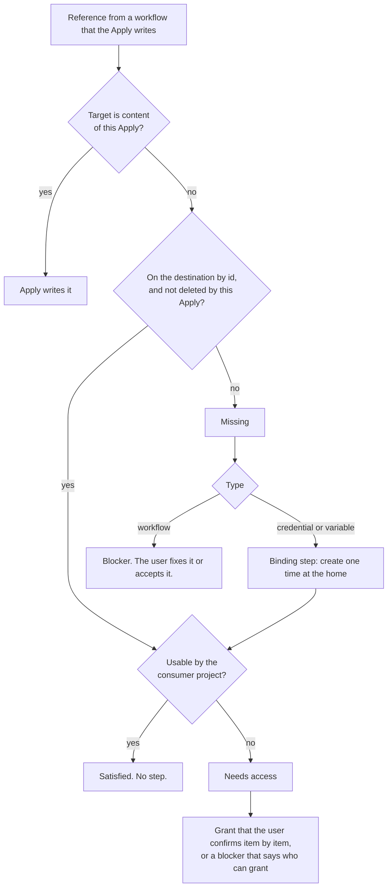
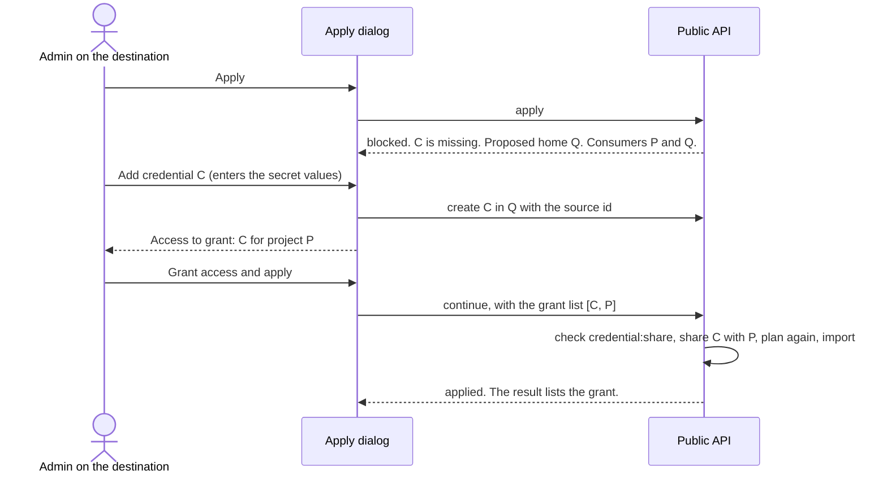
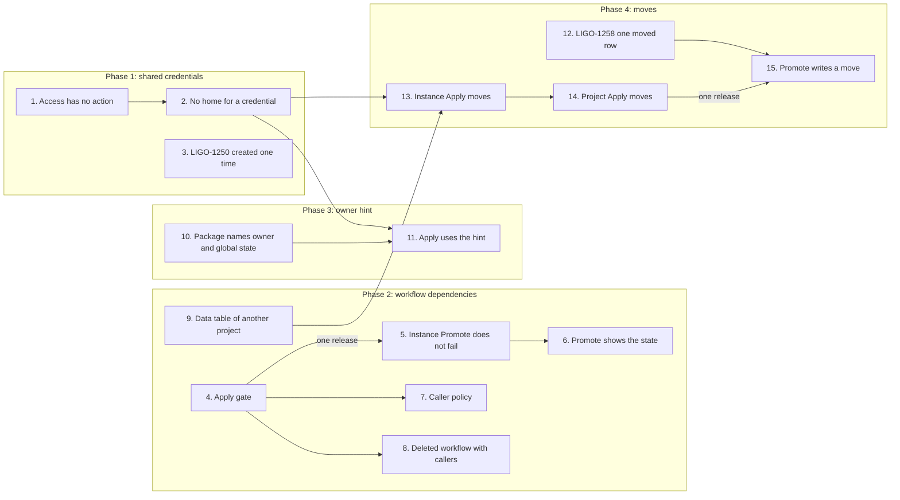

# LIGO-1159: Cross-project promotion, consolidated solution

> **Status (2026-11-17): alternative, not chosen.** The chosen solution is `solution.md` ("dependencies first"). Section 8 of `solution.md` compares the two models. `solution.md` refers to sections and tickets of this file, so keep it.

Inputs: four anonymous submissions (A, B, C, D), the fact ledger (F01 to F53), 34 divergences (D01 to D34), and one critique of each submission.
Code: read only, at checkout `765740d4cf0`. I ran no build, no test, and no application.
Source marks: `[A]`, `[B, C]` and so on name the submissions that an adopted decision comes from. `[new]` marks a decision that no submission made. It comes from a critique finding or from my own code reading.
`[red-team M1]`, `[red-team m3]` and so on mark a change that comes from the red-team review of this document. I verified each finding in the code before I used it. The decision log lists the action for each finding.
"Recommendation, pending decision" marks a part that needs a human decision. Section 9 lists these decisions.
The companion file `decision-log.md` gives the rule and the evidence for each divergence.

## 1. Summary

One model applies to every resource type and every operation:

> An operation carries the content of the projects in its scope. A reference that points outside that content is a requirement. The destination must satisfy each requirement. Apply changes nothing outside its content without an explicit step that the user confirms.

Terms:

- **Scope**: the projects that an operation writes. Instance Promote and instance Apply: all team projects of the package. Project and selective Promote or Apply: a selection inside one team project.
- **Content**: workflows, folders, and the resources that a project in the scope owns.
- **Requirement**: a reference from content to a resource outside the content. Examples: a credential that another project owns, a sub-workflow or error workflow in another project, a global variable.

The decisions:

1. **No closure.** Promote and Apply never add the content of another project. [A, B, C, D]
2. **Promote informs. Apply gates.** A dependency never fails a Promote. Promote shows what the branch will not hold. Apply stops before any write when a requirement is not satisfied. [B, C] Recommendation, pending decisions 3 and 8.
3. **Resolution by id, three states.** Apply resolves each requirement on the destination by id: satisfied, needs access, or missing. A satisfied requirement adds no step. Apply does not compare the owner of a resource that exists. [C; critiques A5, D-02]
4. **Credentials.** The user creates a missing credential one time, in a team project. The proposed home is the source owner project. When the package does not name a team owner, the user selects the home. Consumer projects get access through a grant that the user confirms item by item. Apply never removes a share. [B, C, D; critiques B-01, C-2, C-3] Recommendation, pending decisions 1 and 2.
5. **Workflow dependencies.** A missing sub-workflow or error workflow is a blocker that the user can accept with its own confirmation. The check counts the deletions of the same Apply. [B, C; critiques B-02, C-1, D-04] The server does not store the acceptance. Recommendation, pending decision 8.
6. **Package format.** No version change and no required change. One optional file next to `credential.json` names the owner kind and the global state. Git carries no sharing list, no secret, and no personal data. [C; B, D for "no version change"]
7. **Moves.** A move between two team projects is one change that keeps the id. Apply can run it only when the package holds both projects. The Apply side ships before the Promote side. Until then the current refusals stay. [A, B, C] One exception: an instance Apply can move an item out of a team project that the package does not hold, after the user confirms it. [new; red-team M3]
8. **Order.** The plan removes the dead ends first, without a format change. Each step leaves a safe state. [C; critiques B-09, C-4, D-07]



## 2. Current state

Only the facts that the design depends on. Each fact has its ledger id or a file and line. Paths are relative to `packages/cli/src/modules/` unless they start with `packages/`.

### Package format

- The directory path is the only owner record of a credential, variable or data table. The exporter writes the file under `projects/<project>/` only when the owner project is in the export. Otherwise it writes the file to the top-level collection directory. (F01, F06)
- A top-level credential has `projectId` null on Apply. A top-level variable is a global variable. (F02, F03)
- `credential.json` holds id, name, type, optional data. It has no owner, no sharing, no `isGlobal`, no `usageScope`. Requirements hold id, optional name and type, and `usedBy`. (F04, F07)
- `credential.json`, `variable.json` and `data-table.json` have strict schemas. The manifest and its requirements are not strict, so a reader drops an unknown manifest key without an error. (F05)
- The format version is the string `'1'`. An import rejects another value. (F08) An older selective Promote does not reject it: it discards a manifest that fails the schema and writes a new manifest with version `'1'`. (`promotions.ee/import-manifest-bridge.ts:36-51, 113-121`)
- Readers ignore an unknown file name inside an entity folder. This holds for the directory inventory reader, the tar reader and the import parser. `workflow-metadata.json` is an existing file of this kind. (F09)
- A project or selective Promote rewrites `manifest.json`. It rebuilds the entries from the files and merges the requirement rows of the old and the new manifest. A staged row replaces the old row. Unknown fields are lost. (F18, `import-manifest-bridge.ts:297-327`)
- A project or selective Promote overlays its export on the branch package. An instance Promote replaces the package. A credential is at the top level of the branch when its owner is personal, when its owner team project was never promoted, or when the owner project is on the branch but no Promote wrote the credential under it. (F17)
- The overlay copies files one by one. When a dependency changes its path, the overlay removes only the dependency file and removes the directory only when it is empty. (`promotions.ee/working-copy-updater.ts:430-434, 668-694`)
- The exporter writes a requirement row for each credential id that an exported workflow names. It writes a file only when the user can read the credential and the credential has usage scope `project`. (`n8n-packages/entities/credential/credential.exporter.ts:58-111`, ledger "missed behaviors", batch 1)

### Promote

- Instance Promote exports all team projects with the `Fail` dependency policy. Project and selective Promote are one code path and use `ReferenceOnly`. (F10)
- No preview exists for an instance Promote. The project preview uses `ReferenceOnly`, so it does not predict an instance Promote failure. (F11)
- An instance Promote fails as a whole when a team workflow has a static reference to a workflow in a personal project or to a deleted workflow. The response and the toast show a count only. No surface shows the workflow ids. (F12, F13; F14 is wrong)
- Under `ReferenceOnly`, a sub-workflow or error workflow outside the selection becomes a requirement row. Promote returns no warning. The preview shows a called workflow of another project as an unchanged row. (F39, F38)
- Personal projects are never exported. A personal credential that a team workflow uses goes to the top-level `credentials/` directory. Promotion messages leave out personal project names. (F15, F16)
- Promote refuses a move between projects, and a move into a personal project. (F50) One exception exists: an instance Promote does not refuse a move when the project that holds the item on the branch no longer exists on the source. An example is a project deletion that transferred its workflows to another project. The move then reaches the branch. (`promotions.ee/promotions.service.ts:1373-1383`; F50, corrected statement, point 5) [red-team M3]
- Project and selective Promote run only on an instance-scope environment today. (Ledger "missed behaviors", batch 2; `promotions.ee/promotions.service.ts:436-437, 1438-1449`)

### Apply

- Apply matches a credential by id. A match needs a credential that the consumer project owns, that is shared with it, or that is global. Apply turns the personal route off. Apply does not compare the owner. (F21, F16)
- Apply creates no credential and no variable. The client creates a missing credential with the source id through public `POST /credentials`, then calls Continue. (F24, F28, F30)
- Apply overwrites the name and the expression values of a credential that exists, only when a project of the Apply owns it on the destination. Any other credential is bound and does not change. (`n8n-packages/entities/credential/credential-conflict-policy.ts:24-54`, `promotions.ee/promotions.service.ts:138`, ledger "missed behaviors", batch 4) [red-team m1]
- A missing credential whose file is outside every project folder, or that has no file, is the hard conflict `unknown-owner`. The dialog offers no action. (F19)
- A credential that exists but that the consumer project cannot use is `access-required`. It blocks Apply and the dialog offers no action. No promotion code shares a credential. (F20, F22, F23)
- The case "owned by team project Q, used by P" takes three submissions and a manual share. (F28)
- In a project Apply, the binding flow can create a missing project only when the plan of that Apply creates it. It cannot create an owner project that is on the branch but outside the selection. (`promotions.ee/apply-preview.ts:191-207`, `packages/modules/promotions/frontend/src/composables/usePromotionBindingCreation.ts:70-96`. This is a reading of the code.)
- At runtime, a workflow can use a credential that its project has no share of, through the access of the acting user. (F27, `packages/cli/src/executions/pre-execution-checks/credentials-permission-checker.ts:418-474`) A workflow can never use a credential with usage scope `instance`. (same file, lines 375-384)
- The public API and the CLI have no call that shares a credential with one project. (F34) `shareWithProjects` does not check `credential:share`. The internal controller does, and it needs the licence `feat:sharing`. (F35) An API key cannot hold a `credential:share` scope, and the promotions module reads no API key scope for the import. (`packages/@n8n/permissions/src/public-api-permissions.ee.ts:89-93`, no `apiKeyScopes` in `promotions.ee/`)
- Only global owners and admins hold `promotions:*`. They can read every credential. (F36)
- Apply has no check for a missing workflow dependency. The id stays and the reference is broken. Nothing reports it. (F37) The generic import reports this case as a failed publish. Promotion Apply does not: it uses the publishing policy `preserve-target-state`, which never publishes, so that check does not run. (`n8n-packages/entities/workflow/workflow-publishing-policy.ts:34`, `promotions.ee/promotions.service.ts:134`)
- The sub-workflow caller policy comes from the called workflow, or from an instance setting when the workflow sets none. The checker compares owner projects. (F41)
- Instance Apply treats the package as authoritative. It hard-deletes workflows that the package lacks in a package project. It lists team projects that the package lacks as `project-deletion`. (F44)
- The server asks for a confirmation only for `project-deletion` and for a destructive data table schema change. A workflow deletion by reconciliation has no confirmation. (`promotions.ee/promotions.service.ts:123-125`, `promotions.ee/apply-preview.ts:350-365`)
- One `confirmDestructiveChanges` flag confirms every listed project. A confirmed project deletion deletes the workflows, the owned credentials and the data tables of the project. It does not check for consumers in other projects. (`promotions.ee/promotions.service.ts:1027-1034, 1523-1540`, `packages/cli/src/services/project.service.ee.ts:185-188, 225-235`) [red-team M1]
- Reconciliation keeps a referenced workflow that the package does not carry only when the caller is in the same project. (`n8n-packages/engine/project-package-importer.ts:434-440`, `n8n-packages/entities/workflow/workflow-remover.ts:223-255`. This is a reading of the code. No test covers the cross-project case.)
- Project Apply writes only the selected workflows of one project and does not add sub-workflows. It hard-deletes the workflows that the request names. A caller in any project keeps the id of a deleted workflow. (F43, ledger "missed behaviors", batch 5)
- Variables: `$vars` reads the project of the workflow, then the global scope. The exporter cannot produce a requirement on a variable of another project. Apply requires the declared scope. (F45, F46)
- Data tables: at runtime a workflow uses only tables of its own project. The exporter bundles a table of any project that the user can read. Apply creates a missing table in the consumer project with the source id, or fails with an id conflict when another project holds that id. (F48, F49, `n8n-packages/entities/data-table/data-table.exporter.ts:44-75`, `data-table-importer.ts:160-175, 337-349`)
- Workflow sharing targets personal projects only. Tags are instance-wide. (F42)
- Apply reports a workflow or folder that moved between projects as a `moved` conflict that Continue cannot pass. (F51) The engine matches a workflow only inside the project that it imports. (F52) Moves inside one project work. (F53)
- The editor transfer of a workflow removes all shares of the workflow, deactivates a published workflow, and can leave it unpublished. It needs `workflow:move` on the workflow and `workflow:create` in the destination project. (`packages/cli/src/workflows/workflow.service.ee.ts:803-890, 1222-1250`)

### Generic package import

- With `create-stub` and `id-only`, a missing credential that two projects use gets one stub for each project. The second creation fails after the first project was written. (F29)
- The import reconciles credential updates, tags and variables across projects. It has no package-wide step for the creation or the sharing of a credential. (F31)

## 3. Scope table

| Case | Decision | On Promote | On Apply |
|---|---|---|---|
| Credential that another team project owns | Support [A, B, C, D] | The credential is a requirement. The Promote writes its file as today. The preview shows a note with the owner. No warning. | Usable by the consumer project: no step. Not usable: access grant that the user confirms. Missing: the user creates it one time in the proposed home, then confirms the grants. |
| Personal credential that a team workflow uses | Support as a requirement. Never content. Never a personal home. [B, C] Recommendation, pending decision 1. | No block. The preview shows a note: "Owned by a personal project." | Usable by the consumer project: no step. Missing: the user selects a team project as home. No project is selected in advance. |
| Global credential | Support [C; A] | The global state does not travel until the owner hint exists. | A global credential on the destination satisfies every consumer (current behavior). Missing: created at the home. The consumers get grants. With the hint, the user can make it global in place of the grants. Apply never makes a credential global without that step. |
| Credential with usage scope `instance` | Exclude [new] | A workflow cannot use it at runtime. The package holds a requirement row and no file (current behavior). | Exists with that scope: `incompatible-usage-scope` blocker (current behavior). Not on the destination: treated as a missing credential without a definition. The binding step says that the package has no definition. |
| Static sub-workflow | Support as a requirement [A, B, C, D] | Never fails the Promote. The preview shows a warning when the branch will not hold the workflow. | Present after the Apply: no step. Otherwise: a blocker that the user can accept with its own confirmation. |
| Error workflow | Same rule as a sub-workflow [A, B, C] | Same. | Same. |
| Variable | Support. No change. [B, C] | Project variable under the project folder. Global variable at the top level. | Must exist in the declared scope. The binding step creates it. A shadowed global variable is a warning. |
| Data table of the own project | Support. No change. [A, B, C, D] | Content. | Apply creates or matches it in the project. |
| Data table of another project | Exclude. The reference is broken on the source and stays broken. Apply never copies the table. No block. [A, D for the problem; B, C for the runtime rule; red-team M4] | Warning: the reference does not work at runtime. No block. | Apply never creates a copy in the consumer project. Apply writes the workflow and returns a warning for the reference. It does not block. |
| Tag | Support. No change. [A, B, C, D] | Instance level. | Created or renamed as today. |
| Workflow sharing | Exclude [B, C] | Not in the package. | Destination shares stay as they are. |
| Move of a workflow or folder between team projects | Support in the last phase. Block until then. [A, B, C] | Until then: current refusal. After: one moved change, from either project. | Until then: `moved` conflict. After: one transfer that keeps the id, only when the package holds both projects. |
| Move out of a project that the source deleted (project deletion with transfer of its workflows) | Support on instance Apply in the last phase. Block until then. [new; red-team M3] | Instance Promote writes the move (current behavior). The branch no longer holds the old project. | Until then: `moved` conflict. The user moves the item by hand on the destination, then applies. After: an instance Apply transfers the item after the user confirms. The old project then follows the project deletion rules. A project Apply keeps the block. |
| Move into a personal project | Block [A, C, D] | Current refusal. | Not reached. |
| Move out of a personal project | No rule needed [B] | The branch never held the workflow, so it is a new workflow. (Derived from F50. Not tested.) | Created as a new workflow. |
| Owner change of a credential on the source | Exclude [B, C; made explicit here] | The file path or the hint changes. | No effect on a credential that exists. The owner on the destination is destination configuration. |
| Move across two connections | Block [A, C] | Refused. | Refused: the package does not hold both projects. |
| Permission boundary | Rule: report, do not act, do not leak [C; A, B, D] | A resource that the user cannot read is a requirement with the id only. No elevated lookup. | An action appears only when the user holds the permission for it. Otherwise the row says who can act. |
| Existing branch | Support [A, B, C, D] | No migration. | The `unknown-owner` conflict gets a way out: the user selects a home and creates the credential. The conflict code stays in the response. |
| Older destination version | Support with limits [B, C, D; critiques B-03, C-4] | The source cannot see the destination version. | Ignores the hint file. Has no dependency gate and blocks on a move. The rollout rule in section 6.4 covers this. |

## 4. Answers to the eight ticket questions

### 4.1 Scope

Section 3 is the answer. Only two relations cross a project at runtime: credential use and workflow references. Moves are the third cross-project case. Variables and data tables cannot cross a project, and tags are instance-wide. [B] (F27, F41, F45, F48, F42)

### 4.2 Promote: a dependency is outside the selection or the project

- Promote writes the reference and continues. It never adds the content of another project. [A, B, C, D]
- Instance Promote uses the same policy as project Promote. It returns a typed list of the dependencies that the package does not hold. [B, C] Recommendation, pending decision 3.
- The preview shows a state for each workflow dependency that is not selected: on the branch, same project and not on the branch, other project and not on the branch, personal project, does not exist. Only the last four states show a warning. [C]
- The preview shows no branch state for a credential. Apply needs the credential on the destination, and a file on the branch decides nothing. The row shows the owner as a note. [C; critique B-05]
- The instance Promote dialog shows the same list before the write to the branch. [B, C]
- A reference that an expression computes shows a note: "Resolved at run time. Not checked." [A]
- The Promote button stays enabled in all these cases.

### 4.3 Apply: the owner project is not in the package

Where does the resource land?

1. A credential that exists on the destination stays where it is. Apply checks use, not ownership. [C; current behavior, F21]
2. A missing credential has a proposed home. The proposal is the source owner project when the package names it: by the file path today, by the owner hint later. [A, B, C, D]
3. When that project is not on the destination, the binding step offers to create it. This is an explicit step. [A, D; existing flow for projects that the Apply creates]
4. When the package names no team owner (old branch, personal owner, no file), the user selects a team project. The step selects no project in advance. It lists the consumer projects first. It says that the admins of the selected project can edit, share and delete the credential. [B, C; critique C-3] Recommendation, pending decision 1.
   - The step does not offer a project that the same Apply lists for deletion. On an instance Apply, this leaves the projects of the package. [red-team M1]
   - The step also says that an Apply of the home project updates the name and the expression values of the credential from the branch. [red-team m1]
5. The user can change a proposed home. The step then says that the owner differs from the source. [B] Recommendation, pending decision 1.
6. Never a personal project. [A, B, C, D]

Is a shared resource created one time? Yes. The check already merges the consumers of one credential id into one row, and the client creates one credential with the source id. [A, B, C, D] (F31)

Is sharing kept?

- Git carries no sharing list. [B, C]
- Apply derives the access that the applied workflows need: one item for each pair of credential and consumer project. [B, C, D]
- The user confirms the items. The server then grants them and imports. The same call works for the UI, the public API and the CLI. [C, D] Recommendation, pending decision 2.
- Apply never removes a share. [B, C]
- The destination can hold fewer shares than the source. Other shares are destination configuration. [B, C]

### 4.4 Personal projects

- Never content. Never a home on the destination. No email, no personal project name and no personal project id in Git. [A, B, C, D]
- Credential: section 4.3, rule 4.
- Sub-workflow or error workflow: a warning on Promote. The Promote warning says: move it to a team project. On Apply, the blocker of section 5.7 with the acceptance. It cannot be satisfied through promotion. [B, C]
- The package does not say that a referenced workflow is in a personal project (section 4.7). So the Apply message cannot name this cause. It says "not on the branch" and lists the possible causes. [red-team M4]
- The requirement row of a workflow in a personal project holds the id only. Today a project Promote also writes the name, when the promoting user can read the workflow. (`n8n-packages/entities/workflow/workflow-requirement.exporter.ts:34-46, 59-69`) Ticket 5 removes the name. [red-team m2]
- A move into a personal project stays refused. [A, C, D]

### 4.5 Moves

- Until the last phase, the current refusals stay. They are safe: nothing is deleted or duplicated. [A, C, D]
- Target: a move between two team projects is one change. The preview shows one moved row with both projects, on the page of each project. [A, B, C]
- Apply matches the item by id across the projects of the package. When the destination holds it in another project of the package, Apply transfers it. The id, the history and the executions stay. Reconciliation does not delete the item in the old project. [A, B, C]
- When the destination holds the item in a project that the package does not hold, a project Apply keeps the current `moved` conflict. This also blocks a move across two connections. [A, C; critique C-7]
- An instance Apply has one more case. The source can delete a project and transfer its workflows, and the instance Promote then writes the move (section 2). The destination still holds the old project, and the package does not. Today the `moved` conflict blocks every instance Apply until the user moves the item by hand on the destination. In the last phase, the instance Apply shows the move with the old project. After the user confirms, Apply transfers the item to the project that the branch names. The confirmation of destructive changes covers this transfer. The same Apply lists the old project for deletion and needs that confirmation, unless guard 1 keeps the project (section 6.7). The transfer runs before the project deletions, so the deletion of the old project does not delete the item. [new; red-team M3]
- This case does not open a move across two connections. Only an instance Apply lists project deletions, and its scope is every team project of the instance.
- When the destination holds the item in a personal project, the block stays.
- A folder moves with its whole subtree, or the move is refused. [A]
- Credentials do not move. The credentials of a moved workflow are requirements in the new project and follow section 4.3. [A, C]
- The move needs the rights of the editor move: `workflow:move` on the workflow and `workflow:create` in the destination project. [code; corrects the all-agree statement "move rights in both projects"]
- The transfer must keep the publish state of the destination, as every Apply does. The editor transfer does not do this, so the ticket cannot reuse it without a change. [critique B-06, verified]
- The editor transfer removes the shares of the workflow. Decision 7 says whether the Apply transfer does the same.
- The Apply side ships at least one release before the Promote side. [B, C]

### 4.6 Permissions

- Today only global owners and admins promote and apply, and they can read everything. So the case "the user cannot access the dependency" does not occur yet. (F36) The rules below are for project-level promotion rights (LIGO-1006). [C]
- Promotion acts as the user. No backend lookup reads more than the user can read. [A, B; critique D-09]
- Promote: a credential or workflow that the user cannot read becomes a requirement with the id, and for a credential the name and type that the workflow node holds. No file, no owner. [B, C; current behavior]
- Apply: each write has its own permission check: create a project, create a credential, share a credential, move a workflow. A requirement never gives a permission. [A, D]
- An action appears only when the user holds the permission. Otherwise the row names the action and says who can do it. It names a project or a credential only when the user can read it. A missing resource and an inaccessible resource get the same message when the difference would show that a hidden resource exists. [B, C, D merged]
- A user without global `credential:read` gets no reason for a credential that is not found (F22). A credential that exists then looks missing, and a creation with its id fails. When that happens, the step must say "missing or not accessible, ask an administrator" and offer no second creation. [new; critique B-07]
- An API key can grant credential access through Apply only when the key holds a scope that allows it. [new; critique C-2] This scope does not exist today, and Apply reads no key scope. Ticket 1 adds both. [red-team m4]

### 4.7 Package format

- Required change: none. Existing branches keep working. [C]
- No format version change. [B, C, D] A version change is not a reliable stop: an older selective Promote rewrites the manifest with version `'1'` and reports no error. [critique A1, verified]
- Optional addition: one file next to `credential.json`. It holds the owner kind (`team` or `personal`), for a team owner the project id and name, and the global state. [C; B and D for the content]
- The package carries no sharing list, no grant removal, no coverage field, no move marker, and no owner of a referenced workflow. [B, C]
- An old reader ignores the file (F09). A branch without the file gives "owner not named", which the first phase handles.

### 4.8 Consistency

| | Instance Promote | Project or selective Promote | Instance Apply | Project or selective Apply | One repository for each project (future) |
|---|---|---|---|---|---|
| Content | All team projects | Selection of one project | Whole package | Selection of one project | One project |
| Dependency outside the content | Requirement, typed list | Requirement, preview state | Gate | Gate | Same as project |
| Credential that another project owns | Under the owner folder | Top level, plus hint later | Use check, grant, or creation at the home | Same | Same as project. The hint names the owner. |
| Workflow dependency missing | Warning | Warning | Blocker with acceptance | Blocker with acceptance, or "select it too" | Same as project |
| Variable | By scope | By scope | Must exist in the scope | Same | Same |
| Data table of another project | Warning | Warning | Not created. Warning, no block. | Same | Same |
| Move | One change (last phase) | One change from either project | Transfer. Also out of a project that the package does not hold, after a confirmation. | Transfer, the preview names both projects. Block when the package does not hold the old project. | Refused across connections |

The generic package import keeps its own policies. It gets the "created one time" fix only (LIGO-1250). The workflow dependency gate is a promotion rule. [C]

## 5. User flows

### 5.1 Promote, common case

1. The user selects workflows and folders, or starts an instance Promote.
2. All dependencies are in the selection, or the branch holds them.
3. The preview shows no warning. No new step appears. [A, B, C, D]

### 5.2 Promote with a dependency outside the content

1. The preview lists the dependency under the workflow that uses it.
2. Credential: a note names the owner project, or says "a personal project". No warning.
3. Workflow that the branch holds: no warning.
4. Workflow that the branch will not hold: a warning on the dependency and on the caller, with the next step.
   - Same project: "Select it too."
   - Other team project: "Promote it from {project}."
   - Personal project: "Personal projects are not promoted. Move it to a team project."
   - Does not exist: "This reference is broken."
   - A workflow that the user cannot read: "a workflow you cannot access".
5. A summary line counts the selected workflows with such a dependency.
6. The user promotes. The Promote succeeds.

### 5.3 Instance Promote

1. The dialog shows the list of section 5.2, step 4, before the write to the branch.
2. The Promote no longer fails because of a dependency. The result holds the same list.
3. The move refusals stay until the last phase.

### 5.4 Apply, common case

1. The user starts Apply.
2. Every requirement is satisfied by id on the destination.
3. Apply imports. No new step appears. [A, B, C, D]

### 5.5 Apply: a shared credential on a new destination

Credential C belongs to team project Q on the source. Workflows of P and Q use it.



Today the same case takes three submissions and one manual share. (F28)

Variants:

- C exists and P cannot use it: the first response lists the access item. One Continue grants it and applies.
- The user may not share C: no grant is offered. The row says who can share it.
- The instance has no sharing licence: the access item stays a blocker with that reason. [C]
- Q is not on the destination: the binding step first offers "Create project Q". [A, D]
- The first Apply call never writes a grant. [D]

### 5.6 Apply: a credential without a named team owner

Cases: an old branch with a top-level credential, a personal credential, a credential without a file.

1. The response keeps the `unknown-owner` conflict, so an existing client reads a blocker that it knows. The dialog shows it as a missing credential, not as a dead end. [red-team M2]
2. The binding step shows a project selector. No project is selected in advance. The consumer projects are first in the list. The list leaves out each project that this Apply lists for deletion. [red-team M1]
3. The step says: "The admins of this project can edit, share and delete the credential. An Apply of this project updates the name and the expression values of the credential from the branch." [red-team m1]
4. For a credential without a file, the step also says: "The package has no definition for this credential." The name and the type come from the workflow node.
5. The user creates the credential, then confirms the grants for the other consumer projects, as in section 5.5.

### 5.7 Apply: a workflow dependency is missing

1. Apply stops before any write. The blocker says: "{workflow} calls {dependency}, which will not be on this instance after this Apply."
2. Ways out:
   - Same project, on the branch: add it to the selection.
   - Other project, on the branch: apply that project first.
   - Not on the branch: the destination cannot tell why, because the package carries no owner of a referenced workflow. The message lists the possible causes: not promoted yet, in a personal project on the source, or deleted on the source. The Promote result on the source names the cause (section 5.2). [red-team M4]
   - "Apply anyway": the workflow arrives with the broken reference. This uses a confirmation that is separate from the confirmation of destructive changes. [C]
   - The server does not store the acceptance. The blocker returns on each Apply until the reference is satisfied. Decision 8 covers the form of the acceptance and the effect on public API callers. [red-team M2]
3. Later ticket: the same blocker when the called workflow exists but its caller policy refuses the caller. [A; critique C-5]

### 5.8 Apply: a global credential (after the hint)

1. The credential is missing. The hint says that it is global on the source.
2. After the creation, the step offers two choices: grant access to the consumer projects, or make the credential available to all projects.
3. The second choice needs `credential:shareGlobally` and the sharing licence. It is never automatic. [C; A]

### 5.9 A move (last phase)

1. Promote preview: one moved row, "Moved from A to B".
2. Promote from A or from B: the Promote writes both sides in one commit.
3. Apply preview: one moved row. A project Apply says that it changes two projects.
4. Apply transfers the item. The credentials of the workflow in B follow sections 5.5 and 5.6.
5. The preview says that the workflow loses its shares, as it does in the editor move. [new; critique B-06] Recommendation, pending decision 7.
6. Variant, instance Apply only: the destination holds the item in a project that the package does not hold. The moved row names that project and says that the Apply moves the item out of it. The user confirms with the destructive changes. [new; red-team M3]

## 6. Technical approach

### 6.1 Data model

- Identity: resource type and source id. A variable: name and scope. Names never match resources or projects. [A, B, C, D]
- Owner: for a resource that exists on the destination, the destination decides. Apply does not compare it with the owner on the source, and the owner does not decide whether a requirement is satisfied. Apply reads the destination owner for one purpose: it updates the name and the expression values of a credential from the branch only when a project of the Apply owns the credential (section 2). So the home that the user selects also decides which later Applies update the credential. [red-team m1] For a missing credential, the package proposes the home. The server does not enforce the home: a credential with the source id that the consumer can use satisfies the requirement, in any team project. This is the current rule (F21). [C; B] Recommendation, pending decision 1.
- Consumers: the workflows of the Apply that use the resource, grouped by project. The check already builds this list for each credential id. (F31)
- Access need: one item for each pair of credential and consumer project that cannot use it. The check returns the items and says, for each item, whether the caller may grant it. [C, D]
- Grant confirmation: Continue carries the list of items that the caller accepts. The server grants an item only when the current check requires it, the caller holds `credential:share` on the credential, the API key allows it, and the instance has the sharing licence. An item that is not in the list stays a blocker. Order: grants, then plan again, then import. A grant that stays after a failed import is harmless and the next attempt finds it. [C, D; critique C-2] Recommendation, pending decision 2.
- Workflow dependency check: a promotion rule next to the credential and variable rules. It reads the static references of the workflows that the plan writes. A reference is satisfied when the plan writes the target, or when the destination holds the target and the same Apply does not delete it. [B, C; critiques B-02, C-1]
- "Holds the target" means: the workflow exists on the destination and is not archived. An archived workflow is not present. A workflow in a personal project of the destination counts as present, because a destination that works today must not get a new blocker. The caller policy check of ticket 7 then decides whether that workflow allows the caller. [red-team m7]
- Acceptance: the server does not store it. A reference that cannot be satisfied brings the blocker back on each Apply, until the caller sends the acceptance again. Recommendation, pending decision 8. [red-team M2]
- Retention: reconciliation must keep a workflow that a workflow of the package references, in every project of the package. Today it keeps it only in the project of the caller. [new; critique D-04]
- Retention can keep a workflow that the source deleted, when a caller on the branch still references it. The gate counts that workflow as present. The Apply result lists each workflow that retention keeps, with its caller, so that the kept workflow is visible. [red-team m5]
- No owner check on a workflow dependency. [B, C; critique D-02]

### 6.2 Package format

Nothing changes in the first two phases.

The third phase adds one optional file next to `credential.json`. Illustration only, not a final schema:

```json
{
  "owner": { "kind": "team", "projectId": "<source project id>", "projectName": "Billing" },
  "isGlobal": true
}
```

Rules:

- `owner` is present only for a credential file at the top level. For a file under a project folder, the path is the owner. This gives one owner record for each file. [new; critiques B-08, D-08]
- `owner.kind` is `team` or `personal`. A personal owner has no id, no name and no email. [B, C]
- `owner.projectName` is optional. An export for a connection of one project leaves it out, so that the repository of one project does not hold the names of other projects. Without the name, the "Create project" offer asks the user for a name. [red-team m2]
- `isGlobal` is present when the credential is global on the source.
- The exporter writes only what the promoting user can read. [A, B]
- The selective overlay keeps the file with its credential file and removes it with its credential file. Today the overlay removes only `credential.json` on a path change, so this needs a change. [C; verified at `working-copy-updater.ts:430-434`]
- The reader treats the file as optional. A missing or unreadable file means "owner not named".
- An older source does not know the file. When it renames or relocates a credential, its overlay removes `credential.json` and leaves the hint file alone in the old directory. So the reader ignores a hint file that has no `credential.json` next to it, and the overlay of the new version removes such a file. [red-team m3]
- The hint drives proposals only: the proposed home, the "Create project" offer, the "make it global" offer. It never drives a write without a user step. No deletion rule reads the hint: guard 1 of section 6.7 reads the destination only. So a hint that is not fresh cannot cause damage and cannot keep a project. [new; red-team M4]

Why a file and not a manifest field: a selective Promote rebuilds the manifest and drops unknown fields, and an older source drops them for every project. `credential.json` is strict, so an older reader rejects a new field there. (F05, F18) [C] The reason "the Apply check does not read the manifest" is false (F26) and is not used here.

### 6.3 Existing branches

- No migration. [A, B, C, D]
- A top-level credential on an old branch has no named owner. The first phase handles it with the home selection. No new Promote is needed. [B, C]
- A branch that holds requirement rows for workflows gets the dependency gate. An Apply that passes without a message today can then stop and ask for the acceptance. It stops on each Apply while the reference is not satisfied, because the server does not store the acceptance. This is a behavior change for an existing caller. Recommendation, pending decision 8. [red-team M2]

### 6.4 Older destinations and rollout

An older destination reads a newer branch with its own behavior. The source cannot see the version of a destination.

| What a newer source writes | What an older destination does |
|---|---|
| The hint file | Ignores it. Current behavior. Safe. |
| A package from an instance Promote that no longer fails | Applies it without the dependency gate. A broken reference arrives without a message, as it does today after a project Promote. |
| A move (last phase) | Blocks the Apply with the `moved` conflict. No data is lost. An instance Apply stays blocked until the destination has the new version or the source reverts the move. |
| A move out of a project that the source deleted (a source writes it today) | Blocks the instance Apply with the `moved` conflict. The source cannot revert it. The user moves the item by hand on the destination. |

Rule: the Apply side of a change ships at least one release before the Promote side. The release notes state the minimum destination version. [C; critiques B-03, C-4] Recommendation, pending decision 5.

### 6.5 Permissions

| Action | Needs | Without it |
|---|---|---|
| Create the owner project | `project:create` and a free team project in the licence quota | The row says who can. The user can select another home. |
| Create the credential | `credential:create` in the home project | The row says who can. |
| Grant access to a consumer project | `credential:share` on the credential, the sharing licence, and an API key scope that allows it. Ticket 1 adds this key scope and passes the key scopes to Apply. | Blocker that says who can grant. |
| Make a credential global | `credential:shareGlobally` and the sharing licence | The choice is not offered. |
| Accept a missing workflow dependency | The right to apply | Not applicable. |
| Move a workflow | `workflow:move` on the workflow, `workflow:create` in the new project. A move out of a project that the package does not hold also needs the confirmation of destructive changes (instance Apply only). | Blocker that names the missing permission. |

### 6.6 Future repositories for each project

- The owner of a shared credential is then always outside the package. The model treats that as the normal state. The hint names the owner. [C, D]
- A dependency in another repository stays a requirement. [A]
- A move across two connections stays refused, because the package does not hold both projects. The project "per-project connection" must decide what replaces the refusal. [A, C] The instance Apply exception of section 4.5 does not apply to a connection of one project, because an Apply on that connection lists no project deletion and does not have the whole instance as its scope.
- No part of the design needs one repository for all projects. No part writes the content of a project into the repository of another project. [B, C, D]

### 6.7 Two guards against deletion

The plan adds two rules so that the new flows do not make the current deletion behavior worse:

1. An instance Apply does not delete a project while that project owns, on the destination, a credential that a workflow of the package uses. The check does not list the project as `project-deletion`. It returns a warning that names the project and the credential. The user can transfer the credential to another project, and the next Apply then lists the project again. [D, adapted; red-team M1, M4]
   - The rule reads the destination and the requirement rows of the package. It does not read the owner hint. An earlier form of this rule protected a project that the hint names, so a hint that is not fresh could keep a project with no end.
   - The rule ships with ticket 2, because ticket 2 is the first ticket that lets the user select the home of a new credential. Without the rule, the user can create the credential in a project that the same Apply or a later instance Apply deletes, and every consumer project then loses the credential with no message.
   - The rule also covers a project that the user creates from the hint (ticket 11), from the moment that the project owns the credential. Before that moment the missing credential blocks the Apply, so no deletion runs.
   - The server cannot enforce the home (section 6.1), so the selector rule of ticket 2 is not sufficient alone. This guard is the server rule.
2. The dependency gate counts the deletions of the same Apply, and reconciliation keeps referenced workflows across projects (section 6.1).

The general problem stays open: an instance Apply deletes by absence, and a branch can be a partial view. A confirmed project deletion still deletes a credential that only workflows outside the package use. See decision 4.

### 6.8 Public API changes for each ticket

The promotions public API carries a Beta note: "breaking changes may still occur without major version bump". (`packages/cli/src/public-api/v1/controllers/promotions.public.controller.ts:82`) The plan still states each change, so that the team can decide and document it. [new; red-team M2]

| Ticket | Response and request shape | Behavior for a client that sends the current request |
|---|---|---|
| 1 | New optional fields on an `accessRequirements` item. New optional grant list on Continue. New grant list in the result. New API key scope. | No change. Without the grant list, the access item blocks as today. |
| 2 | The `unknown-owner` conflict stays. It gets optional fields for the creation data. `ownerProject` stays required on a `missingBindings` credential. New warning code for a project that guard 1 keeps. | The client still reads `unknown-owner`. The way out is the one that the server accepts today: create the credential with the source id in a team project, then call Continue. An instance Apply can list fewer `project-deletion` conflicts. |
| 4, 7, 8 | New conflict codes. New optional acceptance on Continue. New warning code for a workflow that retention keeps. | Changes. An Apply that returns `applied` today can return `blocked`, on each call, until the caller sends the acceptance. Pending decision 8. |
| 5 | New list in the Promote result. | An instance Promote that fails today on a workflow dependency succeeds. |
| 9 | New warning code. | Apply no longer creates the table in the consumer project. The `data-table-conflict` for this case no longer occurs. |
| 11 | No new shape. | A top-level credential whose hint names a team owner is a `missingBindings` item with `ownerProject`. It is no longer an `unknown-owner` conflict. |
| 13, 14 | The `moved` conflict stays for the cases that Apply still refuses. | An Apply that returns `blocked` with `moved` today can return `applied`, or can ask for the confirmation of destructive changes. |

Rules:

- `ownerProject` is required in the schema of a missing credential binding, and `conflicts` is a discriminated union. (`packages/@n8n/api-types/src/dto/promotions/promotion-apply-check.dto.ts:92-95, 174-259`) So no ticket reports a credential without a named owner as a `missingBindings` item without `ownerProject`.
- A client that validates the response with the current schema rejects a new conflict code or warning code. Each ticket that adds a code updates the schema, the OpenAPI document and `@n8n/cli` in the same release. The release notes say that a client must treat an unknown conflict code as a blocker and must ignore an unknown warning code.

## 7. Rejected options

| Option | From | Reason |
|---|---|---|
| Add the content of another project to the operation, automatically or with an "Include dependency" action | A (action); rejected by B, C, D | A project Apply is limited to one project, so it cannot apply the included content. The overlay refuses an item under another project. On a branch without that project, an instance Apply then deletes the other workflows of that project. (Critique A4, verified in `project-package-importer.ts:114-122`, `workflow-remover.ts:223-240`) |
| Format version 2 with a hard stop on old readers | A | An older selective Promote rewrites the manifest with version `'1'` and no error, so the stop is not reliable. No adopted field is unsafe to ignore. A version change stops every Apply on an older destination, also for a package with no cross-project reference. (Critiques A1, A7) |
| Coverage field and explicit deletions in the package | A | The branch is built by many operations. No rule says how coverage and deletions merge across Promotes, or when a deletion expires. (Critique A6) The risk that it targets is real and goes to decision 4. |
| Sharing lists in Git, with removals on a full Apply | A, D | A selective Promote does not refresh a credential that the branch holds under another project, so a "complete" list goes out of date. A full Apply would then offer the removal of a share that the source has. (Critique D-06, F17) A merge request could change access for projects that the promotion does not touch. |
| The Git owner is binding for a resource that exists on the destination | A, D | Apply does not compare owners today. A destination that works today would get an owner conflict. One credential transfer on the source would block Promote or Apply with no way out. (Critiques A5, D-02, F21) |
| Promote blocks on a personal owner, an unreadable resource, or an owner change | D | These promotions pass today. One team workflow with one personal credential would block the instance Promote of every team. (Critique D-01, F15, F19) |
| Keep `Fail` for instance Promote | D by default; LIGO-1089 option 2 | One workflow blocks every team, and the project preview cannot predict it. With the Apply gate, the reason for the block is gone. Pending decision 3. |
| Hard block on Apply for a missing workflow dependency, with no acceptance | A, D | Instance Apply has no selection, so the user cannot exclude the caller. Two projects that reference each other could never pass a project Apply on a new destination. (Critiques A2, D-04) |
| Apply shares a credential with no confirmation | B | The consumer list comes from Git and from use. It does not prove that the source project had access. The public API Apply has no preview. (Critique B-01, F27) |
| One yes or no confirmation for all grants | C | It also confirms grants that the check could not show. The item list replaces it. (Critique C-2) |
| The consumer project as the silent default home | B, C | The home project gets owner rights: edit, delete, share. On the source it had the right to use only. (Critique C-3, `packages/@n8n/permissions/src/roles/scopes/credential-sharing-scopes.ee.ts`) The user selects the home. This row is about promotion Apply. The generic import has one stated exception, see ticket 3. |
| A blocker on Apply for a data table of another project | A, D | The reference is already broken on the source, so the Apply makes no state worse. An instance Apply has no selection, so the user cannot exclude the workflow, and the destination has no fix. Apply skips the table and returns a warning. (F48; same reason as critique A2) [red-team M4] |
| A project that the owner hint names is never deleted | D, adapted; first form of guard 1 | A selective Promote does not remove a top-level credential directory that no workflow uses, so a hint can stay on the branch with no end and keep a project with no end. Guard 1 now reads the destination only. (Ledger "missed behaviors", batch 2) [red-team M4] |
| A backend lookup that reads more than the user can read | D | It is an elevation. It would write the name of a hidden project to Git. (Critique D-09) |
| Owner metadata in the manifest | B, D | The selective Promote rebuilds the manifest. A staged requirement row replaces the old row. An older source drops every unknown field. (F18, critiques B-08, D-08) |
| `placement` on variable and data table entries, and a Promote block for a variable of another project | D | The path already gives the scope. The exporter cannot produce a requirement on a variable of another project. (F46, critique D-08) |
| A branch state for credentials in the Promote preview | B | Apply never creates a credential, so a file on the branch decides nothing. "Promote it from project B" cannot move the file under B. (Critique B-05) |
| A move into a personal project becomes a removal | B | An instance Apply hard-deletes a workflow that the branch lacks, and the server asks for no confirmation for that. (`promotions.service.ts:123-125`, `apply-preview.ts:350-365`) Pending decision 6. |
| Reuse the editor transfer as it is for a move on Apply | B, C | It removes all shares, and it can unpublish a published workflow. Apply must keep the publish state. (Critique B-06, verified) |
| Three-way comparison with the base Git owner for a move | A | The destination stores no last applied commit for each resource. (Critique A6) The rule "both projects are in the package" replaces it. |
| Personal owner by email; the personal project of the applying user as home | Rejected by all | Personal data in Git. A production secret tied to one person. |
| Workflow sharing in the package | Rejected by B, C | Share targets are personal projects only (F42). It has no runtime effect (F41). |
| The workflow dependency gate in the import engine | B | The generic import already reports the case as a failed publish (F37). The gate is a promotion rule. [C] |
| The generic import shares a credential that exists | B, C | The generic import has no preview and no confirmation. (Critiques B-01, C-7) |

## 8. Ticket plan

Rules for the whole plan:

- Each ticket states the problem and the outcome. It does not prescribe the implementation.
- A backend ticket that adds a blocker ships with its UI in the same release. The UI treats an unknown blocker as a hard block with no Continue. (Critique C-4, verified at `usePromotionBindings.ts:48-52, 145-146`)
- A change to the shape of a public API response or request is additive: new optional fields and new codes. This rule does not make every change compatible. Tickets 4, 5, 7, 8, 9, 13 and 14 change what an existing caller gets for the same request. Section 6.8 states the change for each ticket. Decision 8 covers the dependency gate. [red-team M2]
- Each ticket includes its tests. No separate test ticket. [new]
- I did not read Linear. Statements about the content or the status of an existing ticket come from submissions B and C. A person must confirm them.



### Phase 1: shared credentials without dead ends. No format change.

**1. Apply: "the credential exists but the project cannot use it" has no action** (new)

Problem
- A credential is on the destination. A consumer project cannot use it. Apply blocks and says "Ask an administrator".
- The person who reads this is the administrator.
- After the user creates a missing shared credential in its owner project, every other consumer project hits this block.
- The public API and the CLI have no call that shares a credential with one project.

Outcome
- The check lists each access that the Apply needs: credential, owner project, consumer project. It says whether the caller may grant it.
- The caller confirms the items that it accepts. Apply grants these items, then imports. The first Apply call grants nothing.
- An item that the caller did not confirm stays a blocker.
- The same flow works in the UI, the public API and the CLI.
- An API key can grant only when it holds a scope that allows it.
- No API key scope for credential sharing exists today, and Apply reads no key scope. So the ticket adds the scope and passes the key scopes to Apply. An existing key cannot grant until its owner adds the scope to it. The other writes of Apply keep the current rule: the key needs `promotions:apply` only. (`packages/@n8n/permissions/src/public-api-permissions.ee.ts:89-93`, `packages/cli/src/public-api/v1/controllers/promotions.public.controller.ts:570-576`) [red-team m4]
- A caller who may not share the credential gets no grant. The message says who can.
- Without the sharing licence, the item stays a blocker with that reason.
- Apply never removes a share. Apply never makes a credential global here.
- The result lists the grants. A grant writes the same audit event as a share in the editor.

Dependencies: none. Existing ticket: none. Closes the access part of LIGO-1091.

**2. Apply: a missing credential without a usable owner project is a dead end** (new)

Problem
- A missing credential whose owner project is not in the package is the conflict "no valid owner project. Set its owner project in the source."
- It happens for a personal credential on any Promote, for a credential of another team project after a project Promote, and for a credential without a file.
- The destination has no action. The source has no direct fix.
- In a project Apply, the owner project can be on the branch and not on the destination. The flow cannot create it.

Outcome
- Apply reports the credential with its consumers, and the UI shows it as a missing credential with a way out.
- The response keeps the `unknown-owner` conflict code for a credential without a named team owner. The conflict gets optional fields for the creation data. A missing credential binding keeps its required `ownerProject`. So a client that reads the current response still gets a blocker that it knows. (Section 6.8) [red-team M2]
- The user selects a team project as the home. No project is selected in advance. The consumer projects are first in the list. The step states the rights that the home project gets.
- The step also says that an Apply of the home project updates the name and the expression values of the credential from the branch. [red-team m1]
- The selector does not offer a project that the same Apply lists for deletion. On an instance Apply, this leaves the projects of the package. [red-team M1]
- An instance Apply does not delete a project while that project owns a credential that a workflow of the package uses. The check does not list the project for deletion. It returns a warning that names the project and the credential. This is guard 1 of section 6.7. It reads the destination, not the package owner. [red-team M1]
- Never a personal project.
- When the package names the owner project (the file is under a project folder), that project is the proposed home. The user can select another team project. The step then says that the owner differs from the source. Recommendation, pending decision 1.
- When the package names the owner project and it is not on the destination, the flow offers to create it. This is an explicit step. The offer appears only when the user holds `project:create` and the licence quota has a free team project. Otherwise the row says who can create it, and the user can select another home. [red-team m6]
- A credential without a file uses the name and the type of the workflow node. The step says that the package has no definition.
- The other consumer projects get access through ticket 1, in the same Continue.

Dependencies: 1. Without 1, the user creates the credential and then stops on the access block.
Existing ticket: none. Related: LIGO-1056 (the rule "do not guess the owner" holds, because the user selects), LIGO-1243 (no submission maps it; check for overlap), LIGO-1268.

**3. LIGO-1250: package import fails or duplicates a missing credential that several projects use** (existing)

Problem (as the ledger verifies it)
- The generic import with `create-stub` plans one stub for each consumer project.
- With `id-only`, the second creation fails after the first project was written. Other modes create one copy for each project.

Outcome to add to the ticket
- One credential for each source id. No partial write. A second import of the same package matches and creates nothing.
- The home is the project whose folder holds the file, when that project is in the import. Otherwise it is the first consumer project, in the order of the package. The result reports the home.
- This default is an exception to the rule that the user selects the home (section 7). The reasons: the generic import has no step where a user can select. Today each consumer project already becomes the owner of its own copy, in both creation modes, so the default gives no project a right that it does not get today. (`n8n-packages/entities/credential/credential-importer.ts:249-268`) [red-team M4]
- The other consumer projects can use the new credential only when the request asks for it and the caller may share. Otherwise the import reports them before any write.
- The import never shares a credential that already exists.
- A credential that exists and is not usable is not a stub candidate. The import reports it before any write. The message does not say more than "missing or not accessible".

Dependencies: none. It can run in parallel. Promotion Apply does not use `create-stub`, so tickets 1 and 2 do not wait for it. (Critique B-09)

### Phase 2: workflow dependencies, visible and gated

**4. Apply writes a workflow whose sub-workflow or error workflow will not be on the destination** (new)

Problem
- A project Promote of W without its sub-workflow S, or a project Apply that selects W and not S, writes W with a broken reference. No message appears on either side.
- A dependency in a personal project can never arrive.
- On an instance Apply, reconciliation keeps a referenced workflow only when the caller is in the same project. It can delete a workflow that a workflow of another project calls. (This is a reading of the code. No test covers it.)

Outcome
- Apply stops before any write. It names the caller, the dependency, and where the dependency is: on the branch in project X, or not on the branch.
- For a dependency that is not on the branch, the message lists the possible causes: not promoted yet, in a personal project on the source, or deleted on the source. The package does not carry the cause, so Apply does not name one. [red-team M4]
- A dependency counts as present only when it is on the destination after this Apply. A workflow that the same Apply deletes does not count.
- Present means: the workflow exists and is not archived. A workflow in a personal project of the destination counts as present. Ticket 7 checks whether it allows the caller. [red-team m7]
- Reconciliation does not delete a workflow that a workflow of the package references, in any project of the package.
- The Apply result lists each workflow that reconciliation keeps for this reason, with its caller. The source can have deleted that workflow. [red-team m5]
- The user can accept and apply anyway. The acceptance is separate from the confirmation of destructive changes.
- The server does not store the acceptance. A reference that can never be satisfied, for example to a personal workflow, brings the blocker back on each Apply. Recommendation, pending decision 8. [red-team M2]
- The gate changes what an existing public API caller gets: `blocked` where it gets `applied` today. Decision 8 says whether the gate is on for every caller, and which form the acceptance has. The ticket states the result in the API description and the release notes. [red-team M2]
- A dependency that the same Apply writes, in any project, passes with no message.
- Instance and project Apply. UI, public API and CLI in the same release.

Dependencies: none. Decision 8 must be made first. Existing ticket: none. B states that this also gives LIGO-1170 the check that LIGO-1165 deferred. That holds for the references of applied workflows only. Ticket 8 covers the rest.

**5. Instance Promote fails when one workflow depends on a workflow outside the team projects** (implements the decision of LIGO-1089) Recommendation, pending decision 3.

Problem
- A static reference to a workflow in a personal project, or to a deleted workflow, fails the whole instance Promote.
- The message is a count. It names no workflow and no next step.
- One workflow blocks every team. The project preview shows no problem for the same workflow.

Outcome
- The instance Promote succeeds.
- The result lists each dependency that the package does not hold: the caller, the dependency, the reason.
- The requirement row of a workflow in a personal project holds the id only, with no name. This also applies to project and selective Promote, which write the name today when the promoting user can read the workflow. The result and the preview on the source can still show the name. [red-team m2]
- The move refusals do not change.

Dependencies: 4, released at least one release earlier. Existing ticket: LIGO-1089 (close with the decision).

**6. Promote: the user does not see that a dependency will be missing** (rescope of LIGO-1405)

Problem
- The preview shows a called workflow of another project as "No changes", also when the branch does not hold it.
- The instance Promote dialog shows no check before the write to the branch.
- Nothing says who owns a credential that another project owns.

Outcome
- Each workflow dependency that the branch will not hold shows a warning, the reason and the next step.
- A summary before the write to the branch. Promote stays available.
- The instance Promote dialog shows the same list before the write to the branch.
- A credential that another project owns shows its owner as a note, with no warning.
- A reference that an expression computes shows a note that it is not checked.
- A resource that the user cannot read is not named.

Dependencies: 5 for the instance dialog. The project preview part has none. Existing ticket: LIGO-1405.

**7. Apply accepts a sub-workflow that exists but does not allow the caller** (new)

Problem
- A called workflow that the Apply does not write keeps the caller policy of the destination. Without a policy, the instance default applies, and two instances can differ.
- A call across two projects can pass the check of ticket 4 and fail at runtime.

Outcome
- For a reference across two projects to a workflow that the Apply does not write, the check reads the caller policy on the destination.
- When the policy refuses the caller, Apply reports it like a missing dependency, with the reason.

Dependencies: 4. Decision 8 applies to this blocker too.

**8. Apply deletes a workflow that other workflows on the destination call** (new)

Problem
- A project Apply hard-deletes the workflows that the request names. A confirmed project deletion deletes all workflows of the project.
- A caller that the Apply does not write keeps the id of the deleted workflow. Nothing reports it.

Outcome
- Before any write, Apply lists each workflow on the destination that calls a workflow that this Apply deletes.
- The user accepts or cancels.

Dependencies: 4. Decision 8 applies to this blocker too. This gap exists today. It is not a result of this plan.

**9. A workflow that references a data table of another project gets a copy of the table or an id conflict** (new)

Problem
- At runtime a workflow uses only the tables of its own project. A reference to a table of another project is broken on the source.
- The export still bundles the table. Apply then creates an empty table with the same id in the project of the workflow, or fails with an id conflict.

Outcome
- Apply never creates a data table in a project that does not own it in the package. This holds for a table file under another project folder and for a table file at the top level.
- Apply does not block. It plans no table for the consumer project, writes the workflow, and returns a warning that names the workflow and the table. The reference is broken on the destination as it is on the source. [red-team M4]
- The id conflict of today no longer occurs for this case, also when the owner project already holds the table on the destination. Apply plans no creation in the consumer project, so no id can collide. The table in the owner project does not change because of this reference. [red-team M4]
- Promote shows a warning for the reference.
- A table of the own project behaves as today.

Dependencies: none.

### Phase 3: owner hint. Optional format addition.

**10. The package does not name the owner or the global state of a credential** (new)

Problem
- The owner is the folder. When the owner project is not in the export, the package has no owner.
- The global state of a credential does not travel.
- So the destination user selects the home by hand, and a global credential needs one grant for each consumer project.

Outcome
- For a credential outside the exported projects, the package says: team owner with project id and name, or personal owner.
- The project name is optional. An export for a connection of one project leaves it out. [red-team m2]
- For each credential, the package says whether it is global.
- No email, no personal project name, no personal project id.
- The data survives a project or selective Promote of any project. It leaves the branch with its credential.
- Existing branches and older instances keep working. An older source that promotes to the same branch causes no error.
- An older source can leave the data alone in a directory after it renames or relocates the credential. The reader ignores data that has no credential file next to it. The Promote of the new version removes it. [red-team m3]
- The promoting user must be able to read what the package says.

Dependencies: none. Useful only with ticket 11.

**11. Apply uses the owner and the global state from the package** (new)

Outcome
- The proposed home of a missing credential is the source owner, when it is a team project.
- When that project is not on the destination and not content of the Apply, the flow offers to create it with the source id and name. The offer appears only when the user may create a project and the licence quota allows it. When the package holds no project name, the user enters one.
- No rule reads the hint to keep a project from deletion. Guard 1 of ticket 2 keeps the created project from the moment that it owns the credential. Before that moment the missing credential blocks the Apply, so no deletion runs. [red-team M4]
- A top-level credential whose hint names a team owner is reported as a missing credential binding with its owner project. A credential with a personal owner or without a hint keeps the `unknown-owner` code of ticket 2. [red-team M2]
- A credential that is global on the source: after the creation, the user can make it global in place of the grants. This needs the permission and the licence. It is never automatic and never applies to a credential that already exists without that step.
- A personal owner: the selector of ticket 2, with the text "owned by a personal project on the source".

Dependencies: 10, 2, 1.

### Phase 4: moves

**12. LIGO-1258: show a move between projects as one moved change in the Promote preview** (existing)

No change. Deliver before ticket 15.

**13. Instance Apply refuses every workflow and folder that moved between projects** (the remaining part of LIGO-1363, or a new ticket)

Problem
- Each move blocks the whole instance Apply. The user repeats the move by hand on every destination.
- One move reaches the branch today: after a project deletion with transfer on the source, the instance Promote writes it. The destination still holds the old project, so every instance Apply stops. The source cannot revert the move. [red-team M3]

Outcome
- When the package holds both projects, Apply moves the workflow or folder to the project that the branch holds it in. The id, the history and the executions stay.
- Nothing is deleted in the old project because of the move.
- The publish state of the destination does not change.
- A folder moves with its whole subtree.
- When the destination holds the item in a team project that the package does not hold, the instance Apply shows the move and names that project. After the user confirms the destructive changes, Apply transfers the item to the project that the branch names. The transfer runs before the project deletions of the same Apply. This removes the dead end after a project deletion with transfer on the source, which an instance Promote writes today. [new; red-team M3]
- When the destination holds the item in a personal project, the current block stays.
- The credentials of a moved workflow follow tickets 1 and 2 in the new project. A data table follows ticket 9.
- A credential that the old project owns does not move. Guard 1 of ticket 2 keeps the old project while a moved workflow uses that credential. The warning says so.
- The preview shows one moved change and says what happens to the shares of the workflow.
- Out of scope: personal projects, credentials, variables, data tables.

Dependencies: 1, 2, 9. [red-team m6] Existing ticket: LIGO-1363. B and C state that it is marked as released while master has no transfer between projects. The code confirms the second part (F53). A person must check the status.

**14. Project Apply of a moved workflow or folder** (new)

Problem
- A moved workflow blocks each project Apply that selects it. One moved folder blocks every selection of the project.

Outcome
- The moved row is selectable from the old project and from the new project. It is one operation.
- The preview says that the Apply changes two projects.
- A user without the right to move the item sees which permission is missing.
- A move from a project that the package does not hold stays refused.

Dependencies: 13.

**15. Promote refuses a move between team projects** (new)

Problem
- Instance Promote says "move it back, then promote again". Project Promote disables the moved workflow.
- One move already passes an instance Promote today: a move out of a project that no longer exists on the source. Ticket 13 handles it on Apply. [red-team M3]

Outcome
- Instance Promote writes the move.
- Project Promote: the moved row is selectable from either project. The Promote writes both sides in one commit.
- A move into a personal project stays refused.

Dependencies: 12, 13 and 14 released at least one release earlier.

### Not in this plan

| Item | Reason | Where |
|---|---|---|
| Instance Apply deletes by absence on a branch that is a partial view | Not a cross-project case, but the same root. It needs its own decision. | Decision 4. Related: LIGO-1268. |
| A confirmed project deletion deletes credentials that other projects use | Guard 1 of ticket 2 covers a credential that a workflow of the package uses. A credential that only workflows outside the package use is still deleted. Existing behavior. Same decision. | Decision 4. |
| A move into a personal project blocks instance Promote | Kept. | Decision 6. |
| Owner change of a credential on the source | Does not travel. | Section 3. |
| Moves across two connections | Belongs to the per-project connection project. | Section 6.6. |
| Project-level promotion rights | The rules of section 4.6 apply when they exist. | LIGO-1006 (named by C). |
| A public API call that shares a credential with a project | Useful. Ticket 1 removes the need for promotion. | None. |
| Variable placement, cleanup of shares | B names LIGO-1234 and LIGO-1235. I did not verify them. | None. |

### Existing Linear tickets

| Ticket | Action | Source |
|---|---|---|
| LIGO-1089 | Close with the decision: the Promote succeeds and lists the gap. Tickets 4, 5, 6. | [B, C] Pending decision 3. |
| LIGO-1405 | Rescope to ticket 6. | [B, C] |
| LIGO-1250 | Keep. Add the outcome of ticket 3. | [B, C] |
| LIGO-1091 | Close. "Created one time" is LIGO-1250. Access is ticket 1. Sharing lists and workflow sharing are rejected. | [B, C] |
| LIGO-1258 | Keep as it is: ticket 12. The Promote side is the new ticket 15. | [C]. B extends LIGO-1258 to cover the Promote. |
| LIGO-1363 | Reopen, or open ticket 13 for the remaining part. | [B, C] |
| LIGO-1268 | Link to decision 4 and to ticket 2. | [C] |

## 9. Open decisions for a human

**Decision 1. Is the owner that Git names binding on the destination?** (D01, D02, D14, D21, D22)

- Option a: binding. Apply creates a missing credential only in the declared owner project. A personal credential stays blocked until the user moves it on the source. An old branch keeps `unknown-owner`. (A, D, without the owner check for resources that exist, which is rejected.)
- Option b: proposal. The source owner is the proposed home. The user can change it. When the package names no team owner, the user selects a team project, with no project selected in advance. (B, with the fix of critique C-3.)
- Option c: as b, with the consumer project selected in advance when there is exactly one. (C)
- Recommendation: option b. The server cannot enforce the home today, because any client can create the credential with the source id in any project. Option b removes the dead end on existing branches with no new Promote. The user sees the rights that the home gets.

**Decision 2. Which consent does a credential access grant on Apply need?** (D13, D06)

- Option a: no confirmation. The preview shows the grant. (B) Not recommended: the public API Apply has no preview.
- Option b: one yes or no confirmation on Continue. (C)
- Option c: an item list on Continue. The server grants only the listed items. (C and D merged)
- Option d: a separate grant action outside Apply. (D) It needs a new public call.
- Recommendation: option c, with the API key rule of ticket 1. Limit that the team must accept: use does not prove that the source project had access. On the source a workflow can run through the access of the acting user. The item text must not claim that the grant copies the source. A later addition to the hint file can say whether the source project had access.

**Decision 3. Does an instance Promote stop failing on a workflow dependency?** (D08, LIGO-1089)

- Option a: yes. The Promote succeeds and lists the gap. Apply gates it. (A, B, C)
- Option b: no. Keep the failure and name the workflows. Still add the Apply gate for project flows. (Status quo; D)
- Recommendation: option a, after ticket 4 and one release. B and C state that LIGO-1089 already points to this option. I did not read the ticket.

**Decision 4. What does an instance Apply delete when the branch is a partial view?** (D03, LIGO-1268)

- Facts: an instance Apply hard-deletes workflows that the branch lacks, with no confirmation, and offers the deletion of projects that the branch lacks. A branch built by project Promotes is a partial view.
- Plan change after the red-team review: guard 1 of section 6.7 ships in phase 1. An instance Apply keeps a project while it owns a credential that a workflow of the package uses, and returns a warning. This decision can replace the guard with a wider rule.
- Option a: a separate ticket and decision in the promotion project. This plan adds the two guards of section 6.7 only. (C)
- Option b: a coverage declaration in the package. (A) It needs a merge rule that no submission gives.
- Option c: restrict the deletion steps of instance Apply to a branch that an instance Promote wrote last.
- Recommendation: option a. Decide before per-project connections make partial branches the normal state.

**Decision 5. How does the rollout protect an older destination?** (D23)

- Option a: release order only. The Apply side ships one release before the Promote side. Release notes state the minimum destination version. (C)
- Option b: as a, and the Promote-side changes need a setting that the admin turns on. (A, reduced)
- Option c: a format version change. Not reliable, see section 7.
- Recommendation: option a for ticket 5. Consider option b for ticket 15, because one move blocks every instance Apply on an older destination.

**Decision 6. Does a move into a personal project keep blocking the instance Promote?** (D15)

- Option a: keep the refusal. (A, C, D)
- Option b: treat it as a removal with a warning. (B) Today this would delete the workflow on the destination with no confirmation on an instance Apply.
- Recommendation: option a. Option b is possible only after instance Apply asks for a confirmation before it deletes a workflow.

**Decision 7. What happens to the shares of a workflow when Apply moves it?** (D17)

- Option a: as in the editor move. The shares are removed and the preview says so.
- Option b: the transfer keeps them.
- Recommendation: option a. The same move removed the shares on the source. Decide in ticket 13.

**Decision 8. How does the workflow dependency gate reach existing public API callers, and which form does the acceptance have?** (red-team M2)

- Facts: with ticket 4, an Apply that returns `applied` today can return `blocked`. The same holds for tickets 7 and 8. The server stores no acceptance, so a reference that can never be satisfied blocks each Apply until the caller sends the acceptance. The promotions public API carries a Beta note that allows a breaking change without a major version. (`promotions.public.controller.ts:82`) The repository rule sends a breaking change to the `3.x` branch and other work to `master` behind an opt-in flag. (`.github/DEVELOPING_V3.md`) The code does not say whether the team applies that rule to a Beta API.
- Option a: the gate is on for every caller on `master`. The acceptance is a list of pairs of caller and dependency on Continue, as for the grants. The server passes only the listed pairs. An automation accepts the pairs that it knows and still stops on a new one.
- Option b: the gate is on for every caller on `master`. The acceptance is one flag. An automation that always sends the flag turns the gate off.
- Option c: on `master`, the gate is opt-in for a public API caller. The UI always opts in. Without the opt-in, the result holds the same list as warnings. The gate becomes the default on `3.x`.
- Option d: the server stores each accepted pair on the destination. Not recommended: the destination stores no promotion state for each resource today, and Git stays the source of truth.
- Recommendation: option a, on the condition that the team accepts a behavior change in the Beta API. The gate is the safety net of ticket 5. Under option c, an Apply through the public API still writes a broken reference after an instance Promote stops failing, and only a warning reports it. If the team does not accept the change on `master`, use option c and keep the pair list.
- This decision blocks ticket 4. It does not block phase 1.
