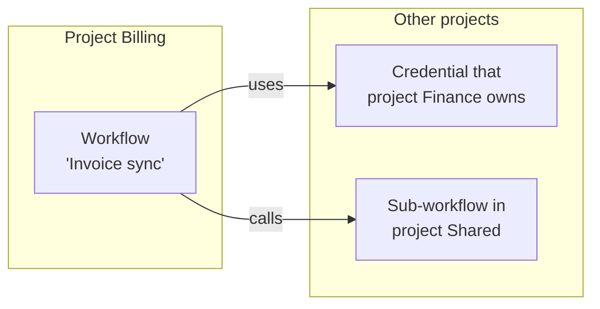
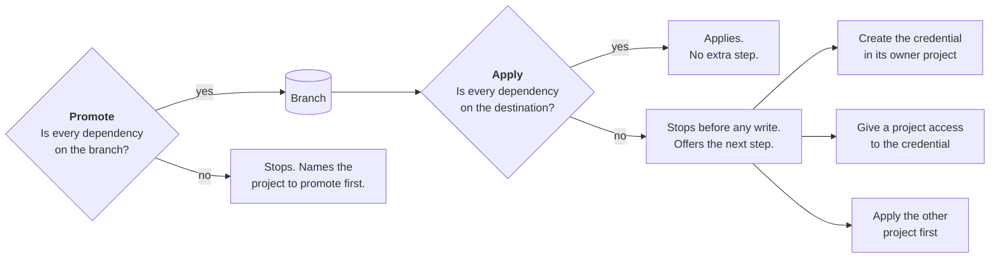
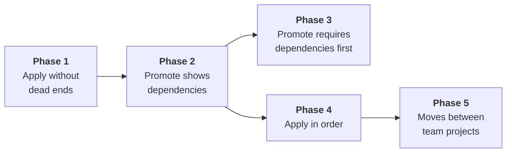

# Cross-project promotion: proposed direction (LIGO-1159)

This page gives the direction that the spike recommends. It leaves out the details on purpose. The analysis behind each point is available on request.

## The problem

Promotion treats a project as a closed unit. Real projects are not closed. A workflow in one project uses a credential that another project owns, or calls a sub-workflow that lives in another project.

Example: the workflow "Invoice sync" is in project Billing. It uses a credential that project Finance owns, and it calls a sub-workflow in project Shared.

Today, each such case fails, stops with no way forward, or breaks with no message. The table in "What changes for users" shows the cases.

## The direction

**Promote the dependencies first.** The branch must hold everything that its workflows need, in the project that owns it. Then the destination can be built in the same shape as the source.

Three principles:

1. **The branch matches the source.** When a workflow on the source can use a credential or a sub-workflow, the branch holds it too, under its own project.
2. **Promote stops early, with the next step.** When a dependency is not on the branch, Promote says which project must promote it first. A dependency in a personal project must first move to a team project.
3. **Apply follows the same order.** Apply writes a dependency before the workflows that use it. When a dependency is not there yet, Apply says what to apply first. Apply changes nothing outside the selected projects without a confirmation.

## What changes for users

| Situation | Today | Proposed |
|---|---|---|
| A workflow uses a credential that another team project owns. The branch does not hold it. | Promote passes. Apply needs three attempts and a manual share. | Promote asks the owner project to promote the credential first. Apply then creates it one time in that project and asks the user to confirm access for each project that uses it. |
| The credential is on the destination, but the project cannot use it. | Apply stops. The dialog offers no action. | Apply offers to give the project access. The user confirms. |
| A workflow uses a credential or a sub-workflow in a personal project. | Credential: Apply stops with "unknown owner" and no action. Sub-workflow: instance Promote fails with a count only. | Promote stops and says: move it to a team project. Personal projects are never promoted. |
| A workflow calls a sub-workflow in another project that the branch does not hold. | Project Promote: no warning. Apply: the reference arrives broken, and nothing reports it. | Promote stops and names the project to promote first. Apply stops before it writes and says which project to apply first. |
| Two workflows in two projects call each other. | Not handled. | An instance Promote and an instance Apply carry both together. |
| A workflow calls a workflow that does not exist on the source. | Instance Promote fails. | A warning. The reference is broken on both sides, as on the source. |
| A workflow or a folder moved to another team project. | Promote refuses the move. Apply stops. | Supported in the last phase. The item moves on the destination and keeps its id and its history. |

## What stays the same

- The common case gets no new step: all dependencies are in the selection or already on the branch.
- Existing branches keep working. No migration and no format change.
- Personal projects are not promoted. A move into a personal project stays refused.
- Variables, tags, and the data tables of a project work as today.
- An instance Apply still deletes the projects and workflows that the branch does not hold. This matters more when partial Promotes build the branch. It needs its own decision (LIGO-1268) before credentials can be promoted on their own.

## The cost

- A team can wait for another team. When a workflow needs a credential or a sub-workflow of another project, someone who can promote that project must do it first.
- Promotes that pass today can stop. The new checks show warnings for one release before they block.

## What we chose not to do

| We do not... | Why |
|---|---|
| Include a dependency of another project in the Promote or the Apply. | A project Apply writes one project only, so it cannot apply that content. On an instance Apply, a project that the branch holds only in part looks incomplete, and Apply deletes its other workflows. |
| Let Promote pass and let Apply resolve the gaps on the destination. | This was the first proposal. The destination then differs from the source: a credential lands in a project that the user picks on the destination. Comparing the two sides gets harder with each difference. |
| Store credential sharing in Git. | A later Promote of one project changes which credentials it uses, but does not update the file of the credential in the owner project. The list goes out of date. Apply works out the access that the applied workflows need, and the user confirms it. Apply never removes access. |
| Give credential access with no confirmation. | A workflow that uses a credential does not prove that its project had access on the source. |
| Change the package format. | The project folder on the branch already names the owner of each credential. |

## Phases

Each phase leaves a safe state.

1. **Apply without dead ends.** Apply can give a project access to a credential. A missing credential lands in its owner project. A credential that several projects use is created one time.
2. **Promote shows dependencies.** The preview shows each dependency that the branch will not hold, with warnings only. A project Promote can write the credentials that the project owns. Instance Promote lists every problem before the write to the branch.
3. **Promote requires dependencies first.** The warnings become blocks. Workflows that call each other across projects go through an instance Promote.
4. **Apply in order.** Apply stops when a dependency on the branch is not on the destination, and says what to apply first.
5. **Moves.** Apply moves a workflow or a folder between team projects. Then Promote writes a move.

## Later: one repository for each project

A separate spike covers this. With one repository for each project, "promote the dependency first" means a Promote to another repository. That spike must decide between self-contained projects and declared references to other repositories.
