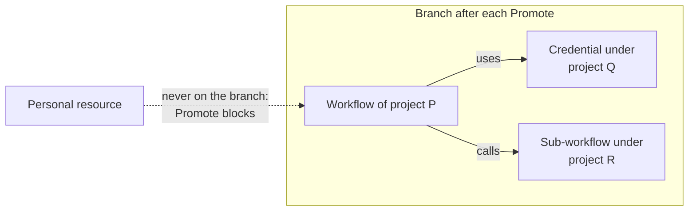
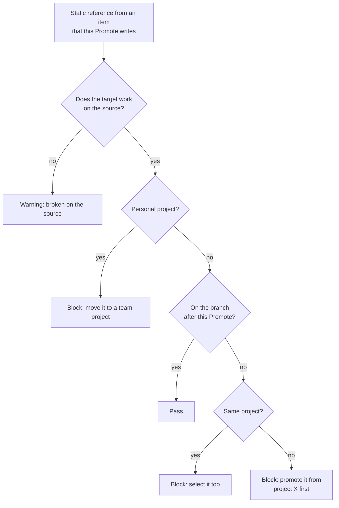
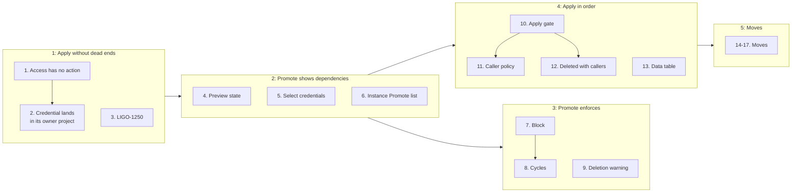

# LIGO-1159: Cross-project promotion, condensed solution

Full version: `solution.md`. Evidence: `decision-log.md`, Part 7. The earlier model is in `consolidated-solution.md` (alternative, not chosen).

## The rule

The branch resolves every reference that resolves on the source. A Promote that breaks this rule stops and names the dependency to promote first. Apply writes a dependency before the workflows that use it.

## Promote: dependencies first

- **No closure.** Promote never adds content of another project. The owner team promotes it.
- **Credentials are selectable** in a project Promote, so the owner team can promote a credential that only other projects use.
- **Item level.** Most cycles between projects pass in order. A true cycle (workflows that call each other across projects) goes through an instance Promote.
- **Instance Promote** carries all team projects. Only personal dependencies stop it. It lists every problem before the write to the branch.
- **Rollout.** Warnings for one release, then blocks.

## Apply: in order

- A dependency on the branch that is not on the destination blocks, with a fix: select it, apply project X first, or use an instance Apply for a cycle. No "apply anyway".
- A missing credential is created one time in its owner project on the branch. Each consumer project gets a grant that the user confirms. Apply never removes a share.
- A dependency that is not on the branch (broken on the source, or an existing branch) is a warning.
- Existing branches: a top-level credential gets a home selector.

## Format, scope and moves

- **Format:** no change. No version change, no new file. The branch path names the owner.
- **No change:** variables, tags, and the data tables of the own project.
- **Does not travel:** workflow sharing, credential sharing, the global state of a credential, a data table of another project.
- **Moves:** last phase. One transfer that keeps the id, only when the package holds both projects. A move into a personal project stays refused.

## Plan

17 tickets in five phases. The dead ends on Apply go first. Promote warns before it blocks.

## Open decisions

| # | Question | Recommendation |
|---|---|---|
| 1 | Does a personal dependency stop the whole instance Promote? | Yes, with the full list before the write to the branch. |
| 2 | How does a cycle across projects reach the branch? | Instance Promote and instance Apply only. |
| 3 | Which consent does a credential grant need? | The user confirms each grant. |
| 4 | What does instance Apply delete on a partial branch? (LIGO-1268) | Decide first. It blocks ticket 5. |
| 5 | How does the Promote block roll out? | Warning for one release, then block. |
| 6 | Does a move into a personal project keep blocking? | Yes. |
| 7 | What happens to the shares of a moved workflow? | Removed, as in the editor. |
| 8 | Does the Apply gate reach existing public API callers? | Yes, if the Beta API change is accepted. |
| 9 | Does Apply report a credential with a different owner on the destination? | A note, no block. |
| 10 | Does a reference that is broken on the source block the Promote? | No. Warning only. |

## Flag: repositories for each project

A separate spike decides. Problems: credentials and sub-workflows of other projects, cycles across repositories, checking another connection, instance resources. Directions: self-contained projects, declared external dependencies ("sidecar"), or a mix.
