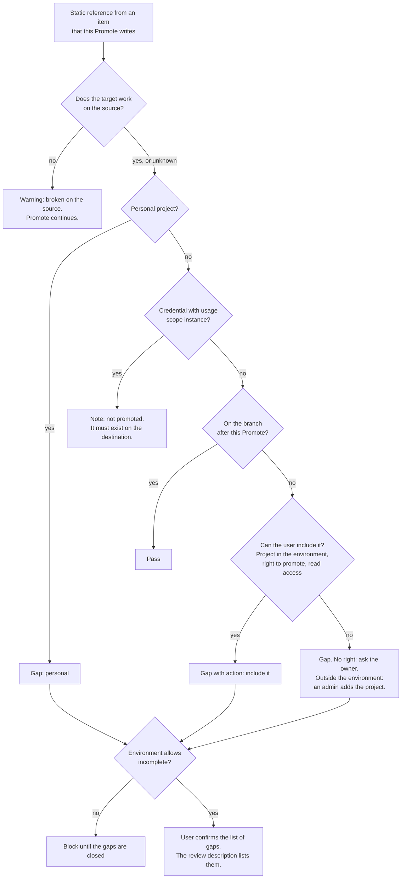
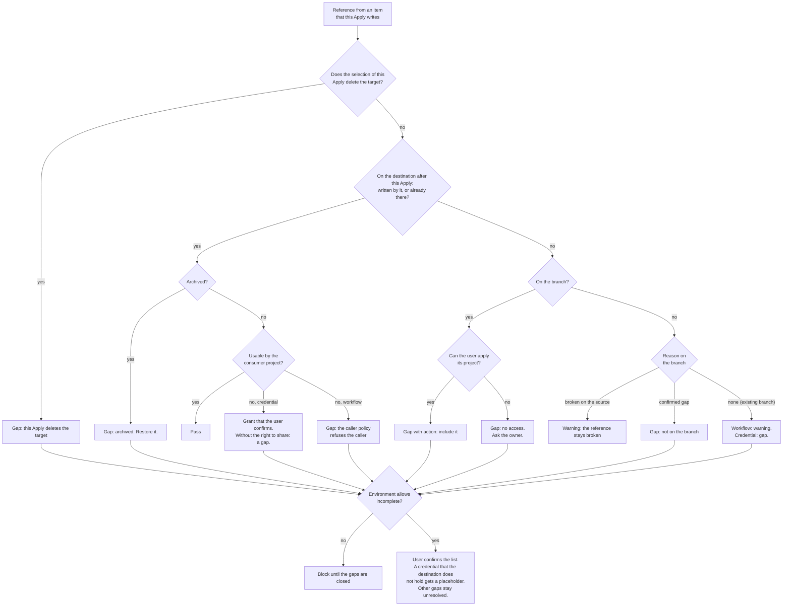

# LIGO-1159: Cross-project promotion, solution (complete by default, never stuck)

Status: chosen solution, revision of 2026-11-17 (evening), amended after the specification review. It describes the final state only. Work planning is a separate conversation.
Previous revision: "dependencies first", with hard blocks and no "apply anyway". Git history keeps it (`git log -- spike/ligo-1159/review/final/solution.md`).
Alternative: "Promote informs, Apply decides" in `consolidated-solution.md`. Section 8 says what this revision takes from it.
Evidence: `decision-log.md`. Part 8 records the decisions of this revision. Part 9 records the amendments after the specification review. Code: read only, at checkout `0b787546e38`.
Input: the comments on the Notion spike page and the Slack thread of 2026-11-17. Section 7 maps each point of feedback to its answer.

## 1. Summary

The rule stays:

> A dependency goes before, or with, what uses it.

The rule defines a **complete** Promote or Apply. It no longer decides alone whether the user can continue. Each gap gets the best exit that the user can take:

| Situation of the user | Exit |
|---|---|
| The dependency is in a project that the user can promote or apply | **Include it.** One action adds it to the same operation. |
| The dependency is in a project that the user cannot access | **Ask the owner**, or **continue incomplete** when the environment allows it |
| The dependency is personal, or archived on the destination | **Continue incomplete** when the environment allows it, with the fix in the message |
| The reference is already broken on the source | **Warning.** The operation continues. Promotion copies the source, it does not repair it. |
| None of the above, on a strict environment | **Block**, with the fix in the message |

The decisions:

1. **Strict by default.** A gap blocks Promote and Apply.
2. **"Allow incomplete" is an opt-in setting of each environment**, next to the review setting (`createBranchOnPromotion`). It is off by default. It needs no extra permission.
3. **Selection across projects.** One Promote or one Apply can hold items of several projects. A Promote across projects opens one review.
4. **One dependency report** in Promote and Apply. It shows each gap, its state, and the exits.
5. **No information leaks.** A user never sees information about a resource that they cannot access.
6. **Credentials live in the project that owns them.** This is not negotiable.
7. **Placeholders for credentials.** An incomplete Apply creates one empty placeholder credential, in a project that uses it, for a credential that the destination does not hold. A placeholder has a marker (open decision 6).
8. **The owner on the destination follows the branch.** When Apply writes a credential that the branch places in project P, and the destination holds it in project Q, Apply moves it to P. A placeholder moves with rights in P only. Any other credential moves only when the user may move it (open decision 5). Every project keeps its access.
9. **The publish state never changes.** Promotion Apply never publishes and never unpublishes (current behavior). A workflow with a gap waits on the destination until somebody publishes it. Other writes of an Apply can still change what a live workflow does (section 3.9).
10. **Personal dependencies** block on a strict environment. With "allow incomplete" they become broken references, and the message says how to fix them.
11. **No closure.** Promote and Apply never add content of another project by themselves.
12. **Package format:** no version change and no new file. The branch path names the owner. One optional field on a requirement row records why its target is not on the branch (open decision 7). Older readers ignore it.
13. **Broken stays broken.** A reference that already fails on the source is a warning in both modes, on Promote and on Apply. Apply reads the reason from the branch (section 3.4). The destination never becomes worse than the source.

## 2. Terms

- **Gap**: a static reference from an item of the operation to a resource that will not resolve after the operation.
- **Works on the source**: the target exists, is not archived, and the item can use it. For a credential: the project of the workflow can use it. For a workflow: its caller policy allows the caller. When the check cannot tell, the reference counts as working. Unknown is never "broken".
- **Strict environment**: an environment where "allow incomplete" is off. This is the default.
- **Incomplete operation**: a Promote or an Apply that writes items with gaps, after the user confirms the list of gaps.
- **Placeholder credential**: an empty credential that an incomplete Apply creates, with the id, name and type of the source credential, and a marker. The marker goes away when a person saves values in it.
- **Changes view**: the list of changes that a Promote or an Apply can write, grouped by project.

## 3. Final state

### 3.1 Changes view across projects

- The changes view groups the changes by project. It shows only the projects that the user can access.
- The user can select items from several groups. The selection stays inside the projects of the environment scope.
- "Include it" needs three things: the project of the item is in the environment scope, the user can promote or apply that project, and the user can read the item.
- The Apply side builds on the instance Apply preview (#43422, `promotionInstanceApplyPreviewSchema`). It has the same resource list and the same check as the project preview.
- The Promote side needs the same view. Today there is no preview for an instance Promote.
- An instance Promote or an instance Apply is "select all": every change of every project of the environment that the user can promote or apply. It is not the only route for workflows that call each other across projects any more.
- A Promote across projects opens **one review**. One review for each project would bring back the order problem between reviews. The data model supports it: a promotion run stores `contents.projectIds` as a list, and `reviewCoversProject` reads the list (`promotions.ee/promotion-review-gate.service.ts`).
- The open-review gate (`reviewOpen` blocker) checks each project of the selection.
- An Apply across projects resolves each reference against the whole plan. A dependency in the same plan counts as present. Present is not enough: the check also asks whether the consumer can use the target after the Apply (section 3.4).

### 3.2 Dependency report

Promote and Apply show the same report. The preview and the operation compute it from the same plan.

| Group | What the user sees | Exits |
|---|---|---|
| In the selection | Nothing to do | None |
| Same project, not selected | The item, with its state | Include it |
| Other project that the user can promote or apply | The item, its project, and its state: on the branch, in an open review (with a link), or missing | Include it. Open the review. |
| Project that the user can read and cannot promote or apply | The item and its project | Ask the owner. Continue incomplete when allowed. |
| Project that the user cannot access | Only what the workflow of the user already shows: the id, and the name and type from the node | Ask the owner. Continue incomplete when allowed. |
| Personal resource | "A personal resource. Move it to a team project." | Continue incomplete when allowed. |
| Broken on the source | "This reference is broken." | None. A warning. The operation continues. |
| Archived on the destination (Apply) | "Archived on the destination. Restore it." | Restore it. Continue incomplete when allowed. |
| Project outside the environment scope | "In a project that this environment does not cover." The project name only when the user can access it. | Continue incomplete when allowed. An admin adds the project to the environment. |
| Credential with usage scope `instance` | A note: "An instance credential is not promoted. It must exist on the destination." | None on Promote. It is not a gap. |
| Access that the user cannot grant (Apply) | The credential, and who can grant when the user may see that | Continue incomplete when allowed. The binding stays unusable until somebody grants access. |
| Target that this Apply deletes (Apply) | The item of the Apply that still references it | Remove the deletion from the selection. Continue incomplete when allowed. |
| Caller policy refuses the caller (Apply) | The sub-workflow and the reason, when the user can access it | Change the policy on the destination. Continue incomplete when allowed. |

- The report says that it does not check references made by expressions. An expression needs an execution context that Promote and Apply do not have. This is a permanent limit.
- The report never names a project, a state or a review that the user cannot access.
- The same rule holds in the other direction. A list of callers, of consumer projects, of kept items, or of the projects of a move names an item or a project only when the user can access it. Otherwise it gives a count: "1 workflow that you cannot access calls it."
- The review description and the commit message of an incomplete Promote list only what the promoting user can see.

### 3.3 Promote check

- The check reads items, not projects. Most cycles between projects pass in the right order. A true cycle passes when the user selects all its items in one Promote.
- An incomplete Promote writes the reference as a requirement row, as `ReferenceOnly` does today. The branch then holds a reference that is not on the branch.
- The requirement row records why the target is not on the branch: "confirmed gap" or "broken on the source" (open decision 7). Apply needs this to tell the two apart.
- A placeholder is never content. A Promote from an instance that holds a placeholder does not write it to the branch. The reference to it is a gap (open decision 6). So a gap does not disappear on the way through several environments.
- A credential id under two project folders of the branch has no clear owner. Promote and Apply stop. The message names a folder only when the user can access its project.
- A true cycle needs one user with the right in each project. Two owners who each have one right cannot close it, and "Ask the owner" does not help them. Until stacked promotions exist (open decision 4), an admin promotes the cycle.
- The open-review gate still applies. A project with an open review cannot get a second Promote.

### 3.4 Apply check

- **The check reads the state after the Apply.** A target that the same Apply writes is present, but the consumer must still be able to use it. A credential that the Apply writes can still need a grant for a consumer project. A sub-workflow that the Apply writes can still refuse the caller. Including a target never changes a permission, a caller policy or an archive state.
- **Broken on the source wins.** A reference that the branch records as broken on the source is a warning on Apply, also when its target is on the destination and archived, or refuses the caller. The source has the same failure. A gap is a reference that works on the source and will not work on the destination.
- **Archived.** Archived counts as not usable. Apply does not restore a workflow. On a strict environment the fix is to restore the target on the destination. With "allow incomplete" it is a gap like the others. This removes the dead end of an archived dependency.
- **Not on the branch.** Apply reads the reason from the requirement row (open decision 7).
  - Broken on the source: a warning in both modes, for a workflow and for a credential.
  - Confirmed gap (an incomplete Promote left it out, also a personal dependency): a gap. A strict Apply stops. So a strict apply environment stays strict after an incomplete Promote.
  - No reason: an earlier version wrote the branch. A workflow reference is a warning. A credential reference is a gap. Today it is the hard conflict `unknown-owner` with no action.
- **Deletions.** Three cases, in this order:
  1. The selection of the Apply deletes a target that an item of the same Apply still references: a gap. The fix is to remove the deletion from the selection.
  2. An instance Apply would delete a workflow that the package lacks, and a workflow of the package still references it: the Apply keeps the workflow and the result lists it as kept. The reference then resolves.
  3. A workflow on the destination that the Apply does not write calls a workflow that the Apply deletes: the Apply lists the callers that the user can access, and the user accepts or cancels. A workflow that the Apply writes is in this list too when only its published version still calls the target (open decision 8).
- **Credential identity.** A match by id also needs the same credential type. Another type is a block in both modes. The message gives both types when the user can read the destination credential. Apply never binds, moves or updates a credential of another type.

### 3.5 "Allow incomplete" setting

- One setting for each environment and each direction, next to the review setting:
  - promote environment: "Allow incomplete promotions"
  - apply environment: "Allow incomplete applies"
- Off by default. An instance admin turns it on.
- Why on the environment and not on the instance: the risk depends on the destination. A team can allow incomplete promotions from development and keep the Apply to production strict. An instance has instance-scope and project-scope environments, and they can need different values.
- No extra permission. A user who can promote or apply can continue incomplete on an environment that allows it.
- Before an incomplete operation, the user confirms the list of gaps. Promote writes the list into the review description and the commit message, so the reviewer sees it.

### 3.6 Ask the owner

- A gap in a project that the user cannot promote or apply has the action "Ask the owner". This covers a project that the user cannot access and a project that the user can only read.
- n8n sends the request to the promotion inbox of the owner project. The requester sees "Request sent". The requester gets no information about the owner project.
- The request names the resource of the owner and the requesting user.
- The request stores the operation and the environment. A request from a Promote offers the Promote of the resource. A request from an Apply offers the Apply of the resource on that destination.
- When the owner project is not on the destination, the request of an Apply goes to the instance admins.
- Extension: stacked promotions. A Promote can wait on another Promote and land after it. A request can turn into a stack. This document does not specify it.

### 3.7 Credentials

**Home.** A credential lives in the project that owns it on the source. The branch path names that project. A missing credential that is on the branch is created in that project, never in a project that uses it.

**Creation.** The branch carries no secret values. So "Include it" for a credential that the destination does not hold adds one step: a person creates the credential in its owner project and enters the secret values. This needs `credential:create` in that project. The Apply creates nothing for a user without that right.

**Grants.** A consumer project gets access through a grant that the user confirms. The grant needs the right to share the credential. Without that right, the missing grant is a gap. Apply never removes a share. A grant that the user confirmed stays when the Apply then stops on something else. The result lists it, and a retry does not grant it again.

**Placeholder (incomplete Apply only).** A credential gap gets an empty placeholder when the destination does not hold the id: the credential is not on the branch, or it is on the branch in a project that the user cannot apply.

- The placeholder has the source id, name and type, and a marker. The workflow binds to it.
- One id gets one placeholder. When several projects of the Apply use the credential, the placeholder goes to the first of them in the order of the changes view, and the Apply shares it with the others. A later Apply of another consumer finds the placeholder and follows the grant rule.
- The placeholder needs `credential:create` in the consumer project. Without it the Apply stops on that credential. The confirmation of the gaps never gives a permission.
- Sharing the new placeholder with the other consumer projects of the same Apply is part of its creation and needs no other right.
- A placeholder for a credential that is on the branch moves to its owner in the same way, at the Apply of the owner project.
- A credential that the destination holds, and that the consumer cannot use, gets no placeholder. The id is taken. The workflow arrives with a binding that does not work until somebody grants access.
- A credential with an incompatible usage scope blocks in both modes, as today.
- The workflow does not go live (section 3.9).

**The owner follows the branch.** When Apply writes a credential that the branch places in project P, and the destination holds the same id in project Q:

1. Apply moves the credential to P.
2. Apply keeps every share. Q becomes a user of the credential.
3. Apply then updates the name and the expression values with the usual rules (`CredentialConflictPolicy.Overwrite`). The branch carries no secret values.

This one rule covers two cases:

- **A placeholder gets its home.** Sales applies incomplete, so an empty *CRM key* lands in Sales. Later Platform promotes and applies *CRM key*. Apply moves it to Platform, and Sales keeps access. A person then enters the secret values.
- **An owner change on the source.** *CRM key* moves from Marketing to Billing on the source. The next Apply of Billing moves it on the destination too.

Rules for the move (open decision 5):

- **A placeholder moves with rights in P only.** It holds no secret of Q, and every share stays. The user does not need access to Q.
- **Any other credential moves only when the user may move it** (`credential:move` on the credential, as in the editor). The move changes who can edit, share and delete a credential that holds secret values, so rights in P are not enough. Without the right, Apply does not move and does not update the credential. The result says: "CRM key has another owner on the destination. A user who may move it must apply."
- **The destination mirrors the branch.** A move made by hand on the destination is undone at the next Apply that writes the credential, when the user may move it. An owner mismatch alone makes a change row for the credential.
- **Visibility.** The preview says "*CRM key* moves into Platform. The projects that use it keep access." It names Q only when the user can access Q.
- **Excluded.** A managed credential and a resolvable (end-user) credential never move. The current update rules already exclude them (`isUpdateCandidate`). The Apply continues and the result says that the credential stays where it is. A destination credential with usage scope `instance` does not match a project credential of the branch: the usage scope is not compatible, and the Apply blocks in both modes, as today.
- Members of Q who could edit the credential become users of it. This is accepted: the credential belongs to P.

**Instance credentials.** A credential with usage scope `instance` is never in the package. Promote writes a requirement row and a note, not a gap. On Apply the destination must hold it: when it does not, the Apply blocks in both modes and says "Create the instance credential on the destination." It gets no placeholder.

**Existing branches.** A credential file at the top level of the branch has no owner. This is the one case where the user selects the home: the Apply shows a home selector, in both modes. After the owner project promotes the credential, the file is under its folder and the rule above applies.

**Central credentials.** IAM plans a central credential management system for Q1. The core rule does not change. The home, grant and move steps can change, so check them with IAM before the build.

### 3.8 Sub-workflows and error workflows

- A static reference to a workflow follows the same checks as a credential.
- There is no placeholder workflow. In an incomplete Apply the reference stays unresolved.
- When the target arrives later with the same id, the reference resolves by itself.
- A workflow reference that is not on the branch follows section 3.4: a warning when it is broken on the source, a gap when an incomplete Promote left it out.

### 3.9 Publishing

- Promotion Apply uses `WorkflowPublishingPolicy.PreserveTargetState`. It never publishes and never unpublishes (`promotions.ee/apply-preview.service.ts`).
- So a new workflow with a gap lands unpublished. A workflow that is live keeps its live version. The new version waits until somebody publishes it on the destination.
- The publish state is the only promise. Three writes of an Apply can change what a live version does: an update of a credential that it uses, a move of the workflow to another project, and the deletion of a workflow that it calls.
- So the deletion check and the grant check of a move also read the published version, not only the incoming one (open decision 8).
- To verify: every publish path (editor, public API, CLI) refuses to publish a workflow whose credential is a placeholder. The generic import has this check (`blockedReason: 'stub-credential'`). The editor publish path is not checked yet. The check reads the marker (open decision 6), so a placeholder that got a name from the branch and no secret is still a placeholder.

### 3.10 Personal resources

- A personal resource is never on the branch. No personal data goes to Git.
- Strict environment: a reference to a personal resource blocks. The fix: move the resource to a team project.
- "Allow incomplete": the reference becomes a gap with the same fix in the message.
- A move into a personal project stays refused (section 10 lists the limit).

### 3.11 Moves of workflows and folders

- A move between team projects is one transfer that keeps the id, the history and the executions.
- It needs both projects in the operation. The selection across projects makes this easy.
- The changes view and the API response show each other project that the move changes.
- An instance Apply can move an item out of a project that the package does not hold, after the user confirms.
- A moved row names the other project only when the user can access it.
- A workflow move follows the editor move: it needs both projects and the workflow loses its shares. This is the stated exception to "workflow shares stay". A credential move keeps every share (section 3.7).
- Credentials, data tables and project variables do not move with a workflow. After the move a credential is a dependency in the new project, and the checks of sections 3.3 and 3.4 apply. A data table or a project variable of the old project no longer resolves on the source after the move, so the reference is a warning (section 3.13).

### 3.12 Permissions and visibility

- Promotion acts as the user. No response carries more than the user can read. The check itself resolves whether a target exists, where it lives and whether it works, also for a target that the user cannot read. It needs this to tell a gap from a broken reference. A target that it cannot resolve counts as working, never as broken.
- An operation across projects needs the right in each project of the operation. Only global owners and admins have promotion rights today, so this matters when project-level promotion rights arrive (LIGO-1006).
- A user never sees information about a resource that they cannot access: not its project, not its state, not its review.
- Each write has its own permission check: create a project, create a credential, share a credential, move a workflow. A dependency never gives a permission.
- Exception: moving a placeholder to its owner on the branch needs rights in the owner project only (section 3.7, open decision 5).
- The confirmation of an incomplete operation never gives a permission.

### 3.13 What does not change

- Package format: no version change and no new file. The branch path names the owner. A requirement row gets one optional field (open decision 7).
- Variables, tags, and data tables of the own project work as today. A data table cannot cross projects, so Promote includes it when a workflow uses it.
- Workflow sharing, credential sharing, and the global state of a credential do not travel.
- Promote never adds content of another project by itself.
- Initial setup: an instance Promote and an instance Apply are the cleanest first sync. A gradual start, project by project, follows the same rules.
- Instance to instance: the same rules. Read "the branch" as "the source instance".
- Changes to an environment: the next operation compares the repository and the instance as usual. n8n closes the open reviews when an environment is removed or points to another repository (current behavior).
- One repository for each project: self-contained by default. A separate spike decides the details (LIGO-1399). "Allow incomplete" gives that spike its "reference only" option.

## 4. User journeys

Cast: **Sales** owns the workflow *Sync orders*. **Platform** owns the credential *CRM key*. **Ops** owns the sub-workflow *Normalize*.

### 4.1 A builder with access to Sales only, strict environment

1. The builder selects *Sync orders* and opens Promote.
2. The report shows two gaps in projects that the builder cannot access: a credential "CRM key" and a workflow with an id. No project names.
3. The builder clicks "Ask the owner" for each. Promote stays blocked.
4. Platform and Ops get the requests in their inbox and promote. The next preview of the builder shows no gap.

### 4.2 The same builder, "allow incomplete" on the promote environment

1. Steps 1 and 2 as above.
2. The builder confirms "Promote with 2 gaps". The review description lists the gaps.
3. The reviewer merges with the gaps visible.
4. The apply environment is strict. The branch records both references as confirmed gaps, so the Apply of *Sync orders* blocks until *CRM key* and *Normalize* are on the destination.

### 4.3 A user with access to Sales, Platform and Ops

1. The user opens the changes view. Promote shows the gaps with "Include it".
2. The user includes *CRM key* and *Normalize*. One Promote, one review, three projects.
3. Apply across projects writes the credential and the sub-workflow first, then *Sync orders*.

### 4.4 An incomplete Apply, then the real credential

1. The apply environment allows incomplete. Sales applies *Sync orders*. *CRM key* is not on the branch.
2. Apply creates an empty *CRM key* placeholder in Sales. *Sync orders* lands unpublished.
3. Later Platform promotes and applies *CRM key*.
4. Apply moves *CRM key* to Platform, keeps the access of Sales, and updates the name and the expression values.
5. A member of Platform enters the secret values. The marker of the placeholder goes away.
6. An admin publishes *Sync orders* on the destination.

## 5. Current state that the design depends on

Verified at `0b787546e38`. The fact ledger of the earlier revisions is in `consolidated-solution.md`, section 2.

- The review setting is on the promote environment: `createBranchOnPromotion` in `promotionGitPromoteSettingsSchema` (`packages/@n8n/api-types/src/dto/promotions/promotion-environment.dto.ts`). The apply environment has only `branchName`.
- An instance Apply preview exists (#43422, `promotionInstanceApplyPreviewSchema`). No instance Promote preview exists.
- The open-review gate returns the blocker `reviewOpen`. A run stores `contents.projectIds` as a list (`promotions.ee/promotion-review-gate.service.ts`).
- Promotion Apply never changes the publish state: `WorkflowPublishingPolicy.PreserveTargetState` (`promotions.ee/apply-preview.service.ts`).
- Promotion Apply creates no credential: `credentialMissingMode: 'must-preexist'`. The client creates a missing credential with the source id, then calls Continue. The generic import can create stubs (`create-stub`).
- A stub credential is created in the project of the import, not in the owner project (`n8n-packages/entities/credential/credential-importer.ts`, `createStubCredential({ projectId: context.projectId })`). A stub has no marker. It is an empty, normal credential (`credentials/credentials.service.ts`, `createStubCredential`).
- Apply updates a credential only when a project of the Apply owns it on the destination. Any other match is bound and does not change (`isUpdateCandidate` in `n8n-packages/entities/credential/credential-conflict-policy.ts`). So today a placeholder in Sales stays in Sales and stays empty.
- The editor credential transfer removes every share and needs `credential:move` on the credential and `credential:create` in the new project (`credentials/credentials.service.ee.ts`, `transferOne`).
- A credential that is not on the branch and not on the destination is the hard conflict `unknown-owner`, with no action.
- Promote under `ReferenceOnly` writes a requirement row for a dependency outside the selection.
- Instance Apply hard-deletes the workflows that the package lacks in a package project (F44). This is not specific to cross-project and this document does not change it.

## 6. Technical approach

High level only. No ticket split.

- **Check engine.** One function computes the gaps for a plan, for Promote and Apply. Input: the static references of the items of the plan (the workflow requirement exporter extracts them today), the branch inventory after the operation, the destination state, and the scopes of the user. Output: gaps with a group and the exits that the user can take.
- **Report in the API.** The Promote and Apply previews return the gaps. A gap carries only the fields that the user may see.
- **Selection across projects.** The selection carries items for several projects. The server checks the right of the user in each project. A Promote writes one commit and opens one review whose run lists every project.
- **Environment setting.** A new required boolean in the settings of each direction. A write replaces the whole settings object, so the field is required, like `createBranchOnPromotion`.
- **Incomplete Promote.** The Promote request carries a confirmation of the gaps. The server checks that the confirmed list matches the current gaps, like `expectedPreviewRevision`. A gap is one reference: a consumer and a target. "2 gaps" counts references.
- **Incomplete Apply.** The Apply request carries the same confirmation, and the server makes the same check. A credential that the destination does not hold uses the stub path of the engine, in the consumer project. Other gaps write the reference unchanged.
- **Reason on the requirement row.** One optional field: `confirmed-gap` or `broken-on-source`. The manifest reader of an older version drops unknown keys, so it reads the package as today.
- **Placeholder marker.** A flag on the credential. It is set by the stub path of promotion and cleared when a person saves values.
- **Owner follows the branch.** A new step in the credential importer. A credential in the package whose destination owner differs from its branch project is transferred before the update step, when the rules of section 3.7 allow it. The transfer keeps every share. It goes through `CredentialsService`, as a general method next to `transferOne`, not through a repository.
- **Ask the owner.** A new inbox item type in the owner project. It stores the requested resource, the requester, the operation and the environment.
- **Public API and CLI.** Every new field goes through the DTO, the public API and `@n8n/cli`. A client must treat an unknown gap code as a blocker.

## 7. Feedback and answers

| Feedback | Who | Answer |
|---|---|---|
| The hard block degrades the experience. Rather finish incomplete than not start. | Fabian | Strict by default, but "allow incomplete" on each environment (3.5), "include it" (3.2) and "ask the owner" (3.6). |
| Users do not know which dependencies are cross-project, must search other projects, and cannot see reviews in progress. | Fabian | The report groups the gaps, names the project when allowed, and shows the review state with a link (3.2). |
| Can one journey promote the dependencies of other projects in one transaction? | Fabian | Selection across projects, one review (3.1). |
| Consider "apply anyway". Export and import or source control allow it. | Jeroen | "Allow incomplete", opt-in (3.5). |
| A promotion could request a promotion in the other project. | Jeroen | "Ask the owner" (3.6). Stacked promotions as an extension. |
| Initial setup, environment changes, instance to instance. | Jeroen | Section 3.13. |
| Per-project repositories. | Jeroen, Nour, Sandra | Self-contained by default. LIGO-1399 decides (3.13). |
| Cross-project workflows should be promotable through a project-level selection. | Sandra | Selection across projects (3.1). |
| Show the other project that a move affects. | Sandra | Section 3.11. |
| How is the owner project of a credential determined? | Sandra | The branch path (3.7). |
| References made by expressions. | Nour | Not checked. Permanent limit, stated in the report (3.2). |
| A reference that is already broken on the source. | (earlier decision) | A warning, not a gap (3.3). |
| Data tables and other dependencies. | Nour | Data tables cannot cross projects (3.13). Agents follow the same rules as workflows. |
| Archived dependencies. | Nour | Not present on the destination. Gap with a fix. No dead end (3.4). |
| A resource that exists but that the user cannot access. | Nour | Gap with no information leak. Ask the owner (3.2, 3.6). |
| The user who applies must have the right to share. | Nour | Each grant checks the right. Without it, a gap (3.7). |
| A credential moved from Marketing to Billing, then promoted again. | Nour | The owner follows the branch (3.7). |
| IAM plans central credentials for Q1. | Jan, through Jeroen | Rule unchanged. Check home, grant and move with IAM (3.7). |

## 8. Alternatives and rejected options

- **Hard block only** (previous revision). Replaced: it stops users who cannot access the dependency, and it gives no exit for archived or personal dependencies.
- **"Promote informs, Apply decides"** (`consolidated-solution.md`). Kept: an incomplete operation is possible. Not kept: a destination home that the user selects. The home comes from the branch. The one exception is a top-level credential of an existing branch, which has no owner (section 3.7).
- **"Allow incomplete" as an instance setting.** Rejected: the risk depends on the destination, and environments of one instance can need different values.
- **Default "allow incomplete" on.** Rejected: the override is opt-in.
- **No placeholder for a missing credential.** Rejected for credentials: the workflow cannot bind. The placeholder plus "owner follows the branch" gives the same end state and keeps the credential in its owner project at the end.
- **A placeholder in the owner project.** Rejected: Apply does not know the owner of a credential that is not on the branch, and the owner project can be missing on the destination.
- **Move placeholders only (with a marker).** Rejected: one rule also covers an owner change on the source. The marker itself is kept, for the rights of the move and for the publish check (open decisions 5 and 6).
- **Require access to the old owner project for the move.** Rejected for a placeholder: it holds no secret of the old owner. Kept for any other credential, as the right to move it: the move takes edit, share and delete rights from the old owner (open decision 5).
- **Any owner mismatch moves with rights in the new owner project only** (first text of this revision). Replaced: a user with rights in one project could take over a credential of a project that they cannot access.
- **Promote adds the dependencies of other projects automatically.** Still rejected. The owner team loses control of what ships and when.
- **A sharing list in Git.** Still rejected. A Promote of one project does not rewrite the credential file of another project, so the list goes out of date.

## 9. Open decisions

Each scenario of the specification that depends on one of these decisions carries the tag `@open-decision-N` and shows the recommended answer.

**Decision 1. Who receives an "ask the owner" request, and what does it show to them?**
- Recommendation: the admins of the owner project, or the instance admins when the owner project is not on the destination. The request shows the requested resource, the requesting user and the operation. It never shows the project of the requester.

**Decision 2. Does n8n refuse to publish a workflow whose credential is a placeholder?**
- Recommendation: yes, on every publish path. Verify the editor publish path, and add the check when it is missing.

**Decision 3. Does a secret that a destination admin types into a placeholder survive the move and the update?**
- Recommendation: yes. Promote carries no secret values, and the update writes only the name and the expression values.

**Decision 4. How do stacked promotions work?**
- No recommendation yet. The specification does not cover it. A request can turn into a stack later.

**Decision 5. What authorizes the move of a credential to its owner on the branch?**
- Recommendation: a placeholder moves with rights in the new owner project only. Any other credential moves only when the user may move it (`credential:move`). Without the right, Apply leaves the credential as it is and says who must apply.

**Decision 6. How does n8n recognise a placeholder?**
- Recommendation: a marker on the credential, cleared when a person saves values. The publish check reads it. Promote never writes a placeholder to a branch, so the gap stays visible in the next environment.

**Decision 7. Does the branch record why a reference is not on the branch?**
- Recommendation: yes. One optional field on the requirement row: "confirmed gap" or "broken on the source". A strict Apply then blocks on a confirmed gap and warns on a broken reference, for workflows and for credentials.

**Decision 8. Do the checks of an Apply also read the published version of a workflow?**
- Recommendation: yes, for the deletion check and for the grant check of a move. A live version can use a dependency that the incoming version dropped.

## 10. Not decided in this document

- Central credentials: alignment with IAM before the build of the home, grant and move steps.
- One repository for each project: LIGO-1399.

Known limits. The specification review found them, and this revision does not solve them:

- **A move into a personal project stops the Promote in both modes.** One such move stops every instance Promote until somebody moves the workflow back or deletes it.
- **A move out of a project that the package does not hold needs an instance Apply.** A user with project-level rights only cannot do it.
- **Strict by default meets existing branches.** After the upgrade, each workflow that uses a top-level credential has a gap at its next Promote, until the owner project promotes the credential.
- **A review across projects holds the open-review gate of each of its projects.** Who can see or close it when they can access only one of its projects is not decided. It belongs to LIGO-1006.
- **A global credential that a personal project owns** is a personal dependency for every workflow that uses it.
- **The result of a check shows that an id exists.** A gap and a warning differ, also for a target that the user cannot access. Accepted.
- **Kept items are not checked further.** A workflow that an instance Apply keeps can call something that the same Apply deletes.
- **Changes between the preview and the write.** The preview revision and the environment lock (LIGO-1129) cover them. A dependency that leaves the branch while a review is open is caught by the Apply check, not at the merge.
- **The settings field for old clients.** A client that writes the settings without the new field needs a rule: default off on create, keep the stored value on update. Not specified here.
- **Not covered by scenarios:** agents, instance to instance, the life cycle of a request to the owner (duplicates, decline, closure), and the public API and CLI shape of a confirmation.
