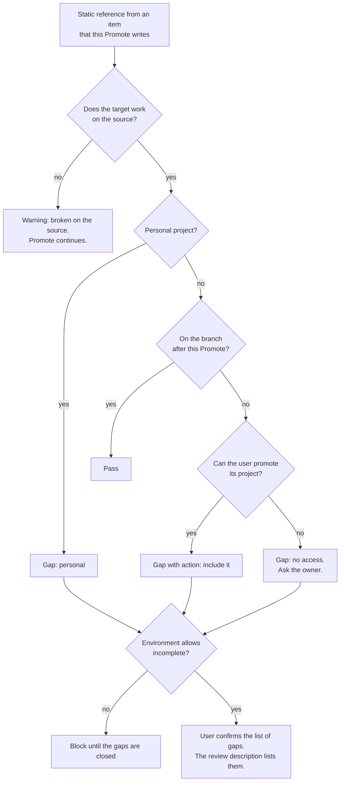
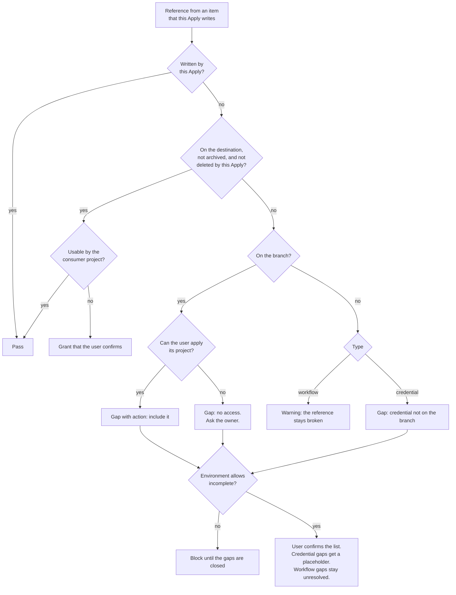

# LIGO-1159: Cross-project promotion, solution (complete by default, never stuck)

Status: chosen solution, revision of 2026-11-17 (evening). It describes the final state only. Work planning is a separate conversation.
Previous revision: "dependencies first", with hard blocks and no "apply anyway". Git history keeps it (`git log -- spike/ligo-1159/review/final/solution.md`).
Alternative: "Promote informs, Apply decides" in `consolidated-solution.md`. Section 8 says what this revision takes from it.
Evidence: `decision-log.md`, Part 8 records the decisions of this revision. Code: read only, at checkout `0b787546e38`.
Input: the comments on the Notion spike page and the Slack thread of 2026-11-17. Section 7 maps each point of feedback to its answer.

## 1. Summary

The rule stays:

> A dependency goes before, or with, what uses it.

The rule defines a **complete** Promote or Apply. It no longer decides alone whether the user can continue. Each gap gets the best exit that the user can take:

| Situation of the user | Exit |
|---|---|
| The dependency is in a project that the user can promote or apply | **Include it.** One action adds it to the same operation. |
| The dependency is in a project that the user cannot access | **Ask the owner**, or **continue incomplete** when the environment allows it |
| The dependency is personal, or archived on the destination | **Continue incomplete** when the environment allows it, with the fix in the message |
| The reference is already broken on the source | **Warning.** The operation continues. Promotion copies the source, it does not repair it. |
| None of the above, on a strict environment | **Block**, with the fix in the message |

The decisions:

1. **Strict by default.** A gap blocks Promote and Apply.
2. **"Allow incomplete" is an opt-in setting of each environment**, next to the review setting (`createBranchOnPromotion`). It is off by default. It needs no extra permission.
3. **Selection across projects.** One Promote or one Apply can hold items of several projects. A Promote across projects opens one review.
4. **One dependency report** in Promote and Apply. It shows each gap, its state, and the exits.
5. **No information leaks.** A user never sees information about a resource that they cannot access.
6. **Credentials live in the project that owns them.** This is not negotiable.
7. **Placeholders for credentials.** An incomplete Apply creates an empty placeholder credential in the project that uses it.
8. **The owner on the destination follows the branch.** When Apply writes a credential that the branch places in project P, and the destination holds it in project Q, Apply moves it to P. Every project keeps its access.
9. **Nothing new goes live.** Promotion Apply never changes the publish state (current behavior). A workflow with a gap waits on the destination until somebody publishes it.
10. **Personal dependencies** block on a strict environment. With "allow incomplete" they become broken references, and the message says how to fix them.
11. **No closure.** Promote and Apply never add content of another project by themselves.
12. **Package format:** no change, no version change, no new file. The branch path names the owner.
13. **Broken stays broken.** A reference that already fails on the source is a warning in both modes. The destination never becomes worse than the source.

## 2. Terms

- **Gap**: a static reference from an item of the operation to a resource that will not resolve after the operation.
- **Strict environment**: an environment where "allow incomplete" is off. This is the default.
- **Incomplete operation**: a Promote or an Apply that writes items with gaps, after the user confirms the list of gaps.
- **Placeholder credential**: an empty credential that an incomplete Apply creates, with the id, name and type of the source credential.
- **Changes view**: the list of changes that a Promote or an Apply can write, grouped by project.

## 3. Final state

### 3.1 Changes view across projects

- The changes view groups the changes by project. It shows only the projects that the user can access.
- The user can select items from several groups. The selection stays inside the projects of the environment scope.
- The Apply side builds on the instance Apply preview (#43422, `promotionInstanceApplyPreviewSchema`). It has the same resource list and the same check as the project preview.
- The Promote side needs the same view. Today there is no preview for an instance Promote.
- An instance Promote or an instance Apply is "select all". It is not the only route for workflows that call each other across projects any more.
- A Promote across projects opens **one review**. One review for each project would bring back the order problem between reviews. The data model supports it: a promotion run stores `contents.projectIds` as a list, and `reviewCoversProject` reads the list (`promotions.ee/promotion-review-gate.service.ts`).
- The open-review gate (`reviewOpen` blocker) checks each project of the selection.
- An Apply across projects resolves each reference against the whole plan. A dependency in the same plan counts as present.

### 3.2 Dependency report

Promote and Apply show the same report. The preview and the operation compute it from the same plan.

| Group | What the user sees | Exits |
|---|---|---|
| In the selection | Nothing to do | None |
| Same project, not selected | The item, with its state | Include it |
| Other project that the user can promote or apply | The item, its project, and its state: on the branch, in an open review (with a link), or missing | Include it. Open the review. |
| Project that the user cannot access | Only what the workflow of the user already shows: the id, and the name and type from the node | Ask the owner. Continue incomplete when allowed. |
| Personal resource | "A personal resource. Move it to a team project." | Continue incomplete when allowed. |
| Broken on the source | "This reference is broken." | None. A warning. The operation continues. |
| Archived on the destination (Apply) | "Archived on the destination. Restore it." | Restore it. Continue incomplete when allowed. |

- The report says that it does not check references made by expressions. An expression needs an execution context that Promote and Apply do not have. This is a permanent limit.
- The report never names a project, a state or a review that the user cannot access.

### 3.3 Promote check

- The check reads items, not projects. Most cycles between projects pass in the right order. A true cycle passes when the user selects all its items in one Promote.
- An incomplete Promote writes the reference as a requirement row, as `ReferenceOnly` does today. The branch then holds a reference that is not on the branch.
- The open-review gate still applies. A project with an open review cannot get a second Promote.

### 3.4 Apply check

- A workflow reference that is not on the branch stays a warning in both modes. The source or the reviewed Promote already accepted it.
- A credential reference that is not on the branch is a gap. Today it is the hard conflict `unknown-owner` with no action. The message now names the fix: the owner team promotes it, or the environment allows incomplete.
- Archived counts as not present. On a strict environment the fix is to restore the target on the destination. With "allow incomplete" it is a gap like the others. This removes the dead end of an archived dependency.

### 3.5 "Allow incomplete" setting

- One setting for each environment and each direction, next to the review setting:
  - promote environment: "Allow incomplete promotions"
  - apply environment: "Allow incomplete applies"
- Off by default. An instance admin turns it on.
- Why on the environment and not on the instance: the risk depends on the destination. A team can allow incomplete promotions from development and keep the Apply to production strict. An instance has instance-scope and project-scope environments, and they can need different values.
- No extra permission. A user who can promote or apply can continue incomplete on an environment that allows it.
- Before an incomplete operation, the user confirms the list of gaps. Promote writes the list into the review description and the commit message, so the reviewer sees it.

### 3.6 Ask the owner

- A gap in a project that the user cannot access has the action "Ask the owner".
- n8n sends the request to the promotion inbox of the owner project. The requester sees "Request sent". The requester gets no information about the owner project.
- The request names the resource of the owner and the requesting user.
- Extension: stacked promotions. A Promote can wait on another Promote and land after it. A request can turn into a stack. This document does not specify it.

### 3.7 Credentials

**Home.** A credential lives in the project that owns it on the source. The branch path names that project. Apply creates a missing credential that is on the branch in that project, never in a project that uses it.

**Grants.** A consumer project gets access through a grant that the user confirms. The grant needs the right to share the credential. Without that right, the missing grant is a gap. Apply never removes a share.

**Placeholder (incomplete Apply only).** A credential that is not on the branch and not on the destination gets an empty placeholder in the project that uses it. It has the source id, name and type. The workflow binds to it. The workflow does not go live (section 3.9).

**The owner follows the branch.** When Apply writes a credential that the branch places in project P, and the destination holds the same id in project Q:

1. Apply moves the credential to P.
2. Apply keeps every share. Q becomes a user of the credential.
3. Apply then updates the credential with the usual rules (`CredentialConflictPolicy.Overwrite`).

This one rule covers two cases:

- **A placeholder gets its home.** Sales applies incomplete, so an empty *CRM key* lands in Sales. Later Platform promotes and applies *CRM key*. Apply moves it to Platform, fills it in, and Sales keeps access.
- **An owner change on the source.** *CRM key* moves from Marketing to Billing on the source. The next Apply of Billing moves it on the destination too.

Rules for the move:

- **Any owner mismatch moves.** The move does not need a placeholder marker. The destination mirrors the branch. A move made by hand on the destination is undone at the next Apply that writes the credential.
- **Permission.** The move needs the rights of the user in P only, because every share stays. The user does not need access to Q.
- **Visibility.** The preview says "*CRM key* moves into Platform. The projects that use it keep access." It names Q only when the user can access Q.
- **Excluded.** A managed credential, a resolvable (end-user) credential, and a credential with usage scope `instance` never move. The current update rules already exclude them (`isUpdateCandidate`).
- Members of Q who could edit the placeholder become users of the credential. This is accepted: the credential belongs to P.

**Central credentials.** IAM plans a central credential management system for Q1. The core rule does not change. The home, grant and move steps can change, so check them with IAM before the build.

### 3.8 Sub-workflows and error workflows

- A static reference to a workflow follows the same checks as a credential.
- There is no placeholder workflow. In an incomplete Apply the reference stays unresolved.
- When the target arrives later with the same id, the reference resolves by itself.
- A workflow reference that is not on the branch is a warning in both modes.

### 3.9 Publishing

- Promotion Apply uses `WorkflowPublishingPolicy.PreserveTargetState`. It never publishes and never unpublishes (`promotions.ee/apply-preview.service.ts`).
- So a new workflow with a gap lands unpublished. A workflow that is live keeps its live version. The new version waits until somebody publishes it on the destination.
- To verify: the editor refuses to publish a workflow whose credential is an empty placeholder. The generic import has this check (`blockedReason: 'stub-credential'`). The editor publish path is not checked yet.

### 3.10 Personal resources

- A personal resource is never on the branch. No personal data goes to Git.
- Strict environment: a reference to a personal resource blocks. The fix: move the resource to a team project.
- "Allow incomplete": the reference becomes a gap with the same fix in the message.
- A move into a personal project stays refused.

### 3.11 Moves of workflows and folders

- A move between team projects is one transfer that keeps the id, the history and the executions.
- It needs both projects in the operation. The selection across projects makes this easy.
- The changes view and the API response show each other project that the move changes.
- An instance Apply can move an item out of a project that the package does not hold, after the user confirms.

### 3.12 Permissions and visibility

- Promotion acts as the user. No lookup reads more than the user can read.
- An operation across projects needs the right in each project of the operation. Only global owners and admins have promotion rights today, so this matters when project-level promotion rights arrive (LIGO-1006).
- A user never sees information about a resource that they cannot access: not its project, not its state, not its review.
- Each write has its own permission check: create a project, create a credential, share a credential, move a workflow. A dependency never gives a permission.
- Exception: moving a credential to its owner on the branch needs rights in the owner project only, because every share stays (section 3.7).

### 3.13 What does not change

- Package format: no change. The branch path names the owner.
- Variables, tags, and data tables of the own project work as today. A data table cannot cross projects, so Promote includes it when a workflow uses it.
- Workflow sharing, credential sharing, and the global state of a credential do not travel.
- Promote never adds content of another project by itself.
- Initial setup: an instance Promote and an instance Apply are the cleanest first sync. A gradual start, project by project, follows the same rules.
- Instance to instance: the same rules. Read "the branch" as "the source instance".
- Changes to an environment: the next operation compares the repository and the instance as usual. n8n closes the open reviews when an environment is removed or points to another repository (current behavior).
- One repository for each project: self-contained by default. A separate spike decides the details (LIGO-1399). "Allow incomplete" gives that spike its "reference only" option.

## 4. User journeys

Cast: **Sales** owns the workflow *Sync orders*. **Platform** owns the credential *CRM key*. **Ops** owns the sub-workflow *Normalize*.

### 4.1 A builder with access to Sales only, strict environment

1. The builder selects *Sync orders* and opens Promote.
2. The report shows two gaps in projects that the builder cannot access: a credential "CRM key" and a workflow with an id. No project names.
3. The builder clicks "Ask the owner" for each. Promote stays blocked.
4. Platform and Ops get the requests in their inbox and promote. The next preview of the builder shows no gap.

### 4.2 The same builder, "allow incomplete" on the promote environment

1. Steps 1 and 2 as above.
2. The builder confirms "Promote with 2 gaps". The review description lists the gaps.
3. The reviewer merges with the gaps visible.
4. The apply environment is strict, so the Apply of *Sync orders* blocks until *CRM key* and *Normalize* are on the destination.

### 4.3 A user with access to Sales, Platform and Ops

1. The user opens the changes view. Promote shows the gaps with "Include it".
2. The user includes *CRM key* and *Normalize*. One Promote, one review, three projects.
3. Apply across projects writes the credential and the sub-workflow first, then *Sync orders*.

### 4.4 An incomplete Apply, then the real credential

1. The apply environment allows incomplete. Sales applies *Sync orders*. *CRM key* is not on the branch.
2. Apply creates an empty *CRM key* placeholder in Sales. *Sync orders* lands unpublished.
3. Later Platform promotes and applies *CRM key*.
4. Apply moves *CRM key* to Platform, keeps the access of Sales, and writes the values.
5. An admin publishes *Sync orders* on the destination.

## 5. Current state that the design depends on

Verified at `0b787546e38`. The fact ledger of the earlier revisions is in `consolidated-solution.md`, section 2.

- The review setting is on the promote environment: `createBranchOnPromotion` in `promotionGitPromoteSettingsSchema` (`packages/@n8n/api-types/src/dto/promotions/promotion-environment.dto.ts`). The apply environment has only `branchName`.
- An instance Apply preview exists (#43422, `promotionInstanceApplyPreviewSchema`). No instance Promote preview exists.
- The open-review gate returns the blocker `reviewOpen`. A run stores `contents.projectIds` as a list (`promotions.ee/promotion-review-gate.service.ts`).
- Promotion Apply never changes the publish state: `WorkflowPublishingPolicy.PreserveTargetState` (`promotions.ee/apply-preview.service.ts`).
- Promotion Apply creates no credential: `credentialMissingMode: 'must-preexist'`. The client creates a missing credential with the source id, then calls Continue. The generic import can create stubs (`create-stub`).
- A stub credential is created in the project of the import, not in the owner project (`n8n-packages/entities/credential/credential-importer.ts`, `createStubCredential({ projectId: context.projectId })`). A stub has no marker. It is an empty, normal credential (`credentials/credentials.service.ts`, `createStubCredential`).
- Apply updates a credential only when a project of the Apply owns it on the destination. Any other match is bound and does not change (`isUpdateCandidate` in `n8n-packages/entities/credential/credential-conflict-policy.ts`). So today a placeholder in Sales stays in Sales and stays empty.
- The editor credential transfer removes every share and needs `credential:move` on the credential and `credential:create` in the new project (`credentials/credentials.service.ee.ts`, `transferOne`).
- A credential that is not on the branch and not on the destination is the hard conflict `unknown-owner`, with no action.
- Promote under `ReferenceOnly` writes a requirement row for a dependency outside the selection.
- Instance Apply hard-deletes the workflows that the package lacks in a package project (F44). This is not specific to cross-project and this document does not change it.

## 6. Technical approach

High level only. No ticket split.

- **Check engine.** One function computes the gaps for a plan, for Promote and Apply. Input: the static references of the items of the plan (the workflow requirement exporter extracts them today), the branch inventory after the operation, the destination state, and the scopes of the user. Output: gaps with a group and the exits that the user can take.
- **Report in the API.** The Promote and Apply previews return the gaps. A gap carries only the fields that the user may see.
- **Selection across projects.** The selection carries items for several projects. The server checks the right of the user in each project. A Promote writes one commit and opens one review whose run lists every project.
- **Environment setting.** A new required boolean in the settings of each direction. A write replaces the whole settings object, so the field is required, like `createBranchOnPromotion`.
- **Incomplete Promote.** The Promote request carries a confirmation of the gaps. The server checks that the confirmed list matches the current gaps, like `expectedPreviewRevision`.
- **Incomplete Apply.** The Apply request carries the same confirmation. Credential gaps use the stub path of the engine, in the consumer project. Workflow gaps write the reference unchanged.
- **Owner follows the branch.** A new step in the credential importer. A credential in the package whose destination owner differs from its branch project is transferred before the update step. The transfer keeps every share. It goes through `CredentialsService`, as a general method next to `transferOne`, not through a repository.
- **Ask the owner.** A new inbox item type in the owner project. It stores the requested resource and the requester.
- **Public API and CLI.** Every new field goes through the DTO, the public API and `@n8n/cli`. A client must treat an unknown gap code as a blocker.

## 7. Feedback and answers

| Feedback | Who | Answer |
|---|---|---|
| The hard block degrades the experience. Rather finish incomplete than not start. | Fabian | Strict by default, but "allow incomplete" on each environment (3.5), "include it" (3.2) and "ask the owner" (3.6). |
| Users do not know which dependencies are cross-project, must search other projects, and cannot see reviews in progress. | Fabian | The report groups the gaps, names the project when allowed, and shows the review state with a link (3.2). |
| Can one journey promote the dependencies of other projects in one transaction? | Fabian | Selection across projects, one review (3.1). |
| Consider "apply anyway". Export and import or source control allow it. | Jeroen | "Allow incomplete", opt-in (3.5). |
| A promotion could request a promotion in the other project. | Jeroen | "Ask the owner" (3.6). Stacked promotions as an extension. |
| Initial setup, environment changes, instance to instance. | Jeroen | Section 3.13. |
| Per-project repositories. | Jeroen, Nour, Sandra | Self-contained by default. LIGO-1399 decides (3.13). |
| Cross-project workflows should be promotable through a project-level selection. | Sandra | Selection across projects (3.1). |
| Show the other project that a move affects. | Sandra | Section 3.11. |
| How is the owner project of a credential determined? | Sandra | The branch path (3.7). |
| References made by expressions. | Nour | Not checked. Permanent limit, stated in the report (3.2). |
| A reference that is already broken on the source. | (earlier decision) | A warning, not a gap (3.3). |
| Data tables and other dependencies. | Nour | Data tables cannot cross projects (3.13). Agents follow the same rules as workflows. |
| Archived dependencies. | Nour | Not present on the destination. Gap with a fix. No dead end (3.4). |
| A resource that exists but that the user cannot access. | Nour | Gap with no information leak. Ask the owner (3.2, 3.6). |
| The user who applies must have the right to share. | Nour | Each grant checks the right. Without it, a gap (3.7). |
| A credential moved from Marketing to Billing, then promoted again. | Nour | The owner follows the branch (3.7). |
| IAM plans central credentials for Q1. | Jan, through Jeroen | Rule unchanged. Check home, grant and move with IAM (3.7). |

## 8. Alternatives and rejected options

- **Hard block only** (previous revision). Replaced: it stops users who cannot access the dependency, and it gives no exit for archived or personal dependencies.
- **"Promote informs, Apply decides"** (`consolidated-solution.md`). Kept: an incomplete operation is possible. Not kept: a destination home that the user selects. The home always comes from the branch.
- **"Allow incomplete" as an instance setting.** Rejected: the risk depends on the destination, and environments of one instance can need different values.
- **Default "allow incomplete" on.** Rejected: the override is opt-in.
- **No placeholder for a missing credential.** Rejected for credentials: the workflow cannot bind. The placeholder plus "owner follows the branch" gives the same end state and keeps the credential in its owner project at the end.
- **A placeholder in the owner project.** Rejected: Apply does not know the owner of a credential that is not on the branch, and the owner project can be missing on the destination.
- **Move placeholders only (with a marker).** Rejected: any owner mismatch moves. One rule also covers an owner change on the source.
- **Require access to the old owner project for the move.** Rejected: every share stays, so the move removes no access.
- **Promote adds the dependencies of other projects automatically.** Still rejected. The owner team loses control of what ships and when.
- **A sharing list in Git.** Still rejected. A Promote of one project does not rewrite the credential file of another project, so the list goes out of date.

## 9. Open decisions

Each scenario of the specification that depends on one of these decisions carries the tag `@open-decision-N` and shows the recommended answer.

**Decision 1. Who receives an "ask the owner" request, and what does it show to them?**
- Recommendation: the admins of the owner project. The request shows the requested resource and the requesting user. It never shows the project of the requester.

**Decision 2. Does the editor refuse to publish a workflow whose credential is an empty placeholder?**
- Recommendation: yes. Verify the editor publish path, and add the check when it is missing.

**Decision 3. Does a secret that a destination admin types into a placeholder survive the move and the update?**
- Recommendation: yes. Promote carries no secret values, and the update writes only the name and the expression values.

**Decision 4. How do stacked promotions work?**
- No recommendation yet. The specification does not cover it. A request can turn into a stack later.

## 10. Not decided in this document

- Central credentials: alignment with IAM before the build of the home, grant and move steps.
- One repository for each project: LIGO-1399.
