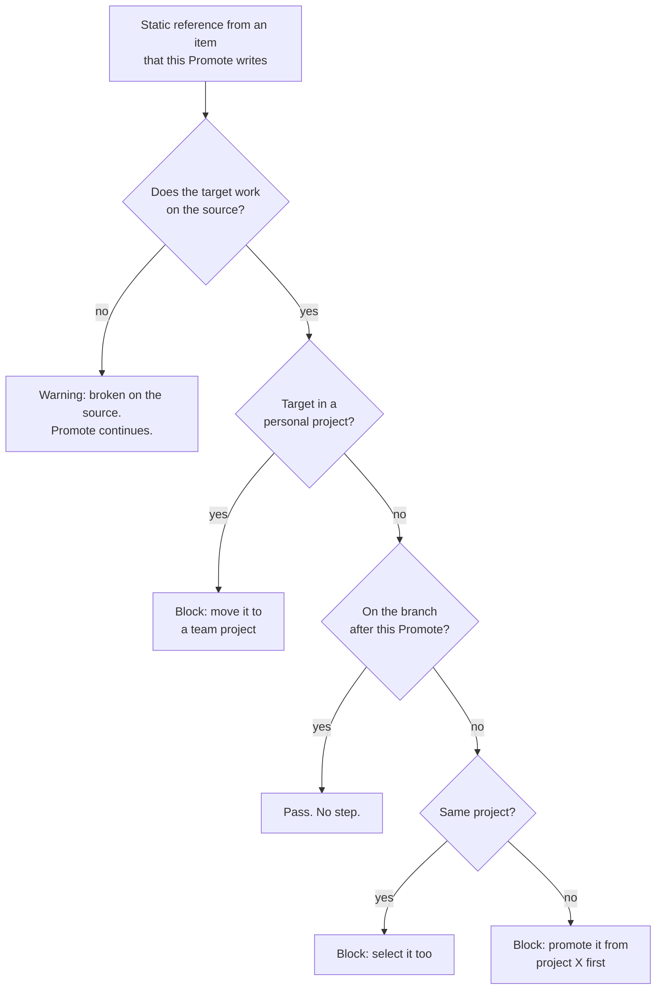
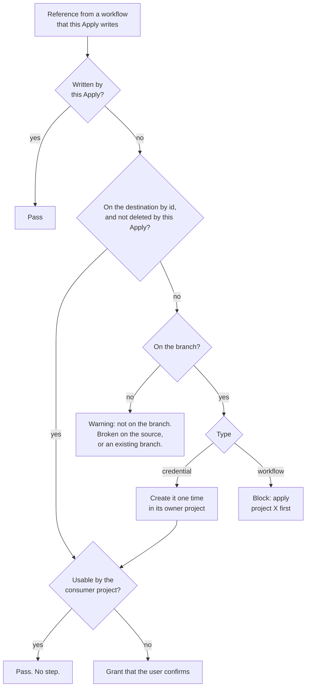
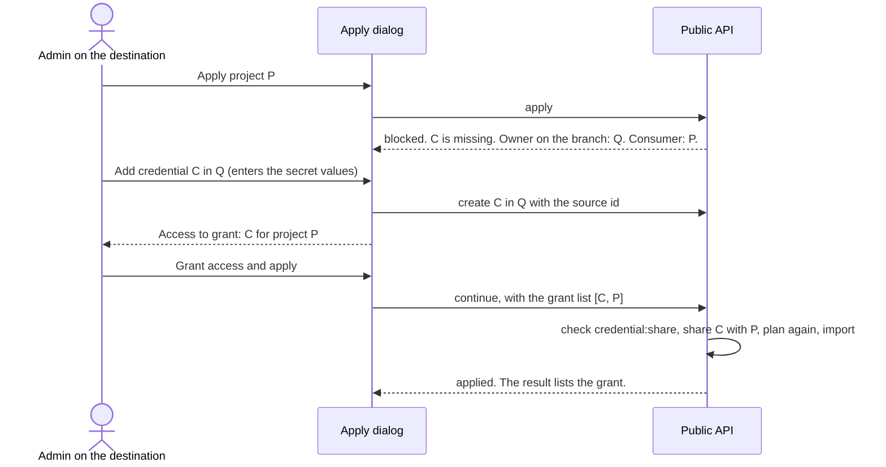
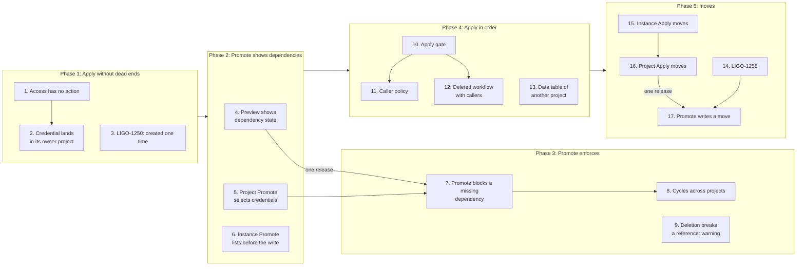

# LIGO-1159: Cross-project promotion, solution (dependencies first)

Status: chosen solution, revision of 2026-11-17.
The earlier model ("Promote informs, Apply decides") is now the alternative. Section 8 summarizes it. `consolidated-solution.md` keeps its full text.
Evidence: `decision-log.md`. Part 7 records the decisions of this revision.
Code: read only, at checkout `765740d4cf0`. Fact ids (F01 to F53) refer to the fact ledger in `../facts/`.
"Recommendation, pending decision" marks a part that needs a human decision. Section 10 lists these decisions.

This revision reverses the consensus of the four submissions. An engineer can challenge it in 12 months, so it is a candidate for an ADR.

## 1. Summary

One rule applies to every resource type and every operation:

> The branch resolves every reference that resolves on the source. A Promote that breaks this rule stops and names the dependency to promote first. Apply writes a dependency before the workflows that use it.

Terms:

- **Scope**: the projects that an operation writes. Instance Promote and instance Apply: all team projects of the package. Project and selective Promote or Apply: a selection inside one team project.
- **Content**: workflows, folders, and the resources that a project in the scope owns.
- **Dependency**: a static reference from content to another resource. Examples: a credential, a sub-workflow, an error workflow, a variable, a data table.
- **Closed branch**: a branch where each dependency of the content is also content of the branch, or an instance resource (global variable, tag).

The decisions:

1. **Dependencies first.** Promote checks each item that it writes. Each dependency of the item must be on the branch after the Promote: in the same Promote, or already on the branch. Otherwise Promote stops and names the next step.
2. **No closure.** Promote and Apply never add the content of another project by themselves. The user promotes a dependency from its own project. [A, B, C, D]
3. **Personal resources block.** A personal resource can never be on the branch. A reference to it stops the Promote. The fix: move the resource to a team project.
4. **Broken stays broken.** A reference that does not work on the source is a warning, not a block. Examples: a workflow that does not exist, a data table of another project. The branch then matches the source: the reference is broken on both sides.
5. **Item level, not project level.** The check reads items, so most cycles between projects pass in the right order. A true cycle needs one Promote for all its items. Recommendation, pending decision 2.
6. **The branch path is the owner.** A new Promote never writes a credential at the top level. For a missing credential, the owner project on the branch is the home on the destination. The home selector stays only for existing branches.
7. **Apply in order.** Apply writes nothing while a dependency on the branch is not on the destination. The fix is "apply project X first", or the creation of the credential in its owner project. There is no "apply anyway". A dependency that is not on the branch is a warning.
8. **Credentials.** Apply creates a missing credential one time, in its owner project. A consumer project gets access through a grant that the user confirms item by item. Apply never removes a share. Git holds no sharing list. [B, C, D]
9. **Package format.** No change, no version change, no new file.
10. **Moves.** As in the earlier model: one change that keeps the id, in the last phase. [A, B, C]
11. **Rollout.** The Promote check warns for one release, then blocks. Recommendation, pending decision 5.

### Promote check

### Apply check

## 2. Current state

Copied from `consolidated-solution.md`. These facts do not depend on the model.

Only the facts that the design depends on. Each fact has its ledger id or a file and line. Paths are relative to `packages/cli/src/modules/` unless they start with `packages/`.

### Package format

- The directory path is the only owner record of a credential, variable or data table. The exporter writes the file under `projects/<project>/` only when the owner project is in the export. Otherwise it writes the file to the top-level collection directory. (F01, F06)
- A top-level credential has `projectId` null on Apply. A top-level variable is a global variable. (F02, F03)
- `credential.json` holds id, name, type, optional data. It has no owner, no sharing, no `isGlobal`, no `usageScope`. Requirements hold id, optional name and type, and `usedBy`. (F04, F07)
- `credential.json`, `variable.json` and `data-table.json` have strict schemas. The manifest and its requirements are not strict, so a reader drops an unknown manifest key without an error. (F05)
- The format version is the string `'1'`. An import rejects another value. (F08) An older selective Promote does not reject it: it discards a manifest that fails the schema and writes a new manifest with version `'1'`. (`promotions.ee/import-manifest-bridge.ts:36-51, 113-121`)
- Readers ignore an unknown file name inside an entity folder. This holds for the directory inventory reader, the tar reader and the import parser. `workflow-metadata.json` is an existing file of this kind. (F09)
- A project or selective Promote rewrites `manifest.json`. It rebuilds the entries from the files and merges the requirement rows of the old and the new manifest. A staged row replaces the old row. Unknown fields are lost. (F18, `import-manifest-bridge.ts:297-327`)
- A project or selective Promote overlays its export on the branch package. An instance Promote replaces the package. A credential is at the top level of the branch when its owner is personal, when its owner team project was never promoted, or when the owner project is on the branch but no Promote wrote the credential under it. (F17)
- The overlay copies files one by one. When a dependency changes its path, the overlay removes only the dependency file and removes the directory only when it is empty. (`promotions.ee/working-copy-updater.ts:430-434, 668-694`)
- The exporter writes a requirement row for each credential id that an exported workflow names. It writes a file only when the user can read the credential and the credential has usage scope `project`. (`n8n-packages/entities/credential/credential.exporter.ts:58-111`, ledger "missed behaviors", batch 1)

### Promote

- Instance Promote exports all team projects with the `Fail` dependency policy. Project and selective Promote are one code path and use `ReferenceOnly`. (F10)
- No preview exists for an instance Promote. The project preview uses `ReferenceOnly`, so it does not predict an instance Promote failure. (F11)
- An instance Promote fails as a whole when a team workflow has a static reference to a workflow in a personal project or to a deleted workflow. The response and the toast show a count only. No surface shows the workflow ids. (F12, F13; F14 is wrong)
- Under `ReferenceOnly`, a sub-workflow or error workflow outside the selection becomes a requirement row. Promote returns no warning. The preview shows a called workflow of another project as an unchanged row. (F39, F38)
- Personal projects are never exported. A personal credential that a team workflow uses goes to the top-level `credentials/` directory. Promotion messages leave out personal project names. (F15, F16)
- Promote refuses a move between projects, and a move into a personal project. (F50) One exception exists: an instance Promote does not refuse a move when the project that holds the item on the branch no longer exists on the source. An example is a project deletion that transferred its workflows to another project. The move then reaches the branch. (`promotions.ee/promotions.service.ts:1373-1383`; F50, corrected statement, point 5) [red-team M3]
- Project and selective Promote run only on an instance-scope environment today. (Ledger "missed behaviors", batch 2; `promotions.ee/promotions.service.ts:436-437, 1438-1449`)

### Apply

- Apply matches a credential by id. A match needs a credential that the consumer project owns, that is shared with it, or that is global. Apply turns the personal route off. Apply does not compare the owner. (F21, F16)
- Apply creates no credential and no variable. The client creates a missing credential with the source id through public `POST /credentials`, then calls Continue. (F24, F28, F30)
- Apply overwrites the name and the expression values of a credential that exists, only when a project of the Apply owns it on the destination. Any other credential is bound and does not change. (`n8n-packages/entities/credential/credential-conflict-policy.ts:24-54`, `promotions.ee/promotions.service.ts:138`, ledger "missed behaviors", batch 4) [red-team m1]
- A missing credential whose file is outside every project folder, or that has no file, is the hard conflict `unknown-owner`. The dialog offers no action. (F19)
- A credential that exists but that the consumer project cannot use is `access-required`. It blocks Apply and the dialog offers no action. No promotion code shares a credential. (F20, F22, F23)
- The case "owned by team project Q, used by P" takes three submissions and a manual share. (F28)
- In a project Apply, the binding flow can create a missing project only when the plan of that Apply creates it. It cannot create an owner project that is on the branch but outside the selection. (`promotions.ee/apply-preview.ts:191-207`, `packages/modules/promotions/frontend/src/composables/usePromotionBindingCreation.ts:70-96`. This is a reading of the code.)
- At runtime, a workflow can use a credential that its project has no share of, through the access of the acting user. (F27, `packages/cli/src/executions/pre-execution-checks/credentials-permission-checker.ts:418-474`) A workflow can never use a credential with usage scope `instance`. (same file, lines 375-384)
- The public API and the CLI have no call that shares a credential with one project. (F34) `shareWithProjects` does not check `credential:share`. The internal controller does, and it needs the licence `feat:sharing`. (F35) An API key cannot hold a `credential:share` scope, and the promotions module reads no API key scope for the import. (`packages/@n8n/permissions/src/public-api-permissions.ee.ts:89-93`, no `apiKeyScopes` in `promotions.ee/`)
- Only global owners and admins hold `promotions:*`. They can read every credential. (F36)
- Apply has no check for a missing workflow dependency. The id stays and the reference is broken. Nothing reports it. (F37) The generic import reports this case as a failed publish. Promotion Apply does not: it uses the publishing policy `preserve-target-state`, which never publishes, so that check does not run. (`n8n-packages/entities/workflow/workflow-publishing-policy.ts:34`, `promotions.ee/promotions.service.ts:134`)
- The sub-workflow caller policy comes from the called workflow, or from an instance setting when the workflow sets none. The checker compares owner projects. (F41)
- Instance Apply treats the package as authoritative. It hard-deletes workflows that the package lacks in a package project. It lists team projects that the package lacks as `project-deletion`. (F44)
- The server asks for a confirmation only for `project-deletion` and for a destructive data table schema change. A workflow deletion by reconciliation has no confirmation. (`promotions.ee/promotions.service.ts:123-125`, `promotions.ee/apply-preview.ts:350-365`)
- One `confirmDestructiveChanges` flag confirms every listed project. A confirmed project deletion deletes the workflows, the owned credentials and the data tables of the project. It does not check for consumers in other projects. (`promotions.ee/promotions.service.ts:1027-1034, 1523-1540`, `packages/cli/src/services/project.service.ee.ts:185-188, 225-235`) [red-team M1]
- Reconciliation keeps a referenced workflow that the package does not carry only when the caller is in the same project. (`n8n-packages/engine/project-package-importer.ts:434-440`, `n8n-packages/entities/workflow/workflow-remover.ts:223-255`. This is a reading of the code. No test covers the cross-project case.)
- Project Apply writes only the selected workflows of one project and does not add sub-workflows. It hard-deletes the workflows that the request names. A caller in any project keeps the id of a deleted workflow. (F43, ledger "missed behaviors", batch 5)
- Variables: `$vars` reads the project of the workflow, then the global scope. The exporter cannot produce a requirement on a variable of another project. Apply requires the declared scope. (F45, F46)
- Data tables: at runtime a workflow uses only tables of its own project. The exporter bundles a table of any project that the user can read. Apply creates a missing table in the consumer project with the source id, or fails with an id conflict when another project holds that id. (F48, F49, `n8n-packages/entities/data-table/data-table.exporter.ts:44-75`, `data-table-importer.ts:160-175, 337-349`)
- Workflow sharing targets personal projects only. Tags are instance-wide. (F42)
- Apply reports a workflow or folder that moved between projects as a `moved` conflict that Continue cannot pass. (F51) The engine matches a workflow only inside the project that it imports. (F52) Moves inside one project work. (F53)
- The editor transfer of a workflow removes all shares of the workflow, deactivates a published workflow, and can leave it unpublished. It needs `workflow:move` on the workflow and `workflow:create` in the destination project. (`packages/cli/src/workflows/workflow.service.ee.ts:803-890, 1222-1250`)

### Generic package import

- With `create-stub` and `id-only`, a missing credential that two projects use gets one stub for each project. The second creation fails after the first project was written. (F29)
- The import reconciles credential updates, tags and variables across projects. It has no package-wide step for the creation or the sharing of a credential. (F31)

## 3. Scope table

| Case | Decision | On Promote | On Apply |
|---|---|---|---|
| Credential that another team project owns | Support. Dependency first. | Must be on the branch under its owner project. Otherwise: block, "Promote credential C from project Q first." | Usable by the consumer project: no step. Not usable: grant that the user confirms. Missing: the user creates it one time in the owner project, then confirms the grants. |
| Personal credential that a team workflow uses | Block | Block: "This credential belongs to a personal project. Move it to a team project, then promote it from there." The editor transfer of a credential is the fix. | Existing branches only: a top-level credential gets the home selector (section 5.10). |
| Global credential | Support, as a credential of its owner team project | Same as a team credential. The global state does not travel. | Same as a team credential. The consumer projects get grants. |
| Credential with usage scope `instance` | Exclude. No change. | A workflow cannot use it at runtime. The package holds a requirement row and no file (current behavior). | Exists with that scope: `incompatible-usage-scope` blocker (current behavior). |
| Static sub-workflow or error workflow, same project | Support. Dependency first. | Not selected and not on the branch: block, "Select it too", with an action that adds it. | Not on the destination and not in this Apply: block, "Select it too". |
| Static sub-workflow or error workflow, other team project | Support. Dependency first. | Not on the branch: block, "Promote it from project R first." | On the branch and not on the destination: block, "Apply project R first." |
| Static sub-workflow or error workflow, personal project | Block | Block: "Personal projects are not promoted. Move it to a team project." | Not reached on a new branch. Existing branch: warning. |
| Reference to a workflow that does not exist on the source | Warning | Warning: "This reference is broken." Promote continues. | Not on the branch: warning. Apply continues. |
| Workflows that call each other across two projects | Support through instance Promote. Recommendation, pending decision 2. | A project Promote cannot write both. Block, "These workflows call each other. Promote them together with an instance Promote." | Instance Apply writes both. A project Apply blocks, "Apply them together with an instance Apply." |
| Variable | Support. No change. | Project variable under the project folder. Global variable at the top level. | Must exist in the declared scope. The binding step creates it. |
| Data table of the own project | Support. No change. | Content. | Created or matched in the project. |
| Data table of another project | Warning. Broken on the source, stays broken. | Warning. No block. | Apply never copies the table. Warning. No block. |
| Tag | Support. No change. | Instance level. | Created or renamed as today. |
| Workflow sharing | Exclude | Not in the package. | Destination shares stay. |
| Deletion of a workflow that other branch content calls | Warning | Warning: "W1 in project P calls this workflow. After the Apply, W1 has a broken reference." The source already has the same broken reference. | Ticket 12 covers the destination callers. |
| Move of a workflow or folder between team projects | Support in the last phase. Block until then. | Until then: current refusal. After: one moved change. | Until then: `moved` conflict. After: one transfer that keeps the id. |
| Move out of a project that the source deleted | Support on instance Apply in the last phase | Instance Promote writes the move (current behavior). | After the user confirms, instance Apply transfers the item, before the project deletions. |
| Move into a personal project | Block | Current refusal. | Not reached. |
| Move out of a personal project | No rule needed | A new workflow. Its dependencies follow this table. | Created as a new workflow. |
| Owner change of a credential on the source | Exclude. No effect on the destination. | The check finds the credential by id under any project folder. | An existing credential keeps its destination owner. Recommendation, pending decision 9. |
| Permission boundary | Report, do not act, do not leak | The check reads the branch by id. A resource that the user cannot read and that is not on the branch: block, with no name. | An action appears only when the user holds its permission. |
| Existing branch | Support. No migration. | The check covers only the items of the Promote. A top-level credential does not count as on the branch. | Top-level credential: home selector. Reference not on the branch: warning. |
| Older destination version | Support with limits | The source cannot see the destination version. | No format change, so nothing new to ignore. No Apply gate: a broken reference arrives as today. A move blocks. |

## 4. Answers to the eight ticket questions

### 4.1 Scope

Section 3 is the answer. Two relations cross a project at runtime: credential use and workflow references. Moves are the third cross-project case. Variables and data tables cannot cross a project, and tags are instance-wide. (F27, F41, F45, F48, F42)

### 4.2 Promote: a dependency is outside the selection or the project

- Promote never adds the content of another project. [A, B, C, D]
- Promote checks each dependency of each item that it writes. The dependency must be on the branch after the Promote.
- Same project, not selected: "Select it too". The preview offers the action.
- Other team project, not on the branch: "Promote it from project X first". The message names who can promote that project.
- A credential of another team project counts only under its owner project folder. Project Promote can select the credentials that the project owns (ticket 5). So the owner team can promote a credential that only other projects use.
- Personal project: block, "Move it to a team project".
- Broken on the source: warning only.
- An expression computes the reference: note, "Resolved at run time. Not checked." [A]
- Instance Promote carries all team projects. So only personal dependencies, broken references and moves can stop it. It lists them all before the write to the branch. Recommendation, pending decision 1.

### 4.3 Apply: the owner project is not in the package

Where does the resource land?

1. A credential that exists on the destination stays where it is. Apply checks use, not ownership. (F21) Recommendation, pending decision 9.
2. A missing credential lands in the owner project that the branch names. On a closed branch, the branch always names it.
3. When the owner project is not on the destination, the binding step offers "Create project Q", or "Apply project Q first". [A, D]
4. Existing branches only: a top-level credential has no named owner. The user selects a team project. No project is selected in advance. The consumer projects are first in the list. The list leaves out each project that this Apply deletes. [B, C; red-team M1]
5. Never a personal project. [A, B, C, D]

A workflow dependency on the branch that is not on the destination: Apply blocks with "Apply project R first". An instance Apply never hits this case, because it writes the whole package.

Is a shared resource created one time? Yes. The check merges the consumers of one credential id into one row. (F31)

Is sharing kept?

- Git carries no sharing list. The reason of the earlier model still holds: a later Promote of project P changes the use of credential C, and it does not rewrite the file of C under project Q. A sharing list in that file goes out of date. [B, C]
- Apply derives the access that the applied workflows need: one item for each pair of credential and consumer project. The user confirms the items. [B, C, D] Recommendation, pending decision 3.
- Apply never removes a share.

### 4.4 Personal projects

- Never content. Never a home on the destination. No personal data in Git. [A, B, C, D]
- A reference to a personal credential, sub-workflow or error workflow blocks the Promote. The fix is a move to a team project in the editor.
- A new branch never holds a personal resource or a reference to one. So Apply has no personal case, except for existing branches.
- A move into a personal project stays refused. A move out of a personal project gives a new workflow.
- On the destination, a workflow in a personal project counts as present for a reference. A destination that works today must not get a new blocker. The caller policy check (ticket 11) decides whether that workflow allows the caller. [red-team m7]

### 4.5 Moves

No change from the earlier model. Section 4.5 of `consolidated-solution.md` applies. In short:

- The current refusals stay until the last phase.
- A move between two team projects is one change. Apply transfers the item and keeps the id, the history and the executions, only when the package holds both projects.
- An instance Apply can move an item out of a project that the package does not hold, after the user confirms. [red-team M3]
- The transfer keeps the publish state of the destination. The editor transfer does not, so it needs a change. [critique B-06]
- The credentials of a moved workflow are dependencies in the new project and follow section 4.3.

### 4.6 Permissions

- Today only global owners and admins promote and apply, and they can read everything. (F36) The rules below are for project-level promotion rights (LIGO-1006).
- Promotion acts as the user. No backend lookup reads more than the user can read. [A, B]
- Promote: the check reads the branch by id, so it needs no read access to the dependency. A dependency that the user cannot read and that is not on the branch blocks with a generic message: "A resource that you cannot access is not on the branch. Ask an administrator."
- A block message names who can promote the dependency. It names a project only when the user can read it.
- Apply: each write has its own permission check: create a project, create a credential, share a credential, move a workflow. A dependency never gives a permission. [A, D]
- A user without global `credential:read` gets no reason for a credential that is not found. (F22) The step says "missing or not accessible, ask an administrator", and offers no second creation. [critique B-07]
- An API key can grant credential access only when it holds a scope that allows it. Ticket 1 adds the scope. [critique C-2; red-team m4]

### 4.7 Package format

- No change. No version change. No new file. [B, C, D for "no version change"]
- The earlier model needed an optional owner hint file, because the branch often did not name the owner. A closed branch always names it, so the hint is not needed.
- The global state of a credential does not travel. The grants cover the consumer projects. A later ticket can add it when users ask for it.
- An old reader reads every new branch. An old writer can still write a top-level credential. The check then treats it as an existing branch.

### 4.8 Consistency

| | Instance Promote | Project or selective Promote | Instance Apply | Project or selective Apply | One repository for each project (future) |
|---|---|---|---|---|---|
| Content | All team projects | Selection of one project | Whole package | Selection of one project | See section 11 |
| Dependency outside the content | Only personal and broken cases remain | Must be on the branch | Written by the same Apply | Must be on the destination, or "apply X first" | See section 11 |
| Credential of another project | Under its owner folder | Under its owner folder, promoted from the owner project | Created in its owner project | Same | See section 11 |
| Personal dependency | Block, full list before the write to the branch | Block | Not reached | Not reached | Block |
| Broken on the source | Warning | Warning | Warning | Warning | Warning |
| Cycle across projects | Passes | Block, "use an instance Promote" | Passes | Block, "use an instance Apply" | See section 11 |
| Variable | By scope | By scope | Must exist in the scope | Same | Same |
| Data table of another project | Warning | Warning | Warning, not created | Same | Same |
| Move | One change (last phase) | One change from either project | Transfer | Transfer, both projects in the package | Refused across connections |

The generic package import keeps its own policies. It gets the "created one time" fix only (LIGO-1250). The dependency check is a promotion rule. [C]

## 5. User flows

### 5.1 Promote, common case

1. The user selects workflows and folders, or starts an instance Promote.
2. Each dependency is in the selection or on the branch.
3. The preview shows no warning. No new step appears.

### 5.2 Promote: a dependency of another team project is not on the branch

Workflow W in project P calls sub-workflow S in project R, and uses credential C of project Q. The branch holds neither.

1. The preview lists S and C under W, with "Not on the branch".
2. S: "Promote it from project R first." C: "Promote credential C from project Q first." Each row links to the Promote page of that project, when the user can open it. Otherwise it says who can.
3. W cannot be promoted. The other selected items can be promoted.
4. Someone promotes S from R, and selects C in the Promote of Q.
5. The user promotes W. The check passes.

### 5.3 Promote: a dependency in the same project is not selected

1. The preview shows "Select it too" on the dependency, with an action.
2. The user adds it. The check passes.

### 5.4 Promote: a cycle across two projects

W1 in P calls W2 in R, and W2 calls W1.

1. A project Promote of P stops: "W1 and W2 call each other across projects P and R. Promote them together with an instance Promote."
2. An instance Promote carries both projects and passes.

Most cycles between projects are not cycles between items. Example: P uses a credential of Q, and Q calls a sub-workflow of P. Then Q's sub-workflow goes first, then P's workflow, then Q's caller. The check reads items, so these pass with no special step.

### 5.5 Promote: a personal dependency

1. The preview shows the dependency with "This belongs to a personal project. Move it to a team project."
2. The user moves the credential or the workflow to a team project in the editor.
3. The user promotes it from that team project, then promotes W.

### 5.6 Promote: a deletion that breaks a reference on the branch

1. The user promotes the deletion of S. The branch holds W1, which calls S.
2. The preview warns: "W1 in project P calls S. After the Apply, W1 has a broken reference."
3. Promote continues. The source has the same broken reference.

### 5.7 Instance Promote

1. The dialog shows the full list before the write to the branch: personal dependencies (block), broken references (warning), moves (block until the last phase).
2. A reference to a deleted workflow no longer fails the Promote. Today it does. (F12)
3. A personal dependency still stops the Promote. The list names each workflow and the fix. Today the message is a count. (F13) Recommendation, pending decision 1.

### 5.8 Apply, common case

1. The user starts Apply.
2. Each dependency is in the Apply or on the destination, and usable.
3. Apply imports. No new step.

### 5.9 Apply: a shared credential on a new destination

Credential C belongs to project Q on the branch. Workflows of P and Q use it. The user applies P.

Variants:

- Q is not on the destination: the step offers "Create project Q", or "Apply project Q first".
- C exists and P cannot use it: one Continue grants access and applies.
- The user may not share C: no grant is offered. The row says who can.
- No sharing licence: the access item stays a blocker with that reason.
- A later Apply of Q updates the name and the expression values of C from the branch, because Q owns C. (`n8n-packages/entities/credential/credential-conflict-policy.ts:24-54`)

### 5.10 Apply: an existing branch

1. A top-level credential has no named owner. The response keeps the `unknown-owner` conflict, so an existing client reads a blocker that it knows. The dialog shows the home selector of section 4.3, rule 4. [red-team M2]
2. A reference to a workflow that is not on the branch: warning. The workflow arrives with the broken reference, as today, but now the result says so.

### 5.11 Apply: a workflow dependency is on the branch but not on the destination

1. Project Apply of P stops before any write: "W calls S in project R. Apply project R first." Or, in the same project: "Select S too."
2. The user applies S from R, then applies W.
3. A cycle across two projects: "Apply them together with an instance Apply."

### 5.12 A move (last phase)

As in section 5.9 of `consolidated-solution.md`.

## 6. Technical approach

### 6.1 Promote check

- Input: the static references of the items that the Promote writes. The workflow requirement exporter already extracts them. (`n8n-packages/entities/workflow/workflow-requirement.exporter.ts`)
- Branch inventory: the package on the branch after the overlay of this Promote. A workflow is on the branch when its file is under any project folder. A credential is on the branch only when its file is under a team project folder. A top-level credential file does not count.
- Source lookup, as the promoting user: does the target exist, and is it in a personal project. When the user cannot read the target, the check uses only the branch inventory.
- The check runs in the preview and again in the Promote. The Promote is authoritative.
- Item level: an item passes when each dependency passes. A selective Promote can write the items that pass and report the others. The UI keeps the current rule: the Promote runs only on a selection where each item passes.
- Cycle: the check finds strongly connected items across projects. It names all items of the cycle.
- Instance Promote: replaces the `Fail` policy. It reports personal dependencies as blockers and missing workflows as warnings, with the full list, before the write to the branch.
- Warning mode: for one release, each block is a warning. Recommendation, pending decision 5.

### 6.2 Credentials in project Promote

- The selection gets `credentialIds`. A project Promote can write a credential that the project owns, also when no selected workflow uses it.
- The Promote writes it under `projects/<project>/credentials/`.
- The preview of project Q lists the credentials of Q that branch content of other projects uses and that the branch does not hold. This is how the owner team finds out.
- Risk: a Promote of credentials only puts project Q on the branch with no workflows. An instance Apply then hard-deletes the workflows of Q on the destination that the branch lacks. (F44) A partial Promote of workflows has the same risk today. This model makes it more frequent. Decision 4 must be made before ticket 5 ships.

### 6.3 Apply

- The dependency gate is a promotion rule next to the credential and variable rules. It reads the static references of the workflows that the plan writes.
- A workflow reference is satisfied when the plan writes the target, or when the destination holds the target and the same Apply does not delete it. Present means: exists and is not archived. [red-team m7]
- A reference whose target is on the branch and not satisfied: blocker. A reference whose target is not on the branch: warning.
- No acceptance. Each blocker has a fix: select it, apply the other project first, or use an instance Apply for a cycle. The earlier model needed "apply anyway", because a dependency could be off the branch forever. A closed branch removes that case.
- Retention: reconciliation keeps a workflow that a workflow of the package references, in every project of the package. Today it keeps it only in the project of the caller. [critique D-04] The result lists each kept workflow with its caller. [red-team m5]
- A missing credential: the binding step creates it in the owner project that the branch names. The server does not enforce the home: any client can create the credential with the source id in any project. (F19, F28) The UI offers only the owner project.
- Grants: as in section 6.1 of `consolidated-solution.md`. Continue carries the list of items that the caller accepts. The server grants an item only when the current check requires it, the caller holds `credential:share`, the API key allows it, and the instance has the sharing licence.

### 6.4 Package format

No change. Section 4.7.

### 6.5 Existing branches

- No migration.
- The Promote check covers only the items of the Promote. An existing violation on the branch does not block an unrelated Promote.
- A workflow that uses a top-level credential blocks at its next Promote, until the owner project promotes the credential. The warning release gives teams time to do this.
- Apply: a top-level credential gets the home selector. A reference not on the branch gets a warning.

### 6.6 Older destinations and rollout

| What a newer source writes | What an older destination does |
|---|---|
| A closed branch | Applies it as today. No format change. |
| A package from an instance Promote that no longer fails on a deleted workflow | Applies it. The broken reference arrives with no message, as today after a project Promote. The source has the same broken reference. |
| A move (last phase) | Blocks the Apply with the `moved` conflict. No data is lost. |

Rules:

- The Promote check warns for one release, then blocks. Recommendation, pending decision 5.
- The Apply side of a move ships at least one release before the Promote side. [C; critiques B-03, C-4]

### 6.7 Permissions

| Action | Needs | Without it |
|---|---|---|
| Promote a dependency of another project | The right to promote that project | The block names who can. |
| Select a credential in a project Promote | The right to promote the project, and read access to the credential | Not offered. |
| Create the owner project | `project:create` and a free team project in the licence quota | The row says who can. The user can apply that project first. |
| Create the credential | `credential:create` in the owner project | The row says who can. |
| Grant access to a consumer project | `credential:share` on the credential, the sharing licence, and an API key scope that allows it | Blocker that says who can grant. |
| Move a workflow | `workflow:move` on the workflow, `workflow:create` in the new project | Blocker that names the missing permission. |

### 6.8 Guards against deletion

1. An instance Apply does not delete a project while that project owns, on the destination, a credential that a workflow of the package uses. It returns a warning that names the project and the credential. [D, adapted; red-team M1] The rule reads the destination only.
2. The Apply gate counts the deletions of the same Apply, and reconciliation keeps referenced workflows across projects (section 6.3).
3. Promote warns when a deletion breaks a reference on the branch (section 5.6).

The general problem stays open: an instance Apply deletes by absence, and a branch can be a partial view. Decision 4.

### 6.9 Public API changes

The promotions public API carries a Beta note. (`packages/cli/src/public-api/v1/controllers/promotions.public.controller.ts:82`)

| Ticket | Shape | Behavior for a current client |
|---|---|---|
| 1 | New optional fields on an `accessRequirements` item. New optional grant list on Continue. New API key scope. | No change. Without the grant list, the access item blocks as today. |
| 2 | The `unknown-owner` conflict stays for a top-level credential. `ownerProject` stays required on a `missingBindings` credential. | No change for an existing client. |
| 4 | New dependency list in the Promote preview. | No change. |
| 5 | New optional `credentialIds` in the Promote selection. | No change. |
| 6 | New list in the instance Promote result. | An instance Promote that fails today on a deleted workflow succeeds. |
| 7, 8 | New conflict codes in the Promote result. | A Promote that succeeds today can stop. This includes an instance Promote with a personal credential. Warning release first. |
| 10, 11, 12 | New conflict codes and warning codes in the Apply check. | An Apply that returns `applied` today can return `blocked`. Decision 8. |
| 13 | New warning code. | Apply no longer creates the table in the consumer project. |
| 15, 16 | The `moved` conflict stays for the cases that Apply still refuses. | An Apply that returns `blocked` with `moved` today can return `applied`. |

Each ticket that adds a code updates the schema, the OpenAPI document and `@n8n/cli` in the same release. A client must treat an unknown conflict code as a blocker and must ignore an unknown warning code.

## 7. Rejected options

| Option | Reason |
|---|---|
| Add the content of another project to the operation automatically | A project Apply is limited to one project, so it cannot apply the included content. On a branch without that project, an instance Apply then deletes the other workflows of that project. (Critique A4) The user promotes the dependency from its own project. |
| Promote writes the credential of another project under that project folder | It is the same as the row above, for credentials. It writes content of a project that the user did not promote. The owner team promotes it (ticket 5). |
| Format version 2, or a new owner hint file | A closed branch names the owner by path. An older selective Promote rewrites the manifest with version `'1'` and no error, so a version stop is not reliable. (Critique A1) |
| Sharing lists in Git | A Promote of project P changes the use of a credential of Q, and does not rewrite the file of Q. The list goes out of date. A full Apply could then remove a share that the source has. (Critique D-06, F17) |
| The Git owner is binding for a credential that exists on the destination | A destination that works today would get an owner conflict. (Critiques A5, D-02, F21) Decision 9. |
| "Apply anyway" for a missing workflow dependency | On a closed branch each blocker has a fix. A stored or repeated acceptance adds a second confirmation and an API change for no case that remains. |
| Block on a reference that is broken on the source | The destination cannot become worse than the source. A block forces a fix of the source workflow for no gain in parity. Decision 10. |
| Apply shares a credential with no confirmation | Use does not prove that the source project had access. The public API Apply has no preview. (Critique B-01, F27) |
| A home selector for every missing credential | The branch names the owner. The selector stays only for existing branches. |
| A backend lookup that reads more than the user can read | It is an elevation. (Critique D-09) |
| The workflow dependency gate in the generic import engine | The gate is a promotion rule. [C] |
| The generic import shares a credential that exists | The generic import has no preview and no confirmation. (Critiques B-01, C-7) |

## 8. Alternative considered: Promote informs, Apply decides

This was the model of `consolidated-solution.md`. All four submissions converged on it.

The rule: an operation carries the content of its scope. A reference outside the content is a requirement. Promote never fails on a dependency. It shows what the branch will not hold. Apply resolves each requirement on the destination and offers a step for each gap: create the credential at a home that the user selects, grant access, or apply anyway.

| | Dependencies first (chosen) | Promote informs, Apply decides (alternative) |
|---|---|---|
| Branch | Closed. Each working reference resolves on the branch. | Can hold references to content that is not on it. |
| Owner of a missing credential | The branch path. | A proposal: the path, a new owner hint file, or a home that the user selects. |
| Package format | No change. | One optional hint file. |
| Personal dependency | Blocks the Promote. | Passes the Promote. Apply needs a home or an acceptance. |
| Missing workflow dependency on Apply | Blocker with a fix. No acceptance. | Blocker with "apply anyway". The acceptance repeats on each Apply. |
| Promote friction | A team waits for the owner team of a dependency. | None. |
| Instance Promote | Fails only on personal dependencies, with a full list. | Never fails on a dependency. |
| Repositories for each project | Needs a rule for references across repositories (section 11). | Works as it is: every external reference is a requirement. |

Why it is not chosen:

- The destination differs from the source. A credential lands in a home that the user selected, and the source never sees it. A diff between source and destination then needs rules for each kind of difference.
- A reference to a personal workflow can never be satisfied, so the Apply blocker returns on each Apply.
- It needs a format addition (the owner hint) to make proposals that a closed branch gets from the path.

What it does better: no Promote friction and no coordination between teams, and repositories for each project need no extra rule.

## 9. Ticket plan

Rules for the whole plan:

- Each ticket states the problem and the outcome. It does not prescribe the implementation.
- A backend ticket that adds a blocker ships with its UI in the same release. The UI treats an unknown blocker as a hard block with no Continue. (Critique C-4)
- Each ticket includes its tests.
- Statements about existing Linear tickets come from submissions B and C. A person must confirm them.

Phases 3 and 4 can run in parallel. The Apply gate does not need the Promote block. Ticket 5 needs decision 4.

### Phase 1: Apply without dead ends. No format change.

**1. Apply: "the credential exists but the project cannot use it" has no action** (new)

Unchanged from ticket 1 of `consolidated-solution.md`.

Problem
- A credential is on the destination. A consumer project cannot use it. Apply blocks and says "Ask an administrator". The person who reads this is the administrator.
- The public API and the CLI have no call that shares a credential with one project.

Outcome
- The check lists each access that the Apply needs. It says whether the caller may grant it.
- The caller confirms the items that it accepts. Apply grants them, then imports. The first Apply call grants nothing.
- The same flow works in the UI, the public API and the CLI.
- An API key can grant only with a scope that allows it. The ticket adds the scope.
- Apply never removes a share. The result lists the grants. A grant writes the same audit event as a share in the editor.

Dependencies: none. Closes the access part of LIGO-1091.

**2. Apply: a missing credential has no way to land in its owner project** (new)

Problem
- A missing credential whose owner project is not in the Apply is the conflict `unknown-owner`, or a binding that the flow cannot create. The dialog offers no action.
- In a project Apply, the owner project can be on the branch and not on the destination. The flow cannot create it.

Outcome
- A credential under a team project folder on the branch: the binding step creates it in that project. When the project is not on the destination, the step offers "Create project Q" or "Apply project Q first".
- A top-level credential (existing branch): the user selects a team project. No project is selected in advance. The consumer projects are first. The list leaves out each project that this Apply deletes. The step states the rights of the home project, and that an Apply of the home project updates the credential from the branch. [red-team M1, m1]
- The response keeps `unknown-owner` for a top-level credential. [red-team M2]
- Guard 1 of section 6.8 ships with this ticket.
- Never a personal project.
- The other consumer projects get access through ticket 1, in the same Continue.

Dependencies: 1. Related: LIGO-1056, LIGO-1243.

**3. LIGO-1250: package import fails or duplicates a missing credential that several projects use** (existing)

Unchanged from ticket 3 of `consolidated-solution.md`. One credential for each source id, no partial write, home = the project whose folder holds the file, else the first consumer project.

### Phase 2: Promote shows dependencies. Warnings only.

**4. Promote: the user does not see that a dependency will be missing** (rescope of LIGO-1405)

Problem
- The preview shows a called workflow of another project as "No changes", also when the branch does not hold it.
- Nothing says that a credential of another project is not on the branch.
- Nothing says that a dependency is in a personal project.

Outcome
- Each dependency shows its state: on the branch, in this Promote, same project and not selected, other project and not on the branch, personal project, broken on the source.
- Each state except the first two shows a warning with the next step of section 3.
- "Select it too" is an action.
- A reference that an expression computes shows a note.
- A resource that the user cannot read is not named.
- Promote stays available in this phase.

Dependencies: none. Existing ticket: LIGO-1405.

**5. Project Promote cannot write a credential that only other projects use** (new)

Problem
- Promote selects workflows and folders only. (`packages/@n8n/api-types/src/dto/promotions/promotable-resource.dto.ts:14-15`)
- A credential of project Q reaches the branch under Q only when a selected workflow of Q uses it.
- So the owner team has no way to promote a credential that other projects need.

Outcome
- A project Promote can select the credentials that the project owns.
- The preview of Q lists the credentials of Q that other projects on the branch use and that the branch does not hold.
- The Promote writes them under the folder of Q.
- UI, public API and CLI.

Dependencies: decision 4. A Promote of credentials only puts Q on the branch with no workflows, and an instance Apply then deletes the workflows of Q on the destination (section 6.2).

**6. Instance Promote fails as a whole and shows only a count** (implements the decision of LIGO-1089) Recommendation, pending decision 1.

Problem
- A static reference to a workflow in a personal project, or to a deleted workflow, fails the whole instance Promote.
- The message is a count. It names no workflow and no next step. (F12, F13)

Outcome
- The dialog lists each dependency problem before the write to the branch: the caller, the dependency, the reason, the fix.
- A reference to a workflow that does not exist on the source is a warning. The Promote continues.
- A reference to a personal workflow stops the Promote, as today. The list names each one.
- A personal credential passes today. In this phase it shows a warning. Ticket 7 makes it a block.
- The move refusals do not change.

Dependencies: 4. Existing ticket: LIGO-1089 (close with the decision).

### Phase 3: Promote enforces dependencies first

**7. Promote writes a workflow whose dependency will not be on the branch** (new)

Problem
- A project Promote of W without its sub-workflow S, or without the credential of another project, writes W with a reference that the branch does not resolve.
- The destination then cannot know where S or the credential belongs.

Outcome
- The warnings of ticket 4 become blocks, one release after ticket 4.
- Same project: the user selects the dependency too.
- Other team project: "Promote it from project X first", with who can.
- Personal project: "Move it to a team project".
- Broken on the source: warning only.
- A top-level credential on the branch does not count as on the branch.
- Instance Promote: a personal credential becomes a block, as in the list of ticket 6.
- The check runs again in the Promote. UI, public API and CLI.

Dependencies: 4 (one release earlier), 5.

**8. Workflows that call each other across two projects cannot be promoted by project** (new)

Problem
- With ticket 7, W1 in P and W2 in R that call each other both block, because neither can go first.

Outcome
- The check finds the cycle and names all its items.
- The message says: "Promote them together with an instance Promote."
- Project-level cycles that are not item-level cycles pass with no message.

Dependencies: 7. Recommendation, pending decision 2.

**9. Promote of a deletion breaks a reference on the branch with no message** (new)

Problem
- Project R deletes S on the source and promotes the deletion. W1 in project P on the branch still calls S.

Outcome
- The preview warns: "W1 in project P calls S. After the Apply, W1 has a broken reference."
- Promote continues.

Dependencies: 4.

### Phase 4: Apply in order

**10. Apply writes a workflow whose dependency will not be on the destination** (new)

Problem
- A project Apply that selects W and not S writes W with a broken reference. Nothing reports it. (F37)
- On an instance Apply, reconciliation keeps a referenced workflow only when the caller is in the same project.

Outcome
- Apply stops before any write when a dependency is on the branch and will not be on the destination. The message names the caller, the dependency and the fix: select it, apply project R first, or use an instance Apply for a cycle.
- A dependency that is not on the branch: warning. Apply continues.
- A workflow that the same Apply deletes does not count as present.
- Present means: exists and is not archived. A workflow in a personal project of the destination counts.
- Reconciliation keeps a referenced workflow in any project of the package. The result lists it with its caller.
- No acceptance.
- UI, public API and CLI in the same release.

Dependencies: decision 8.

**11. Apply accepts a sub-workflow that exists but does not allow the caller** (new)

Unchanged from ticket 7 of `consolidated-solution.md`.

Dependencies: 10.

**12. Apply deletes a workflow that other workflows on the destination call** (new)

Unchanged from ticket 8 of `consolidated-solution.md`. Apply lists each caller before any write. The user accepts or cancels.

Dependencies: 10.

**13. A workflow that references a data table of another project gets a copy of the table or an id conflict** (new)

Unchanged from ticket 9 of `consolidated-solution.md`. Apply never creates a table in a project that does not own it. Warning on both sides.

Dependencies: none. It can ship in any phase.

### Phase 5: moves

Tickets 14 to 17 are tickets 12 to 15 of `consolidated-solution.md`, with these number changes: "tickets 1 and 2" stay 1 and 2, "ticket 9" becomes 13, "ticket 13" becomes 15, "ticket 14" becomes 16.

- **14. LIGO-1258**: one moved row in the Promote preview. Deliver before ticket 17.
- **15. Instance Apply moves a workflow or folder between team projects.** Also out of a project that the package does not hold, after confirmation. Dependencies: 1, 2, 13.
- **16. Project Apply of a moved workflow or folder.** Dependencies: 15.
- **17. Promote writes a move between team projects.** Dependencies: 14, and 15 and 16 one release earlier.

### Not in this plan

| Item | Where |
|---|---|
| Instance Apply deletes by absence on a partial branch | Decision 4. It now blocks ticket 5. |
| A confirmed project deletion deletes credentials that other projects use | Decision 4. |
| The global state of a credential on the branch | Later, when users ask. |
| Owner drift of an existing credential | Decision 9. |
| Repositories for each project | Section 11. Separate spike. |
| Project-level promotion rights | LIGO-1006. |

### Existing Linear tickets

| Ticket | Action |
|---|---|
| LIGO-1089 | Close with the decision: instance Promote lists each problem before the write to the branch. A deleted workflow is a warning. A personal dependency blocks. Ticket 6. |
| LIGO-1405 | Rescope to ticket 4. |
| LIGO-1250 | Keep. Ticket 3. |
| LIGO-1091 | Close. "Created one time" is LIGO-1250. Access is ticket 1. Sharing lists are rejected. |
| LIGO-1258 | Keep. Ticket 14. |
| LIGO-1363 | Reopen, or open ticket 15. |
| LIGO-1056 | Related to ticket 2. |

## 10. Open decisions for a human

**Decision 1. Does a personal dependency stop the whole instance Promote?**

- Option a: yes. The dialog lists each problem before the write to the branch, with the fix. One personal dependency stops every team.
- Option b: no. The Promote leaves out the workflows with a personal dependency and lists them.
- Recommendation: option a. Option b makes the branch differ from the source with no visible sign on the destination. Only admins run an instance Promote, and they can fix the dependency or move it.

**Decision 2. How does a cycle across two projects reach the branch?**

- Option a: only through an instance Promote and an instance Apply.
- Option b: a selective Promote and Apply that span several projects.
- Recommendation: option a. Cycles between items of two projects are rare. Option b changes the scope of project Promote and Apply. Revisit it with project-level rights (LIGO-1006).

**Decision 3. Which consent does a credential grant on Apply need?**

- Recommendation: an item list on Continue. The server grants only the listed items. Same as decision 2 of `consolidated-solution.md`.

**Decision 4. What does an instance Apply delete when the branch is a partial view?**

- Background: LIGO-1268 (done) lets a project Promote write to a branch with no full export, so a branch can be a partial view. LIGO-1269 (done) asks for confirmation before an instance Apply deletes a project that the branch lacks. No ticket covers the workflows of a project that the branch holds.
- Facts: an instance Apply hard-deletes the workflows of a package project that the branch lacks, with no confirmation. (F44) A credential-only Promote of ticket 5 puts a project on the branch with no workflows.
- Options as in decision 4 of `consolidated-solution.md`: a separate decision, a coverage declaration, or deletion only on a branch that an instance Promote wrote last.
- This decision now blocks ticket 5.

**Decision 5. How does the Promote block roll out?**

- Option a: warning for one release, then block.
- Option b: block at once.
- Option c: a setting that the admin turns on.
- Recommendation: option a. Promotes that pass today start to fail. Teams need one release to promote their dependencies.

**Decision 6. Does a move into a personal project keep blocking the instance Promote?**

- Recommendation: yes. It also follows from the personal block of this model.

**Decision 7. What happens to the shares of a workflow when Apply moves it?**

- Recommendation: as in the editor move. The shares are removed and the preview says so.

**Decision 8. How does the Apply gate reach existing public API callers?**

- Facts: with ticket 10, an Apply that returns `applied` today can return `blocked`. The Beta note allows a breaking change. The repository rule sends a breaking change to the `3.x` branch. (`.github/DEVELOPING_V3.md`)
- Change from the earlier model: no acceptance. Each blocker has a fix, so an automation is not stuck with no way out.
- Option a: the gate is on for every caller on `master`.
- Option b: on `master`, the gate is opt-in for a public API caller. Without the opt-in, the result holds the same list as warnings. The gate becomes the default on `3.x`.
- Recommendation: option a, if the team accepts a behavior change in the Beta API. Otherwise option b.

**Decision 9. Does Apply report an existing credential that has a different owner on the destination?**

- Option a: no. Apply checks use, not ownership. (Current behavior, F21)
- Option b: a note in the preview. No block.
- Option c: an offer to transfer the credential to the owner on the branch.
- Recommendation: option b. It shows the difference without a new blocker for a destination that works today.

**Decision 10. Does a reference that is broken on the source block the Promote?**

- Option a: no. Warning only. The branch matches the source.
- Option b: yes. The user fixes the source workflow first.
- Recommendation: option a. The destination cannot become worse than the source.

## 11. Flag: repositories for each project (separate spike)

A project with its own repository makes cross-project dependencies harder. "Promote the dependency first" then means a Promote to another repository.

Problems to solve:

- A credential of another project. A copy in each repository duplicates secrets and makes rotation harder.
- A sub-workflow of another project. A shared library of sub-workflows lives in another repository.
- Workflows that call each other across two repositories. Neither repository can go first, so Apply deadlocks.
- The check that a dependency was promoted. It reads another connection, or it trusts the record of the last Promote on the source.
- Instance resources. Global variables, global credentials and tags belong to no project.

Possible directions:

- Self-contained projects. No reference leaves the repository. Instance resources are exempt.
- Declared external dependencies ("sidecar"). The repository holds only a declaration of an external resource: id, type, owner. It never holds the resource. The repository of the owner stays authoritative.
- A mix. A declaration is allowed for credentials. A cycle of workflows across repositories is blocked.

The model of this document must not exclude any of these directions.

## 12. What the code does not settle

- A credential transfer on the source from Q to Q2. A Promote of Q2 writes the credential under Q2. The file under Q stays until a Promote of Q removes it. The package can then hold one credential id under two project folders. The behavior of the reader for a duplicate id is not verified. Ticket 7 must check it.
- A static reference in a disabled node. The check treats it as a reference. Not verified against the requirement exporter.
- The cost of the branch inventory check on a large branch. Not measured.
