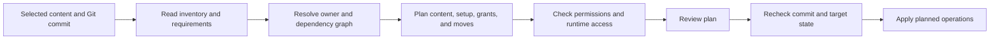

# LIGO-1159: Cross-project promotion

## Decision

Use one resource identity and one explicit owner across projects. Separate **content to change**, **dependencies to resolve**, and **permission changes**. Use one read-only plan for Promote, Apply, and their previews.

When an included resource's owner project is outside the selection, keep that owner. Reuse the owner project by ID. If it does not exist, offer to create a minimal team project from a Git-owned descriptor. Never put the resource in the consuming project or the applying user's personal project as a fallback.

Do not automatically promote every dependency. Include the normal supporting files for selected workflows. Show external workflow dependencies in the existing review. Let the user include an authorized dependency or leave it as an external requirement. Apply must resolve all static requirements before it writes content.

This is a recommended design, not an implementation or an approved product decision. The identity and ownership contract is a long-term architectural decision that may warrant an ADR if the team requests one.

## Investigation boundary

Issue: https://linear.app/n8n/issue/LIGO-1159

The supplied brief includes one comment dated October 30, 2026. I found the attachment at the archived path with the same `ednbkd` attachment ID. The workspace attachment path was absent. Linear was not connected. I could not verify later comments or the contents of LIGO-1089, LIGO-1091, and LIGO-1250. The ticket plan does not assume their scope or status.

Code baseline: `ed626a767fa9015bf75007d915737eb436fc3f75`. Local HEAD and local `origin/master` matched. No remote refresh was performed. Findings below come from source and test inspection. Dependencies were not installed, so no test or live instance run was performed. See [evidence.md](evidence.md) for exact paths and the distinction between observed code and inferred consequences.

## What exists today

Promotions uses `promotions.ee` and `n8n-packages`. It does not use the legacy Source Control import contract.

- Full instance Promote exports team projects and uses the `Fail` workflow dependency policy. Selective Promote uses `ReferenceOnly`.
- Selective Promote and Apply already exist. Apply has a read-only plan, dependency checks, source commit checks, and a preview revision.
- Package ownership comes from directory paths. A dependency whose owner is outside the exported projects goes into a top-level collection. Credential serialization omits sharing and global-access metadata.
- Apply already distinguishes missing credential setup, missing access, and an unknown owner. It requires credentials and variables to exist. It matches credentials by ID. It keeps target variable values.
- Variables are separate package files. Runtime resolution uses the consumer's project first, then global scope. Apply rejects a missing definition and checks the declared scope.
- Cross-project workflow and folder moves are explicitly refused. Same-project folder moves and renames already work.
- Full Apply can delete team projects absent from the package after confirmation. This makes partial-package coverage part of the solution, not a later cleanup.

The premise is therefore only partly current: this is not a missing-preview project. The work should extend the existing plan and checks. It should remove ambiguity in ownership, coverage, and sharing.

## Contract and scope

A package describes desired state at a Git commit. A selection describes which parts of that state the operation may change. A requirement does not authorize a write.

| Case | Decision |
|---|---|
| Dependency inside selection | Resolve once. Apply selected content in dependency order. |
| Dependency outside selection, valid on target | Reuse it without updating its content. Show it as an external dependency. |
| Dependency outside selection, missing on target | Offer to include its Git definition if authorized. Otherwise block the affected selection with a specific remedy. |
| Included resource, owner project absent from content | Use the declared owner ID. Create a minimal team project only when the plan includes creation and the actor has permission. |
| Credential used by several projects | One credential ID and owner. Preserve declared team sharing through explicit grant operations. Never create one copy per consumer. |
| Dependency in a personal project | Reference only. Never export its content, create a personal project, or match a person by email. Reuse only an already valid, project-usable target dependency. Otherwise move it to a team project at source and promote again. |
| Dependency inaccessible to the actor | Keep only reference data already present in authorized workflow content. Permit an external requirement. Do not export or traverse hidden content. |
| Static sub-workflow or error workflow | Support team-to-team references. Check target existence and caller policy. Include only after selection or dependency expansion. |
| Dynamic reference | Show an unresolved-at-preview warning. Do not execute expressions. Do not claim full dependency validation. |
| Project variable | Keep its declared project scope. Never turn it into a global variable or obtain its value from another project. |
| Global variable | Keep global scope. Warn if a target project variable shadows it. |
| Data table | Preserve ownership and schema. Support same-project usage. Block cross-project usage until runtime access supports it. Do not copy tables to make the reference pass. |
| Tags | Keep existing instance-level tag behavior. Do not invent project ownership. |
| Folders | Structural dependencies. Include required ancestors. Cross-project folder moves require a complete subtree operation. |
| Agents, skills, provider connections | Outside this Promotions release. Promotions currently excludes Agents. Do not expand this spike into enabling every package entity. |
| Credential secrets, table rows, execution history | Target-local or outside promotion. Preserve existing export policy. |

A common model does not imply that every resource supports sharing. Workflows have caller policy; credentials have project grants; variables and data tables have scope. Check the actual runtime rule for each.

### External dependency compatibility

Reuse by stable ID and resource type, not by name. Check owner and runtime usability. For sub-workflows, check static reference validity and caller policy. For credentials, check type, usage scope, and access from every consuming project. For tables, check supported project scope and schema needs. For variables, check name and declared scope.

Reusing an unselected workflow does not promise an identical revision or compatible business behavior. Show “Uses the version already on this instance.” Include the workflow to deploy the Git version. Do not silently update an unselected dependency. A missing setup value is different from a missing definition; show both accurately.

## User flows

### Promote

1. The user selects workflows and folders as today.
2. The server builds the selected content and its dependency graph from one source snapshot. It also reads the base Git commit.
3. The existing review shows selected changes and a Dependencies section. No extra modal appears when all dependencies resolve within the selection.
4. Supporting credential definitions, variable definitions, tags, and table schemas follow existing export policy, subject to owner and permission checks. The review lists every extra write.
5. An external sub-workflow shows its owner, when visible, and its consumers. The default is to keep it as an external requirement. “Include dependency” adds its authorized content and required project/folder descriptors. It does not add the whole project.
6. A dependency from a different configured repository remains external. The user promotes it through its own connection first. This release does not coordinate commits across repositories.
7. A personal or inaccessible dependency cannot be included. The user can keep a reference or remove the consuming workflow from the selection. Promote states that Apply will check the target.
8. The server rechecks permissions and source revisions before commit. A changed source returns a refreshed review. The Git diff contains only the reviewed content, metadata, and explicit deletions.

Promote cannot certify a remote target that it has not inspected. Its success means that the Git package is valid and explicit, not that every destination is ready.

### Apply

1. Read the selected Git commit and the target state.
2. Plan selected changes and resolve external requirements against the state that will exist after this operation.
3. Reuse existing dependencies automatically when they satisfy the contract. Do not request confirmation for read-only reuse.
4. For a missing team owner, show “Create project Billing.” A minimal owner descriptor must not overwrite existing project metadata or reconcile its contents.
5. For a missing credential, open the existing setup flow in its declared owner project. Keep secret values on the target. For missing sharing, show the credential, consuming project, and proposed access change. Only an actor with grant authority can perform it.
6. If the selected definition cannot resolve, block before content writes. Offer to include an available branch dependency, exclude its consumers, or have an authorized person prepare the target. Do not offer a generic force option.
7. Recompute the plan after setup. Apply checks the source commit, target revision, and permissions again. It writes only the reviewed plan.
8. Report content changes, created owner projects, reused dependencies, sharing changes, and setup still needed. Keep the current publication policy: Apply does not introduce automatic publishing.

Setup can occur before Apply through existing creation endpoints. Such writes must be visible and idempotent. A blocked content Apply must not claim that no setup work happened.

### Example: shared credential outside the package

Orders owns workflow W. Billing owns credential C and shares it with Orders. The user promotes W only.

The Git package contains W, an authorized definition of C, Billing's owner descriptor, and the C-to-Orders grant. Billing's unrelated workflows are absent. On the target:

- C exists with the same owner and valid access: reuse C.
- C is missing: create or configure C once in Billing through setup. Create Billing first if authorized.
- C exists but Orders lacks access: require the declared grant before Apply.
- C exists under another owner: show an ownership conflict. Do not clone it or transfer it as a side effect of a dependency.
- The actor cannot set up Billing or share C: an authorized person completes that setup. The user then retries the same Git commit.

### Proposed copy

| Surface | Copy | Suggested key | Reason |
|---|---|---|---|
| Dependency row | Uses the version already on this instance | `promotions.dependencies.reuseTarget` | Explains the external-reference contract. |
| Action | Include dependency | `promotions.dependencies.include` | Names the extra content action. |
| Missing owner | Create project {projectName} | `promotions.dependencies.createProject` | Makes placement explicit. |
| Missing access | This workflow can't use a required credential. Ask a project admin to grant access, then retry. | `promotions.dependencies.accessRequired` | Gives a remedy without disclosing hidden ownership. |
| Personal dependency | This dependency belongs to a personal project. Move it to a team project to include it. | `promotions.dependencies.personal` | Explains the supported path. |
| Move row | Move {resourceName} from {sourceProject} to {targetProject} | `promotions.moves.summary` | Shows both sides of the operation. |
| Dynamic reference | This reference is resolved during execution. Check it on the target instance. | `promotions.dependencies.dynamic` | States the verification limit. |

Keys are proposed. Use the final Promotions UI namespace when implementation starts. Reuse existing review rows, dialogs, project badges, and status components. Keep errors next to affected resources. Make dependency controls keyboard accessible. Use design-system tokens and i18n for implementation.

## Ownership and sharing

Use `(resource type, source ID)` within the existing promotion lineage. Project names are labels. Never use them to merge projects. An independent lineage with a colliding ID is a conflict; do not introduce cross-instance name matching.

Carry owner metadata independently from resource content. The owner descriptor contains the team ID and display name. It does not contain project members. Personal metadata contains only the classification needed to explain a reference; do not export email addresses.

Credential sharing is a separate planned action. A dependency requirement does not grant access. Preserve authorized team grants carried by Git. Omitted grants in a partial package mean “not managed by this operation,” not “revoke.” An explicit revocation requires a reviewed grant removal and an impact check. Keep unrelated target-local grants. Global access must be explicit and require the relevant instance authority. Never replace a missing team grant with global access.

Do not reproduce all source project memberships on the target. New owner projects use the existing authorized project-creation flow. Their admin assignment follows that flow. Reuse of a resource does not require permission to edit its owner project. Creation, update, sharing, and transfer each require their own permissions.

## Moves

Support team-to-team moves as one operation that preserves resource ID. A move is an owner change, not a delete followed by a create.

- Compare the base Git owner, desired Git owner, and current target owner.
- Target already has the desired owner: treat ownership as a no-op.
- Target has the expected old owner: plan a transfer.
- Target has a third owner: report drift. Do not force a transfer.
- Resource is absent: create it in the desired owner when its definition and creation permissions are available.
- Require transfer authority on both sides. Recheck folder placement, credential access, variable resolution, and incoming sub-workflow caller policies under the new owner.
- Keep independent credential ownership. Moving a workflow does not move its credentials.
- A folder transfer includes the entire moved subtree. Partial subtree selection blocks with an explanation. Do not move unselected children silently.
- For variables and data tables, permit a transfer only through a supported domain operation. Check scoped-name collisions, dependent workflows, table data preservation, and permissions. Until that operation exists, block those moves explicitly.
- Moves into or out of personal projects remain blocked in this release.
- A move across different repository connections remains blocked. It needs a later coordinated-transfer design.

Show the move from either affected project, but submit one operation. Apply ownership and folder changes in a persistence transaction. Stop deletion reconciliation from deleting the old location of a moved resource.

## Package format and compatibility

Recommend a version 2 package contract for the new semantics. Existing format 1 branches remain readable and writable through their existing path. Do not require a bulk migration.

Version 2 must carry:

| Field group | Required meaning |
|---|---|
| Format | Explicit version checked before any write. Unknown required versions stop cleanly. |
| Resource identity | Type and stable source ID. Exactly one definition per resource. |
| Owner | Team project reference, global scope, or reference-only personal/unknown classification. |
| Project descriptors | Separate identity-only owner descriptors from selected project content. |
| Requirements | Consumer, resource identity or scoped variable name, reference kind, and static/dynamic classification. |
| Sharing | Explicit team/global grant intent. Separate grant additions and removals from content inclusion. |
| Coverage | Complete snapshot or partial patch. Declare the scopes whose absence may mean deletion. |
| Deletions | Explicit resource/grant removals for partial updates. Record expected owner for transfers. |

Illustrative contract, not a final DTO:

```json
{
  "packageFormatVersion": "2",
  "coverage": { "mode": "partial", "completeProjects": [] },
  "ownerProjects": [{ "id": "billing", "name": "Billing" }],
  "resourceMetadata": [{
    "type": "credential",
    "id": "c1",
    "owner": { "kind": "team", "projectId": "billing" },
    "grants": [{ "projectId": "orders", "role": "credential:user" }]
  }],
  "requirements": [{
    "consumer": { "type": "workflow", "id": "w1" },
    "resource": { "type": "credential", "id": "c1" }
  }],
  "deletions": []
}
```

This shows the new semantic fields only. Retain current resource files, requirement categories, and source metadata where possible. Extend their schemas instead of adding a second dependency format. Paths remain useful for review and folder layout. Explicit owner metadata is authoritative; reject disagreement with a project path rather than silently choosing one.

The Git tree must retain this metadata across selective overlays. Update `working-copy-updater`, branch parsing, inventory readers, preview hashing, and the temporary manifest bridge together. Do not add fields only to a generated manifest that the next selective Promote can lose. Requirement merge keys must include variable scope and consumer context where needed.

Compatibility rules:

1. A new reader accepts format 1 and format 2. Nested format 1 paths supply inferred ownership. A top-level credential remains owner-unknown; do not guess from its consumer.
2. Keep existing format 1 behavior for unchanged branches. Show its existing blockers where metadata is insufficient. Do not promise that the old format can express new cross-project behavior.
3. Write format 2 only when the environment opts into it and participating instances support it. Upgrade readers before writers. The existing version literal provides a rejection boundary, but verify every entry point before release.
4. A format 2 partial package cannot cause instance-wide absence deletion. Owner descriptors never authorize project deletion. An explicit complete snapshot can retain full reconciliation with the existing destructive review.
5. For legacy packages, preserve the current full-Apply confirmation behavior and disclose its scope. Do not retrospectively infer completeness that was never recorded.
6. Old clients must reject format 2 before setup or imports. They must not ignore required ownership fields. Rolling back requires a format 1 branch commit or disabling new writes; stripping metadata is not a valid downgrade.

## Technical plan

Extend `PackageImportPlan` and Promotions preview checks. Add a package-wide resource plan before the per-project import scopes. Those scopes must consume shared resolutions instead of independently creating dependencies.



Reuse the package requirement extractors and workflow reference registry. It already covers sub-workflow nodes, error workflows, and caller IDs. Distinguish a caller allowlist reference from an execution dependency; it must not trigger automatic content inclusion. Reuse `WorkflowDependencyResolver` for authorized traversal. Use a visited set and bounded traversal for cycles. Recompute requirements from selected content; manifests alone are not proof of valid references.

Plan all static dependencies before writing. Resolve cycles by reserving identities and writing content before publication checks. Extend current cross-project workflow bindings rather than creating a second rebinding system. Preserve existing import policy gates.

Use one shared resolution map and one write per resource ID. Check grant and owner changes before the write stage. Use existing domain services. New transaction orchestration belongs behind persistence methods and `TransactionRunner`, as required by repository guidance.

Preflight failure must leave content unchanged. Do not promise an atomic whole-instance import: Git, database writes, and workflow lifecycle effects do not share one transaction. Use atomic transfer units, idempotent creation, explicit outcomes, and safe retry. A stale preview, permission change, or different Git commit requires replanning. Extend the revision to cover dependency state, sharing, owner metadata, and coverage.

## Rejected options

| Option | Why reject it |
|---|---|
| Put every missing dependency in the selected project | Changes ownership and variable scope. Can duplicate shared resources. |
| Export all dependencies and owner projects automatically | Can include unrelated work and personal content. Makes selective Promote misleading. |
| Require whole-project packages | Contradicts live selective Promote and Apply. |
| Copy each shared credential into each consumer project | Creates separate secrets and makes later updates inconsistent. |
| Match by project or resource name | Names can collide and change. |
| Copy all memberships and global access | Source access policy is not a target authorization grant. |
| Store only a local ownership map | Git stops being sufficient to review intended placement. |
| Add optional owner fields while keeping version 1 | Old readers can ignore fields that change placement and access semantics. |
| Fix only credential export | Leaves partial deletion, moves, variable scope, and other dependency paths inconsistent. |

## Conclusion

Proceed with explicit ownership, external requirements, and bounded write coverage. Build this into the existing package plan and preview. Preserve valid common-case reuse without new dialogs. Require visible decisions only for additional content, project creation, access changes, and moves. Deliver dependency handling first, then supported team transfers. Keep personal content export and cross-repository coordination outside this release.

The next work is the ordered [ticket plan](ticket-plan.md). No production files, branches, tickets, or external messages were changed.
