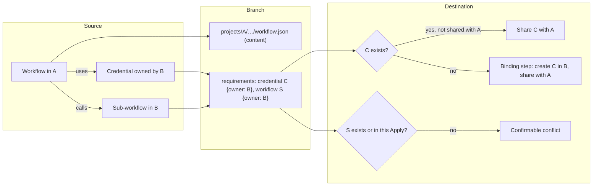

# LIGO-1159 — Cross-project promotion: the solution

Evidence: [current-state.md](current-state.md). Tickets: [ticket-plan.md](ticket-plan.md).

## 1. The model in one sentence

**Content travels with its project. Everything else travels as a reference. Apply binds
each reference once, in its owner's place, and gives the consuming projects access.**

### Three rules

1. **Content belongs to one project.** A workflow or folder belongs to exactly one team
   project. It is written only under that project's folder, and only a promotion of that
   project changes it. A move changes two projects, so it travels as **one** change.
2. **A dependency outside the scope is a reference.** This covers:
   - a credential owned elsewhere;
   - a sub-workflow or error workflow in another project;
   - a global variable or a tag.

   A reference carries its identity, its **owner** and its usage. The reference's own data,
   such as credential expression data or a variable value, travels only as a hint for
   creation. A promotion never pulls another project's content in.
3. **Apply resolves package-wide, once.** Apply matches each reference by identity against
   *destination ∪ what this Apply brings*. An unresolved reference becomes a binding step or a
   confirmable conflict. Apply adds the access edges (credential shares) that the consuming
   projects need. Apply never removes an edge.

"Scope" means the same thing in every variant:

| Variant | Scope |
|---|---|
| Instance promote / Apply | all team projects |
| Project promote / Apply | one team project |
| Selective promote / Apply | a subset of one team project |

So one code path serves all three. Only the scope set changes. A per-project repository
(later) is the same thing with a smaller scope.

## 2. Answers to the ticket's questions

### Scope

| Case | Decision |
|---|---|
| Credential owned by another team project (shared) | **Supported.** It travels as a reference with its owner. Apply creates it once in the owner project and shares it with the consumers. |
| Credential owned by a personal project | **Supported.** The owner is not portable. Apply puts it in the consuming team project. |
| Global credential | **Supported.** It travels with `isGlobal`. Apply makes it global again if the actor may share globally. Otherwise Apply treats it like a normal credential. |
| Sub-workflow or error workflow in another team project | **Supported as a reference.** A promotion never pulls it in. Apply checks it. |
| Sub-workflow or error workflow in a personal project, or deleted | **Supported with a warning.** The push no longer fails. Apply asks the user to confirm the dangling reference. |
| Workflow or folder moved between team projects | **Supported** as one *moved* change, on both promote and Apply. Apply transfers it, so the id, history and executions are kept. |
| Moved into a personal project | It shows as a **removal** from the team project, with an explicit warning. It no longer blocks the instance push. |
| Moved out of a personal project | It shows as a **new** workflow. |
| Workflow sharing (`workflow:editor`) | **Out of scope.** It is access control on the destination and does not travel. |
| Project membership, users | Out of scope (as today). |
| Variables, data tables | Not cross-project at runtime (current-state §1). There is no new work here. Variable placement is LIGO-1234. |
| Removing shares or dependencies that the source no longer has | Out of scope. This is LIGO-1235 (cleanup). |

### Promote: a dependency outside the selection or project

- **What happens:** the push writes the reference and **never fails** because of a
  dependency outside the scope. This applies to every variant, including instance promote.
  It replaces `ExportDependencyPolicy.Fail` (LIGO-1089 → option 1 plus the clearer message of option 2).
- **What the user sees:** a **Dependencies** group in the preview, before the push. Each
  outside dependency shows where it lives and whether the branch has it:
  - *In project B · on the branch*: information only.
  - *In project B · not on the branch*: warning. Copy: "Apply needs it. Promote it from project B."
  - *In a personal project* or *Deleted*: warning. Copy: "Promotion does not include personal
    projects. Move it to a team project, or promote anyway. Apply will ask to confirm."
- **When:** in the preview, and the same check runs in the push. The preview must use the
  **same export policy as the push**, so it predicts what the push does.
- Instance promote gets the same list in its dialog (LIGO-1405), so the user finds out
  **before** they click.

### Apply: the owning project is not in the package

Placement of a **missing** credential:

| Owner on the source (from the package) | Default placement on the destination |
|---|---|
| Team project B. B exists on the destination, or this Apply creates it | **B.** Then share with every consuming project in scope. |
| Team project B, absent from the destination and from the package | The consuming project. If more than one project consumes it, the user picks one of them in the binding step. |
| Personal project | Same as the row above. The binding step says "owned by a personal project on the source". |
| Unknown (an old branch without owner data) | Same as above. This replaces today's hard `unknown-owner` conflict. |

Rules for every row:
- The binding step shows the default and lets the user change it.
- The binding step never guesses silently. This is consistent with LIGO-1056.

**Shared resource:**
- It is created **once**, package-wide (LIGO-1250).
- Apply then adds a share for each consuming project in scope that can't use it yet.
- Source shares to projects outside the scope do **not** travel.
- Destination-only shares are kept.

**Existing credential that a consumer can't use:** Apply shares it. The preview shows this
as an *Access change* row ("Credential *Stripe prod* will be shared with project A"), not as
a blocker. It blocks only if the actor can't share it.
> ADR candidate: Apply widens credential access on the destination without a separate
> confirmation. The change is visible in the preview, and it reproduces an edge the source has.

**Sub-workflow or error workflow:**
- Apply checks every workflow reference against *destination ∪ this Apply*.
- An unresolved reference is a **confirmable conflict** (like `destructive-change`). The copy
  names the caller and the callee and says where the callee lives:
  - "Apply it from project B first", or
  - "Continue: calls will fail until it exists".
- Apply never creates a sub-workflow as a side effect.

### Personal projects

Personal projects are never promoted and never targets of an Apply. A dependency on one
behaves like this:
- **Credential:** it travels with owner kind `personal` (no id, no email). Apply puts it in the consuming team project.
- **Sub-workflow or error workflow:** a promote warning, then a confirmable conflict on Apply.
- **Move into a personal project:** a removal. **Move out of one:** a new workflow.
- **Names:** an admin sees the workflow name and "a personal project". A user who can't read the
  workflow sees "a workflow you can't access" and the id.

### Moves

- **Promote preview:** one *moved* row: "Moved from A to B" (LIGO-1258).
- **Selective promote:** the move can be selected from either project when the user can read the
  workflow. The push writes both sides in one commit: it removes the workflow from A's folder and
  adds it to B's. Without read access, the row shows "Moved to project B. Promote it from B."
- **Instance promote:** writes the move.
- **Apply (instance and selective):**
  - Matches the workflow or folder by id across projects and transfers it (LIGO-1363).
  - The transfer gives B access to the workflow's credentials, through the same share step as above.
  - It needs `workflow:move` on both projects for the actor. Without it, it blocks with a reason.
  - It never deletes the workflow from A because of the move.

### Permissions

The principle is that **promotion acts as the user and never elevates**. This is already true. Keep it for project-level roles (P-LIGO-1604).

| Action that touches another project | Needs | Without it |
|---|---|---|
| Export a dependency's data (credential expression data) | `credential:read` on it | Reference only, no data. The promote is not blocked |
| Create a missing credential in owner project B | `credential:create` in B | Blocker: "You can't create credentials in project B. Ask an admin of B, or choose project A." |
| Share a credential with consumer project A | `credential:share` on the credential | Blocker: "Ask an admin to share *X* with project A." |
| Move a workflow A → B | `workflow:move` in A and B | Blocker |
| Create a missing project | global `project:create` | Blocker (as today) |
| Create a global variable or credential | global scopes | Blocker, or a fallback to a project credential |

A user **never** gets a fix that they can't perform. Each blocker names the permission and the
project.

### Package format

These fields are added, and all of them are optional:
- `requirements.credentials[].owner`:
  `{ kind: 'team', projectId, projectName } | { kind: 'personal' }`, plus `isGlobal?: true`.
  Only the team id and name are written. There is no personal id and no email, because these
  must not go into Git.
- `requirements.workflows[].owner`: same shape, plus `{ kind: 'missing' }`. The destination can then name
  where a missing sub-workflow lives.
- **No sharing graph** and no workflow sharing. Each consumer's project already follows from
  `usedBy` and from where the consumer sits, so the edges that Apply needs can be derived.
- **Compatibility:**
  - There is no format version bump.
  - When `owner` is absent, today's inference applies (the folder, or else unknown). Unknown now leads to the binding step picker, not a hard conflict.
  - The manifest schemas are non-strict `z.object`, so an **older destination ignores the new
    fields**. This matters: destinations often run an older n8n version than the source.
  - Moves on existing branches are already path changes with the same id, so they apply once
    Apply matches across projects.

### Consistency

| | Instance | Project | Selective | Generic import (API/CLI) |
|---|---|---|---|---|
| Out-of-scope dependency on promote | reference + warning | same | same | `dependencyPolicy` (unchanged default) |
| Preview equals push | yes (new instance check) | yes | yes | n/a |
| Credential resolution | package-wide, once | same | same | same (fixes LIGO-1250 in `create-stub`) |
| Consumer access | share on Apply | same | same | same, with `create-stub` |
| Missing credential placement | owner, then consumer, then picker | same | same | owner, then first consumer project (no UI; reported) |
| Workflow references | confirmable conflict | same | same | reported in the result |
| Moves | transfer | same | same, needs both sides | transfer under `overwrite` |

## 3. Technical approach

1. **Export:** the credential and workflow-requirement exporters fill in `owner` from the
   `credential:owner` / `workflow:owner` sharing. Instance promote switches to `ReferenceOnly`. A shared
   "outside dependencies" check (the requirements whose target is not in scope, plus their owner and branch
   presence) feeds the preview, the instance dialog and the push result.
2. **Import, package-wide resolution pass:** this runs before the per-project planning in
   `ProjectPackageImporter`. It resolves each unique credential id once (match, or create in its placement)
   and computes the **access edges** (credential, consumer project) that are missing. The per-project
   plans consume this result. The same pass serves the promotion preflight, so preflight and engine use
   one rule.
3. **Share step:** a new write step after credential creation and before the workflow writes. It uses the
   existing credential sharing service with the actor's `credential:share` check, and the result reports it.
4. **Reference check:** workflow requirements are checked against *destination ∪ planned workflows*.
   An unresolved one becomes a new confirmable conflict code. This also gives LIGO-1170 the closure check that
   LIGO-1165 deferred.
5. **Moves:** match workflows and folders by id across all package projects. Keep a moved item out of the
   source project's removal plan. Transfer it with the editor's ownership-transfer services.
6. **UI:**
   - The preview gets a *Dependencies* group with owner and branch-presence badges, an *Access changes*
     section, and copy for each blocker.
   - The bindings dialog gets an owner-project picker.
   - The `unknown-owner` and "ask an administrator" dead ends go away.

## 4. Rejected options

| Option | Why it is rejected |
|---|---|
| **Closed projects:** block every cross-project dependency | Shared credentials and shared sub-workflows are the normal multi-team setup. This blocks the common case. |
| **Pull in:** auto-include the other project's dependency (`IncludeInPackage`) | It writes team B's content through team A's promotion, with no review by B. On Apply it would overwrite B's content from A's change. It needs read access on B. It also breaks per-project repositories. |
| **Replicate the full sharing graph** (the `relationships` section in LIGO-1091) | Sharing is access control on the destination, and production is often stricter on purpose. Edges to projects outside the scope can't resolve. Workflow sharing has no runtime effect. The needed edges can be derived from `usedBy`. |
| **Stub into the consuming project:** today's generic import | It duplicates a shared credential once per project, or collides on the id. It also gives the credential the wrong owner. |
| **Write a credential under its owner folder even when the owner is out of scope** (a project shell) | A project folder in the package means "this project's state", so Apply would reconcile B and delete B's content. |
| **Personal owner by email** (old source control) | It puts PII in Git and is not portable between instances. |
| **Keep `Fail` for instance promote** (LIGO-1089 option 2 only) | One stray workflow blocks every team, and the project preview can't predict it. |
| **Per-push admin choice of dependency policy** (LIGO-1089 option 3) | It puts an engine setting in front of the user, and the default still has to be chosen. |
| **Hard block on Apply for a missing sub-workflow** | It recreates the instance-wide block on the destination. Dangling references already pass silently today, so asking for confirmation is strictly safer. |
| **Default owner = the applying user's personal project** | It ties a production secret to one person. |

## 5. Decisions a reviewer could challenge (one line each)

- Apply shares credentials without a separate confirmation. The share is only visible in the preview. **(ADR candidate.)**
- A missing sub-workflow on Apply is confirmable, not blocking.
- A move into a personal project is promoted as a removal instead of blocking the push.
- Workflow sharing never travels.
