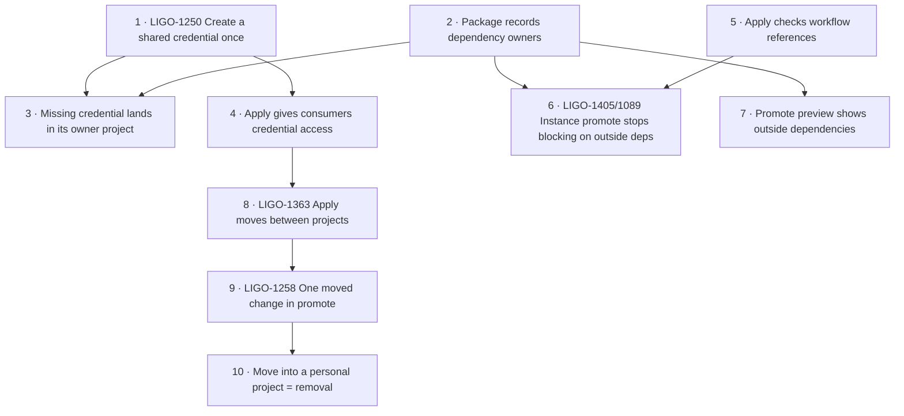

# LIGO-1159 — Ticket plan

Order = build order. Each ticket follows the model in [solution.md](solution.md).
The drafts state the problem and the expected outcome only. They do not prescribe an implementation.

**Why this order:**
- 1 is a live bug on master, and every credential ticket builds on package-wide resolution.
- **5 must ship before 6**: if instance promote stops blocking before Apply checks references,
  incomplete packages reach production silently.
- 8 needs 4, because a moved workflow's credentials must become usable in the new project.
- 9 lets a move ride along only when Apply can land it.

---

## 1. LIGO-1250 (existing): a missing credential used in several projects is created once

Keep the ticket as written. Add one point to "Expected":
- After the create, every consuming project in the package can use the credential, so a re-import matches and does not collide.

## 2. NEW: the package records where an outside dependency lives

**Problem**
- A credential or sub-workflow owned outside the export goes to the package's top level (credential) or gets an id only (sub-workflow).
- The destination can't tell "owned by team project B" from "personal" or "unknown".
- So Apply can't place a missing credential, and it can't say where a missing sub-workflow lives.

**Expected**
- Each credential and workflow dependency says where it lives on the source: a team project (with its id and name), a personal project, or missing.
- A global credential says it is global.
- The package never contains personal project ids or user emails.
- Older destinations still import the package. Older branches still import.

## 3. NEW: Apply places a missing credential in its owner project

**Problem**
- A missing credential whose file sits at the package top level is a hard `unknown-owner` conflict. This happens for a personal owner or an owner that was never promoted.
- The copy says "Set its owner project in the source", but the user often can't do that.
- A team workflow that uses a personal credential can't be applied to a fresh destination.

**Expected**
- The binding step proposes a placement:
  - the owner project, when it exists on the destination or this Apply creates it;
  - else the consuming project;
  - with several consuming projects, the user picks one.
- The user can change the proposed placement.
- A personal or unknown owner no longer blocks.
- A user who can't create in the proposed project sees why, and can choose another project.

## 4. NEW: Apply gives consuming projects access to a credential they use

**Problem**
- The credential exists on the destination, but the consuming project can't use it. Apply blocks with "Ask an administrator to give their projects access".
- Only instance admins can apply, so the person who reads this is the admin.
- After a binding creates a credential in its owner project, every other consuming project hits the same block on Continue.

**Expected**
- Apply shares the credential with each consuming project in scope.
- The preview lists these shares before Apply as access changes, not as blockers.
- It blocks only when the user can't share. The message then names the credential and the project.
- Apply never removes existing shares.

## 5. NEW: Apply checks sub-workflow and error-workflow references

**Problem**
- A workflow that calls a sub-workflow absent from both the destination and the Apply is imported silently.
- Calls fail at runtime in production.
- Selective Apply never checks this.

**Expected**
- Apply lists each unresolved reference before any write. It names the calling workflow, the missing workflow and where it lives on the source.
- The user can continue past it after an explicit confirmation, or apply the dependency first.
- A reference that resolves on the destination, or within the same Apply, passes.

## 6. LIGO-1405 (rescope) + close LIGO-1089 as decided: instance promote reports outside dependencies instead of failing

**Problem**
- Instance promote fails when a team workflow references a workflow outside the team projects: personal, deleted, or an error workflow.
- The message is only a count. It names no workflow, no place and no next step.
- The user finds out only after clicking Promote.
- One workflow blocks the whole instance.
- The project preview shows no problem for the same workflow.

**Expected**
- Instance promote no longer fails because of these references.
- Before the push, the dialog lists each one: the referencing workflow, the referenced workflow, where it lives (or that it was deleted), and a next step.
- The push result includes the same list.
- Depends on 5.

## 7. NEW: the promote preview shows where outside dependencies live

**Problem**
- Project and selective promote list outside sub-workflows and credentials without saying where they live.
- They also don't say whether the branch has them.
- A user can push a workflow whose dependency never reaches the branch, and only finds out at Apply.

**Expected**
- Each outside dependency shows its owner project, or "personal project", or "deleted".
- Each one shows whether the branch has it.
- When Apply will need something that the branch lacks, the preview shows a non-blocking warning with the next step.
- An inaccessible dependency shows no name the user can't see.

## 8. LIGO-1363 (existing, fix status): Apply moves workflows and folders between projects

- The status shows "To Be Released", but master still refuses cross-project moves. The only merged PR is #42117 (LIGO-1338, moves within a project). Move the ticket back to Ready for Dev.
- Add to "Expected":
  - The moved workflow's credentials become usable in the new project, through the same access step as ticket 4.
  - A user without move rights in either project sees why.
- Add selective Apply to the scope: a moved workflow can be applied when its new project is the selected one.

## 9. LIGO-1258 (extend): one moved change in the promote preview, and it can be pushed

- Keep the current scope.
- Change one point. Once ticket 8 ships, a move **can** ride along a selective promote from either project, when the user can read the workflow. The push updates both projects in one commit.
- When the user can't read the workflow, the row stays disabled with "Promote it from project B".
- Instance promote stops refusing moves between team projects.

## 10. NEW: a workflow moved into a personal project shows as a removal

**Problem**
- Instance promote fails ("would be deleted") when someone moves a team workflow into their personal project.
- One person's move blocks every team.

**Expected**
- The preview and the instance dialog show the workflow as removed from its team project, because promotion does not include personal projects.
- The push proceeds.
- Apply shows the deletion like any other deletion, with a confirmation.

---

## Housekeeping (no new build tickets)

- **LIGO-1091:** close. The credential part is covered by 1250 and 4. The decision is that workflow sharing does not travel (solution §2).
- **LIGO-1089:** close as decided. The decision is option 1 plus the clear list from option 2, implemented in ticket 6.
- **LIGO-1056:** no change. The rule "don't guess the owner" holds, because ticket 3 proposes a placement and the user confirms it.
- **P-LIGO-1604** (permissions project): link the permission table in solution §2. Tickets 3, 4 and 8 already check that the actor may act on the other project.
- **LIGO-1234 / LIGO-1235:** unaffected. Variables and data tables are not cross-project at runtime.
