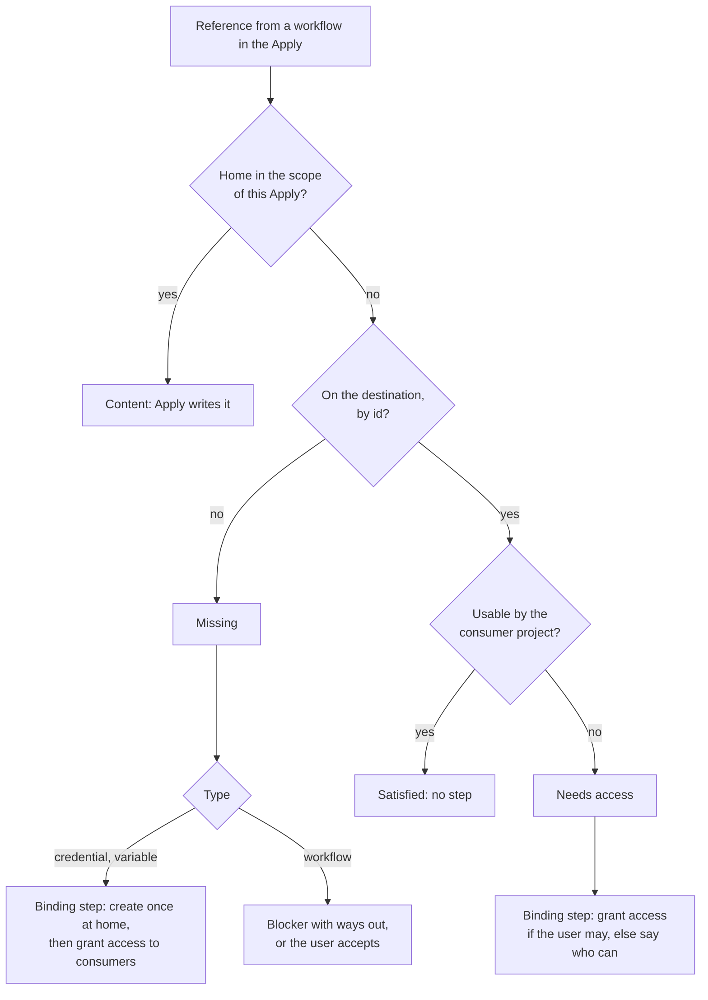
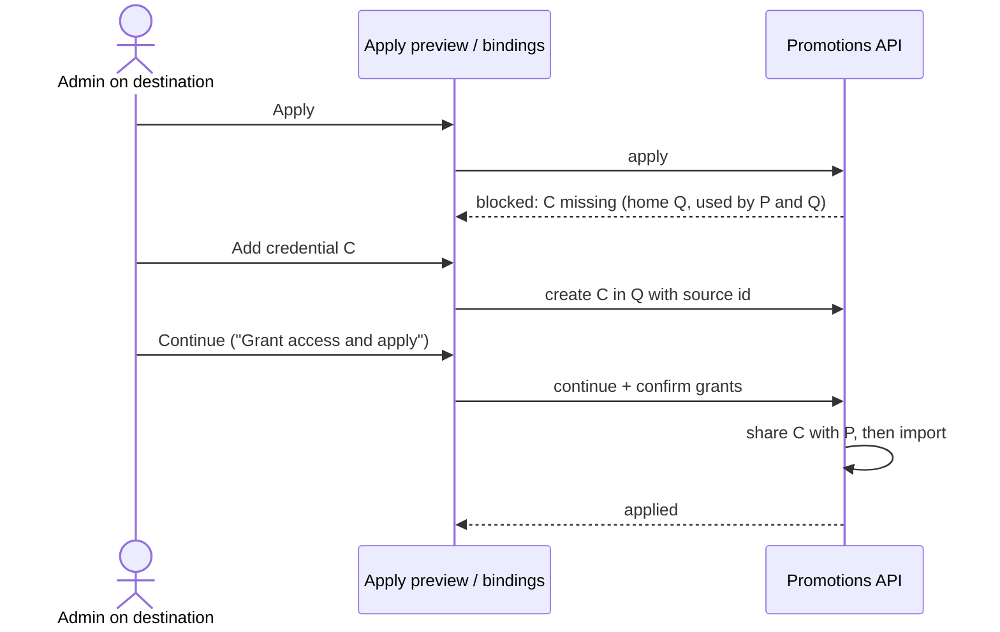

# LIGO-1159 — Cross-project promotion: the solution

Date: 2026-11-13. Evidence for every "today" statement is in [01-current-state.md](01-current-state.md). The tickets are in [03-ticket-plan.md](03-ticket-plan.md).

## 1. Conclusion

Use one model for every resource type and every operation:

> **An operation carries what its projects own. Every reference that points outside is a requirement. The destination must satisfy each requirement. Apply never changes anything outside its scope without a visible step.**

This model is not new. Variables already work this way, and Apply already matches credentials by id without creating them. The work is to apply the same model to the cases that do not follow it yet:

1. **Shared credentials.** Create a missing credential once, in its home project, and give the consuming projects access in the same step. Remove the two dead ends (`unknown-owner`, `access-required`).
2. **Workflow dependencies.** Never fail a whole Promote because of a dependency. Never let a broken reference reach the destination in silence. Show it on Promote, gate it on Apply.
3. **Personal projects.** They are never content and never a home on the destination. A personal credential gets a team home on the destination. A personal sub-workflow can never be satisfied, so the user is told at Promote.
4. **Moves.** A move is one change with two sides. It is valid when both projects are in the same connection. Apply does the transfer. This is the largest item and comes last.
5. **Package format.** No required change. One optional addition later (an owner hint for credentials outside the exported projects). Sharing is derived from use and is not serialized.

Phase 1 and phase 2 need no format change and no engine redesign. They remove every dead end and every silent failure found in the investigation.

## 2. The model

### 2.1 Terms

- **Scope** of an operation: the projects that the operation writes. Instance Promote and Apply: all team projects. Project Promote and Apply: the selection inside one project.
- **Home** of a resource: its owner project, or the instance (global variable, tag).
- **Internal reference**: the home is the project of the workflow. **External reference**: the home is anywhere else (another team project, a personal project, the instance).

### 2.2 Rules

| # | Rule | Status today |
|---|---|---|
| R1 | **Content.** An operation carries only what the projects in its scope own. | Done. |
| R2 | **Requirements.** An external reference becomes a requirement: a stable identity (id; name and scope for a variable), the consumers, and an optional description (credential name, type, expression fields; variable value). | Done for credentials and variables. Workflow requirements exist in the manifest but nothing uses them. |
| R3 | **Three states.** Apply resolves each requirement on the destination by identity: *satisfied*, *needs access*, or *missing*. The same three states apply to every resource type. | Credentials: all three states exist, two have no way out. Workflows: no state at all. |
| R4 | **No silent write outside the scope.** A fix for an external resource (create it, share it, move it) is a step that the preview shows, that the user confirms, and that runs with the user's own permission on that resource. | Partly. Creation is explicit. Access has no step. |
| R5 | **Created once, at home.** A missing resource is created once for each id. Its home on the destination is the source home when that project exists there or is in the package. Otherwise the user selects the home. Consumers get access, not copies. | Not done. |
| R6 | **Moves keep identity.** A move is valid only when both homes are in the scope. Otherwise the operation refuses it and says why. | Refused everywhere today. |
| R7 | **Personal projects.** Never content, never a destination home. | Content rule done. Home rule not handled. |
| R8 | **Promote informs, Apply gates.** A dependency problem never blocks Promote. Every unsatisfied requirement blocks Apply until the user resolves or accepts it. | Opposite today for workflows: instance Promote blocks, Apply says nothing. |

### 2.3 Why this shape

- **It works when the package holds one project.** Per-project repositories make "the owner is not in the package" the normal state. A model that needs the owner project in the package cannot support them.
- **Ownership of an external resource is a destination concern.** Ids are preserved, so a reference resolves wherever the resource lives. The package only needs to describe the resource well enough to create it.
- **Sharing is derived from use.** A workflow of P that uses C proves that P needs access to C. This is the smallest set of grants that makes the promoted workflows run. Other shares are environment configuration, like secrets.
- **The common case stays invisible.** When every requirement is satisfied, the user sees no new step.

### 2.4 Resolution states for each resource type

| Resource | Possible homes | Satisfied | Needs access | Missing | How the user resolves |
|---|---|---|---|---|---|
| Credential | Own project, other team project, personal project, global | Exists by id, same type, usable by the consumer project | Exists, not shared with the consumer project | Not on the instance | Missing: create at home (binding step). Needs access: grant in the same step. |
| Sub-workflow, error workflow | Own project, other team project, personal project, none | Exists by id on the destination, or this Apply writes it | — (caller policy is content of the called workflow) | Not on the destination and not in this Apply | Add it to the selection, apply its project first, promote it from the source, or accept. |
| Variable | Own project, global | Exists in the declared scope | — | Not in the declared scope | Create in the declared scope (existing). |
| Data table | Own project | — | — | Created by Apply (content) | — |
| Tag | Instance | — | — | Created by Apply | — |

## 3. Answers to the questions of the ticket

### 3.1 Scope: support, block, leave out

**Support**

| Case | Behaviour |
|---|---|
| Credential owned by another team project | Travels as a description. Created once at home on the destination. Consumer projects get access. |
| Credential owned by a personal project, used by a team workflow | Same. The destination user selects a team project as home. |
| Global credential | Phase 1: handled like a shared credential (explicit grants). Phase 3: the global flag travels as a hint and the binding step offers "make it global". |
| Sub-workflow or error workflow in another team project | A requirement. Shown on Promote when the branch does not hold it. Gated on Apply when the destination does not have it. |
| Project and global variables | No change. |
| Move between team projects in one connection | One change. Promote writes both sides. Apply transfers. Phase 4. |

**Block, with a reason and a way out**

| Case | Behaviour |
|---|---|
| Workflow or folder moved into a personal project | Promote refuses it (as today). Apply would delete it. |
| Move across two connections (per-project repositories) | Cannot be one change. Documented limit, see 6.4. |
| Until phase 4: any move between projects | Refused as today, with the current messages. |

**Leave out**

| Case | Reason |
|---|---|
| Promoting personal projects | Out of scope of the ticket. |
| Workflow sharing | It targets personal projects only. Not portable. |
| Full credential sharing lists | See rejected option 5.2. |
| Caller policy differences between the two instances | The policy is content of the called workflow and travels with it. |
| Data table references across projects | Not possible at runtime. |

### 3.2 Promote: a dependency outside the selection or the project

Promote never fails because of a dependency. It shows what the destination will need.

| Dependency of a selected workflow | What Promote does | What the user sees, before the push |
|---|---|---|
| Credential owned by this project | Carries it. | As today. |
| Credential owned elsewhere | Carries its description as a requirement. | Dependency row with a note: "Owned by {project} / a personal project. This promotion does not change it." No warning. |
| Variable | Carries it at its scope. | As today. |
| Workflow, selected | Carries it. | As today. |
| Workflow, not selected, the branch holds it | Reference. | Row in "Sub-workflows", no warning. |
| Workflow, same project, not on the branch | Reference. | Warning on the row and on the caller. Action: select it too. |
| Workflow, other team project, not on the branch | Reference. | Warning: "Promote it from {project}." |
| Workflow in a personal project | Reference. | Warning: "Personal projects are not promoted. Move it to a team project." |
| Workflow that does not exist | Reference. | Warning: broken reference. |

- The Promote button stays enabled. A summary line counts the selected workflows with a dependency that the destination will not have.
- Instance Promote changes from "fail" to the same behaviour. It returns the same list as warnings. The dialog shows the list before the push when the pre-check exists (ticket 7), and after the push until then.
- This is option 1 of LIGO-1089, with the visibility that LIGO-1405 asks for. One workflow no longer blocks the instance, and the gap is not hidden: Apply gates it (3.3).

### 3.3 Apply: the owning project is not in the package

**Where does the resource land?**

1. In its source home project, when that project exists on the destination or the package holds it. A missing project is created first (existing flow).
2. Otherwise the user selects the home. The default is the consumer project when there is exactly one.
3. Never in a personal project.

**Is it created once? Is sharing kept?**

- Created once for each id, in the binding step.
- The projects whose workflows use it get access in the same step. That is the sharing that the package proves. Other shares on the source are not copied.
- The grant runs on the server when the user confirms it, so the UI, the public API and the CLI behave the same. The public API has no share endpoint today, so a client-side grant would leave API and CLI users blocked.
- A user who may not share that credential sees who can.

**User flow, first Apply of a shared credential on a new destination**

Today the same case takes three Apply attempts and one manual share outside the flow. For a personal-owned credential it cannot complete at all.

**Missing workflow dependency on Apply**

- New blocker: "{workflow} calls {dependency}, which is not on this instance."
- Ways out, by case:
  - Same project, on the branch: add it to the selection (one click).
  - Other project, on the branch: apply that project first (link).
  - Not on the branch: promote it from the source. For a personal workflow: move it to a team project on the source.
  - Accept: "Apply anyway". The workflow arrives with the broken reference. This uses the Continue step, like a destructive data table change.
- Instance Apply only meets the "not on the branch" case, because it writes the whole package.

### 3.4 Personal projects

| Dependency in a personal project | Promote | Apply |
|---|---|---|
| Credential shared with a team project | Travels as a description. The package records "personal" as the owner kind, never a name or an email. | Satisfied if a credential with that id is usable by the project. Missing: the user creates it in a team project (default: the consumer project). |
| Sub-workflow, error workflow | Warning (3.2). Never content. | Blocker with "Apply anyway". It cannot be satisfied by promotion. |
| Workflow moved into a personal project | Refused (as today). | — |

Rejected: map personal owners by email as the legacy source control does (5.6).

### 3.5 Moves

A move between team projects is one change with two sides: the workflow or folder leaves A and enters B. The id stays.

**Target behaviour (phase 4)**

- Promote preview: one row with status *moved* and both project names (LIGO-1258). It appears on the page of A and on the page of B.
- Promote: selecting the row writes both sides on the branch (remove under A, write under B). Instance Promote writes the move without refusal.
- Apply preview: one row *moved*. Apply transfers the workflow or folder with the existing ownership transfer. Id, history and executions stay.
- Apply never deletes in A an item that the branch holds under B. This rule exists today.
- After the transfer, credential access follows the normal rule: the credentials that the workflow uses in B are requirements of B (satisfied, needs access, or missing).
- The user needs the right to move the item out of A and to create in B. An admin has both.
- A project Apply of B that includes a moved-in item writes in A too (the removal side). This is the only case where a project operation touches a second project. The preview says so.

**Order of delivery**: Apply first, then Promote. A destination must be able to apply a move before a source may write one. A source on a newer version than the destination gets the current refusal on Apply.

**Until then**: the current refusals stay. They are safe and their messages name the item and both projects.

### 3.6 Permissions

Today only owners and admins promote and apply, and they can read everything. So this question is about the future (project-level promotion rights, LIGO-1006). The model gives the rule:

> **Report, do not act, do not leak.** An operation needs permission only in its scope. For anything outside, it reports what it can identify and offers an action only when the user holds the permission for that action.

| Situation | Behaviour |
|---|---|
| Promote, credential the user cannot read | Requirement with the id, and the name and type as written in the workflow node (the user already sees them). No description file. |
| Promote, sub-workflow the user cannot access | Requirement with the id only. The warning says "a workflow you cannot access". |
| Apply, missing credential, user may not create in the home project | The row says who can (project admin, instance admin). Existing copy. |
| Apply, needs access, user may not share the credential | The row says who can. No grant is offered. |
| Apply, move, user may not move out of A | Blocker that names the missing permission. |

The current code already follows this for exports (a credential without read access is exported without a file; names of inaccessible workflows are left out). The destination side then needs the "user selects the home" path of 3.3, which phase 1 adds.

### 3.7 Package format

**Required changes: none.** Existing branches keep working. Phases 1, 2 and 4 read only what the package already holds: folder placement, entity files, workflow nodes.

**Optional addition (phase 3): an owner hint for a credential outside the exported projects.**

- Content: owner kind (`team` or `personal`), team project id and name, and the global flag.
- Purpose: a better default home, the "make it global" offer, and clearer copy. Nothing depends on it. Without it, the user selects the home.
- Carrier: a sidecar file next to `credential.json`, like `workflow-metadata.json`. Not a field in `credential.json` (its schema is strict, an older instance would reject the file). Not the manifest (the Apply check does not read it, and the selective push rewrites it).
- An older instance ignores the file. A branch without the file gives "owner unknown", which phase 1 already handles.
- Never an email or a personal project name: the branch is shared.

**Not carried**

- Sharing lists. Derived from use.
- A move marker. The branch holds state, and the id identifies the item.
- The home of a referenced workflow. The destination looks it up by id in the package and on the instance.

### 3.8 Consistency

One pipeline serves every entry point:

| | Instance Promote | Project Promote | Instance Apply | Project Apply | Project repository (future) |
|---|---|---|---|---|---|
| Content | All team projects | Selection | Whole package | Selection | One project |
| External credential | Under owner (in package) | Top level + hint | Created once at home, access granted | Same | Same as project |
| Workflow dependency | Warning | Warning | Blocker if not on destination | Blocker + "add to selection" | Same as project |
| Variable | By scope | By scope | Must exist in scope | Same | Same |
| Move in one connection | One change | One change, two sides | Transfer | Transfer | Only inside the project |

The generic package import (`.n8np`, not promotion) follows the same rule R5 when it creates credentials: one creation for each id, at home, with access for the consumer projects (LIGO-1250).

## 4. Technical approach

Sizes are rough: S = days, M = about one week, L = more.

### 4.1 Phase 1 — shared credentials without dead ends

**a. Apply check: a home for every missing credential** (backend, S)

- `promo/apply-preview.ts` `addCredentialRules`: a missing credential without a file in a project folder stops being the conflict `unknown-owner`. It becomes a missing binding with `ownerProject` absent and a `suggestedProject` (the consumer project when there is one).
- `@n8n/api-types` `promotion-apply-check.dto.ts`: `ownerProject` becomes optional. Keep `unknown-owner` in the enum for older clients; stop producing it.
- Without a file there is no description. The name and type come from the workflow node (already in `CredentialReference`).

**b. Apply grants credential access on Continue** (backend, M)

- The check marks each access requirement with `canGrant` (the actor holds `credential:share` on it).
- It also predicts the grants that follow a creation: a missing credential with consumers outside its home lists them as "access to grant".
- `continueApply` and `continueApplyProjectSelection` accept a new confirmation (`grantCredentialAccess`). With it, the service shares each listed credential with its consumer projects through `EnterpriseCredentialsService.shareWithProjects`, adding to the existing shares, then plans again and imports.
- `shareWithProjects` adds shares and does not check the caller's permission. The controller does that today (`credentials.controller.ts:604`). The promotions service must do the same `credential:share` check before it calls it.
- `isBlocked` treats an access requirement as confirmable when `canGrant` is true and the confirmation is set.
- The share emits the same events as a share in the editor. Order: grants, then plan, then import. A grant that stays after a failed import is harmless and idempotent.
- Sharing needs the sharing licence. Without it, the requirement stays a hard blocker with a reason.

**c. Bindings UI** (frontend, M)

- Home selector for a missing credential without an owner. Relax the "creation mismatch" check to the selected home.
- "Access to grant" rows in the instance dialog and in the Blockers tab. The dialog no longer switches to "blocked" for access requirements that the user can grant. Continue reads "Grant access and apply".
- A row that the user cannot grant keeps the current copy and names who can.

**d. Generic import: one creation for each credential** (engine, M) — LIGO-1250

- `pkg/engine/import-orchestrator.ts` `planPackage`: after the scopes are planned, reconcile credential stubs across scopes. One stub for each source id. Home = the project whose folder holds the file when that project is in the import, otherwise the first consumer scope. The other scopes bind to the planned id.
- After the creation, share with the other consumer projects of the import.
- A credential that exists but is not usable is not a stub candidate. Use an existence check that does not depend on the user's read access (`findUsageScopes`), and report it before any write.

### 4.2 Phase 2 — workflow dependencies: visible and gated

**a. Instance Promote does not fail on dependencies** (backend, S) — decides LIGO-1089

- `promo/instance-package.ts`: `dependencyPolicy` becomes `reference-only`.
- The result lists each dependency that the package does not hold: caller, dependency id, name when the actor may see it, and kind (personal project, missing). Use a typed list, not the free-text `warnings` of today.
- The move refusals stay.

**b. Apply check: missing workflow dependency** (backend, M)

- New pure step in the promotions check, next to the credential and variable rules. Input: the workflows that the plan writes. Extract references with the existing `extractWorkflowRequirements` logic on the inventory content. A reference is satisfied when the plan writes that id or the destination has it (`findOwningProjectsByWorkflowId`).
- New conflict `missing-workflow-dependency` with the consumers, the dependency, and where it is: on the branch (project id and name, same project or not) or not on the branch.
- Confirmable on Continue with its own flag. Do not reuse `confirmDestructiveChanges`: accepting a data loss must not accept a broken reference, and the reverse.
- It lives in promotions, not in the engine. The engine keeps importing a dangling reference for generic imports, as today. An engine-level policy can follow if the generic import needs it.

**c. Promote preview: dependency state** (backend S, frontend M) — rescopes LIGO-1405

- `promo/promotion-preview.ts` `addProjectLinks`: each `included: false` link gets a state: `on-branch`, `same-project`, `other-project` (with the project), `personal`, `missing`.
- The lookup needs the branch manifest (already read) and the owner of each referenced id (`findOwnerProjectsByWorkflowIds`).
- Frontend: warning marker and copy on the dependency and on the caller, "select it too" for `same-project`, a summary line. Instance dialog: list the warnings (needs a pre-check call, or shows them in the result).

**d. Apply blockers UI** (frontend, S)

- Row for the new conflict in the Blockers tab and in the instance dialog, with the ways out of 3.3.

### 4.3 Phase 3 — ownership parity (format addition)

- Export: write the sidecar for a credential whose owner is not in the export (`pkg/entities/credential/credential.exporter.ts`). The selective push overlay must keep and remove it with the credential file (`promo/working-copy-updater.ts`).
- Read: the inventory reader returns the hint with `InventoryCredential`.
- Apply check: use the hint for the default home and for "make it global" (needs `credential:shareGlobally`).
- Check the tar reader before choosing the file name (see "not verified" in the current-state document).

### 4.4 Phase 4 — moves

- LIGO-1258: pair the two preview rows into one *moved* row.
- LIGO-1363, the remaining part: the engine matches workflows and folders across the projects of the package, keeps a moved item out of the removal plan of its source project, and transfers it with the editor's transfer before it writes content.
- Promote: stop refusing a move between team projects (`assertNoProjectMovesSinceBranch`, `classifySelection`), write both sides.
- Project Apply of a moved item: transfer, with the two-project note in the preview.
- The transfer removes sharings and reactivates published workflows. Promotion keeps the publish state of the destination, so check the reactivation path with care.

## 5. Rejected options

### 5.1 Pull dependencies into the operation (closure)

Promote or Apply would add every dependency, across projects.

- It writes outside the scope that the user selected. A project operation would change other projects.
- It cannot work with one repository for each project: the other project is in another repository.
- It needs permissions in projects that the user did not open.
- The engine has `include-in-package`, but it writes a project shell for the other project. An instance Apply treats a package project as authoritative and would empty it.
- LIGO-1165 already chose "no closure" for selective Apply. This keeps one rule.

### 5.2 Serialize sharing relationships (the proposal in LIGO-1091)

- Usage already gives the grants that the promoted workflows need. Extra shares are destination configuration.
- Shares with personal projects cannot be mapped.
- It turns a merge request into a way to change access on the destination for projects that the promotion does not touch.
- The proposed carrier (the manifest) is not what Apply reads.
- LIGO-1091 keeps its valid part: "create or match each shared entity once" (phase 1d).

### 5.3 Refuse a project Promote that has external dependencies

LIGO-1056 mentions this as a "source rule". Shared credentials are the normal state of a multi-team instance, so the rule would block most projects. It contradicts "no friction for the common case".

### 5.4 Create the missing credential in each consumer project

This is what the engine does today under `create-stub`. It produces id collisions or duplicates, and several copies of one secret to maintain. It breaks "created once".

### 5.5 Write a project shell for the external owner into the package

The owner would always be a folder. But instance Apply would then treat that project as authoritative and delete its content, and a one-project repository would hold foreign projects.

### 5.6 Map personal owners by email (legacy source control)

- It puts emails in a shared repository.
- People differ between instances. The legacy fallback (the pulling user's personal project) surprises users.
- Promotion excludes personal projects on purpose. A team home on the destination is the simpler rule.

### 5.7 Keep failing the instance Promote, with a better error (LIGO-1089 option 2), or a choice for each push (option 3)

- Option 2 keeps "one workflow blocks everyone".
- Option 3 moves a technical decision to the admin at every push and still needs a default.
- With the Apply gate, the reason for failing at Promote is gone.

### 5.8 Grant access from the UI only

The public API has no share endpoint. API and CLI users would stay blocked. The module is public-API-first.

### 5.9 Missing workflow dependency: hard block, or warning only

- Hard block: one broken workflow on the source would block every instance Apply with no way out on the destination.
- Warning only: a broken reference in production is a runtime failure. It deserves a decision by the person who applies.

## 6. Risks and open decisions

### 6.1 Decisions that an engineer could challenge later

Each needs a yes from the team. None has an ADR; say if you want one.

1. **Apply grants credential access.** Content in Git leads to an access change on the destination. Limits: only for projects whose promoted workflows use the credential, only after a confirmation, only when the user could share it by hand.
2. **Promote never blocks on a dependency.** The destination is the gate.
3. **A missing workflow dependency can be accepted on Apply.**
4. **Sharing is not part of the package.** A destination can hold fewer shares than the source.
5. **Ownership of an external credential can differ between instances** (always for a personal owner, and before phase 3 for some team owners).
6. **The owner hint is a sidecar file**, not a manifest field.

### 6.2 Product copy and design

The flows need design for: the home selector, the "access to grant" rows, the dependency warnings on Promote, the missing-dependency blocker, the *moved* row.

### 6.3 Adjacent problem, not solved here

A branch can hold a partial view of the instance since project Promote became possible without a first instance Promote (LIGO-1268). Instance Apply still treats the package as authoritative: it deletes projects and workflows that the branch lacks, after a confirmation. This is not a cross-project case, but it is the same root: "the package is a partial view". It needs its own decision.

### 6.4 Per-project repositories

- The model holds: everything outside the project is a requirement.
- A move between two connections cannot be one change. It becomes a removal in one repository and an addition in the other. If the removal is applied first, the destination deletes the workflow with its history, and the addition creates a new one. That project must decide: refuse, or accept the loss with a warning.
- The owner hint (phase 3) matters more there, because every shared credential is outside the package.

### 6.5 Version skew

A source that runs a newer version can write what an older destination refuses (a move in phase 4). The destination answers with the current `moved` blocker. No data is lost. Deliver the Apply side one release before the Promote side.
