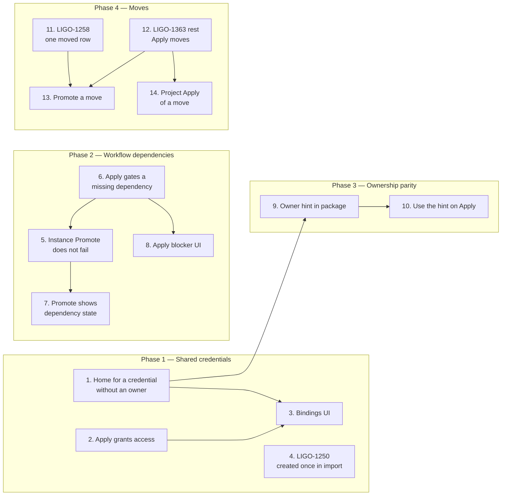

# LIGO-1159 — Ticket plan

Date: 2026-11-13. The model and the technical approach are in [02-solution.md](02-solution.md). The tickets below state the problem and the expected result only.

Nothing was created or changed in Linear. Ticket numbers marked "new" are drafts.

## 1. Order

| Phase | Result for the user | Format change | Size |
|---|---|---|---|
| 1 | A shared or personal credential never stops an Apply without a way forward. One round instead of three. | None | 2 M + 1 S + 1 M |
| 2 | One workflow never blocks an instance Promote. A broken reference never reaches the destination unseen. | None | 2 S + 2 M |
| 3 | A credential gets the same owner and the same global state on both instances by default. | Optional sidecar file | 1 M + 1 S |
| 4 | A move between projects is promoted and applied as one change. | None | 1 M + 3 L |

Reasons for this order:

- Phase 1 first: shared credentials are the normal state of a multi-team instance, and two of the cases are dead ends today.
- Ticket 6 before ticket 5: the destination must gate a missing dependency before the source stops refusing it.
- Phase 3 after phase 1: phase 1 makes "owner unknown" work, so the hint is an improvement, not a requirement.
- Phase 4 last: the largest change, and the current refusals are safe.
- Ticket 12 one release before ticket 13: a destination must apply a move before a source may write one.

Tickets 4, 5+6 and 11 do not depend on phase 1 and can run in parallel.

## 2. Existing tickets

| Ticket | Action |
|---|---|
| LIGO-1089 Decide how a push handles workflows that depend on personal/team projects | Close as decided: option 1 (the push succeeds and records the gap), plus visibility on Promote and a gate on Apply. Implementation = tickets 5, 6, 7. |
| LIGO-1405 Better UX when a promote is blocked by a dependency outside the team projects | Rescope. The block goes away (ticket 5). Keep the "show before the promote" part = ticket 7. |
| LIGO-1250 Package import fails or duplicates a missing credential used in several projects | Keep = ticket 4. Add: the consumer projects of the import get access. |
| LIGO-1091 Package import does not preserve cross-project sharing | Close. "Created once" is LIGO-1250. Access for consumer projects is tickets 2 and 4. Full sharing lists are rejected (solution 5.2). |
| LIGO-1258 Show a cross-project move as one moved change in the promote preview | Keep = ticket 11. |
| LIGO-1363 Move workflows and folders between projects on promotion Apply | "To Be Released" with the in-project part only. Open a new ticket for the rest = ticket 12, or reopen. |
| LIGO-1159 (this spike) | Done with these three documents. |

## 3. Ticket drafts

### Phase 1 — Shared credentials

**1. Apply: a missing credential without an owner project is a dead end** (new, backend, S)

Problem
- Missing credential, owner project not in the package → conflict "no valid owner project. Set its owner project in the source."
- Happens for: credential owned by a personal project (any Promote); credential owned by another team project after a project Promote.
- No action on the destination. No direct fix on the source.

Impact
- Apply blocked for the workflows that use it. For a personal-owned credential, also for the whole instance Apply.

Expected
- Reported as a missing credential, like any other.
- The user selects the destination project. Default: the consumer project when there is one.
- Never a personal project.

**2. Apply: "credential exists but the project cannot use it" has no action** (new, backend, M)

Problem
- Credential on the destination, not shared with the consumer project → "Ask an administrator".
- The instance dialog switches to "Apply is blocked". Continue is hidden.
- After the user creates a missing shared credential in its owner project, the next Apply hits this for every other consumer project.
- The public API has no way to share a credential with a project → API and CLI users cannot resolve it.

Impact
- First Apply of a shared credential: three attempts and a manual share outside the flow.
- Global credentials: one manual fix for each consumer project.

Expected
- The check lists the access that Apply needs: credential, owner project, consumer project.
- The user confirms. Apply grants the access, then imports. Same through UI, API, CLI.
- Only for projects whose applied workflows use the credential.
- A user who may not share the credential: no grant, the message says who can.
- Access needed after a creation in the same flow is granted in the same Continue.

**3. Bindings UI: select a home, grant access** (new, frontend, M — needs design)

Problem
- The UI has no project selector for a credential without an owner.
- The UI has no row or action for access.

Expected
- Missing credential without an owner: project selector, default from the check.
- Access rows in the instance dialog and the project Blockers tab. One Continue: "Grant access and apply".
- Rows that the user cannot resolve say who can.

**4. LIGO-1250 — Package import fails or duplicates a missing credential used in several projects** (existing, engine, M)

Add to the existing ticket
- The credential is created in the project that owns it in the package. If the package has no owner, in the first consumer project.
- The other consumer projects of the import can use it after the import.

### Phase 2 — Workflow dependencies

**5. Instance Promote fails when one workflow depends on a workflow outside the team projects** (new, backend, S — implements LIGO-1089)

Problem
- A sub-workflow or error workflow in a personal project, or a deleted one → the whole instance Promote fails.
- The error: a count and raw ids.

Impact
- One workflow blocks Promote for every team.

Expected
- Promote succeeds.
- The result lists each dependency that was not promoted: the calling workflow, the dependency, why (personal project, does not exist).
- Moves keep their current refusal.
- Depends on ticket 6.

**6. Apply writes a workflow whose sub-workflow or error workflow is not on the destination** (new, backend, M)

Problem
- Project Promote of W without its sub-workflow S → Apply writes W. S is not on the destination. No message on either side.
- Same for a project Apply that selects W and not S.
- Same for a dependency in a personal project: it can never arrive.

Impact
- Broken executions in production, found at runtime.

Expected
- Apply stops before any write and names W, S, and where S is (on the branch in project X, or not on the branch).
- The user can accept and apply anyway. The acceptance is separate from the confirmation of destructive changes.
- Instance and project Apply. UI, API, CLI.

**7. Promote: the user does not see that a dependency will be missing on the destination** (rescoped LIGO-1405, backend S + frontend M — needs design)

Problem
- The preview lists sub-workflows as "No changes", also when the branch does not hold them.
- No difference between: on the branch; same project, not promoted; other project; personal project; does not exist.
- The instance Promote dialog shows no checks.

Expected
- Each dependency that the destination will not have shows a warning with the reason and the next step (select it too; promote it from project X; move it to a team project).
- A summary before the push.
- Promote stays available.
- Same information in the instance Promote dialog.
- A workflow that the user cannot access is not named.

**8. Apply UI: blocker for a missing workflow dependency** (new, frontend, S — needs design)

Expected
- Row in the project Blockers tab and the instance dialog.
- Actions by case: add to the selection; go to the other project; none (source fix).
- "Apply anyway".

### Phase 3 — Ownership parity

**9. The package does not say who owns a credential that is outside the exported projects** (new, engine, M)

Problem
- Owner = folder. Owner project not in the export → no owner in the package.
- The global state of a credential does not travel.

Impact
- The destination user must select the project by hand. Ownership can differ between instances.
- A global credential becomes a project credential with one grant for each consumer.

Expected
- The package carries, for such a credential: owner kind (team, personal), team project id and name, global or not.
- No email and no personal project name.
- Optional. Existing branches and older instances keep working.

**10. Apply uses the owner and the global state from the package** (new, backend + frontend, S)

Expected
- Default destination project = the source owner, when it is a team project.
- Global on the source → the user can make it global on the destination (with the permission for it), in place of grants.

### Phase 4 — Moves

**11. LIGO-1258 — Show a cross-project move as one moved change in the promote preview** (existing, M)

No change. Deliver before ticket 13.

**12. Apply refuses every workflow and folder that moved between projects** (new or reopened LIGO-1363, engine + backend, L)

Problem
- Instance Apply blocks on each move. The user repeats the move by hand on every destination.
- One moved folder disables the project Apply for the whole project.

Expected
- Instance Apply moves the workflow or folder to the project that the branch holds it in. Id, history, executions stay.
- Nothing is deleted in the source project because of the move.
- The credentials of the moved workflow follow the normal check in the new project.
- The preview shows one moved change.
- Out of scope: moves to or from personal projects.

**13. Promote refuses every move between team projects** (new, backend + frontend, L)

Problem
- Instance Promote: "move it back, then promote again".
- Project Promote: the moved workflow is disabled.

Expected
- Instance Promote writes the move.
- Project Promote: the moved row is selectable from either project. Selecting it writes both sides on the branch.
- A move into a personal project stays refused.
- Release after ticket 12.

**14. Project Apply of a moved workflow or folder** (new, backend + frontend, L)

Expected
- The moved row is selectable. Apply moves it on the destination.
- The preview says that the Apply changes two projects.
- A user without the permission to move the item sees which permission is missing.

## 4. Not planned here

- Partial branch and instance Apply (solution 6.3). Needs its own ticket in the promotion project.
- Moves between two connections (solution 6.4). Belongs to "Per-project Promotion connection".
- Project-level promotion permissions. LIGO-1006. The rule in solution 3.6 applies when that lands.
- A public API endpoint to share a credential with a project. Useful, but ticket 2 removes the need for promotion.
