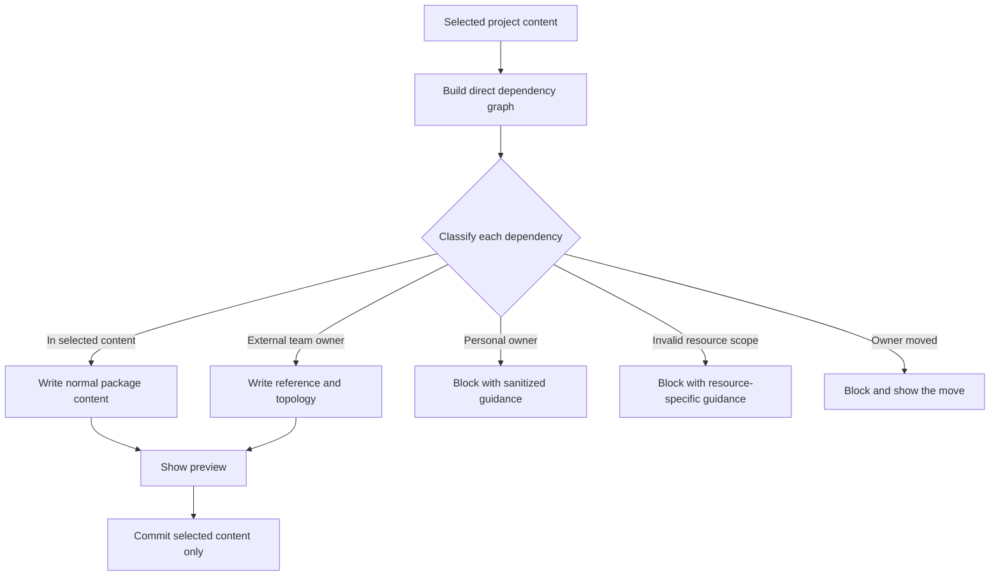
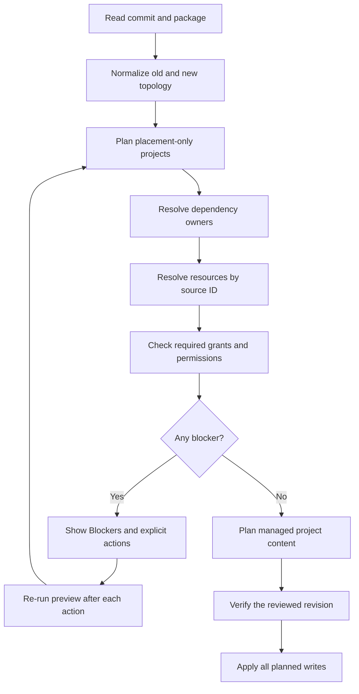

# LIGO-1159: Cross-project promotion solution

Status: spike complete  
Investigation date: 2026-11-13  
Repository revision: `ed626a767fa9015bf75007d915737eb436fc3f75` (`origin/master`)  
Effort estimate: **XL**

## Conclusion

n8n should support team-project dependencies without adding their full owner project to a selective promotion.

The Git package must record two different concepts:

1. Managed project content.
2. External project references that only define resource placement.

The package must also record the owner and access rules of each project-scoped dependency. Apply must use this information before it plans any writes.

The first implementation should support these cases:

- A team-project credential can be owned by one project and used by workflows in other team projects.
- A workflow can reference a sub-workflow in another team project.
- A variable can be global or local to its consumer project.
- A data table can be local to its consumer project.
- Tags keep their current global behavior.

The first implementation should block these cases:

- A dependency is owned by a personal project.
- A project variable is treated as a variable from another project.
- A data table is treated as a table from another project.
- A resource changed its owner project between Git and the destination.
- Apply cannot identify the owner from an old package and cannot safely resolve the resource.

Apply must never duplicate a shared dependency into each consumer project. It must create or bind one resource in its declared owner project. It must then add the required access grants.

This design keeps Git as the source of truth. It also keeps the common path unchanged. A promotion with no external dependency needs no extra step.

## Decision summary

| Question | Decision |
| --- | --- |
| What is supported? | Team-owned shared credentials and team-owned reference-only sub-workflows. |
| What is blocked? | Personal ownership, invalid cross-project variables or data tables, unknown placement, and owner moves. |
| Does Promote expand the selection? | No. It records external topology. It does not add external project content. |
| Does Apply create an owner project automatically? | No. It offers an explicit action when the actor has permission. |
| Does Apply create one credential or many? | One credential in the source owner project. |
| Does Apply restore credential sharing? | Yes. Selective Apply adds required grants only. Full Apply can reconcile all team-project grants after confirmation. |
| What happens when the owner is missing? | Apply asks the user to create the team project with the source ID, or to promote that project first. |
| What happens to personal dependencies? | Promote blocks before it writes Git. The message does not expose a personal project name or email. |
| What happens to moves? | Preview shows the old and new owner. Apply blocks the move in the first phase. |
| Does the package format version change? | No. Version 1 gets optional topology fields. |
| Do old branches keep working? | Yes. New code keeps the current safe fallback. It never guesses a missing owner. |

## Current state

The current implementation already has most of the workflow around this feature.

### What already works

- Full Promote exports all team projects. It excludes personal projects.
- Selective Promote exports one project with `reference-only` dependencies.
- Selective Apply imports only the selected project and workflows.
- Package requirements record credential, data table, variable, tag, and sub-workflow consumers.
- Apply has a read-only preview and a revision check.
- Apply can report missing credentials and variables.
- Apply can create a missing project with the source project ID.
- Apply can report that a credential exists but lacks access.
- Apply detects workflow and folder moves between projects.
- The UI has Changes and Blockers views.
- The UI can open setup forms for missing credentials and variables.

These parts should be extended. They should not be replaced.

### The current failure

The directory path is the only owner record for a packaged credential, variable, or data table.

The exporter nests a resource below its owner project only when that project is in the export. Otherwise, it writes the resource to the top-level collection directory.

For example, a workflow in project A can use a credential owned by project B. A selective export of A writes this credential below `credentials/`. The package no longer says that B owns it.

Apply reads project ownership from the directory path. It therefore sees a `null` owner for this credential. If the destination already has a usable credential with the same ID, Apply can continue. If the credential is missing, Apply reports `unknown-owner` and cannot create it safely.

This behavior is safe, but it is incomplete.

The same path fallback affects variables and data tables. Their runtime rules differ from credential sharing, so one generic fallback cannot give the correct result for all resource types.

### Confirmed code behavior

- The manifest only stores `id`, `name`, and `target` for most resources.
- `projectScopedDirectory()` uses the owner project path only when the owner is in `projectTargetsById`.
- A credential owned by a non-exported project is intentionally written at the top level.
- The package inventory derives `projectId` from the resource path.
- Apply reports `unknown-owner` when a missing credential file has no project path.
- Variable resolution uses consumer-project precedence and then global precedence.
- Data table matching is limited to the consumer project.
- The selective working-copy overlay avoids a second copy when the branch already holds the same dependency below another project.
- The selective manifest bridge rebuilds entries from files. It currently drops metadata that is not in a file path.

## Product rules

The solution uses these rules.

### Resource identity

Source IDs remain stable across environments.

Apply does not map a source resource to an arbitrary destination project. A project mapping would make the branch describe different topologies on different instances.

### Content scope and placement scope

`manifest.projects` lists managed content scopes. Apply can reconcile the contents of these projects.

`manifest.projectReferences` lists placement-only projects. Apply must not reconcile or delete their contents.

A project ID must not appear as both a content scope and a placement-only reference in the same normalized manifest. The reader can remove a redundant reference when the project is already a content scope.

### Secret handling

Git stores topology. Git does not store destination secret values.

The package can keep the current credential expression export policy. Apply still asks the user to configure missing secret values.

### Personal projects

The package does not promote personal projects.

Promote must classify each selected dependency before it writes Git. It must block when a personal project owns a required resource.

The error must say `a personal project`. It must not include the project name or owner email.

### Resource moves

An owner change is not a normal update. It affects two permission scopes and two project histories.

The first implementation must block owner changes for workflows, folders, credentials, variables, and data tables. Preview must show both team projects when the actor can see them.

A later ticket can add atomic team-to-team moves. That work needs transfer permissions, rollback rules, and deletion rules.

## Support matrix

| Resource or case | Promote | Apply | Result |
| --- | --- | --- | --- |
| Credential owned by the selected team project | Include it | Create or match it in that project | Supported today. Keep this behavior. |
| Credential owned by another team project | Include one file and its topology | Create or match it in the owner. Add required grants. | Support. |
| Credential exists but lacks a grant | Record owner and grants | Offer Grant access when allowed | Support. Do not require a Settings detour. |
| Credential owner project is missing | Record a placement-only project reference | Offer explicit project creation, then credential setup | Support. Do not create it silently. |
| Credential owner is personal | Block | Not applicable | Unsupported. Ask the user to move it to a team project. |
| Reference-only sub-workflow in another team project | Record the requirement and owner | Require the same workflow ID under the same owner | Support as a reference. Do not copy it. |
| External sub-workflow is missing | Record the requirement and owner | Block and link to the owner-project promotion flow | Supported blocker. Do not create an empty workflow. |
| External sub-workflow has another owner | Record the expected owner | Show an owner conflict | Block in phase 1. |
| Project variable | Record the selected consumer project | Create or match it in that project | Support. |
| Global variable | Record global scope | Create or match it globally | Support. |
| Variable from an unrelated project | Block as an invalid dependency | Not applicable | Runtime does not use this sharing model. |
| Data table in the consumer project | Record that project | Create or match it in that project | Support. |
| Data table in another project | Block as an invalid dependency | Not applicable | Data tables are project-local. |
| Tag | Keep global metadata | Use current global matching | Support. |
| Workflow or folder moved between team projects | Show a move blocker | Show a move blocker | Keep the current block. |
| Any resource moved to a personal project | Block with a sanitized message | Block with a sanitized message | Unsupported. |
| Agents and skills | Leave out of Promotions | Leave out of Promotions | Out of this phase. Reuse the topology contract later. |

## Promote flow

Promote must run dependency analysis before it commits.



Promote must not select the external owner project automatically.

Promote must show external dependencies in the preview. It can group them below the selected workflows.

The preview uses these states:

- `Ready`: The package carries the resource or a valid reference.
- `Needs destination setup`: The dependency is valid, but Apply can need a project, credential, or grant.
- `Blocked`: The owner is personal, the scope is invalid, the actor cannot export safe metadata, or the resource moved.

The normal case has no new modal and no new confirmation.

## Apply flow

Apply must plan topology before it plans project content.



Apply must make no content write while a topology blocker remains.

### Missing owner project

Apply shows `Create project` only when the actor has `project:create` and the instance has team-project capacity.

The action uses the source project ID and metadata. It creates an empty team project. It does not import content from that project.

If the actor cannot create the project, Apply names the required action and permission. It remains blocked.

### Missing credential

Apply opens the existing credential editor in the declared owner project.

The editor creates the credential with the source credential ID. It can prefill safe expression data. It asks for destination secret values.

After creation, Apply grants access to the selected consumer projects when the actor has `credential:share`.

The UI should show one credential row with all consumer projects. It should not show one duplicate row for each workflow.

### Existing credential without access

Apply shows `Grant access` when the actor has `credential:share` on the owner credential.

The server adds the required project grants. The action is idempotent.

If the actor lacks permission, Apply shows the owner project and the consumer projects that need access. It does not expose the secret or masked credential data.

### Missing sub-workflow

Apply cannot create a reference-only sub-workflow because Git does not contain its body.

The blocker must identify the expected owner project. It must offer a link to promote or apply that project.

Apply can continue after the destination has the same workflow ID in the expected owner project.

## Package contract

The package keeps format version `1`. It adds optional fields.

The field names below are the recommended contract.

```json
{
  "packageFormatVersion": "1",
  "projectReferences": [
    {
      "id": "project-b",
      "name": "Shared services",
      "type": "team"
    }
  ],
  "credentials": [
    {
      "id": "credential-1",
      "name": "Billing API",
      "target": "credentials/billing-api-credential-1",
      "placement": {
        "kind": "project",
        "projectId": "project-b"
      },
      "sharing": {
        "projectIds": ["project-a"],
        "complete": false
      }
    }
  ],
  "variables": [
    {
      "id": "variable-1",
      "name": "REGION",
      "target": "projects/project-a/variables/region-variable-1",
      "placement": {
        "kind": "project",
        "projectId": "project-a"
      }
    }
  ],
  "dataTables": [
    {
      "id": "table-1",
      "name": "Orders",
      "target": "projects/project-a/data-tables/orders-table-1",
      "placement": {
        "kind": "project",
        "projectId": "project-a"
      }
    }
  ],
  "requirements": {
    "workflows": [
      {
        "id": "workflow-child",
        "name": "Process payment",
        "ownerProjectId": "project-b",
        "usedBy": [{ "kind": "workflow", "id": "workflow-parent" }]
      }
    ]
  }
}
```

### Schema rules

- `projectReferences` is optional.
- A project reference must describe a team project.
- Project references use source IDs.
- Resource `placement` is optional for backward compatibility.
- A credential placement must be a team project.
- Credential `sharing.projectIds` contains team-project grants only.
- `sharing.complete` says whether the exporter could read the complete source grant set.
- A project variable placement can be `global` or `project`.
- A data table placement must equal each consumer workflow project.
- A workflow requirement can have `ownerProjectId`.
- Every placement or workflow-owner project ID must exist in `projects` or `projectReferences`.
- New packages must make the file path and placement agree when the owner is a managed project.
- A placement-only project must never become an import content scope.

### Sharing reconciliation

The package stores the source team-project grant set when the exporter can read it. It sets `sharing.complete` to `true` in this case.

When the exporter cannot read the full grant set, it stores only the grants required by packaged consumers. It sets `sharing.complete` to `false`.

Selective Apply adds only the grants required by selected consumers. It does not remove unrelated destination grants.

Full instance Apply can reconcile the full team-project grant set only when `sharing.complete` is `true`. Preview must show grant removals as destructive access changes. The user must confirm them.

Personal grants are not serialized.

## Backward compatibility

New code must read all existing version 1 branches.

The reader uses these rules when `placement` is absent:

1. A nested resource inherits the project from its path.
2. A top-level credential keeps the current ID match behavior.
3. A usable credential with the same ID remains resolved.
4. A missing top-level credential remains `unknown-owner`.
5. A promotion variable keeps the current path-based global or project interpretation.
6. A data table keeps the current consumer-project behavior.
7. The reader never guesses a missing project owner.

The next successful Promote writes the optional topology metadata. Apply does not rewrite Git.

The selective working-copy merge must preserve metadata for unselected resources. It must merge by resource type and source ID.

For each dependency, the merge uses:

- The file walk for the final `target`.
- Staging metadata for selected consumers.
- Leftover metadata for unselected consumers.
- A union of required credential grants and requirement consumers before selection rules remove stale consumers.
- `sharing.complete` becomes `false` when the selected export does not contain a complete grant set.

This change is required. The current manifest bridge rebuilds most entries from `id`, `name`, and `target` only.

An older n8n version can ignore the optional fields. It then has the same safe behavior as it has today. It can block an unresolved external owner, but it must not write to a guessed project.

## Permissions and confidentiality

Promote and Apply must check each action in its real project scope.

| Action | Required capability |
| --- | --- |
| Read a selected workflow | Existing workflow export permission |
| Read credential topology | `credential:read`, or a safe backend-only structural lookup that reveals no secret data |
| Create a placement-only owner project | `project:create` and available team-project capacity |
| Create a credential | `credential:create` in the owner project |
| Edit credential data | `credential:update` in the owner project |
| Grant credential access | `credential:share` on the owner credential |
| Move a workflow later | `workflow:move` in both relevant scopes, plus destination permissions |
| Create a variable | The existing global or project variable create scope |
| Create a data table | `dataTable:create` in the consumer project |

The backend must not reveal a hidden resource name, project name, or credential metadata only to improve a preview.

If Promote cannot read enough structural data, it must use an opaque requirement or block. It must use the same message for a missing resource and an inaccessible resource when disclosure would reveal existence.

## Consistency across promotion modes

### Full instance Promote and Apply

All team projects are managed content scopes. Most owners are already in `manifest.projects`.

The new placement fields validate the path and preserve credential grants. Full Apply can reconcile all managed team-project grants.

### Selective project Promote and Apply

Only the selected project is a managed content scope.

External owners are placement-only project references. Apply changes only selected workflows and their required access.

### Selective workflow Promote and Apply

The same rule applies at workflow level. Requirements contain only direct references. Promote does not pull the external workflow body into the package.

### Future per-project Git connections

The contract does not depend on one repository holding all projects. A project package can carry external project references without carrying their content.

This property makes the design compatible with future per-project connections.

## Existing code to reuse

The implementation should reuse these parts:

- `ExportDependencyPolicy.ReferenceOnly` for selective Promote.
- Package requirement consumer lists.
- Source-ID project creation.
- Source-ID credential creation.
- Apply preview and revision checks.
- `missingBindings`, `accessRequirements`, and conflict presentation.
- The current move detector and sanitized personal-project messages.
- The current Changes and Blockers layout.

## Ordered implementation plan

### 1. Add the topology contract and compatibility reader

Size: **L**

Add resource-specific manifest entry schemas. Add `projectReferences`. Add workflow owner metadata. Keep format version 1.

Normalize old packages with the safe fallback rules. Add schema validation. Update the selective manifest bridge so it preserves topology metadata.

This ticket is the dependency for all later tickets.

### 2. Add export dependency classification

Size: **L**

Build a direct dependency graph for the selected workflows. Resolve each resource owner and access model.

Write project references, resource placement, workflow owner metadata, and credential grant metadata.

Block personal ownership, invalid scopes, and inaccessible structural metadata. Keep error details confidential.

### 3. Add topology-aware Apply planning

Size: **L**

Plan placement-only projects before content scopes. Validate owner identity for existing resources. Validate reference-only sub-workflow ownership.

Return typed blockers for missing owner projects, missing external workflows, wrong owners, and missing credential grants.

This ticket must remain read-only.

### 4. Add credential placement and grant actions

Size: **L**

Create a missing credential once in its owner project. Preserve its source ID. Add an idempotent grant action.

Check `credential:create`, `credential:update`, and `credential:share` in the correct scope. Re-run preview after each action.

Do not add an automatic write to the first Apply request.

### 5. Extend the Promote and Apply UI

Size: **L**

Show external dependencies in the existing preview. Group one dependency with all consumers.

Add `Create project`, `Set up credential`, and `Grant access` actions. Add a link for a missing external sub-workflow.

Keep the default preview unchanged when no external dependency needs attention.

### 6. Add the cross-mode test matrix and telemetry

Size: **M**

Add package schema tests, exporter tests, manifest merge tests, Apply plan tests, permission tests, and frontend tests.

Add end-to-end tests for full and selective promotion. Add tests for old branches. Add tests that prevent personal project data from entering errors or telemetry.

Register any new telemetry events in `@n8n/telemetry` before use.

### 7. Add atomic resource moves later

Size: **XL**

This is a separate follow-up. It must cover workflow, folder, credential, variable, and data table owner changes.

It needs a transaction design, rollback behavior, permission rules, and a migration path. The cross-project dependency work must not wait for it.

### Overall estimate

The main delivery is **XL**. It spans package format work, export analysis, import planning, permission-aware mutations, frontend work, and end-to-end coverage.

A realistic sequence is four to six implementation tickets before the move follow-up. The backend contract and planner should land before the UI ticket.

ADR note: The split between managed projects and placement-only project references is a durable architecture decision. The team should decide whether to record it in an ADR before implementation.

## Acceptance scenarios

The implementation is complete when these scenarios pass.

1. Project A uses a credential owned by project B. The destination is empty. Apply offers B creation, credential setup, and an A grant. Apply then succeeds.
2. B and the credential exist. A lacks access. Apply offers one grant action and then succeeds.
3. A selected workflow calls a workflow in B. The destination has the same child workflow under B. Apply succeeds without importing B.
4. The child workflow is missing. Apply blocks and directs the user to promote B.
5. The child workflow exists under C. Apply reports an owner conflict and writes nothing.
6. A selected workflow uses a personal-owned credential or sub-workflow. Promote blocks and does not expose an email.
7. A package declares a cross-project variable or data table. Promote blocks with resource-specific guidance.
8. A credential owner changed from B to C. Preview shows the move and Apply writes nothing.
9. A selective Promote updates A while an unselected B resource remains on the branch. The resource keeps its file, owner metadata, and grants.
10. An old branch contains a top-level external credential. A destination with a usable same-ID credential still applies. A destination without it gets `unknown-owner`.
11. Full Apply can show and confirm team-project grant removals. Selective Apply never removes unrelated grants.
12. A user without the required owner-project permission sees a safe blocker. The user sees no secret or hidden project data.

## Rejected options

### Treat every top-level resource as global

This is wrong for credentials and data tables. It can create a resource in the wrong scope.

### Put every external dependency in the selected project

This duplicates shared state. It breaks stable IDs and creates drift.

### Add the full owner project to every selective package

This expands the user selection. It can apply unrelated workflows and deletions.

### Use destination-specific project mappings

This makes one Git branch mean different things on different instances. Git stops being the topology source of truth.

### Create projects and grants silently during Apply

This creates security-sensitive state without a clear user action. It also hides permission failures until a late step.

### Store topology only in an Apply run record

The branch would be incomplete. A new instance could not reproduce the source topology from Git.

### Bump the package format and reject old branches

This violates the compatibility requirement. Optional version 1 fields are sufficient.

### Support owner moves in the first delivery

Moves need atomic transfer rules across two projects. They are independent from dependency placement and sharing.

## Risks

### Selective manifest rebuild

This is the largest compatibility risk. A rebuild can silently remove topology metadata for unselected resources.

Mitigation: Merge metadata by resource type and ID. Add mixed selected and unselected integration tests.

### Permission-based information leaks

A detailed blocker can reveal a hidden project or credential.

Mitigation: Use sanitized labels and the existing missing-or-inaccessible pattern.

### Share removal

A full reconciliation can remove access that a destination user added.

Mitigation: Treat removals as destructive access changes. Show them in preview. Require confirmation. Never remove them in selective Apply.

### Mixed-version environments

An older Apply ignores the optional topology fields.

Mitigation: Keep current paths and safe blockers. Do not depend on an older version to apply a new cross-project case successfully.

## Evidence index

The investigation used the current `origin/master` implementation.

- Manifest shape: `packages/cli/src/modules/n8n-packages/spec/manifest.schema.ts:7-74`
- Path fallback: `packages/cli/src/modules/n8n-packages/io/manifest-entry.ts:70-80`
- Full and selective dependency policies: `packages/cli/src/modules/promotions.ee/instance-package.ts:23-66`
- Credential placement: `packages/cli/src/modules/n8n-packages/entities/credential/credential.exporter.ts:88-143`
- Variable placement and runtime resolution: `packages/cli/src/modules/n8n-packages/entities/variable/variable.exporter.ts:55-95,121-162`
- Data table placement: `packages/cli/src/modules/n8n-packages/entities/data-table/data-table.exporter.ts:50-75`
- Inventory path ownership: `packages/cli/src/modules/n8n-packages/io/directory/package-directory-inventory-reader.ts:110-145,219-259`
- Credential `unknown-owner` and access handling: `packages/cli/src/modules/promotions.ee/apply-preview.ts:438-516`
- Variable scope checks: `packages/cli/src/modules/promotions.ee/apply-preview.ts:520-586`
- Data table consumer-project matching: `packages/cli/src/modules/n8n-packages/entities/data-table/data-table-importer.ts:56-145`
- Selective import scope: `packages/cli/src/modules/n8n-packages/engine/project-package-importer.ts:100-200,332-443`
- Selective overlay external dependency handling: `packages/cli/src/modules/promotions.ee/working-copy-updater.ts:539-580`
- Selective manifest rebuild: `packages/cli/src/modules/promotions.ee/import-manifest-bridge.ts:91-223`
- Current move blockers: `packages/cli/src/modules/promotions.ee/promotions.service.ts:690-739,1332-1383`
- External credential fallback test: `packages/cli/src/modules/n8n-packages/__tests__/export-project.integration.test.ts:484-503`
- Reference-only sub-workflow test: `packages/cli/src/modules/n8n-packages/__tests__/export-project.integration.test.ts:773-789`
- Existing binding and project setup flow: `packages/cli/src/modules/promotions.ee/__tests__/promotions-package.integration.test.ts:1169-1311`

## Investigation limit

The supplied ticket named LIGO-1089, LIGO-1091, and LIGO-1250. Their full Linear contents were not available in this workspace. The current code and tests were treated as the source of truth for shipped behavior.

This limit does not change the conclusion. The current implementation contains direct evidence for the package, preview, binding, and move behavior described above.

## Verification

- The JSON package example parses successfully with `jq`.
- `git diff --check` passes for the tracked worktree.
- A focused Vitest command could not start because this checkout has no `vitest` executable. No implementation changed, so this does not affect the codebase.
