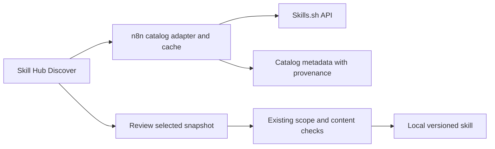

# Skills.sh marketplace spike

**Recommendation: proceed with a small discovery pilot. Do not promise a complete marketplace, usage analytics, or model recommendations yet.**

[CONTEXT-482](https://linear.app/n8n/issue/CONTEXT-482) · Investigated on 12 November 2026 · Repository base `172cd120e3fdb64decf1b4c28cfcb3852236c571`

Skills.sh can supply a useful catalog and skill content. The main launch dependency is supported API access for n8n. The main product dependency is skill portability. Some popular skills need files and tools that the current Skill Hub cannot provide.

## Review the result

- [Working n8n integration](implementation.md): live search, GitHub import, Save, and Try. Includes the code map, checks, and remaining limits.
- `prototype.html`: open the interactive page in a browser. It has search, category filters, sorting, skill details, file checks, and data provenance.
- `prototype.fragment.html`: editable source for the inline preview.
- `snapshot.json`: six real Skills.sh records with explicit editorial annotations.
- `evidence/browser-probes.json` and `evidence/extra-probes.json`: saved HTTP results. Download evidence keeps the hash, file inventory, and frontmatter. It omits full file contents.
- `probe.py`: repeat the bounded, read-only checks with `python3 spikes/skills-marketplace/probe.py`. It stops on HTTP 429. It needs network access. It does not install skills or send telemetry.
- `build_snapshot.py`: rebuild the six prototype records from the saved evidence.

The original HTML prototype uses a fixed sample from Skills.sh. Its search and filters operate on these six records. The user then requested a working n8n integration. That implementation is separate from the HTML prototype and calls live search and GitHub APIs. The existing ticket already covered this spike, so it was extended rather than duplicated.

## What we can obtain

| Requested information | Evidence and availability | Product treatment |
| --- | --- | --- |
| Name, source, ID, install count | Present in the public search responses. The v1 contract also has a slug, source type, install URL, and page URL. | Show the name, source, and **Installs on Skills.sh**. Keep the full ID as the catalog key. |
| How often a skill runs | Not supplied. Skills.sh collects install events. Users can opt out. It does not collect agent prompts, tool calls, or usage patterns. | Do not label installs as uses, runs, active users, or success rate. |
| Category | Skills.sh pages show topics, such as Design & UI and Testing. No category field or topic endpoint appears in the documented v1 contract. | Request a supported topic feed. Until then, omit the field or label our own classification. The prototype marks Documents as a proposed n8n category. |
| What it achieves | The downloaded `SKILL.md` has a description and instructions. Site pages also show summaries. Search results do not include the description. | Parse the author description after fetching details. Mark rewritten summaries as editorial. Do not treat claims as evaluated outcomes. |
| Models it pairs well with | No model scores, model versions, benchmarks, or comparative evaluations found in the documented API or the sample. | Show **Not evaluated** in detail. Do not infer a model recommendation from the author or an agent name. |
| Skill files and change detection | Public downloads returned file contents and a hash. The documented detail response can return null files or hash. | Read files on demand. Keep a local content hash and observation time. Missing content is an explicit state. |
| Popularity over time | The v1 leaderboard documents all-time, trending, and hot views. No general historical time-series endpoint is documented. | Add these views after authenticated verification. Preserve the metric window. Do not call an hourly value a lifetime total. |
| Audits | The audit response supplies provider, verdict, summary, timestamp, and optional risk fields. We retrieved five providers for find-skills. | Show individual results and dates. A pass is not an n8n endorsement. The response has no content hash that proves the audit covers the fetched snapshot. |
| Source type, duplicates, curation | The v1 contract distinguishes GitHub and well-known sources. It has an optional duplicate flag and an official-source listing. | Support both ID shapes. Use curation only when the endpoint confirms it. A repository name alone is not a verified badge. |
| License, tool requirements | Some downloaded frontmatter points to `LICENSE.txt`. Requirements can appear in prose or `allowed-tools`. These fields are not uniformly structured. | Preserve notices and evaluate the actual terms. Check tools separately from file compatibility. An absent field is unknown. |
| Stars, first-seen date, related skills, agent breakdowns | These appear on the website or in its privacy description. They are absent from the documented v1 response shapes we reviewed. | Treat these as website-only or unconfirmed API data until Skills.sh specifies a contract. Repo stars measure the repo, not one skill. |

Sources: [API reference](https://skills.sh/docs/api), [privacy and telemetry](https://skills.sh/privacy), [FAQ](https://skills.sh/docs/faq), [frontend-design page](https://skills.sh/anthropics/skills/frontend-design), [webapp-testing page](https://skills.sh/anthropics/skills/webapp-testing), and the saved probes.

An agent such as Cursor or Claude Code is a host application. It is not a model. Installation into an agent does not show that one model performs better than another.

## Live endpoint checks

Seventeen small GET requests completed through the browser transport. No Authorization header was supplied. Twelve returned 200, four returned 401, and one intentionally short query returned 400. The shell transport first failed DNS in the sandbox, then stalled on the apex host. The saved browser results are the completed probe set. These network failures do not indicate that Skills.sh was down.

| Route | Result | Interpretation |
| --- | --- | --- |
| `/api/v1/skills?per_page=2&page=0` | 401 | Requires a Vercel OIDC token. |
| `/api/v1/skills/search?q=pdf&limit=2` | 401 | Requires a Vercel OIDC token. |
| `/api/v1/skills/curated` | 401 | Requires a Vercel OIDC token. |
| `/api/v1/skills/vercel-labs/skills/find-skills` | 401 | Requires a Vercel OIDC token. |
| `/api/v1/skills/audit/vercel-labs/skills/find-skills` | 200 | Anonymous access worked. The docs say authentication is required. Do not depend on this exception. |
| `/api/search` with five small queries | 200 | Returned `skills`, `count`, and search metadata. Records contained `id`, `source`, `skillId`, `name`, and `installs`. |
| `/api/search?q=a&limit=2` | 400 | Rejects a one-character query. |
| `/api/download/{id}` for six skills | 200 | Returned `hash` and a file array with paths and contents. |

The public search and download routes are used by the [official search client](https://github.com/vercel-labs/skills/blob/main/src/find.ts) and [download client](https://github.com/vercel-labs/skills/blob/main/src/blob.ts). They are separate from the documented v1 API. The search result envelope is `skills`, not v1's `data`.

Example requests, with no credential:

```sh
curl 'https://www.skills.sh/api/search?q=pdf&owner=anthropics&limit=2'
curl 'https://www.skills.sh/api/download/anthropics/skills/pdf'
```

Observed search record, 12 November 2026:

```json
{
  "id": "anthropics/skills/pdf",
  "source": "anthropics/skills",
  "skillId": "pdf",
  "name": "pdf",
  "installs": 227573
}
```

Authenticated pagination, successful v1 payloads, 429 recovery, cross-origin access, and service capacity were not tested. No project token was provisioned. We did not stress the service. Browser calls were same-origin, so they do not prove that a browser-based n8n integration would work across origins.

## Restrictions and unresolved contract details

1. **Authentication.** The documented access method uses a Vercel project OIDC token. A non-Vercel server credential is not documented. A small n8n-owned Vercel adapter is technically plausible, but shared use for n8n Cloud and self-hosted instances needs provider confirmation. Do not require each builder to link a Vercel project.
2. **Rate and caching.** The v1 limit is 600 requests per minute per team/project. Follow response cache directives and `Retry-After`. Terms also describe IP limits. We saw no numeric limit headers on anonymous successes. Their capacity is unknown. Public search returned `max-age=0, must-revalidate`; audit and download returned `public` without a TTL. A retention policy needs a freshness timestamp, revalidation, and a stale state.
3. **Catalog completeness.** The unfiltered all-time v1 view has a 100,000-row serving window. It accepts pages of up to 500. Repository-scoped listings avoid that global cutoff. Search is capped at 200 results and has no documented paging. Neither mechanism is proof of a complete mirror.
4. **Rights and service terms.** The terms encourage reasonable programmatic use and caching. They prohibit rate-limit bypass and service-degrading abuse. They provide no availability or accuracy warranty. Skill authors keep their rights under their repository licenses. Directory inclusion does not grant redistribution rights. Keep attribution, license files, and a way to remove unavailable listings. Pricing and a service commitment are not stated in the reviewed API docs or terms.
5. **Contract inconsistencies.** Audit auth differs between docs and the live response. One live audit returned risk level `SAFE`, outside the documented examples. Privacy says page data is available through the API, but the v1 schema omits topics, stars, first-seen dates, summaries, and agent breakdowns. Ask Skills.sh which endpoint exposes those fields. Accept unknown enum values without upgrading their meaning.
6. **Content changes.** A snapshot hash is not a Git commit, version history, a pinned download API, or an audit identity. No historical fetch or conditional hash-only endpoint is documented. Keep approved content locally and re-review changed content. Do not treat an absent result as proof of deletion after one failed request.
7. **Runtime compatibility.** A portable instruction format does not provide a terminal, browser, Python environment, credentials, or network tools. Assess requirements before offering import. Never run downloaded instructions while indexing them.

Sources: [API reference](https://skills.sh/docs/api), [terms](https://skills.sh/terms), [privacy](https://skills.sh/privacy), and [integration contact](https://skills.sh/contact). These are current published statements, not negotiated terms for n8n.

## Fit with the current Skill Hub

The current entry point is Settings → Context → Skills. Keep the current management table under **Your skills**. Add **Discover** alongside it. Discovery cards show purpose, publisher, installation popularity, and an honest import status. Detail provides the file review, runtime requirements, model-data gap, and source links.

Code inspected at the base commit:

| Existing area | Reuse and remaining work |
| --- | --- |
| `SettingsSkillsView.vue`, `SkillsTable.vue`, and `skills.store.ts` | Keep local management and scope behavior. Add a separate discovery view and catalog store. Local skill IDs and external catalog IDs must remain distinct. |
| `SkillSourceConnectDialog.vue`, `SkillSourceReview.vue`, and `SkillSourceFilesView.vue` | Reuse scope selection, content review, and skipped-file presentation. A Skills.sh catalog selection must resolve a precise snapshot, not assume that the public slug equals a repository path. |
| `SkillSourceClient` and its registry | A provider adapter can map catalog content into existing import contracts. It should declare lossy import and no historical pinned fetch until supported. Discovery/search still needs its own catalog API. |
| `readSkillFolder()` in `utils/skill-md.ts` | Reuse parsing and metadata preservation. It keeps `SKILL.md` and markdown under `references/`; it drops the other files. |
| `SkillService`, `SkillAccessService`, `SkillSecurityScanner`, and `SkillSyncService` | Reuse permissions, content versions, scans, and reviewed updates. Discovery must not bypass the write scopes or approve a remote audit as a local scan. |
| `useAgentSkillImport.ts` | The file importer rejects `scripts/`. It cannot be used as a general remote installer. |
| `SkillUsage` contract | Existing “Used by” counts attached agents. It does not measure runtime invocation frequency. |

These files live under `packages/frontend/editor-ui/src/features/settings/context`, `packages/frontend/editor-ui/src/features/agents`, and `packages/cli/src/modules/skills`. Shared limits are in `packages/@n8n/api-types/src/agents/agent-skill.schema.ts`.

### A concrete portability check

| Skills.sh snapshot | Files returned | Files the current folder reader would keep | Consequence |
| --- | ---: | ---: | --- |
| find-skills | 1 | 1 | Needs terminal access and the Skills CLI. File fit alone is insufficient. |
| frontend-design | 2 | 1 | `LICENSE.txt` would be dropped. Preserve and review the license before import. |
| agent-browser | 1 | 1 | Needs the agent-browser CLI and a browser. Its snapshot frontmatter also says `hidden: true`, despite appearing in public search. Clarify visibility semantics. |
| pdf | 12 | 1 | Drops scripts, root-level documentation, and the license. |
| webapp-testing | 6 | 1 | Drops helper scripts, examples, and the license. |
| xlsx | 53 | 1 | Drops scripts, schemas, and the license. |

This is a file-path assessment, not an execution test or a representative catalog coverage estimate. None of the six skills was installed or run. The current schema also limits references to 20 files and 262,144 characters in total.

[CONTEXT-481](https://linear.app/n8n/issue/CONTEXT-481) already tracks full-file import. That work does not, by itself, provide the execution tools these skills need.

## Smallest useful integration

1. Offer search and a small, cached selection sourced from Skills.sh. Keep attribution and an observation time. Avoid claiming the sample is the whole catalog.
2. Fetch details only when needed. Parse descriptions and requirements from the returned skill content. Treat all fields as untrusted input. Bound response and file sizes. Render plain text or sanitized markdown.
3. Show **View on Skills.sh** for every record. Offer a reviewed, one-time import only when file support, runtime requirements, and license handling pass. Keep existing manual source entry when the catalog is unavailable.
4. Store the external ID, snapshot hash, retrieval time, source URL, provenance, and local skill ID separately. Do not merge skills by name alone.
5. Defer automatic sync, full-catalog mirroring, model rankings, and run-frequency claims. Keep production rollout behind an opt-in flag.



A shared catalog service would add a hosted dependency for self-hosted n8n. That architecture decision needs an owner before implementation; this spike does not make it final.

The preferred production path uses the supported v1 API. The anonymous CLI routes are suitable for an explicitly experimental pilot with caching and a fallback link. Do not make them a supported production dependency without a stable access agreement.

## Decision and effort

| Option | Decision |
| --- | --- |
| Discovery with source links and honest metadata | **Proceed with a pilot**, after access and rights handling are confirmed. |
| Discovery plus reviewed import of a compatible subset | **Conditional go.** Reuse the existing review path. Preserve licenses. Restrict the subset until file and runtime requirements are met. |
| Full marketplace with every skill installable | **No-go today.** Current file handling and runtime capabilities do not support that promise. |
| “How often used” and “best model” powered only by Skills.sh | **Reject that claim.** The evidence is missing. These features would require separately scoped n8n telemetry and controlled evaluations. |

Planning estimate for one engineer, after supported access is available:

| Work | Estimate |
| --- | --- |
| Catalog adapter, validation, cache, rate-limit and outage handling | 2–3 engineering days |
| Discovery list, search, filters, detail, provenance, and i18n | 2–3 days |
| Reviewed import for a narrow compatible subset, attribution, and deduplication | 2–4 days |
| Focused integration tests and product checks | 1–2 days |
| **Total** | **7–12 engineering days** |

This estimate excludes provider response time, procurement, hosted-service approval, full-file support in CONTEXT-481, a general execution runtime, and model evaluations. Discovery with external links alone is the smaller first milestone.

Before implementation, get answers from Skills.sh about non-Vercel/shared-service access, anonymous endpoint support, topic and summary fields, rate-limit scope, pricing, license redistribution, takedowns, and snapshot/audit identity. Their contact page directs integration partnerships to the Vercel partner form. No outreach was sent.

## Validation

- Saved 17 read-only endpoint results and their status codes.
- Built six prototype records from those results. Installation counts are observed values, not fabricated examples.
- Read the current import, file schema, access, and usage contracts.
- UI verification results are recorded in `validation.md`.
- No production code changed. Full application tests, lint, and typechecks are outside this spike.
