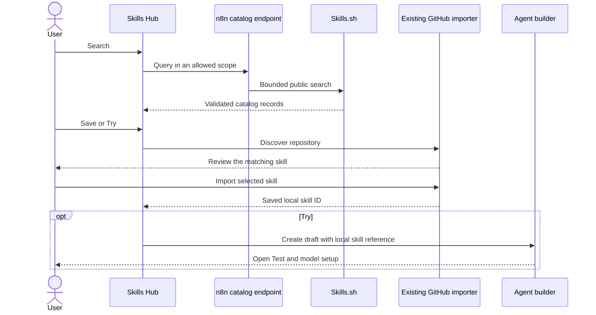

# Working Skills.sh integration

The Skills Hub now has a Discover tab. It searches Skills.sh and sends Save and Try through the existing GitHub importer. The integration uses the existing `136_skill_sync` opt-in flag. No database migration is needed.

This is a working discovery pilot. The API access and content limits in [the research report](README.md) still apply.

## User flow

1. Open Settings → Context → Skills → Discover.
2. Search for a task. Results show the skill name, repository, install count, and Skills.sh page.
3. Select Save skill or Try skill.
4. Choose a scope. The dialog has the repository prefilled. GitHub credentials remain optional for public sources.
5. Review the matching skill in the existing GitHub import dialog. The review shows the author description, content, scanner findings, and omitted files.
6. Save imports the selected skill and keeps it in the Skills Hub. Try imports it, creates a draft agent with its local skill ID, and opens Agent Test.

Try keeps both the skill and the draft. It does not publish an agent or start a model call. The user can select a model and add required tools in the builder.

If the same skill is already saved, the dialog checks its scope, source, name, and GitHub path. It reuses that saved version. It does not update the content in the background. If Agent creation fails after import, the skill stays saved and the user can retry. If navigation fails after creation, retry opens the same draft.

## Implementation

| Area | Change |
| --- | --- |
| API types | `skills/skill-catalog.schema.ts` defines the query and catalog response. |
| Skills backend | `SkillCatalogService` calls the public search endpoint through `OutboundHttp`. It validates every record and builds fixed GitHub and Skills.sh links. |
| Route access | `SkillCatalogController` checks the existing flag. Global and project routes have explicit list scopes and per-user limits of 30 requests per minute. |
| Network bounds | One explicit search returns at most 24 records. The request has a 10-second timeout and 1 MiB response limit. Redirects are disabled. |
| Skills Hub | `SkillsDiscover.vue` handles search, unavailable states, Save, Try, and retry. `SettingsSkillsView.vue` hosts the tab. |
| GitHub review | `SkillSourceConnectDialog.vue` accepts a catalog item. It imports only one exact name match, using the opaque key returned by GitHub discovery. It rejects missing and ambiguous matches. |
| Agent draft | The existing `createAgent` API accepts a partial configuration. The request passes the stored skill ID. It leaves model selection to the existing defaults and builder. |

The app reads all imported files from GitHub. It does not import a Skills.sh download, execute the Skills CLI, or interpret the catalog slug as a GitHub folder.

## Limits to review

- The anonymous search endpoint is used by the official Skills CLI. A stable service agreement for n8n is still unverified. The authenticated v1 API is not integrated.
- Search records do not supply categories, descriptions, audits, or model scores. The dialog gets the author description from GitHub. Other details link to Skills.sh. The app does not fill missing metadata with guesses.
- Install counts are popularity data. They do not measure runs or success.
- The existing importer allows one repository connection per scope. It blocks adding another skill from that repository once connected. The integration keeps that rule. A later import-more feature must reuse the stored connection and its access checks.
- The existing importer preserves `SKILL.md` and supported Markdown references. It omits other files, including scripts and some license files. The review lists omissions. [CONTEXT-481](https://linear.app/n8n/issue/CONTEXT-481) tracks broader file support.
- A skill may require tools that an n8n agent does not have. Try opens setup; it does not guarantee the skill can run without changes.
- The GitHub discovery cap and folder-depth limit can prevent a catalog match. Missing or ambiguous matches stop the import.
- GitHub and Skills.sh can change independently. A catalog result can be stale. The importer reads and scans the current GitHub content again before it saves.

## Validation and preview

[Validation results](validation.md) record automated and live checks. Screenshots show [live discovery](evidence/working-discover.png) and [the created test agent](evidence/working-trial.png).

The review instance runs at `http://127.0.0.1:5681/settings/context/skills`. The backend uses port 5679. Both listeners use loopback. The database and test account are separate from the user's n8n data.

The preview starts the compiled backend with `N8N_FEATURE_FLAG_OVERRIDES='{"136_skill_sync":true}'`. It uses the local `vite-preview.config.mts` to point the editor at that backend and keep its listener on loopback. `NODE_OPTIONS=--dns-result-order=ipv4first` is required for outbound requests on this review host.

This change is ready for code and product review. Broader rollout needs supported API access, an import-more flow, and a decision on file and runtime compatibility.
