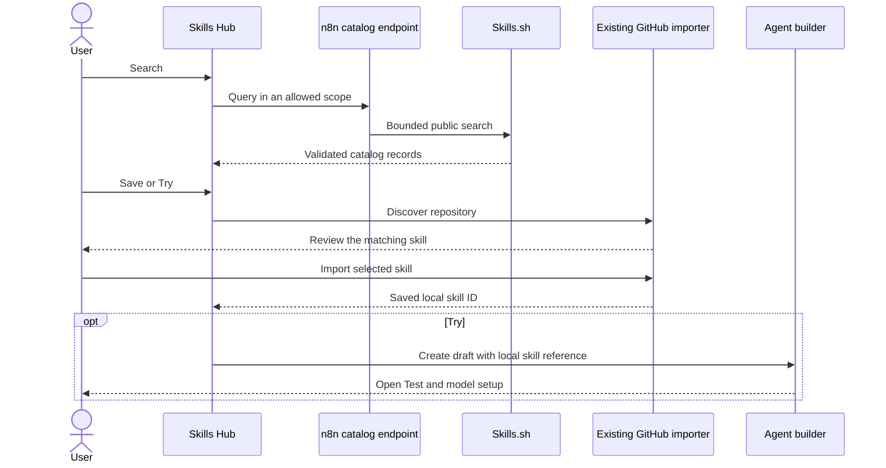

# Working Skills.sh integration

The Skills Hub has a Discover tab with popular and trending skills, category filters, search, and an in-app detail page. Save and Try use the existing GitHub importer. The integration uses the existing `136_skill_sync` opt-in flag. No database migration is needed.

This is a working discovery pilot. The API access and content limits in [the research report](README.md) still apply.

## User flow

1. Open Settings → Context → Skills → Discover.
2. Browse the popular list, switch to Trending, filter a category, or search for a task. Cards show the author description, repository, install count, and an official badge when Skills.sh supplies one.
3. Open a skill inside n8n. Review its purpose, instructions, files, declared requirements, license, and available audit results. GitHub adds repository stars, topics, and the last push date. Select Save skill or Try skill from either the card or detail page.
4. Choose a scope. The dialog has the repository prefilled. GitHub credentials remain optional for public sources.
5. Review the matching skill in the existing GitHub import dialog. The review shows the author description, content, scanner findings, and omitted files.
6. Save imports the selected skill and keeps it in the Skills Hub. Try imports it, creates a draft agent with its local skill ID, and opens Agent Test.

Try keeps both the skill and the draft. It does not publish an agent or start a model call. The user can select a model and add required tools in the builder.

If the same skill is already saved, the dialog checks its scope, source, name, and GitHub path. It reuses that saved version. It does not update the content in the background. If Agent creation fails after import, the skill stays saved and the user can retry. If navigation fails after creation, retry opens the same draft.

## Implementation

| Area | Change |
| --- | --- |
| API types | `skills/skill-catalog.schema.ts` defines browse, search, metadata, and detail contracts. |
| Skills backend | `SkillCatalogService` uses `OutboundHttp` for Skills.sh search, public rankings, downloaded snapshots, and audits. It validates records and builds fixed source links. Optional GitHub metadata has a separate cache. |
| Rankings | The public site embeds its first 600 ranked records in serialized page data. The adapter parses JSON without executing scripts. It keeps the supplied order and excludes sources that the GitHub importer cannot use. A changed page shape produces an unavailable state. |
| Route access | Global and project routes have explicit list scopes and the existing feature gate. Per-user route limits are 30 requests per minute for browse, search, and detail, and 60 for card metadata. |
| Network bounds | Search returns at most 24 records, with a 1 MiB response limit. New upstream calls share four request slots and a 2 MiB response limit. All requests have a 10-second timeout and disable redirects. Downloads accept at most 256 files and 256 Ki characters per file. |
| Caching | Rankings cache for one minute. Skill snapshots and details cache for 15 minutes. Repository metadata caches for one hour. Concurrent requests for the same cached key share a fetch. Snapshot and detail caches have byte limits. |
| Skills Hub | `SkillsDiscover.vue` loads the popular list on entry. It displays 12 cards at a time and enriches visible descriptions with up to three concurrent requests. `SkillCatalogDetail.vue` provides Overview, Instructions, and Files tabs. A `catalogSkill` URL parameter supports direct links and browser navigation. |
| Categories | Deterministic n8n rules use the skill name first and the author description second. The UI labels these as n8n groupings. These are provisional categories, not author claims or a Skills.sh taxonomy. |
| GitHub review | `SkillSourceConnectDialog.vue` accepts a catalog item. It imports only one exact name match, using the opaque key returned by GitHub discovery. It rejects missing and ambiguous matches. |
| Agent draft | The existing `createAgent` API accepts a partial configuration. The request passes the stored skill ID. It leaves model selection to the existing defaults and builder. |

The detail page displays the Skills.sh snapshot. The app still reads all imported files from GitHub and reviews them again before saving. It does not execute the Skills CLI or interpret the catalog slug as a GitHub folder.

## Limits to review

- The anonymous search endpoint is used by the official Skills CLI. A stable service agreement for n8n is still unverified. The authenticated v1 API is not integrated.
- The ranking adapter depends on public website data rather than a stable API contract. Replace it with supported catalog access before production. The anonymous snapshot and audit routes also need a supported access agreement.
- Search records do not supply descriptions or audits. Snapshot downloads add author descriptions, instructions, and frontmatter. Audit and repository failures leave those optional fields out. No model scores or satisfaction ratings are invented.
- Popular and search counts are total installs. Trending counts are labeled recent installs. The app preserves Skills.sh's ranking rather than calculating its own trend score.
- Categories use simple rules. Review their accuracy before making them a production taxonomy. Repository topics are shown as repository metadata, not skill-specific categories.
- These bounds reduce request bursts. They are not a cross-instance quota manager. The pilot reports upstream rate limits; it does not bypass them or implement automatic retry storms.
- Install counts are popularity data. They do not measure runs or success.
- The existing importer allows one repository connection per scope. It blocks adding another skill from that repository once connected. The integration keeps that rule. A later import-more feature must reuse the stored connection and its access checks.
- The existing importer preserves `SKILL.md` and supported Markdown references. It omits other files, including scripts and some license files. The review lists omissions. [CONTEXT-481](https://linear.app/n8n/issue/CONTEXT-481) tracks broader file support.
- A skill may require tools that an n8n agent does not have. Try opens setup; it does not guarantee the skill can run without changes.
- The GitHub discovery cap and folder-depth limit can prevent a catalog match. Missing or ambiguous matches stop the import.
- GitHub and Skills.sh can change independently. A catalog result can be stale. The importer reads and scans the current GitHub content again before it saves.

## Validation and preview

[Validation results](validation.md) record automated and live checks. Screenshots show [live discovery](evidence/working-discover.png) and [the created test agent](evidence/working-trial.png).

The review instance runs at `http://127.0.0.1:5681/settings/context/skills`. The backend uses port 5679. Both listeners use loopback. The database and test account are separate from the user's n8n data.

The preview starts the compiled backend with `N8N_FEATURE_FLAG_OVERRIDES='{"136_skill_sync":true}'`. It uses the local `vite-preview.config.mts` to point the editor at that backend and keep its listener on loopback. `NODE_OPTIONS=--dns-result-order=ipv4first` is required for outbound requests on this review host.

This change is ready for code and product review. Broader rollout needs supported API access, an import-more flow, and a decision on file and runtime compatibility.
