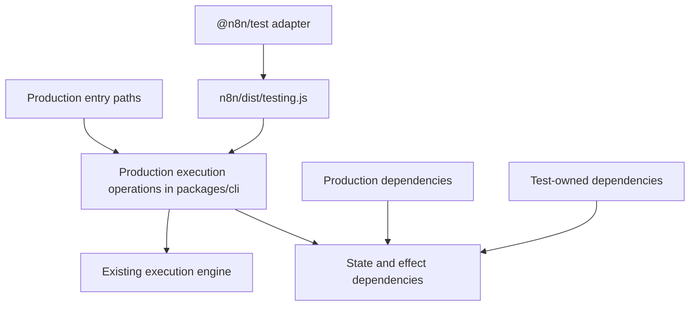

# Plan: Reuse n8n execution orchestration in @n8n/test

## Objective and scope

Make `@n8n/test` use production execution sequences from `packages/cli`, whose package name is `n8n`. Reduce duplicate behavior and the risk of calling shared operations in a different order. Add no workspace package.

The user has accepted the CLI dependency. The test library has no released API. Change the API when this permits closer reuse of n8n. Use asynchronous interfaces when production uses them. Update affected callers and examples. Add no compatibility layer for the current API.

This plan replaces the earlier requirement to preserve synchronous loaders and getters. The checklist is in [todo.md](todo.md). Implementation and verification are complete for the shared boundaries recorded below. See [implementation.md](implementation.md) for results, dependency costs, and remaining limits. No Linear issues are created.

The shared prepared-run operation now awaits supplied configuration and then creates and starts the engine. Root preparation remains caller-owned: the application uses its configured services, and the adapter supplies in-memory state. Child callers share context inheritance, output policy, and the prepared-run operation. They retain separate workflow resolution, preparation, persistence, and completion handling. These boundaries do not provide full application orchestration reuse.

The adapter must still execute workflows without a server or database. Application integration tests can use the existing test-owned database fixtures to check equivalence. This does not add a database requirement to the adapter runtime.

## Share the owner of the sequence

Sharing individual helpers does not guarantee execution order. Prefer an existing production service with supplied dependencies. When a service combines workflow behavior with application infrastructure, extract the smallest complete domain operation within the CLI package. Production must call that operation first. The adapter then calls the same operation with test-owned state and effect dependencies.

Keep dependencies tied to real effects: reading a workflow, supplying credential data, dispatching a code task, and recording a response. Do not add a configurable list of phases, a generic pipeline framework, or a separate sequence for test mode. Do not add application flags that bypass production policy checks.

| Boundary | Production owner | Current gap and proposed reuse |
|---|---|---|
| Node execution | `packages/core/src/execution-engine/workflow-execute.ts` | Both paths already use `WorkflowExecute.processRunExecutionData`. Retain the engine's initialization, expression isolate acquisition, hooks, retries, and scheduling. |
| Root preparation | `packages/cli/src/workflow-runner.ts`, `executions/pre-execution-checks/workflow-pre-execute.ts`, and `workflow-execute-additional-data.ts` | Both callers await supplied configuration before engine construction and start. The application and adapter retain their own earlier preparation and completion handling. |
| Credential preparation | `packages/cli/src/credentials-helper.ts` | Share the applicable overwrite, default, and expression preparation sequence. Keep real retrieval and policy enforcement in their production positions. |
| Authenticated requests | Core `node-execution-context/utils/request-helpers/authentication.ts` | Core already owns credential access, pre-authentication, authentication, dispatch, and refresh order. Keep it in control and replace only the supplied credential state boundary. |
| Code task lifecycle | CLI `task-runners/task-managers/task-requester.ts` and `@n8n/task-runner` | Reuse data conversion and the task result application sequence. Metadata and static data must be applied before the next node continues. Compare the worker transport separately. |
| Child execution | `packages/cli/src/workflow-execute-additional-data.ts` | Both callers share context inheritance, output policy, and configured engine start. The adapter retains its own in-memory resolver and child lifecycle. |
| Webhook response | `packages/cli/src/webhooks/webhook-helpers.ts` and response extractors | The adapter derives responses after execution. Share when response options are evaluated and when responses are captured, as well as extraction. |
| Package reading | CLI `modules/n8n-packages/io/` and `n8n-packages.service.ts` | Make `loadPackage` asynchronous. Reuse production readers and their validation sequence. |

There is no single application path for every run. Manual, trigger, webhook, child, queue, and engine v2 paths differ. Map these paths before choosing extraction boundaries.

Start with the current engine v1 path after supplied trigger data. Match the actual execution mode. The public `$execution.mode`, engine invocation mode, and root mode inherited by a child are distinct concepts.

Production keeps persistence, permissions, policy, UI delivery, queue dispatch, and application configuration. The unit-test adapter does not prove those instance behaviors. Record this scope explicitly. Document supplied trigger output, mocked nodes, skipped time waits, and other intentional substitutions. Reject unsupported paths instead of silently using a different engine. In particular, do not run an engine v2 workflow through engine v1 without an explicit error.

If a required sequence cannot be reused without losing workflow behavior, leave that path unsupported until its boundary is resolved. Do not claim full application equivalence from shared helper imports.

## Package boundary

Add `packages/cli/src/testing.ts`, built as `dist/testing.js` with declarations. Use `n8n/dist/testing.js` as the supported adapter entry. The suffix permits Node resolution from CommonJS and ESM. Add no restrictive export map to the existing `n8n` package.

Export supported operations and their required contracts. Keep orchestration in its production domain. The entry must not become a second application runner. Do not export the whole application container.



Add `n8n: workspace:*` to `@n8n/test`. Keep dependencies one-way. Do not make the CLI or core depend on the test library. Do not make core depend on the CLI or task runner. Retain direct dependencies still imported by the adapter.

The entry import must not initialize application services, create user files, open listeners, or access a database. Test it in a fresh process with a test-owned `N8N_USER_FOLDER` set before import.

## How to verify order

1. Check that application and adapter callers use the same operation that owns the sequence. A barrel of unrelated helper exports is insufficient.
2. Use behavior tests with delayed dependencies. Hold credential preparation pending and prove that no authenticated request is sent. Reject preparation and prove dispatch does not occur. Capture an immediate webhook response and verify it is unaffected by a later mutation or failure.
3. Run representative fixtures through the actual application entry and the public adapter. Compare node data, HTTP requests, responses, state changes, and failures. Normalize only nondeterministic IDs and timestamps. Identify deliberate test substitutions separately.

Assert required happens-before relationships. Do not require a total order for independent or detached operations. Do not snapshot every private helper call.

Application comparisons must use real production callers through existing CLI integration fixtures. Calling the same extracted helper twice does not verify application wiring. Temporarily remove a required await or reverse one causal dependency. Confirm that a behavior test fails, then restore the code.

## Ordered tasks

### 1. Map production paths and capture behavior

Trace root, webhook, child, credential, and code-task paths. Record each entry, mode, ordered operation, effect dependency, and current adapter deviation. Include the engine v2 dispatch boundary. Inspect existing coverage and add only missing order-sensitive behavior cases.

Files: this plan; CLI `src/__tests__/workflow-runner.test.ts`, `workflow-execute-additional-data.test.ts`, and `credentials-helper.test.ts`.

Acceptance: every proposed shared operation has a production caller and defined entry boundary. Required ordering is testable. Application-only checks and intentional adapter differences are explicit.

### 2. Establish a shared prepared-run operation

Select an existing production operation or extract the smallest complete prepared-run sequence within the CLI. Keep preparation, hook attachment, engine start, completion, and failure handling in production order at that boundary. Preserve the positions of earlier permission and persistence operations. Preserve the engine's cancellation contract.

Files: CLI `src/workflow-runner.ts`; a focused module under `src/executions/`; its behavior test; `src/testing.ts`.

Acceptance: production calls the operation before the adapter does. Existing production tests pass. Import has no application initialization. A behavior test detects a missing required await.

### 3. Connect the adapter to the prepared-run operation

Add the CLI dependency with pnpm. Replace corresponding orchestration in `execute-workflow.ts` and `engine/additional-data.ts`. Retain mock registration, supplied state, recording, and cleanup. Update the context contract as required. Delete replaced preparation code.

Files: test package `package.json`, `src/execute-workflow.ts`, `src/engine/additional-data.ts`, `src/execution-context.ts`; root `pnpm-lock.yaml`.

Acceptance: supported application and adapter runs enter the same prepared-run operation with the correct mode. The adapter requires no server or database. Dependencies have no reverse edge.

Checkpoint: build both packages and compare a basic workflow through the actual application and adapter entries. Inspect added build work before extending the entry.

### 4. Share complete credential preparation

Reuse or extract the production operation for supplied credential data. Preserve applicable overwrites, defaults, runtime fields, and expression resolution in production order. Reuse authentication and pre-authentication operations where applicable. Keep real retrieval and policy enforcement before shared preparation. Keep core's authenticated request sequence in control.

Files: CLI `src/credentials-helper.ts`; a focused credential preparation module; its production behavior test; `src/testing.ts`.

Acceptance: production uses the complete shared operation. Production credential and policy behavior is unchanged. Delayed or rejected preparation prevents premature dispatch.

### 5. Replace the adapter credential implementation

Connect `TestCredentialsHelper` to shared preparation and authentication. Remove covered default, expression, authentication, and pre-authentication implementations. Retain supplied credential lookup and secret recording. Update expectations to production semantics. Record unsupported credential features.

Files: test package `src/instance-state/credentials-helper.ts`, `test/instance-state-credentials.test.ts`, `test/http.test.ts`, and `test/http-redact.test.ts`.

Acceptance: requests, credential failures, and redaction are covered. A causal ordering test fails if dispatch can precede preparation. Add no production policy bypass.

### 6. Share code-task preparation and completion

Use the production builder and stripper. Reuse or extract task result application so metadata and static data are available before the next node. Preserve request, acceptance, completion, and cancellation ordering. Compare the worker transport with the production requester and record what must remain test-specific. Keep the real JavaScript runner sandbox.

Files: CLI `src/task-runners/task-managers/task-requester.ts`; a focused task operation module if needed; CLI `src/testing.ts`; test package `src/runtime/code-runner.ts` and `src/runtime/runner-data.ts`.

Acceptance: production uses extracted operations. Following nodes see Code node state changes. Runner failure and cleanup tests pass. Delete `runner-data.ts` and document remaining runner internals.

### 7. Share child execution orchestration

Reuse or extract the production child operation. Supply loaded workflows at the storage boundary. Preserve source resolution, parent and root context, preparation, output policy, and failures. Preserve awaited and detached behavior. Keep static contract diagnostics separate from execution; do not add a stricter test-only preflight rejection to the production-equivalent path.

Files: CLI `src/workflow-execute-additional-data.ts`; a focused child module if needed; CLI `src/testing.ts`; test package `src/sub-workflows/execution.ts` and `test/sub-workflow.test.ts`.

Acceptance: modes and outputs match the selected application path. Preparation and execution failures are covered. Detached child tests assert only necessary causal ordering.

Checkpoint: compare a workflow that combines credentials, Code nodes, and child execution. Run affected production and adapter tests. Review shared sequences for retained copies.

### 8. Share webhook response orchestration

Reuse the production operation that owns response evaluation and timing. Extract it within the CLI only when necessary, and have `webhook-helpers.ts` call it. Supply a test response recorder at the transport boundary. Await the existing asynchronous last-node extractor.

Capture immediate and response-node responses when production produces them. Build the test result from captured state. Do not reconstruct an immediate response from final execution data. An asynchronous result accessor is acceptable. Making extraction asynchronous does not itself add binary or streaming support.

Files: CLI `src/webhooks/webhook-helpers.ts`; a focused response operation module if needed; CLI `src/testing.ts`; test package `src/runtime/webhook-response.ts` and `src/result.ts`.

Acceptance: supported response content and causal timing match production. Cases cover later mutation and failure after an immediate response. Unsupported response capabilities remain explicit.

### 9. Reuse asynchronous package reading

Expose and use `DirectoryPackageReader` and `TarPackageReader`. Use limits from the existing package import configuration. Follow the production validation and inventory sequence, including directory inventory before file use. Share that sequence inside the CLI if it is embedded in the service. Keep database import and entity creation outside the test loader.

Make `loadPackage` asynchronous and await manifest and workflow reads. Keep canonical schemas and the test workflow-set projection. Remove `package-files.ts` and the direct tar dependency when unused.

Files: CLI `src/testing.ts`; test package `src/package/load-package.ts`, `src/package/package-files.ts`, and `package.json`; root `pnpm-lock.yaml`. If validation orchestration needs extraction, land that production extraction before the adapter change.

Acceptance: both paths use production readers, limits, and validation order. Directory and archive fixtures load with await. Production rejection cases are retained without a second validator.

### 10. Reuse remaining static rules

Share production variable scanning and the declarative node predicate. Extract a pure scanner inside the CLI if its service wrapper causes import effects. Retain test workflow attribution and issue presentation. Record intentional corrections from following production semantics.

Files: production scanner and its caller; CLI `src/testing.ts`; test package `src/sub-workflows/requirements.ts` and `src/engine/node-types.ts`.

Acceptance: one implementation per rule. Production tests pass. Adapter tests cover setting references and node loading through the shared rules.

### 11. Complete caller updates and equivalence tests

Update affected tests and examples with each earlier task so every change remains runnable. Group large mechanical caller updates separately from runtime changes. Add no synchronous compatibility API.

Complete application-versus-adapter fixtures for root runs, credential preparation and retry, Code node state, children, webhook modes, and preparation failure. Use existing application integration fixtures and test-owned data directories. Keep these comparisons in an external consumer harness if importing the adapter into the CLI test graph would require a reverse package dependency.

Acceptance: examples use the intended API. Comparisons cover observable effects and required causal relationships. Removing a required await causes a meaningful test failure.

### 12. Verify installed archives and dependency costs

Build and pack both packages. Install archives in a temporary consumer without repository workspace links or aliases. Include local archives for changed versions not yet published. Verify CommonJS, ESM, declarations, entry contents, and release alignment. Set `N8N_USER_FOLDER` to a test-owned path before imports.

Exercise asynchronous package loading and a workflow with mocked HTTP, Code, child execution, and a webhook response. Measure package size, installed dependencies, and build graph changes, including native modules and the editor dependency. Run the complete adapter suite.

Acceptance: the installed adapter works without a server or database. Production operations own supported sequencing. Duplicate adapter implementations are removed. Document retained substitutions and unsupported paths.

## Verification commands

Run focused checks sequentially with one worker. Existing production coverage includes CLI workflow runner, additional data, credentials, pre-execution checks, runner data builder and stripper, webhook responses, and directory and archive readers. Include the core authenticated request suite.

```sh
pnpm --dir packages/cli test src/__tests__/workflow-runner.test.ts --maxWorkers=1
pnpm --dir packages/cli test src/__tests__/credentials-helper.test.ts --maxWorkers=1
pnpm --dir packages/core test src/execution-engine/node-execution-context/utils/request-helpers/__tests__/authentication.test.ts --maxWorkers=1
pnpm --dir packages/@n8n/test test --maxWorkers=1
pnpm --filter @n8n/test typecheck
DB_TYPE=sqlite DB_SQLITE_POOL_SIZE=4 pnpm --dir packages/cli exec vitest run --config ../@n8n/test/vitest.application.config.ts --maxWorkers=1
```

The application comparison uses the CLI integration fixtures and an external consumer configuration. It loads the public adapter from `dist/index.js`. Build the adapter before this check. The fixture runs an owned root workflow and its published child through `WorkflowRunner.run`. It checks asynchronous configuration, HTTP request order, and output against the public adapter. It uses a test-owned database and user directory. The adapter runtime does not need them.

Build the CLI before testing its new built entry. After adding the dependency, build the graph from the adapter target. Always redirect build output:

```sh
pnpm exec turbo run build --filter=@n8n/test > /tmp/n8n-test-cli-reuse-build.log 2>&1
pnpm --dir packages/cli pack --pack-destination /tmp/n8n-test-cli-reuse-pack
pnpm --dir packages/@n8n/test pack --pack-destination /tmp/n8n-test-cli-reuse-pack
```

Create the pack destination first. Install archives with pnpm. Run formatting and lint with explicit changed file paths from each owning package. Run `git diff --check`. Leave comprehensive repository checks to CI. Do not run frontend type checks locally.

## Risks and completion criteria

| Risk | Required mitigation |
|---|---|
| Shared helpers still run in a different order | Share the sequence owner and test through real production callers. |
| Extraction changes policy or persistence order | Preserve production positions and run application behavior tests. |
| The adapter claims excessive equivalence | Define mode and entry boundaries. Document substitutions and reject unsupported engines. |
| Both callers share a wiring error | Compare actual application entries with the public adapter and observe external effects. |
| Independent branches produce different traces | Check causal relationships rather than a total event order. |
| Async reader reuse changes accepted inputs | Adopt production validation and update the unreleased API and examples. |
| CLI reuse adds install or build cost | Measure package, native dependency, editor, and build graph changes. |
| Workspace links hide packaging errors | Verify installed archives without source aliases. |

Complete when the supported production operations own ordering, equivalence tests cover their application wiring, duplicate adapter implementations are removed, and API examples and limitations are accurate. The shared operations form a maintenance contract between the backend and the test adapter. No ADR is created by this plan.
