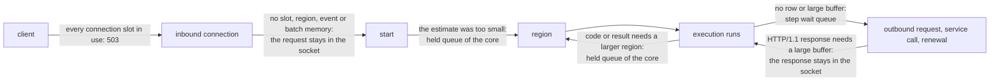

# Bounded tables on the path of an execution

The shard reserves all memory at startup, so each table and pool has a fixed size.
The rule for a full one: **the engine delays work, it does not fail work that it can run later.**
n8n's v1 engine does the same. At its concurrency limit it puts the execution in a queue
(`packages/cli/src/concurrency/concurrency-control.service.ts`, `throttle`) and the caller waits. It does not answer 503.

A limit fails work only in these cases:

- The work can never fit: a trigger larger than the largest region (413), a request larger than `--max-request-mb` (413).
- The wait queue itself is full. Each queue has a counter (`refused`).
- The cases in the column "Still a limit" of the table.

## Where work waits

- **Inbound.** The shell asks the core before it reads a new start (`State.startRoom`). With no room, the request stays in
  the buffer of its connection, and with a full buffer the socket is not read (`Runner.pauseConn`). Requests go on in
  arrival order after each batch (`resumePaused`). The count of connections is the bound.
- **Core.** A start, a run or a result that finds no slot or region waits in `State.held` (`core/held.zig`), oldest first.
  `serveHeld` gives each region that goes back to the oldest entry that it fits. While work waits there, the shell
  reads no new start: work in flight goes first. A start takes a region of the class that the last execution of its
  module ended in, or a larger one, and waits when none is free. It does not start in a smaller region, because it would
  then wait later, with its region and its outbound work, for the result of a step.
- **Steps.** A step that finds no row waits in `shell/step_wait.zig`, one queue for each kind. The shell keeps no copy
  of the args: the core gives them again (`State.pendingDispatch`).
- **Fallback host.** `fbAdmit` and `sendWaiting` (not changed by this work).

## The tables

Sizes are for one shard. "embedded" is `--profile embedded`. "default" is no profile.
Before this work the 64 KB, 1 MB and 32 MB regions were 256/16/2 (embedded) and 1,024/64/4 (default), and the large
buffers were 2 (embedded).

| Table or pool | embedded | default | Flag | When full, before | When full, now | Still a limit |
|---|---|---|---|---|---|---|
| Inbound connections | 1,024 | 4,096 | `--max-conns` | connection closed | 503, then closed | yes: the bound on new work |
| Large request buffers (body above 16 KB) | 4 | 2 | `--request-big-slots` | 503 | request waits | io_uring: 503 |
| Events of a batch | 8,192 | 32,768 | from `--egress-max-requests` | 503 `busy` | request waits | |
| Batch memory | 64 MB | 64 MB | | 503 `busy` | request waits | |
| Execution slots | 4,096 | 16,384 | `--slots` | 503 `no execution slots` | start waits | |
| Regions 4 KB | slots | slots | | next class | next class | |
| Regions 64 KB | 1,024 | 4,096 | `--target-in-flight` | start: 413 `trigger too large`; run or result: status `limit`, webhook 500 `Error in workflow` | start, run or result waits | |
| Regions 1 MB | 128 | 512 | `--target-in-flight` | the same | the same | |
| Regions 32 MB | 8 | 32 | `--target-in-flight` | the same | the same | a value that fits no region |
| Held queue (new) | 2,048 entries, 64 MB | 8,192 entries, 256 MB | `--target-in-flight` | | start: 503; run or result: status `limit` | yes |
| Effects in flight | 16,384 | 131,072 | from `--slots` | status `limit` | status `limit` | yes (`pending.full`) |
| Outbound requests | 4,096 | 16,384 | `--egress-max-requests` | step error | step waits | |
| Outbound connections | 1,024 | 8,192 | `--egress-max-conns` | request waits in the queue of its origin | the same | |
| Queue of one origin | | | `--egress-origin-queue` | step error | step error | yes: a policy of the operator |
| Large buffers (body above 16 KB, 16 MB each) | 8 | 8 | `--egress-big-slots` | request, response or reply: error | request: step waits. HTTP/1.1 response: waits | HTTP/2 response: step error. Reply above 64 KB: 500 |
| Service calls | 256 | 256 | `--max-service-calls` | step error | step waits | a call of a host step: error to the step |
| Credential renewals | 256 | 256 | `--max-renewals` | step error | step waits | |
| Step wait queue (new) | 16,384 for each kind | 131,072 | | | step error | yes |
| Fallback host steps | 65,536 | 65,536 | | step waits (`fbAdmit`) | the same | |
| Event outbox | 1,024 MB | 1,024 MB | `--max-outbox-mb` | new work: 503 (spec 9.2) | the same | yes: n8n does not take the events |

## Sizing

`--target-in-flight N` (after `--profile`) sizes every table above from the count of executions that run at one time:
connections `N + N/4 + 64`, slots `4N`, 64 KB regions `N`, 1 MB regions `N/8`, 32 MB regions `N/128` (2 to 32), outbound
requests `4N`, outbound connections `2N`, large buffers `N/16` (8 to 128), large request buffers `N/64` (4 to 32), service
calls `N/2` (256 to 1,024), renewals `N`. A flag after it changes one size. The `sizing:` line at startup gives the sizes
and the memory that each shard reserves. Reserved memory is address space: a page counts for the process after its first use.

## Counters

`GET /_admin/limits` gives one JSON document, and `--stats` prints the same document each second as a `limits:` line.
Each table has `used` and `max`. `waits` counts work that waited there. `refused`, `full`, `limit` and `empty` count
work that failed or found the pool empty. A table with waits and no refusals did its work: raise its flag, or
`--target-in-flight`, when the latency matters.
