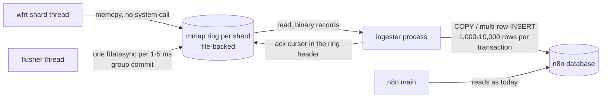

# Execution records off the hot path: shard rings and a batch ingester

Status: design, agreed 2026-11-13. Not built yet.

## Why

The goal is 100,000 workflows per second on one core for `wfrt`. The budget is 10 µs per workflow. Today, every
durable event (at least `started` and `finished` per workflow) costs:

- one `write()` system call in the shard thread (`src/shell/outbox.zig` `Record.flush`), and one `fsync` per event
  on the `sync` tier;
- one `pread` to read it back for the event stream, a JSON line on a socket, and per-event handling in n8n's main
  process with one database round trip (TypeORM).

Measured on one pinned VM core (W3, 30,000 in flight, 2026-11-13): 112,764 wf/s at 8.87 µs per workflow without
the on-disk outbox, and 86,312-88,829 wf/s at 10.7-11.0 µs with it. The outbox costs about 2 µs per workflow. n8n's
per-event handling caps at about 1,000-5,000 executions per second. Neither fits.

## Design

1. **Ring.** Each shard has one memory-mapped, file-backed ring (`<log dir>/ring-<shard>.bin`, mode 0600). The shard
   thread copies a binary record into it and moves a write cursor (an atomic store with release order in the ring
   header). No system call per event. The ring replaces the outbox segment files. It may later replace the shard log
   too, so that each event is written once.
2. **Group commit.** A flusher thread calls `fdatasync` on the ring file once per interval (default 2 ms) when the
   write cursor moved, then publishes a durable cursor. A `sync`-tier execution is confirmed (its webhook answered)
   only after the durable cursor passes its record. No event pays its own `fsync`.
3. **Ingester.** A separate process (started by n8n's compiled-engine module, outside the 1-core budget) reads the
   ring file from its own cursor, decodes records in batches, writes them to n8n's database in one transaction per
   batch (Postgres `COPY` or multi-row `INSERT`; SQLite multi-row `INSERT`), then writes the ack cursor into the ring
   header. `wfrt` reuses ring space up to the ack cursor. A full ring refuses new work with 503, as the outbox does.
4. **What goes to the database.** The execution row always. Node data only when the workflow's save settings ask for
   it (`saveData`); at scale the default should save node data for errors only. n8n's main process is not on this
   path. Watched and manual runs keep the live event stream for the canvas.

## Fixed format (both cards build to it)

- Ring header (one page, `extern struct`, comptime size check): magic, version, capacity, write cursor (u64),
  durable cursor (u64), ack cursor (u64), each on its own cache line.
- Record: `extern struct` header `{ len: u32, kind: u8, flags: u8, pad: u16, seq: u64, exec_id: u64, at_ms: i64 }`
  then `len` bytes of payload, padded to 8. A record never wraps: when it does not fit at the end, a `wrap` record
  fills the rest and the next starts at offset 0.
- Kinds: `started` (workflow id, trigger mode), `waiting` (wait till, resume token), `finished` (status, error text,
  node data JSON when saved), `static_data` (workflow id, document). Payload: length-prefixed UTF-8 fields in a
  fixed order per kind.

## Cards (briefs in the handoff folder: `/Users/craig/work/engine-test-full/handoff/cards/`)

- `RING` (Zig): ring, flusher thread, record writer, the stream reads from the ring for watched runs, the 503 limit,
  restart from the durable cursor, tests, fuzz target for the record reader. Removes the outbox segment files.
- `INGEST` (TypeScript, n8n): the ingester process and batch repository methods in `@n8n/db` (use-case named, no
  TypeORM in business logic), cursor and ack, idempotent by execution id, tests with a ring file written by a test.

## Measure

- W3 on one VM core with the ring, against W3 without any durable events (`--log-dir` unset): the ring must cost
  at most 1 µs per workflow.
- The ingester must sustain 100,000 execution rows per second into Postgres on its own cores.
