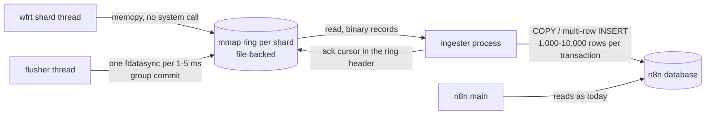

# Execution records off the hot path: shard rings and a batch ingester

Status: design, agreed 2026-11-13, format revised 2026-11-16. Not built yet.

## Why

The goal is 100,000 workflows per second on one core for `wfrt`. The budget is 10 µs per workflow. Today, every
durable event (at least `started` and `finished` per workflow) costs:

- one `write()` system call in the shard thread (`src/shell/outbox.zig` `Record.flush`), and one `fsync` per event
  on the `sync` tier;
- one `pread` to read it back for the event stream, a JSON line on a socket, and per-event handling in n8n's main
  process with one database round trip (TypeORM).

Measured on one pinned VM core (W3, 30,000 in flight, 2026-11-13): 112,764 wf/s at 8.87 µs per workflow without
the on-disk outbox, and 86,312-88,829 wf/s at 10.7-11.0 µs with it. The outbox costs about 2 µs per workflow. n8n's
per-event handling caps at about 1,000-5,000 executions per second. Neither fits.

## Design

1. **Ring.** Each shard has one memory-mapped, file-backed ring (`<log dir>/ring-<shard>.bin`, mode 0600). The shard
   thread copies a binary record into it and moves a write cursor (an atomic store with release order in the ring
   header). No system call per event. The ring replaces the outbox segment files. It may later replace the shard log
   too, so that each event is written once.
2. **Group commit.** A flusher thread calls `fdatasync` on the ring file once per interval (default 2 ms) when the
   write cursor moved, then publishes a durable cursor. A `sync`-tier execution is confirmed (its webhook answered)
   only after the durable cursor passes its record. No event pays its own `fsync`.
3. **Ingester.** A separate process (started by n8n's compiled-engine module, outside the 1-core budget) reads the
   ring file from its own cursor, decodes records in batches, writes them to n8n's database in one transaction per
   batch (Postgres `COPY` or multi-row `INSERT`; SQLite multi-row `INSERT`), then writes the ack cursor into the ring
   header. `wfrt` reuses ring space up to the ack cursor. A full ring refuses new work with 503, as the outbox does.
4. **What goes to the database.** The execution row always. Node data only when the workflow's save settings ask for
   it (`saveData`); at scale the default should save node data for errors only. n8n's main process is not on this
   path. Watched and manual runs keep the live event stream for the canvas.

## Fixed format (both cards build to it)

Revised 2026-11-16 to meet the Zig coding standards (`docs/zig-standards.md`): each record has a checksum, a
version and a writer epoch, and the ring is untrusted input for its reader.

- Ring header (one page, `extern struct`, little-endian, comptime size check):
  - Fixed part, written once when the file is made: `magic: u64`, `version: u16`, `shard: u16`, `reserved: u32`,
    `capacity: u64` (bytes of the record area, a multiple of 8), `epoch: u64`, `header_checksum: u32` (CRC-32C of
    the fields before it).
  - Cursors, each a `u64` on its own cache line: write cursor, durable cursor, ack cursor. A cursor is a byte
    count since the ring was made. It never wraps: the offset is `cursor % capacity`.
- Record header, 48 bytes, `extern struct` with a comptime size check:
  `{ checksum: u32, len: u32, seq: u64, epoch: u64, exec_id: u64, at_ms: i64, kind: u8, flags: u8, version: u16,
  reserved: u32 }`, then `len` bytes of payload, padded to 8.
  - `checksum` is CRC-32C of the rest of the header and the payload. Budget: about 20 ns for a 200-byte record
    with the CPU's CRC instruction, inside the 1 µs target.
  - `seq` increases by exactly one for each record of a shard. A gap or a repeat is corruption.
  - `epoch` names the writer. `wfrt` takes a new epoch at each start (the stored epoch plus one). A reader
    refuses a record whose epoch is lower than the epoch of the header.
  - `version` is the version of the payload layout of the kind. A reader refuses a version that it does not know.
  - A record never wraps: when it does not fit at the end, a `wrap` record fills the rest and the next starts at
    offset 0.
- Kinds: `started` (workflow id, trigger mode), `waiting` (wait till, resume token), `finished` (status, error text,
  node data JSON when saved), `static_data` (workflow id, document), `wrap`. Payload: length-prefixed UTF-8 fields
  in a fixed order per kind. Each length is checked against the rest of the record before use.
- Golden files: one ring file of each version in `src/shell/testdata/`, read by a Zig test and by the ingester's
  tests.

## Rules that both sides obey

- **The file has its full size from the start.** `wfrt` makes the ring file at `capacity` plus one page, writes
  zeroes, and syncs the file and its directory before the first record. A steady-state write never changes the
  file size.
- **Acknowledge after durable.** Only the flusher moves the durable cursor, and only after `fdatasync` returned 0.
- **A failed sync is fatal.** After an `fdatasync` error the kernel may have dropped the pages. `wfrt` stops and
  recovers from the ring at the next start. It does not try the sync again.
- **The ring is untrusted input for its reader.** The ingester and `wfrt` at recovery copy each cursor into a local
  once, check the local (`ack <= durable <= write`, `write - ack <= capacity`, a multiple of 8), then use only the
  local. They check `len` against the limit and against the cursor before they read the payload. The ring holds
  offsets, never pointers.
- **Recovery stops at the first bad record.** A record with a bad checksum at the durable cursor or after it is a
  torn tail: recovery sets the write cursor there. A bad record before the durable cursor is corruption: `wfrt`
  does not start, and it names the shard and the offset.
- **Pressure comes before full.** Above a high-water mark (default 75% of `capacity` between the ack cursor and
  the write cursor) `wfrt` refuses new starts with 503 and a `Retry-After` header. Executions in flight still
  write their records. The space above the mark is theirs. A full ring is then a limit that only a stalled
  ingester for a long time can reach, and it fails the execution with a counted reason.
- **Every refusal has a counter.** `ring_refused_high_water`, `ring_full`, `ring_sync_failed`, `ring_torn_tail`
  and `ring_bad_record` are counters of the shard, shown by the admin stats.
- **The database write is idempotent.** The key is the execution id. A batch that is sent twice, after a crash or
  a lost connection during the commit, does no harm. An unknown outcome is always sent again. The ack cursor moves
  only after the commit returned.
- **The ingester is crash-only.** It starts from the ack cursor each time. `wfrt` does not depend on it to be up.

## Cards (briefs in the handoff folder: `/Users/craig/work/engine-test-full/handoff/cards/`)

- `RING` (Zig): ring, flusher thread, record writer, the stream reads from the ring for watched runs, the 503 limit,
  restart from the durable cursor, tests, fuzz target for the record reader. Removes the outbox segment files.
  The crash simulation tears the last record and drops unsynced bytes at each write and sync.
- `INGEST` (TypeScript, n8n): the ingester process and batch repository methods in `@n8n/db` (use-case named, no
  TypeORM in business logic), cursor and ack, idempotent by execution id, tests with a ring file written by a test.

## Measure

- W3 on one VM core with the ring, against W3 without any durable events (`--log-dir` unset): the ring must cost
  at most 1 µs per workflow.
- The ingester must sustain 100,000 execution rows per second into Postgres on its own cores.
