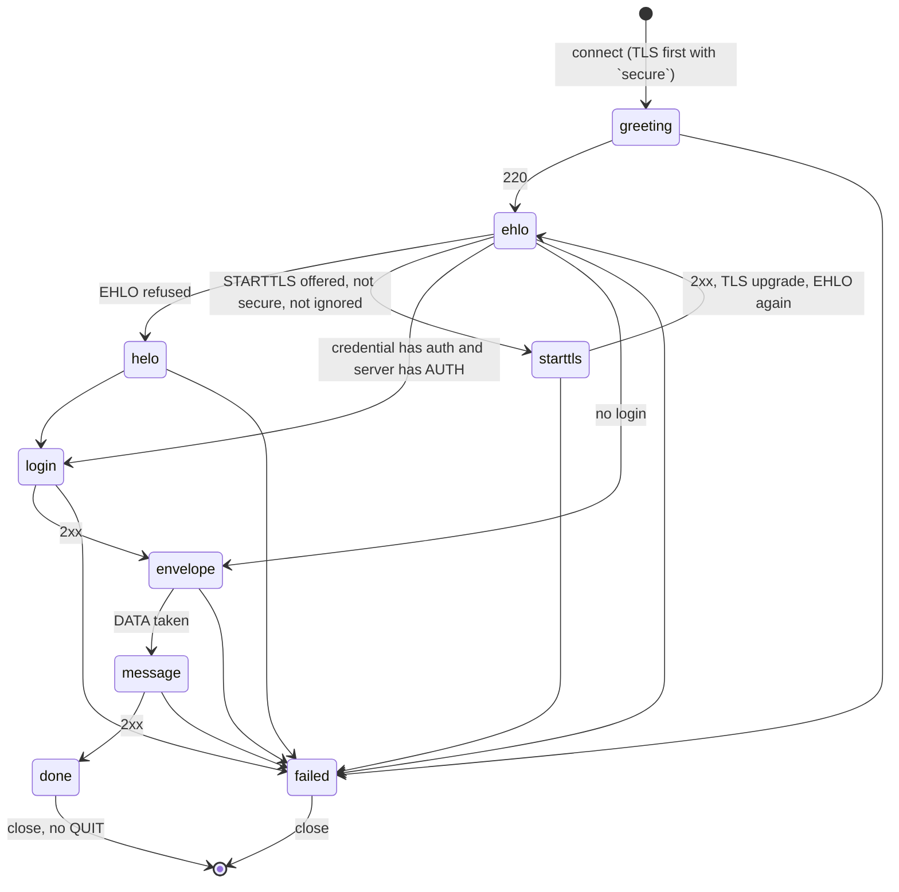

# The `smtp` effect: a native SMTP client for the Send Email node

Status: the runtime side is built and tested against a scripted server: the pure state machine
(`src/core/smtp.zig`), the message builder (`src/core/mail.zig`), the session and the settings of the
credential (`src/shell/smtp_call.zig`), the connection on the event loop (`src/shell/smtp.zig`) and the effect
kind 8, behind `--smtp-native` (off by default). The SDK, the compiler and the reference runner have
`ctx.smtp` with the fields of the message. The `emailSend` library node sends with the effect, and the Gmail
library node gets its messages from the builder (a call with `build`). The converter links both only with
the option `smtp`, which n8n sets from `N8N_COMPILED_ENGINE_SMTP_NATIVE` (off by default). Without it, the
Send Email node runs in the fallback host, as before.

## Why

The Send Email node (`emailSend`) sends with nodemailer over SMTP. A compiled module cannot use nodemailer:
`configureTransport` does not compile. The node keeps 121 of 4,876 sampled workflows out of full compilation.
The `smtp` effect lets a library node give the fields of a message to the runtime. The runtime builds the
message and speaks SMTP itself.

## What v1 does

Paths: `N` is `packages/nodes-base/nodes/EmailSend`, `C` is `packages/nodes-base/credentials/Smtp.credentials.ts`,
and `M` is `nodemailer@10.1.4/dist/cjs` (the version in the lock file).

### The node

| Fact | Where |
|---|---|
| The `send` operation reads `fromEmail`, `toEmail`, `subject`, `emailFormat` (`text`, `html`, `both`) and `options` for each item. Address values go through `toMailAddressString` (an array is joined with `, `), the subject and the bodies through `toMailString` | `N/v2/send.operation.ts:199-207`, `N/utils.ts:1-15` |
| Options: `appendAttribution`, `attachments`, `fileAttachments` (version 2.2), `ccEmail`, `bccEmail`, `allowUnauthorizedCerts`, `replyTo` | `N/v2/send.operation.ts:113-173` |
| The mail options are `from`, `to`, `cc`, `bcc`, `subject`, `replyTo`, then `text` for `text` and `both`, and `html` for `html` and `both` | `N/v2/send.operation.ts:211-228` |
| The attribution is on when the option is not set and the node version is 2.1 or more. For `html`, or `both` with HTML that is not empty, the HTML gets a block with a link that has the instance id. If not, the text gets `\n\n---\nThis email was sent automatically with n8n\nhttps://n8n.io` | `N/v2/send.operation.ts:230-250`, `packages/nodes-base/utils/utilities.ts:441` |
| Attachments are read only when the item has binary data. `attachments` gives `{filename, content, cid}` for each name in the list, `fileAttachments` gives `{filename, content}`. The file name is `unknown` when the binary has none | `N/v2/send.operation.ts:252-281` |
| A new transport is made for each item, and one message is sent on it | `N/v2/send.operation.ts:209`, `:283` |
| The result of an item is the `info` object of nodemailer, with `pairedItem` | `N/v2/send.operation.ts:285-290` |
| An error becomes `NodeApiError(node, error)` after `delete error.cert`. With "continue on fail" the item is `{ error: error.message }` | `N/v2/send.operation.ts:291-305` |
| `sendAndWait` waits for a webhook. It stays in the host | `N/v2/sendAndWait.operation.ts` |

### The credential and the transport

| Fact | Where |
|---|---|
| The `smtp` credential has `user`, `password`, `host`, `port` (465), `secure` (true), `disableStartTls` (shown when `secure` is false) and `hostName` | `C:10-63` |
| `host`, `port` and `secure` go to nodemailer as they are. `ignoreTLS` is `disableStartTls`, only when `secure` is false. `name` is `hostName` when it is a string that is not empty. `auth` is `{user, pass}` when the user or the password is set. `tls.rejectUnauthorized` is false with `allowUnauthorizedCerts` | `N/v2/utils.ts:20-52` |
| File and URL access of nodemailer is off | `N/v2/utils.ts:48-51` |
| The port is `Number(port)`, or 465 with `secure` and 587 without. The host is `localhost` when it is empty. With no `secure` value and port 465 the connection is secure | `M/smtp-connection/index.js:171-180` |
| The EHLO name is `name`, or the host name of the machine when it has a dot, or `[127.0.0.1]`; an IPv4 address is put in `[]`; CR and LF are removed | `M/smtp-connection/index.js:181`, `:2041-2060` |
| `secure` true: TLS from the first byte, on any port, with SNI when the host is not an IP address. `secure` false: a plain socket | `M/smtp-connection/index.js:314-320`, `:402-406` |
| No pool: each message has its own connection. After the message the client closes the socket and sends no QUIT | `M/smtp-transport/index.js:176`, `:212-219` |
| Time limits: 2 minutes for the connection (name lookup included), 30 s for the greeting and for the TLS upgrade (cut by the rest of the connection time), 10 minutes without bytes on the socket | `M/smtp-connection/index.js:50-54`, `:419`, `:443-445`, `:809`, `:823`, `:1123` |

### The session

| Step | What nodemailer does | Where (`M/smtp-connection/index.js`) |
|---|---|---|
| Replies | Lines end with LF or CRLF. A line that starts with digits and `-` continues the reply; the lines are joined with `\n`. A blank reply is skipped. The bytes are UTF-8 when they are valid UTF-8 without U+FFFD, and Latin-1 if not. A reply over 1 MB ends the connection | `:854-898`, `:86-95`, `:1152-1170` |
| Greeting | Must start with `220`, or `Invalid greeting. response=…` (EPROTOCOL, command CONN). Then `EHLO name` | `:1475-1489` |
| EHLO | `421`: `Server terminates connection. response=…` (ECONNECTION, EHLO). Another reply that does not start with `2`: `HELO name`. A refused HELO: `Invalid HELO. response=…` (EPROTOCOL, HELO). After HELO the client assumes AUTH and has no list of extensions | `:1513-1538`, `:1609-1617` |
| STARTTLS | Sent when the connection is not secure, `ignoreTLS` is off and the reply has `STARTTLS`. This holds on every port. A refusal is an error: `Error upgrading connection with STARTTLS` (ETLS, STARTTLS). After the upgrade the buffered bytes are dropped and EHLO is sent again | `:1529-1535`, `:1626-1669`, `:1074-1092` |
| Extensions | `SMTPUTF8`, `DSN`, `8BITMIME`, `REQUIRETLS`, `PIPELINING`, `AUTH` and `SIZE` are read from the last EHLO reply. The mechanisms come from the `AUTH` lines, in the order PLAIN, LOGIN, CRAM-MD5, XOAUTH2 | `:1545-1601` |
| Login | Only when the credential has `auth` and the server has AUTH. The method is the first that the server offers, or PLAIN. A user or a password that is empty gives `Missing credentials for "PLAIN"` (EAUTH, API). PLAIN sends `AUTH PLAIN base64(\0user\0pass)` in one line. LOGIN sends `AUTH LOGIN`, then the user and the password in base64 after each `334`. A `334` at the end is answered with an empty line. A refusal gives `Invalid login` (EAUTH, `AUTH PLAIN` or `AUTH LOGIN`) | `M/smtp-transport/index.js:137-146`, `:253-267`; `:531-564`, `:642-667`, `:1681-1691`, `:1750-1806` |
| Envelope | The sender is the first address of From (or of Reply-To or Sender when From gives none). The recipients are the addresses of To, Cc and Bcc, each once | `M/mime-node/index.js:1011-1038` |
| Envelope checks | No recipient: `No recipients defined`. CR, LF, `<` or `>` in an address: `Invalid sender "…"` or `Invalid recipient "…"` (all EENVELOPE, API). The checks run after the login | `:1243-1263` |
| MAIL FROM | `MAIL FROM:<from>`, with ` SMTPUTF8` when an address is not ASCII and the server has the extension. No `BODY=8BITMIME` and no `SIZE=`: the transport never sets them | `:1297-1329` |
| Pipelining | With `PIPELINING`, MAIL FROM, every RCPT TO and DATA go in one write, and the reply to DATA decides. Without it, one command goes at a time | `:1291`, `:1331-1346`, `:1860-1883` |
| RCPT TO | A refusal is kept in `rejected` and `rejectedErrors` (`Recipient command failed`, EENVELOPE, RCPT TO, with `recipient`). With no accepted recipient: `Can't send mail - all recipients were rejected`, with the reply of the first deferred recipient (code below 500) or of the last one | `:1831-1850`, `:1892-1910` |
| DATA | A reply that starts with `2` or `3` starts the message. If not: `Data command failed` (EENVELOPE, DATA). Pipelined, with a refused sender: the error of MAIL FROM (`Mail command failed`). Pipelined, with no recipient and `354`: the client sends `.` and then reports the error | `:1918-1957` |
| Message | A lone CR or LF becomes CRLF, a dot at the start of a line is doubled, and the end is `.` on its own line. A last reply that does not start with `2`: `Message failed` (EMESSAGE, DATA) | `M/smtp-connection/data-stream.js`, `:1966-1971` |
| 421 | A `421` reply during the envelope ends the message with the error of MAIL FROM, or `Server closed the connection` (ECONNECTION, CONN) | `:835-846`, `:1176-1185` |
| Close | A close that nobody asked for: `Connection closed unexpectedly` (ECONNECTION, or ETLS during the upgrade; CONN). Bytes after the last line are the `response` when they start like a 4xx or 5xx reply | `:981-1028` |
| Error form | `message` is the text, then `: ` and the reply. `code`, `response`, `responseCode` (the digits at the start of the reply) and `command` are properties | `:946-974` |

### The result

`info` has, in this order: `accepted`, `rejected`, `ehlo` (the lines of the last EHLO reply after the first, when
there is one), `rejectedErrors` (when a recipient was refused), `envelopeTime` and `messageTime` (ms),
`messageSize` (the bytes of the message on the wire, with the added dots and the end), `response` (the last
reply), `envelope` (`from`, `to`) and `messageId`
(`M/smtp-connection/index.js:737-742`, `:1946-1956`, `M/smtp-transport/index.js:227-231`).

### The message

MailComposer builds the message (`M/mail-composer/index.js:65-121`, `M/mime-node/index.js`):

- **Structure.** Text only: `text/plain`. HTML only: `text/html`. Both: `multipart/alternative` with the text
  first. An attachment with `cid` is "related": with HTML it goes in `multipart/related; type="text/html"` beside
  the HTML. Without HTML, and for every attachment without `cid`, the root is `multipart/mixed`
  (`M/mail-composer/index.js:69-71`, `:212-213`, `:394-499`).
- **Headers of the root**, in this order: From, To, Cc, Reply-To, Subject, Message-ID, Content-Transfer-Encoding
  (a root that is not multipart), Date, MIME-Version, then Content-Type last (`M/mail-composer/index.js:103-115`,
  `M/mime-node/index.js:603-630`). Bcc is not written (`M/mime-node/index.js:709-714`).
- **Random and time values.** `Message-ID` is `<8hex-4hex-4hex-4hex-12hex@domain>` from 16 random bytes; the
  domain is the part after `@` of the envelope sender, or `localhost` (`_generateMessageId`). `Date` is the time
  of the build in UTC with `+0000` (`:614-615`). A boundary is `--_NmP-<16 random bytes in hex>-Part_<n>`
  (`_generateBoundary`).
- **Body encoding.** A text body that is ASCII with no line over 76 characters goes as `7bit`. If not, it goes
  as quoted-printable when it has more ASCII letters than bytes that need encoding, and as base64 if not
  (`getTransferEncoding`, `M/mime-node/index.js:571-597`, `_getTextEncoding`). An attachment goes as base64 in lines of 76.
- **Header encoding.** A header value that is not ASCII goes as encoded words, and a long header is folded.

## The native route

`src/core/smtp.zig` is the pure core:

- `takeReply` frames and decodes one reply from the bytes that are read.
- `Client` holds the state of one message. `onReply` gives the next step: `wait`, `tls`, `data`, `done` or
  `failed`. `onSecured`, `onClose`, `onTimeout` and `onTransportError` are the other events.
- `Stuffer` encodes the message for DATA and counts `messageSize`.
- `writeResult` writes `info` without `envelope` and `messageId`: the shell adds both from the builder.
  `writeFailure` writes `{"error":{message, code, response?, responseCode?, command, rejected?, rejectedErrors?}}`.

The call of the effect is `{credential, from?, to?, cc?, bcc?, replyTo?, subject?, text?, html?, attachments?,
allowUnauthorizedCerts?}` (`SmtpRequest` of the SDK). An attachment is `{filename, cid?, data, id?}`: `data` is
base64, or the mode name of n8n's binary data store with the file in `id`, and the shell then reads the stored
file (`binary_store.zig`). The attribution is not a field: the node adds it to `text` or `html`. The shell reads host, port, `secure`, `disableStartTls`, `hostName`, user and password from the
credentials document when the call starts, as the `sql` effect does. Node code never sees them. The values are
copied into the call slot. The copy is overwritten when the MAIL command is written (the login is over), the
login commands leave the write buffer when it is empty after that, and both are overwritten again when the
call ends.

Without `--smtp-native` the shard has no SMTP client, and an `smtp` step ends with
`smtp: the native SMTP client is not on in this build (limit: smtp-host)`.

A call with `build: true` builds the message and sends nothing. It needs no credential, and the runtime
makes no connection. The result is `{raw, messageId}`: `raw` is the message in base64 with `-` and `_`,
without padding, as `encodeEmail` of the Gmail node writes it for the Gmail API. Three more fields are for
the mail options of the Gmail node: `inReplyTo`, `references` and `keepBcc` (the message has the Bcc
header). A file can have a `contentType`: the Gmail node gives the type of the binary data, and the Send
Email node gives none, so nodemailer takes the type from the file name.

## The message builder

`src/core/mail.zig` builds the message from the fields: `build(fields, entropy, work)`. It allocates nothing:
the message, the envelope and a work space of 256 KiB are buffers of the caller. The call slot has the message
buffer (`--smtp-max-message-kb`), and the shard has one work space.

**Equal to nodemailer byte for byte** (500 generated field sets, `mailcase_tables.zig`):

- The structure: one text part, `multipart/alternative` for text and HTML, `multipart/related` for HTML with
  files that have a `cid`, `multipart/mixed` with other files, one file alone, and a message without a body.
- The header order of each node, and the fold of a header at 76 characters.
- The addresses of From, To, Cc and Reply-To: `a@b`, `<a@b>`, `Name <a@b>` and `"Name" <a@b>`, the quotes of a
  name, the encoded words of a name that is not ASCII, the domain in lower case. Bcc gives no header.
- The Subject: a line break becomes a space, and a value with `"`, a control character or a character that
  is not ASCII goes as encoded words (Q or B by the count of nodemailer, 52 characters for each word).
- The encoding of a text part: `7bit`, quoted-printable or base64 (`getTransferEncoding`). Quoted-printable
  has the soft line breaks of `qp.wrap`, and the slices of 64 KiB and the white space at the end as
  `qp.Encoder` handles them.
- A file: base64 in lines of 76, the content type from the table of nodemailer (`mailmime_tables.zig`, 1,013
  extensions), `name` and `filename` with their quotes, `Content-ID`, and `inline` for an image with a `cid`.
- The envelope: the first address of From (or of Reply-To), and each address of To, Cc and Bcc once.
- The mail options of the Gmail node (300 more field sets, built as `encodeEmail` builds them with
  `MailComposer` and `keepBcc`): the Bcc header, In-Reply-To and References (each id in `<` and `>`), a
  file with a content type, and the address lists of `prepareEmailsInput` (`<a@b>, <c@d>, `).

**From the runtime, in the format of nodemailer:** 8 random bytes for the boundaries
(`--_NmP-<16 hex>-Part_<n>`), 16 random bytes for the Message-ID (`<8-4-4-4-12 hex@domain>`), and the clock
for the Date header (`Tue, 17 Nov 2026 10:00:00 +0000`). A comparison with v1 must mask these 32 hex digits,
the 16 hex digits of each boundary and the Date value. The vectors do not mask them: the generator gives
nodemailer the same bytes and the same time.

**Not built here: the builder answers `error.HostOnly`, and the call ends with the marker `smtp-host`
before a connection is open.** An address with a group, a comment, an escape in quotes, a local part or a
domain that is not ASCII, a domain that is an IP address, has an IDNA label or ends with a dot; a name with
`@`, a control character or a Unicode space; a file name that is not printable ASCII, has `"`, or has 75
characters or more; a file of the type `message/*`; a `cid` that is not printable ASCII; a field that is not
valid UTF-8; more than 16 files or 256 recipients; an In-Reply-To or References value with a control
character or a character that is not ASCII; a content type of a file that is not `type/subtype` in token
characters (a type with a parameter).

## The hand-over to the host

The marker `(limit: smtp-host)` sends the step to the fallback host, where the v1 node sends the message. The
message must go out once, so the marker is raised only while no MAIL command is written:

| Where | Case |
|---|---|
| `Runner.startSmtpCall` (`server.zig`) | The gate is off |
| `Client.prepare` and `compose` (`smtp.zig`), before a connection | The call or the message is over `--smtp-max-message-kb`, the builder does not take the message (see "The message builder"), a stored file cannot be read, or the credential has a `secure` that is not a boolean, a port over 65535, or a value that is too long |
| `Client.hostOnly` (`smtp.zig`), which asserts that the envelope did not start | A host name without an address (nodemailer has its own resolver and text), a connect error for a host with more than one address (Node.js reports all of them in one error), a TLS handshake that failed (the text of Node.js has no native form) |
| `onEhlo` and `connected` (`core/smtp.zig`), before AUTH | An EHLO reply that is not ASCII; a server that offers only CRAM-MD5 |
| `Session.writeOutcome` (`smtp_call.zig`) | Any other limit of the buffers, when `envelopeStarted` is false |

After the MAIL command a limit is a plain error (`(limit)`, no marker): the step fails and the host does not
send the message.

## Limits and known differences

| Case | v1 | The native client |
|---|---|---|
| The server offers only CRAM-MD5 or XOAUTH2 | CRAM-MD5 login | Hand-over before AUTH: the call runs in the host |
| An EHLO reply that is not ASCII | Lines after `trim` of JavaScript | Hand-over before AUTH: the call runs in the host |
| More than 8 replies `334` at the end of a login | An empty line for each, without a bound | Hand-over (the MAIL command is not written) |
| A reply over 64 KiB, or kept texts over 256 KiB | 1 MB for one reply | Hand-over before the MAIL command; a plain limit error after it |
| A name lookup that fails, a connect error for a host with more than one address, a TLS error | Errors with the texts of nodemailer and Node.js | Hand-over: no command was written |
| `rejectedErrors` | Error objects. Their JSON (the saved run data) has no `message` | The effect gives objects with `message`, `code`, `response`, `responseCode`, `command`, `recipient`. The library node gives the JSON of v1, without `message`. An expression of a later node that reads `message` gets no value |
| A reply with more than 15 digits at its start | `responseCode` is a rounded number | The first 15 digits |
| `envelopeTime`, `messageTime` | Times of the run | Times of the run: a comparison must ignore them |
| QUIT | Not sent | Not sent |

## What is built

| Part | State |
|---|---|
| The statement of v1 | This file |
| The state machine, the reply framing, the DATA encoding, the result and the error JSON | `src/core/smtp.zig`, with tests against scripted dialogues |
| The settings from the `smtp` credential (`loadSettings`), and `Session`: one message over a read and a write buffer, with the message sent in parts and the outcome (`info`, `{"error":…}`, or a limit with or without the marker `smtp-host`) | `src/shell/smtp_call.zig`, with tests against a scripted server in memory |
| The connection on the event loop of the shard: socket, name lookup, TLS from the first byte and after STARTTLS through `tls.zig`, the four time limits, call slots (`--smtp-max-requests`, 16), the arguments of the call, the credential | `src/shell/smtp.zig`; `src/shell/smtp_fake.zig` is the scripted server on a loopback socket, with TLS |
| The effect kind `smtp` (8) and the gate `--smtp-native` | `src/core/module.zig`, `src/shell/server.zig`, `src/main.zig` |
| The message of MailComposer from the fields, with the content types of nodemailer | `src/core/mail.zig`, `src/core/mailmime_tables.zig`; vectors from the real nodemailer in `src/core/mailcase_tables.zig` (`node src/core/gen_mail_cases.mjs`, run by hand); the fuzz target `fuzz mail builder` |
| `ctx.smtp` with the fields, in the SDK, the compiler, the reference runner and the test VM | `packages/@n8n/workflow-lang`: `src/sdk/index.ts`, `src/compiler`, `src/reference/runner.ts`, `src/__tests__/smtp-effect.test.ts` |
| The `emailSend` library node (versions 2 and 2.1, operation `send`), the converter lowering behind the convert option `smtp`, the n8n setting `N8N_COMPILED_ENGINE_SMTP_NATIVE` | `packages/@n8n/workflow-lang/src/nodes/email-send.ts`, `src/convert/library.ts`, `packages/cli/src/modules/compiled-engine` |
| The proof against v1: the v1 node and the runtime against one scripted SMTP server on a loopback socket | `src/nodes/__tests__/email-send-equivalence.test.ts` (48 cases), `smtp-server.ts`, `smtp-runtime.ts` |
| The call with `build`, and the Gmail library node on it (`message.send`, `message.reply`, `thread.reply`, `draft.create`, with files) | `src/shell/smtp.zig` (`writeBuilt`), `src/nodes/gmail.ts`, `src/nodes/__tests__/gmail-mail-builder.test.ts` |

## What the library node does

The runtime builds the message, so the node has no MIME code. It does what `send.operation.ts` does:

- **Fields.** `toMailAddressString` for the addresses, `toMailString` for the subject and the bodies, `text`
  for the formats `text` and `both`, `html` for `html` and `both`.
- **The attribution.** On when the option is not set and the version is 2.1 or more. The link has the
  instance id (`ConvertOptions.instance`, as the Telegram node uses it).
- **Attachments.** Only when the item has binary data: `{filename: fileName || 'unknown', cid, data, id}` for
  each name of `attachments` (`prepareBinariesDataList`), and the same without `cid` for each name of
  `fileAttachments`.
- **The result.** The result of the effect is `info`. The item is its JSON as v1 gives it: the members in
  the order of nodemailer, and each entry of `rejectedErrors` without `message`.
- **The error.** An `{error}` result becomes the `NodeApiError(node, error)` of v1: the message of nodemailer
  (or the text of n8n for a code of Node.js in the message, `COMMON_ERRORS`), no description, and the
  `code` of nodemailer as the HTTP code. Under a continue setting the item is `{ error: message }` with the
  message of nodemailer as it is. With the error output, the item has the JSON of the input item and the
  error, without binary data.
- **Per item.** v1 makes one transport and one message for each item. The converter calls the node once
  for each item.
- **The hand-over.** When the effect ends with the marker, the converted workflow runs the v1 node in the
  fallback host for that item only (the step `<node> (fallback host)`). The items before it are not sent
  again. n8n then moves the node to the host for the next runs.
- **The gate.** The converter links the node only with the option `smtp` (the n8n setting
  `N8N_COMPILED_ENGINE_SMTP_NATIVE`, off by default, as `mysql` is). With the attribution and no instance
  id, the node stays in the host. `sendAndWait` is not a call of the library node.
- **Retry on fail.** v1 runs the node again for all items, so it sends the messages before the failure
  again. The step does the same: the loop of the tries is around the loop of the items. With "retry on
  fail" and the error output together, the node stays in the host.

## Tests

`src/core/smtp.zig` (fast tier), each against a scripted dialogue of the server:

- A message without login, one command at a time; the `info` JSON.
- STARTTLS, the second EHLO, AUTH PLAIN, a pipelined envelope, and a rejected recipient among accepted ones.
- AUTH LOGIN; a refused login for PLAIN and LOGIN; a credential without a password; a server without AUTH.
- Each failure point before the envelope: the greeting, EHLO with 421, a refused HELO.
- STARTTLS refused; STARTTLS ignored; HELO, which has no STARTTLS.
- MAIL FROM refused; every recipient refused (the deferred reply is reported); DATA refused; the message refused.
- A pipelined envelope with no recipient and `354`; a refused sender; a `421` reply.
- Addresses that nodemailer refuses; SMTPUTF8 and its message for `550`.
- A closed connection, with and without a last reply; the time limits; a socket error.
- Replies in parts, blank lines, Latin-1 bytes; the DATA encoding.

`src/core/mail.zig` (fast tier):

- Each of the 500 vectors: the message, the envelope and the Message-ID equal nodemailer, or the builder
  refuses the fields. More than 6 of 10 vectors must build.
- A buffer that is too small is a limit, and no byte goes past it. The Date header.
- `fuzz mail builder` (`src/core/fuzz_test.zig`): any bytes in the fields.

`src/shell/smtp_call.zig` (fast tier): the server sends three bytes at a time.

- STARTTLS with bytes after the `220` reply (dropped), login, and a message larger than the write buffer.
- A refused login; a close with a last reply; a server with only CRAM-MD5 (the marker `smtp-host`).
- The settings of the credential: `secure`, the default port, `disableStartTls`, `hostName`, no user.

`src/shell/smtp_test.zig` (fast tier), the client on the event loop against `smtp_fake.zig` on a loopback
socket:

- Login, a pipelined envelope, a rejected recipient among accepted ones, the built message on the wire with
  fixed random bytes and time, `envelope` and `messageId` of the result, a Bcc recipient, no QUIT.
- A field that is not a string, and an address group (the marker `smtp-host`, no connection).
- A refused login; a close with a last reply; a refused connection (`connect ECONNREFUSED 127.0.0.1:1`).
- The hand-over for CRAM-MD5 and for an EHLO reply that is not ASCII: the server saw only EHLO.
- The time limit of the greeting; the limit of the call slots.
- STARTTLS and TLS from the first byte with the certificate of the tests; a certificate that is not trusted.

`src/shell/server.zig`: a module with an `smtp` step through the shard, without the gate (the marker, no
connection) and with it (the result resumes the run).

`packages/@n8n/workflow-lang/src/__tests__/smtp-effect.test.ts`: `ctx.smtp` in the compiler, the reference
runner and the bytecode VM.

`packages/@n8n/workflow-lang/src/nodes/__tests__/email-send-equivalence.test.ts`, with `wfrt` built: each
case runs the v1 node (nodemailer in n8n's engine) and the library node against one scripted SMTP server
on a loopback socket. `wfrt serve --smtp-native` answers the `smtp` effects of the library node, and runs
the whole converted workflow as bytecode. The test compares the result or the error, the commands and the
message, with the Message-ID digits, the boundaries, the Date value and the two times masked. The cases:
text, HTML and both with the attribution, versions 2 and 2.1, a subject and names that are not ASCII,
quoted-printable and base64 bodies, cc, bcc and reply-to, values that are not texts, files and inline
files from binary data, a binary field that is missing, two items, a refused recipient, every recipient
refused, no recipient, a refused login, AUTH LOGIN, no AUTH, a refused message, no pipelining, STARTTLS,
STARTTLS turned off, TLS from the first byte, a certificate that is not trusted and an address group (both
go to the host), a port without a server, and the continue settings. Without `wfrt`, the library node
runs on the recorded results.

`gmail-mail-builder.test.ts`, with `wfrt` built: the requests of the v1 Gmail node and of the library node,
with the message of `raw` from the call with `build`, byte for byte with the same masks.

## What the bed must run live

`wfrt --smtp-native` against a real SMTP server (for example Mailpit or Postfix on loopback): one message with
`secure` on port 465, one with STARTTLS on 587, one without TLS, each with and without a login, and one with a
refused recipient. Send these forms: text, HTML with the attribution, both, a subject and a name that are not
ASCII, a body over 64 KiB, an inline image with a `cid`, and a file from the binary data store. Compare `info`
and the received message with the v1 node on the same server. Mask `envelopeTime`, `messageTime`, the hex
digits of the Message-ID, the Date value and the hex digits of the boundaries.
