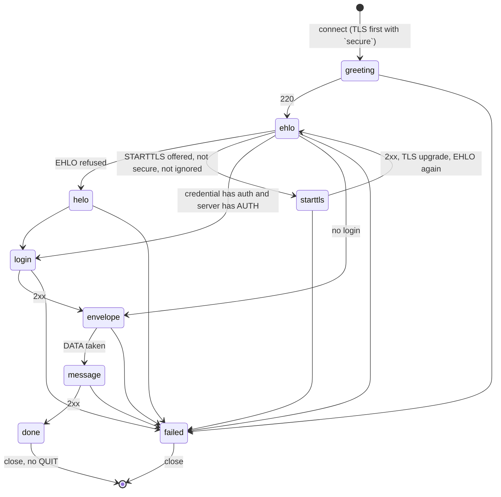

# The `smtp` effect: a native SMTP client for the Send Email node

Status: the statement of v1, the pure state machine (`src/core/smtp.zig`) and the session over byte buffers
with the settings of the credential (`src/shell/smtp_call.zig`) are built and tested. The connection on the
event loop, the effect kind and the library node are not built: see "What is built". Until they are, the Send
Email node runs in the fallback host, as before.

## Why

The Send Email node (`emailSend`) sends with nodemailer over SMTP. A compiled module cannot use nodemailer:
`configureTransport` does not compile. The node keeps 121 of 4,876 sampled workflows out of full compilation.
The `smtp` effect lets a library node give a built message and an envelope to the runtime, and the runtime
speaks SMTP itself.

## What v1 does

Paths: `N` is `packages/nodes-base/nodes/EmailSend`, `C` is `packages/nodes-base/credentials/Smtp.credentials.ts`,
and `M` is `nodemailer@10.1.4/dist/cjs` (the version in the lock file).

### The node

| Fact | Where |
|---|---|
| The `send` operation reads `fromEmail`, `toEmail`, `subject`, `emailFormat` (`text`, `html`, `both`) and `options` for each item. Address values go through `toMailAddressString` (an array is joined with `, `), the subject and the bodies through `toMailString` | `N/v2/send.operation.ts:199-207`, `N/utils.ts:1-15` |
| Options: `appendAttribution`, `attachments`, `fileAttachments` (version 2.2), `ccEmail`, `bccEmail`, `allowUnauthorizedCerts`, `replyTo` | `N/v2/send.operation.ts:113-173` |
| The mail options are `from`, `to`, `cc`, `bcc`, `subject`, `replyTo`, then `text` for `text` and `both`, and `html` for `html` and `both` | `N/v2/send.operation.ts:211-228` |
| The attribution is on when the option is not set and the node version is 2.1 or more. For `html`, or `both` with HTML that is not empty, the HTML gets a block with a link that has the instance id. If not, the text gets `\n\n---\nThis email was sent automatically with n8n\nhttps://n8n.io` | `N/v2/send.operation.ts:230-250`, `packages/nodes-base/utils/utilities.ts:441` |
| Attachments are read only when the item has binary data. `attachments` gives `{filename, content, cid}` for each name in the list, `fileAttachments` gives `{filename, content}`. The file name is `unknown` when the binary has none | `N/v2/send.operation.ts:252-281` |
| A new transport is made for each item, and one message is sent on it | `N/v2/send.operation.ts:209`, `:283` |
| The result of an item is the `info` object of nodemailer, with `pairedItem` | `N/v2/send.operation.ts:285-290` |
| An error becomes `NodeApiError(node, error)` after `delete error.cert`. With "continue on fail" the item is `{ error: error.message }` | `N/v2/send.operation.ts:291-305` |
| `sendAndWait` waits for a webhook. It stays in the host | `N/v2/sendAndWait.operation.ts` |

### The credential and the transport

| Fact | Where |
|---|---|
| The `smtp` credential has `user`, `password`, `host`, `port` (465), `secure` (true), `disableStartTls` (shown when `secure` is false) and `hostName` | `C:10-63` |
| `host`, `port` and `secure` go to nodemailer as they are. `ignoreTLS` is `disableStartTls`, only when `secure` is false. `name` is `hostName` when it is a string that is not empty. `auth` is `{user, pass}` when the user or the password is set. `tls.rejectUnauthorized` is false with `allowUnauthorizedCerts` | `N/v2/utils.ts:20-52` |
| File and URL access of nodemailer is off | `N/v2/utils.ts:48-51` |
| The port is `Number(port)`, or 465 with `secure` and 587 without. The host is `localhost` when it is empty. With no `secure` value and port 465 the connection is secure | `M/smtp-connection/index.js:171-180` |
| The EHLO name is `name`, or the host name of the machine when it has a dot, or `[127.0.0.1]`; an IPv4 address is put in `[]`; CR and LF are removed | `M/smtp-connection/index.js:181`, `:2041-2060` |
| `secure` true: TLS from the first byte, on any port, with SNI when the host is not an IP address. `secure` false: a plain socket | `M/smtp-connection/index.js:314-320`, `:402-406` |
| No pool: each message has its own connection. After the message the client closes the socket and sends no QUIT | `M/smtp-transport/index.js:176`, `:212-219` |
| Time limits: 2 minutes for the connection (name lookup included), 30 s for the greeting and for the TLS upgrade (cut by the rest of the connection time), 10 minutes without bytes on the socket | `M/smtp-connection/index.js:50-54`, `:419`, `:443-445`, `:809`, `:823`, `:1123` |

### The session

| Step | What nodemailer does | Where (`M/smtp-connection/index.js`) |
|---|---|---|
| Replies | Lines end with LF or CRLF. A line that starts with digits and `-` continues the reply; the lines are joined with `\n`. A blank reply is skipped. The bytes are UTF-8 when they are valid UTF-8 without U+FFFD, and Latin-1 if not. A reply over 1 MB ends the connection | `:854-898`, `:86-95`, `:1152-1170` |
| Greeting | Must start with `220`, or `Invalid greeting. response=…` (EPROTOCOL, command CONN). Then `EHLO name` | `:1475-1489` |
| EHLO | `421`: `Server terminates connection. response=…` (ECONNECTION, EHLO). Another reply that does not start with `2`: `HELO name`. A refused HELO: `Invalid HELO. response=…` (EPROTOCOL, HELO). After HELO the client assumes AUTH and has no list of extensions | `:1513-1538`, `:1609-1617` |
| STARTTLS | Sent when the connection is not secure, `ignoreTLS` is off and the reply has `STARTTLS`. This holds on every port. A refusal is an error: `Error upgrading connection with STARTTLS` (ETLS, STARTTLS). After the upgrade the buffered bytes are dropped and EHLO is sent again | `:1529-1535`, `:1626-1669`, `:1074-1092` |
| Extensions | `SMTPUTF8`, `DSN`, `8BITMIME`, `REQUIRETLS`, `PIPELINING`, `AUTH` and `SIZE` are read from the last EHLO reply. The mechanisms come from the `AUTH` lines, in the order PLAIN, LOGIN, CRAM-MD5, XOAUTH2 | `:1545-1601` |
| Login | Only when the credential has `auth` and the server has AUTH. The method is the first that the server offers, or PLAIN. A user or a password that is empty gives `Missing credentials for "PLAIN"` (EAUTH, API). PLAIN sends `AUTH PLAIN base64(\0user\0pass)` in one line. LOGIN sends `AUTH LOGIN`, then the user and the password in base64 after each `334`. A `334` at the end is answered with an empty line. A refusal gives `Invalid login` (EAUTH, `AUTH PLAIN` or `AUTH LOGIN`) | `M/smtp-transport/index.js:137-146`, `:253-267`; `:531-564`, `:642-667`, `:1681-1691`, `:1750-1806` |
| Envelope | The sender is the first address of From (or of Reply-To or Sender when From gives none). The recipients are the addresses of To, Cc and Bcc, each once | `M/mime-node/index.js:1011-1038` |
| Envelope checks | No recipient: `No recipients defined`. CR, LF, `<` or `>` in an address: `Invalid sender "…"` or `Invalid recipient "…"` (all EENVELOPE, API). The checks run after the login | `:1243-1263` |
| MAIL FROM | `MAIL FROM:<from>`, with ` SMTPUTF8` when an address is not ASCII and the server has the extension. No `BODY=8BITMIME` and no `SIZE=`: the transport never sets them | `:1297-1329` |
| Pipelining | With `PIPELINING`, MAIL FROM, every RCPT TO and DATA go in one write, and the reply to DATA decides. Without it, one command goes at a time | `:1291`, `:1331-1346`, `:1860-1883` |
| RCPT TO | A refusal is kept in `rejected` and `rejectedErrors` (`Recipient command failed`, EENVELOPE, RCPT TO, with `recipient`). With no accepted recipient: `Can't send mail - all recipients were rejected`, with the reply of the first deferred recipient (code below 500) or of the last one | `:1831-1850`, `:1892-1910` |
| DATA | A reply that starts with `2` or `3` starts the message. If not: `Data command failed` (EENVELOPE, DATA). Pipelined, with a refused sender: the error of MAIL FROM (`Mail command failed`). Pipelined, with no recipient and `354`: the client sends `.` and then reports the error | `:1918-1957` |
| Message | A lone CR or LF becomes CRLF, a dot at the start of a line is doubled, and the end is `.` on its own line. A last reply that does not start with `2`: `Message failed` (EMESSAGE, DATA) | `M/smtp-connection/data-stream.js`, `:1966-1971` |
| 421 | A `421` reply during the envelope ends the message with the error of MAIL FROM, or `Server closed the connection` (ECONNECTION, CONN) | `:835-846`, `:1176-1185` |
| Close | A close that nobody asked for: `Connection closed unexpectedly` (ECONNECTION, or ETLS during the upgrade; CONN). Bytes after the last line are the `response` when they start like a 4xx or 5xx reply | `:981-1028` |
| Error form | `message` is the text, then `: ` and the reply. `code`, `response`, `responseCode` (the digits at the start of the reply) and `command` are properties | `:946-974` |

### The result

`info` has, in this order: `accepted`, `rejected`, `ehlo` (the lines of the last EHLO reply after the first, when
there is one), `rejectedErrors` (when a recipient was refused), `envelopeTime` and `messageTime` (ms),
`messageSize` (the bytes of the message on the wire, with the added dots and the end), `response` (the last
reply), `envelope` (`from`, `to`) and `messageId`
(`M/smtp-connection/index.js:737-742`, `:1946-1956`, `M/smtp-transport/index.js:227-231`).

### The message

MailComposer builds the message (`M/mail-composer/index.js:65-121`, `M/mime-node/index.js`):

- **Structure.** Text only: `text/plain`. HTML only: `text/html`. Both: `multipart/alternative` with the text
  first. An attachment with `cid` is "related": with HTML it goes in `multipart/related; type="text/html"` beside
  the HTML. Without HTML, and for every attachment without `cid`, the root is `multipart/mixed`
  (`M/mail-composer/index.js:69-71`, `:212-213`, `:394-499`).
- **Headers of the root**, in this order: From, To, Cc, Reply-To, Subject, Message-ID, Content-Transfer-Encoding
  (a root that is not multipart), Date, MIME-Version, then Content-Type last (`M/mail-composer/index.js:103-115`,
  `M/mime-node/index.js:603-630`). Bcc is not written (`M/mime-node/index.js:709-714`).
- **Random and time values.** `Message-ID` is `<8hex-4hex-4hex-4hex-12hex@domain>` from 20 random bytes; the
  domain is the part after `@` of the envelope sender, or `localhost` (`_generateMessageId`). `Date` is the time
  of the build in UTC with `+0000` (`:614-615`). A boundary is `--_NmP-<16 random bytes in hex>-Part_<n>`
  (`_generateBoundary`).
- **Body encoding.** A text body that is ASCII with no line over 76 characters goes as `7bit`. If not, it goes
  as quoted-printable when it has more ASCII letters than bytes that need encoding, and as base64 if not
  (`getTransferEncoding`, `M/mime-node/index.js:571-597`, `_getTextEncoding`). An attachment goes as base64 in lines of 76.
- **Header encoding.** A header value that is not ASCII goes as encoded words, and a long header is folded.

## The native route

`src/core/smtp.zig` is the pure core:

- `takeReply` frames and decodes one reply from the bytes that are read.
- `Client` holds the state of one message. `onReply` gives the next step: `wait`, `tls`, `data`, `done` or
  `failed`. `onSecured`, `onClose`, `onTimeout` and `onTransportError` are the other events.
- `Stuffer` encodes the message for DATA and counts `messageSize`.
- `writeResult` writes `info` without `envelope` and `messageId`: the node knows both. `writeFailure` writes
  `{"error":{message, code, response?, responseCode?, command, rejected?, rejectedErrors?}}`.

The call of the effect (not built yet) has the credential slot, `from`, `to`, the message and
`allowUnauthorizedCerts`. The shell reads host, port, `secure`, `disableStartTls`, `hostName`, user and
password from the credentials document when the call starts, as the `sql` effect does. Node code never sees
them, and the password leaves the call slot when the call ends.

## Limits and known differences

| Case | v1 | The native client |
|---|---|---|
| The server offers only CRAM-MD5 or XOAUTH2 | CRAM-MD5 login | Limit before a byte of the login goes: the call runs in the host |
| An EHLO reply that is not ASCII | Lines after `trim` of JavaScript | Limit before the login: the call runs in the host |
| More than 8 replies `334` at the end of a login | An empty line for each, without a bound | Limit |
| A reply, the commands or the kept texts over the buffers | 1 MB for one reply | Limit. After DATA is taken the limit is a plain error: the host must not send the message again (`messageSent`) |
| `rejectedErrors` | Error objects | The properties that JSON gives: `code`, `response`, `responseCode`, `command`, `recipient` (no `message`) |
| A reply with more than 15 digits at its start | `responseCode` is a rounded number | The first 15 digits |
| `envelopeTime`, `messageTime` | Times of the run | Times of the run: a comparison must ignore them |
| QUIT | Not sent | Not sent |

## What is built

| Part | State |
|---|---|
| The statement of v1 | This file |
| The state machine, the reply framing, the DATA encoding, the result and the error JSON | `src/core/smtp.zig`, with tests against scripted dialogues |
| The settings from the `smtp` credential (`loadSettings`), and `Session`: one message over a read and a write buffer, with the message sent in parts and the outcome (`info`, `{"error":…}`, or a limit with or without the marker `smtp-host`) | `src/shell/smtp_call.zig`, with tests against a scripted server in memory |
| The connection on the event loop of the shard (socket, name lookup, TLS and the STARTTLS upgrade through `tls.zig`, the four time limits, call slots, the password wiped at the end), a fake server on a socket in the style of `pg_fake.zig`, the effect kind `smtp`, the arguments of the call | Not built. `pg.zig` is the model: one connection for each call, no pool |
| The effect in the SDK and the reference runner, the `emailSend` library node, the converter lowering | Not built |

## Tests

`src/core/smtp.zig` (fast tier), each against a scripted dialogue of the server:

- A message without login, one command at a time; the `info` JSON.
- STARTTLS, the second EHLO, AUTH PLAIN, a pipelined envelope, and a rejected recipient among accepted ones.
- AUTH LOGIN; a refused login for PLAIN and LOGIN; a credential without a password; a server without AUTH.
- Each failure point before the envelope: the greeting, EHLO with 421, a refused HELO.
- STARTTLS refused; STARTTLS ignored; HELO, which has no STARTTLS.
- MAIL FROM refused; every recipient refused (the deferred reply is reported); DATA refused; the message refused.
- A pipelined envelope with no recipient and `354`; a refused sender; a `421` reply.
- Addresses that nodemailer refuses; SMTPUTF8 and its message for `550`.
- A closed connection, with and without a last reply; the time limits; a socket error.
- Replies in parts, blank lines, Latin-1 bytes; the DATA encoding.

`src/shell/smtp_call.zig` (fast tier): the server sends three bytes at a time.

- STARTTLS with bytes after the `220` reply (dropped), login, and a message larger than the write buffer.
- A refused login; a close with a last reply; a server with only CRAM-MD5 (the marker `smtp-host`).
- The settings of the credential: `secure`, the default port, `disableStartTls`, `hostName`, no user.
