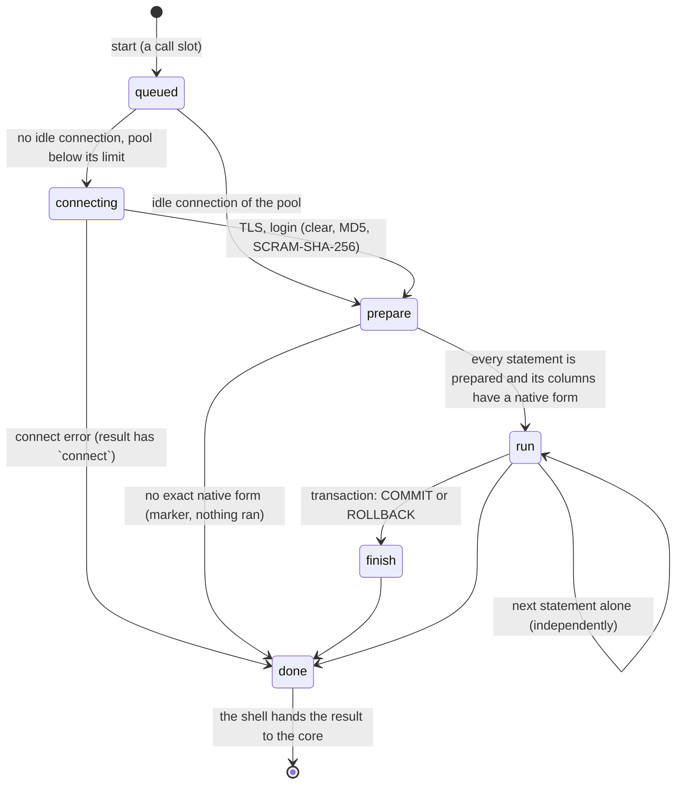

# The `sql` effect: a native PostgreSQL client

Status: built for PostgreSQL (effect kind 7, spec section 9.10). The files are `src/core/pgwire.zig` (the pure
codec), `src/shell/pg_call.zig` (the arguments and the result JSON) and `src/shell/pg.zig` (connections, pools
and the state of a call on the event loop of the shard).

## Why

The Postgres node of n8n uses the npm driver, which a compiled module cannot use. A host step limits a workflow
to a few hundred runs per second on one core. The `sql` effect lets a library node send statements and bind
values, and the runtime speaks the wire protocol itself.

## What a call does



- **Bind values only.** Each value goes in a Bind message, in text format, with a declared type: string and null
  as unknown, boolean as `bool`, an integer as `int4` or `int8`, any other number as `numeric`. This makes a bind
  equal the literal that pg-promise writes into the text for the v1 node. The client never writes a value into a
  statement text.
- **Prepared statements.** A connection keeps 16 prepared statements. The key is SHA-256 of the text and the
  parameter types, so two texts cannot share a statement. A call with more than 16 different statements runs in
  the fallback host.
- **Validate, then run.** All statements of a call are parsed and described before one of them runs. The call
  ends with a marker, and runs in the fallback host, when: the server refuses to prepare a text that pg-promise
  can run (more than one command, a parameter without a type or without a value, a parameter where only a literal
  can be), a result column has a type without a native form (arrays, interval, point, circle, a timestamp without
  a zone unless `--sql-timestamp-zone utc`, a date with `dates: legacy`), two columns have one name, or the
  DateStyle of the session is not ISO.
- **Modes.** `single` with one statement and `independently` run each statement alone. `single` with more than
  one statement and `transaction` send `BEGIN`, all statements in one write, then `COMMIT` or `ROLLBACK`.
- **A failure after the statement ran.** A result over `--sql-max-result-kb`, or a value without a native form (a
  timestamp before the year 1000), shows only in the rows. A statement that gives rows and does not start with
  `SELECT` therefore runs between `BEGIN` and `COMMIT`, so the client can roll it back and give the marker. A
  `SELECT` runs again in the host.

## Limits

| Limit | Flag | Default | At the limit |
|---|---|---|---|
| Calls in flight or waiting | `--sql-max-requests` | 64 | The step fails with a limit error and can run again |
| Connections of the shard | `--sql-max-conns` | 16 | The call waits in order; the oldest idle connection of another pool closes |
| Connections of one credential and host | `--sql-pool-conns`, lowered by `maxConnections` of the credential | 4 | The call waits in order |
| Credentials and hosts in use | 16 pools | 16 | Limit error |
| Result JSON of a call | `--sql-max-result-kb` | 4096 | Marker `sql-max-result` |
| Arguments of a call | `--sql-max-request-kb` | 1024 | Marker `sql-statement` |
| Statements of a call | `--sql-max-statements` | 256 | Marker `sql-statement` |
| Time to connect and log in | `connectTimeoutMs` of the call | 30 s | Connect error |
| Total time of a call | `timeoutMs` of the call | 300 s | The statement is cancelled, the connection closes, the step fails |

All buffers are reserved at start: for each call slot the arguments and the result, for each connection a read
buffer (one result row at most), a write buffer and the column table. Pages of a large buffer go back to the
system after use. A finished call keeps its slot until the core has room for its result, so results that wait
hold back new calls.

## Credentials

The call names a credential slot. The shell reads host, port, database, user, password and the TLS settings from
the credentials document when the call starts. Node code never sees them. The password stays in the call slot
until the call ends and is then overwritten; no message has a value of the credential. TLS follows
`getPostgresConfig` of the v1 node. A credential with the SSH tunnel, a CA certificate or a client certificate
gives the marker `sql-credential`: that workflow stays in the fallback host.

## Known differences and what is not built

- A call in `independently` mode that already committed a statement cannot run again in the host. A later result
  over the limit then fails the step with a plain limit error.
- A `SELECT` that calls a function with side effects, and whose result is over the limit, runs again in the host.
- `single` with more than one statement uses `BEGIN`. The v1 node sends one multi-command text. A command that
  cannot run in a transaction block (`VACUUM`, `CREATE DATABASE`) fails with another message.
- When the connection closes while a statement runs, the step fails. The v1 node gives an error of the query.
- TLS verification errors have the text of OpenSSL, not of Node.js.
- Not built: array, interval, point and circle columns; the escape format of `bytea`; SSH tunnels; CA and client
  certificates; the simple query protocol for a text with more than one command; a retry on a connection that the
  server closed while idle.

## Tests

- `src/core/pgwire.zig`, `src/shell/pg_call.zig`: unit tests of the codec, the bind types and the result JSON.
- `src/core/fuzz_test.zig`: three fuzz targets (backend messages, column values, the SCRAM server-first message).
- `src/shell/pg_fake.zig`: a scripted PostgreSQL server for tests without a database. It runs on the poller and
  in the thread of the test, with a clock that only the test moves. A rule gives the columns, the rows, the tag
  or the error of one statement text, or says that the server gives no answer or closes. The server writes a log
  line for each login, Parse, Bind (with the values), Execute, `BEGIN`, `COMMIT`, `ROLLBACK` and cancel request.
- `src/shell/pg_test.zig`, the `pg fake` tests (fast tier): the trust, clear, MD5 and SCRAM logins and a wrong
  password, prepare and reuse, the three modes, an error in a transaction, the markers and their rollback, the
  pool queue, the call-slot limit, the connection limit of the shard, the idle close, the time limit with its
  cancel request, and a connection that closes while a statement runs.
- `src/shell/server.zig`: a run of a module with a `sql` step through the shard (`startSql`, `drainSql`) against
  the scripted server, and results that wait while the event list has no room.
- `src/shell/pg_test.zig`, the `pg live` tests: against a real server. They are skipped without `WFRT_TEST_PG`:

```bash
docker run -d --name wfrt-pg -e POSTGRES_PASSWORD=secret -p 127.0.0.1:5544:5432 postgres:17
zig build install-tests
WFRT_TEST_PG=127.0.0.1:5544 WFRT_TEST_PG_PASSWORD=secret ./zig-out/bin/shell-test
```

`WFRT_TEST_PG_AUTH=1` also tests the MD5 and clear password logins (roles `wfrt_md5` and `wfrt_clear` with the
passwords `md5-secret` and `clear-secret`, and `md5` and `password` lines for them in `pg_hba.conf`).
`WFRT_TEST_PG_TLS=1` tests TLS (the server has `ssl = on` with a self-signed certificate).
