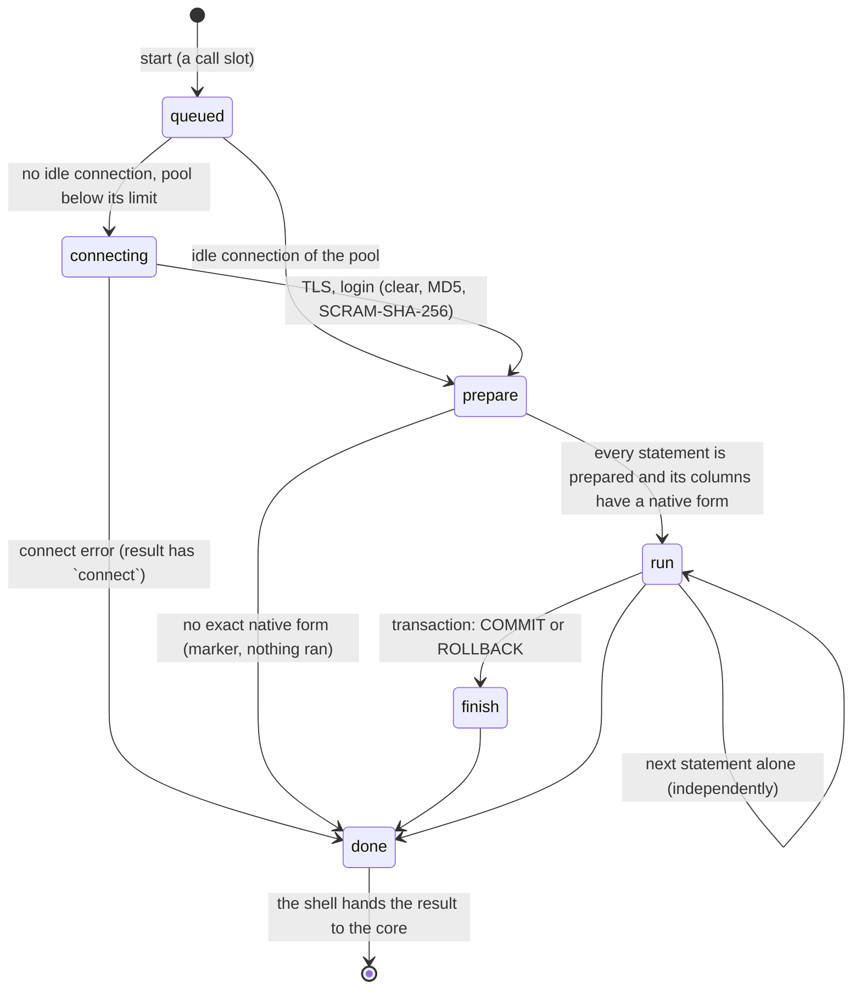

# The `sql` effect: a native PostgreSQL client

Status: built for PostgreSQL (effect kind 7, spec section 9.10). The files are `src/core/pgwire.zig` (the pure
codec), `src/shell/pg_call.zig` (the arguments and the result JSON) and `src/shell/pg.zig` (connections, pools
and the state of a call on the event loop of the shard).

## Why

The Postgres node of n8n uses the npm driver, which a compiled module cannot use. A host step limits a workflow
to a few hundred runs per second on one core. The `sql` effect lets a library node send statements and bind
values, and the runtime speaks the wire protocol itself.

## What a call does



- **Bind values.** Each value goes in a Bind message, in text format, with a declared type: string and null
  as unknown, boolean as `bool`, an integer as `int4` or `int8`, any other number as `numeric`. This makes a bind
  equal the literal that pg-promise writes into the text for the v1 node. The client never writes a value into a
  statement text. A statement with `"simple": true` has no values: see "A simple statement".
- **Prepared statements.** A connection keeps 16 prepared statements. The key is SHA-256 of the text and the
  parameter types, so two texts cannot share a statement. A call with more than 16 different statements runs in
  the fallback host.
- **Validate, then run.** All statements of a call are parsed and described before one of them runs. The call
  ends with a marker, and runs in the fallback host, when: the server refuses to prepare a text that pg-promise
  can run (more than one command, a parameter without a type or without a value, a parameter where only a literal
  can be), a result column has a type without a native form (a timestamp without a zone or an array of
  them unless `--sql-timestamp-zone utc`, the same for a date or an array of dates with `dates: legacy`), two
  columns have one name, the DateStyle of the session is not ISO and a column has a date or a timestamp, or the
  IntervalStyle of the session is not `postgres` and a column has an interval.
- **Modes.** `single` with one statement and `independently` run each statement alone. `single` with more than
  one statement and `transaction` send `BEGIN`, all statements in one write, then `COMMIT` or `ROLLBACK`.
- **A failure after the statement ran.** A result over `--sql-max-result-kb`, or a value without a native form (a
  timestamp before the year 100, a text that is not in the form that the server writes), shows only in the rows.
  A statement that gives rows and does not start with `SELECT` therefore runs between `BEGIN` and `COMMIT`, so the
  client can roll it back and give the marker. A `SELECT` runs again in the host.
- **When a marker is allowed.** The call keeps one fact: a statement that can have changed the database is
  committed. A statement counts when it ended without an error and it is not a `SELECT` that gives rows
  (`SELECT ... INTO` gives no rows, so it counts). While the fact is false, the host can run the whole call again,
  so the call can end with a marker. In the modes `single` and `transaction` the fact is always false at a
  failure, because the failure rolls the transaction back. In the mode `independently` each statement commits
  alone, so the fact becomes true after the first statement with an effect. After that, a later statement at a
  limit ends the call with a plain limit error (`(limit)`, no marker), and the statements after it do not run.
- **One entry for each statement.** A deferred constraint fails when the statement commits, after its rows and its
  tag. For a statement that runs alone (also in a transaction that the client put around it), the failure takes
  the place of the entry, as in v1. For a transaction of the mode, the failure of `COMMIT` is one more entry.

## A simple statement

A statement with `"simple": true` holds the exact text that the v1 node sends for a form that has no exact bind
form. The library node makes the text. The runtime sends it as it is with the simple query protocol (`Q`). The
statement has no `values` (with `values`, the call is refused), it is not prepared, and it takes no
prepared-statement slot. The text can hold several commands.

The entry of the statement is `{"sets":[...]}`, with one `{rows, command, rowCount}` for each command that
completed, in order. A text without a command gives `"sets":[]`. When a command fails, the server drops the rest
of the text and the entry is `{"error":{...}}`. The columns have the same JSON as for a bind statement.

The runtime cannot describe a simple text before it runs. A column type or a value without a native form, or a
result over the limit, shows only after commands ran. To keep the rule "a marker only when the call committed
nothing", a simple statement that runs alone (`single` with one statement, or `independently`) runs in one of
these ways. The runtime reads the first word of each command of the text (strings, quoted names, dollar quotes
and comments are passed over) to select the way.

| The text | How it runs | At a limit |
|---|---|---|
| No transaction word, and not only `SELECT` commands | `BEGIN`, the text, then `COMMIT` or `ROLLBACK` | The text is rolled back: marker |
| Each command starts with `SELECT` | As it is | Marker when each command gave rows. A plain error when a command gave no rows (`SELECT ... INTO`) |
| A command starts with a transaction word: `BEGIN`, `START`, `COMMIT`, `END`, `ROLLBACK`, `ABORT`, `SAVEPOINT`, `RELEASE`, `PREPARE`, `LOCK`, `DECLARE` | As it is | A plain error |
| A command cannot run in a transaction block (`VACUUM`, `CREATE DATABASE`, a `DO` or `CALL` that commits; codes 25001 and 2D000) | `BEGIN`, the text, `ROLLBACK`, then the text as it is | A plain error (in the second run) |

- **The database effect equals v1.** PostgreSQL runs a text of several commands as one transaction: a failure
  rolls back every command of the text. `BEGIN` and `COMMIT` of the client around the text give the same effect.
  The live test compares these cases with the same text sent alone: a failure in the text, `COMMIT` in the text,
  `VACUUM` alone and after another command, `DO` with `COMMIT`, `LOCK TABLE` alone, `SAVEPOINT`, and `COPY`.
- **Two checks.** The scan of the text is the first check. The command tags of the text that ran are the second:
  a tag `COMMIT`, `ROLLBACK` or `PREPARE`, or a text that ended the transaction of the client, sets the fact "a
  statement is committed". After that, the call gets no marker.
- **A text that leaves a transaction open** (`BEGIN` without `COMMIT`): the runtime sends `ROLLBACK`. The v1 node
  leaves the transaction open on a connection of its pool.
- **A text that runs two times.** In the last row of the table, the first run is rolled back. A sequence that the
  text uses advances two times.
- **In a transaction of the mode** (`transaction`, or `single` with more than one statement), the text goes
  between the other statements, inside `BEGIN` and `COMMIT` of the mode. A text with a transaction word gets the
  marker `sql-statement` before a statement is sent: the statements after it are on the wire before its answer
  comes, so they would run after the text ended the transaction.
- **`COPY`.** The rows of `COPY ... TO STDOUT` are dropped and the set has only the tag. `COPY ... FROM STDIN`
  fails with "No source stream defined". Both are as in node-postgres.
- **v1 `single` mode.** The v1 node sends the queries of all items as one text. A library node gets exactly
  that behavior when it sends the text as one simple statement.

What remains a plain error (`(limit)`, no marker, the step fails), all for a result over the limit or a type or
value without a native form:

- A simple text that ran as it is and is not only `SELECT` commands that gave rows (rows 2 to 4 of the table).
- A simple text that committed by itself before the limit showed (a `COMMIT` that the scan did not see).
- In `independently` mode, a statement after a simple statement that committed (the rule of the bind statements).

## Safety of a simple statement

The `simple` path sends text that the library node made with a formatter that equals pg-promise. It gives the
same text as v1 and therefore the same safety as v1, no more. The runtime does not check or change the text. The
bind path stays in use wherever a bind is the same statement for the database.

## Column types

The client reads each value as text and writes the JSON that node-postgres (pg-types 2.2.0) and the v1 node
(version 2.7 and later) give. Each form was compared with pg-promise against a server (`pg live` tests).

| Type | JSON |
|---|---|
| `bool`, `int2`, `int4`, `oid`, `float4`, `float8`, `int8`, `numeric`, `json`, `jsonb`, `bytea`, `date`, `timestamptz`, `timestamp` | see spec section 9.10 |
| `int2[]`, `int4[]`, `oid[]` | numbers |
| `float4[]`, `float8[]`, `numeric[]` | numbers (`parseFloat`); NaN and the infinities are null. `largeNumbers` changes nothing: v1 changes only a column of type `numeric` |
| `int8[]` | texts. `largeNumbers` changes nothing |
| `bool[]` | booleans |
| `text[]`, `varchar[]`, `char[]`, `uuid[]`, `cidr[]`, `inet[]`, `macaddr[]`, `money[]`, `time[]`, `timetz[]`, `numrange[]`, `regproc[]` | texts |
| `json[]`, `jsonb[]` | the JSON values |
| `date[]` | the texts of the server |
| `timestamptz[]`, and `timestamp[]` with `--sql-timestamp-zone utc` | as `timestamptz` for each element |
| `timestamptz`, `timestamp` and their arrays, old values | The years 0100 to 9999 have the ISO text. A value before Christ (`... BC`) and a value with seconds in its zone offset (`+00:53:28`, the local mean time of a named zone) stay the text of the server, because `new Date` gives no date for them. A year below 100 and a year above 9999 give the marker `sql-type`: JavaScript reads "0099" as 1999 and "0031" as no date |
| `bytea[]` | a `Buffer` object for each element, only in the hex format of `bytea_output` (the default); the escape format gives the marker `sql-type` |
| With `dates: legacy`: `timestamptz[]`; and `date`, `date[]`, `timestamp[]` with `--sql-timestamp-zone utc` | the JSON of the `Date` of postgres-date 1.0.7: the ISO text (a year outside 0 to 9999 has a sign and six digits); null for `infinity` and for a time outside the range of a JavaScript date. Also before Christ, and with the rule of postgres-date for the years 0 to 99 (February 29 of the year 0 is March 1) |
| `interval`, `interval[]` | the object of postgres-interval: `years`, `months`, `days`, `hours`, `minutes`, `seconds`, `milliseconds`, without the parts that are 0. Only the `postgres` IntervalStyle |
| `point`, `point[]` | `{ "x": x, "y": y }` |
| `circle` | `{ "x": x, "y": y, "radius": r }` |
| each other type, also each other array type (`circle[]`, `name[]`) | the text of the server |

An array is a JSON array. `NULL` without quotes is null, an inner array is an inner JSON array, and bounds before
the values (`[0:2]={7,8,9}`) are ignored, as postgres-array 2.0.0 does. The reader takes only the text that the
server writes (no space outside quotes, a backslash only inside quotes, 6 dimensions at most); another text gives
the marker `sql-type`.

## Limits

| Limit | Flag | Default | At the limit |
|---|---|---|---|
| Calls in flight or waiting | `--sql-max-requests` | 64 | The step fails with a limit error and can run again |
| Connections of the shard | `--sql-max-conns` | 16 | The call waits in order; the oldest idle connection of another pool closes |
| Connections of one credential and host | `--sql-pool-conns`, lowered by `maxConnections` of the credential | 4 | The call waits in order |
| Credentials and hosts in use | 16 pools | 16 | Limit error |
| Result JSON of a call | `--sql-max-result-kb` | 4096 | Marker `sql-max-result` |
| Arguments of a call | `--sql-max-request-kb` | 1024 | Marker `sql-statement` |
| Statements of a call | `--sql-max-statements` | 256 | Marker `sql-statement` |
| Time to connect and log in | `connectTimeoutMs` of the call | 30 s | Connect error |
| Total time of a call | `timeoutMs` of the call | 300 s | The statement is cancelled, the connection closes, the step fails |

All buffers are reserved at start: for each call slot the arguments and the result, for each connection a read
buffer (one result row at most), a write buffer and the column table. Pages of a large buffer go back to the
system after use. A finished call keeps its slot until the core has room for its result, so results that wait
hold back new calls.

## Credentials

The call names a credential slot. The shell reads host, port, database, user, password and the TLS settings from
the credentials document when the call starts. Node code never sees them. The password stays in the call slot
until the call ends and is then overwritten; no message has a value of the credential. TLS follows
`getPostgresConfig` of the v1 node. A credential with the SSH tunnel, a CA certificate or a client certificate
gives the marker `sql-credential`: that workflow stays in the fallback host.

## Known differences and what is not built

- A call in `independently` mode that committed a statement with an effect cannot run again in the host. A later
  statement then fails the step with a plain limit error in three cases: its result makes the call larger than
  `--sql-max-result-kb`; a value has no native form (a timestamp before the year 100 or after the year 9999, a
  `bytea[]` in the escape format, an interval after a `SET intervalstyle` of the same call); or the statement could not be prepared
  before the call ran (its table is made by a statement of the call) and a column has a type without a native
  form. The checks that can run before the first statement do run there (Parse, Describe, the styles of the
  session), so only these cases stay. Rejected: one transaction with a savepoint for each statement. It lets the
  client roll back everything, but `now()`, deferred constraints, locks and what other sessions see differ from
  v1. Proposed, not built: a marker that says how many statements are done (with their results), so that the
  library node gives only the other items to the host. It needs a change of the effect contract in
  `packages/@n8n/workflow-lang`.
- A `SELECT` that calls a function with side effects, and whose result is over the limit, runs again in the host.
  In `independently` mode the same holds for each `SELECT` before the statement at the limit.
- `single` with more than one statement uses `BEGIN`. The v1 node sends one multi-command text. A command that
  cannot run in a transaction block (`VACUUM`, `CREATE DATABASE`) fails with another message. A library node that
  needs the exact v1 behavior sends the one text as one simple statement.
- A simple text with `COPY ... FROM STDIN` in a transaction of the mode: the statements after it are on the wire
  when the server waits for the data, so the server reads them as a protocol error. The transaction fails and is
  rolled back, but the error is not the one of v1.
- When the connection closes while a statement runs, the step fails. The v1 node gives an error of the query.
- TLS verification errors have the text of OpenSSL, not of Node.js.
- Two columns of one name give the marker `sql-type`. node-postgres gives one key, at the place of the first
  column and with the value of the last.
- Not built: timestamps in the years below 100 and above 9999 (the marker `sql-type`); SSH tunnels; CA and client
  certificates; a retry on a connection that the server closed while idle.

## MySQL (`dialect: mysql`)

Status: built and tested against a scripted server. Not yet run against a real server, so the shard does not send
calls to it: `Options.sql_mysql` is off, and a call with the dialect `mysql` ends with `(limit: sql-host)` and
runs in the fallback host. The flag `--sql-mysql` of `wfrt serve` turns the option on. n8n gives the flag, and
tells the converter that the runtime has the client (`ConvertOptions.mysql`), only with
`N8N_COMPILED_ENGINE_SQL_MYSQL=true`. Keep both off until the `mysql live` tests pass.

The files are `src/core/mywire.zig` (the pure codec), `src/core/myerr_tables.zig` (the error names of mysql2,
made by `gen_myerr.mjs`), `src/shell/my_call.zig` (the arguments and the row JSON), `src/shell/my.zig` (the
client) and `src/shell/sql_net.zig` (what `pg.zig` and `my.zig` share: socket and TLS bytes, address text,
credential values, the finished-call record). The pools, the queue and the connect steps of `my.zig` follow
`pg.zig` but are not shared code.

- **Text protocol only.** The v1 node writes the values into the text and sends `COM_QUERY`. A statement must
  have `simple: true` and no `values`. The runtime sends the text as it is. There is no prepared statement.
- **Login.** Handshake version 10, the capability flags of mysql2 that change behavior (`FOUND_ROWS`,
  `IGNORE_SPACE`, `MULTI_STATEMENTS`, `SESSION_TRACK`, `LOCAL_FILES`), character set 224, no
  `CLIENT_DEPRECATE_EOF`. Methods: `mysql_native_password`, and `caching_sha2_password` with the fast login and
  the full login (the clear password over TLS; without TLS the password under the RSA key of the server, through
  OpenSSL in `tls.zig`). The server can change the method. Another method gives `(limit: sql-credential)`.
- **Modes.** All statements of a call run on one connection, one after the other. `single`: each alone, the
  result ends with the first failure. `independently`: each alone; a failure skips the later statements of the
  same `group` (`{"skipped":true}`). `transaction`: `START TRANSACTION`, the statements, `COMMIT`; the first
  failure sends `ROLLBACK` and ends the result.
- **Result.** One `{"sets":[...]}` for each statement, with one set for each result of the text, or
  `{"error":{...}}` with the fields of mysql2 (`code` is the name of the error number). Two columns of one name:
  the place of the first, the value of the last.
- **A marker only when the call committed nothing.** The call keeps one fact. Outside a transaction of the mode,
  each OK packet sets it, and so does a result set of a text that does not only read (each command starts with
  `SELECT`, `SHOW`, `DESCRIBE`, `DESC` or `EXPLAIN`). In a transaction of the mode, an answer whose status has
  lost `SERVER_STATUS_IN_TRANS` sets it (a command with an implicit commit). At a limit (`sql-type`,
  `sql-max-result`), a transaction of the mode is rolled back first. While the fact is false the error has the
  marker; else it is a plain `(limit)` error. The client adds no transaction of its own, so the database effect
  equals v1.
- **A connection is new for each call.** The v1 node makes a pool for each run. The runtime keeps connections,
  so it sends `COM_RESET_CONNECTION` before a call on a used connection. A statement that sets
  `SERVER_SESSION_STATE_CHANGED` (`USE`, a tracked variable), an open transaction at the end of a call, or a
  server without the reset command: the connection closes after the call.
- **Time limit.** The connection closes, and a second connection logs in with the same credential and sends
  `KILL QUERY <id>` (4 at one time; best effort).
- **Credential.** `host`, `port`, `database`, `user`, `password`, `ssl`. `sshTunnel`, or `ssl` with a
  certificate field, gives `(limit: sql-credential)`. A TLS failure also gives it, because the text of OpenSSL is
  not the text of Node.js.

| Limit | Flag | Default | At the limit |
|---|---|---|---|
| Calls in flight or waiting | `--sql-max-requests` | 64 | Limit error; the step can run again |
| Connections of the shard (apart from PostgreSQL) | `--sql-max-conns` | 16 | The call waits in order |
| Connections of one credential and host | `--sql-pool-conns` | 4 | The call waits in order |
| Credentials and hosts in use | 16 pools | 16 | Limit error |
| Result JSON of a call | `--sql-max-result-kb` | 4096 | Marker `sql-max-result`, or `(limit)` |
| Arguments of a call, and one statement text | `--sql-max-request-kb` | 1024 | Limit error |
| Statements of a call | `--sql-max-statements` | 256 | Marker `sql-statement` |
| Columns of one result set | 512 | 512 | Marker `sql-type` |
| One value | 16 MB (one packet) | | Marker `sql-max-result` |
| Time to connect and log in | `connectTimeoutMs` | 10 s | Connect error `ETIMEDOUT` |
| Total time of a call | `timeoutMs` | 300 s | `KILL QUERY`, the step fails |

Known differences and what is not built:

- Not verified against a real server: everything. In particular the RSA login, the reset (the character set
  after it), `KILL QUERY`, and each column type. TLS with a certificate that verifies was never run.
- A table that has no transactions (MyISAM) is not rolled back: a limit in a transaction of the mode then gives
  a marker after a write.
- A JSON column keeps the key order of the server; JavaScript puts keys that are whole numbers first. A string
  with a `\u` escape gives `sql-type`.
- A character column in a set that is not UTF-8 or ASCII, and DATE or DATETIME with `dates: legacy`, give
  `sql-type`. Geometry and vector types also.
- When the connection closes while a statement runs, the step fails. mysql2 gives an error of the query.
- Not built: server-side prepared statements, compression, `sha256_password`, `mysql_clear_password`, CA and
  client certificates, SSH tunnels, a local file for `LOAD DATA LOCAL` (the entry is the error of mysql2).

Tests: unit tests in `mywire.zig` and `my_call.zig`; three fuzz targets in `src/core/fuzz_test.zig` (server
packets, column values, the text scan); `src/shell/my_fake.zig` is the scripted server of the `mysql fake` tests
in `src/shell/my_test.zig`; `src/shell/server.zig` has a run through the shard. The `mysql live` tests need the
server of the contract (users `root`, `nat`, `sha`, `nopw`, database `card`):

```bash
WFRT_TEST_MY=127.0.0.1:5545 WFRT_TEST_MY_PASSWORD=cardmy ./zig-out/bin/shell-test
```

## Cost

Measured on 2026-11-17 with a ReleaseSafe build (`zig build -Drelease=true`) on macOS (Apple silicon), one shard,
`wfrt load --conns 64 --seconds 10`, PostgreSQL 17 in a container on the same machine. The machine ran other
builds at the same time (load average near 80), so the rate is low; the CPU time of the process is the stable
number. The workflow is a webhook, one `ctx.sql` call (`select $1::int4 + 1 as a, $2 as label` with two bind
values) and `ctx.respond` with the result.

| Workflow | Requests | CPU of `wfrt` for each request (user + system) |
|---|---|---|
| webhook, `sql`, respond (`--sql-pool-conns 16 --sql-max-requests 512`) | 64,278 and 63,936 in 10 s | 43.1 µs and 43.6 µs (16.5 µs user, 26.6 µs system) |
| webhook, respond with the same body, no `sql` | 245,686 in 10 s | 15.6 µs (4.7 µs user, 10.9 µs system) |

The `sql` call adds about 28 µs for each request: about 12 µs user and 16 µs system. No profile of
the call was made.

## Tests

- `src/core/pgwire.zig`, `src/shell/pg_call.zig`: unit tests of the codec, the bind types and the result JSON.
- `src/core/fuzz_test.zig`: four fuzz targets (backend messages, column values, the scan of a simple text, the SCRAM server-first message).
- `src/shell/pg_fake.zig`: a scripted PostgreSQL server for tests without a database. It runs on the poller and
  in the thread of the test, with a clock that only the test moves. A rule gives the columns, the rows, the tag
  or the error of one statement text, or says that the server gives no answer or closes. The server writes a log
  line for each login, Parse, Bind (with the values), Execute, `BEGIN`, `COMMIT`, `ROLLBACK` and cancel request.
- `src/shell/pg_test.zig`, the `pg fake` tests (fast tier): the trust, clear, MD5 and SCRAM logins and a wrong
  password, prepare and reuse, the three modes, an error in a transaction, the markers and their rollback, simple statements (alone, with bind statements, at a limit, with a transaction command), the
  pool queue, the call-slot limit, the connection limit of the shard, the idle close, the time limit with its
  cancel request, and a connection that closes while a statement runs.
- `src/shell/server.zig`: a run of a module with a `sql` step through the shard (`startSql`, `drainSql`) against
  the scripted server, and results that wait while the event list has no room.
- `src/shell/pg_test.zig`, the `pg live` tests: against a real server. They are skipped without `WFRT_TEST_PG`:

```bash
docker run -d --name wfrt-pg -e POSTGRES_PASSWORD=secret -p 127.0.0.1:5544:5432 postgres:17
zig build install-tests
WFRT_TEST_PG=127.0.0.1:5544 WFRT_TEST_PG_PASSWORD=secret ./zig-out/bin/shell-test
```

`WFRT_TEST_PG_AUTH=1` also tests the MD5 and clear password logins (roles `wfrt_md5` and `wfrt_clear` with the
passwords `md5-secret` and `clear-secret`, and `md5` and `password` lines for them in `pg_hba.conf`).
`WFRT_TEST_PG_TLS=1` tests TLS (the server has `ssl = on` with a self-signed certificate).

### Replay of the calls of the library node

`bench/pg-replay/replay.mts` sends the recorded `sql` calls of the Postgres library node
(`packages/@n8n/workflow-lang/src/nodes/__tests__/postgres-recordings.json`) to `wfrt` and a real database, and
compares each result with the recorded result of the TypeScript reference client. Each case starts from the
tables of the equivalence test, in the database `wfrt_replay`. `workflow.ts` in the same directory is the workflow
that forwards a posted call to `ctx.sql`.

```bash
zig build && node bench/pg-replay/replay.mts
```

Result on 2026-11-17 with the release build (279 cases, 365 calls: select, insert, update, upsert, delete,
execute query): 357 results are equal, and the tables after each such case are equal. 1 call ends with the same
marker and another message. 7 calls differ. In 6 of them the reference client gives a marker for a column that
`wfrt` reads: an `int4[]` or `text[]` column, an `interval` column, a `date` column with `dates: legacy`. In 1 the
result has two columns of one name: the reference client gives the row of JavaScript, and `wfrt` gives the
marker `sql-type`.

## Microsoft SQL Server (`dialect: mssql`)

Status: the client is built and tested against a scripted server. It is not yet run against a real server, so the
shard does not send calls to it: `Options.sql_mssql` is off, and a call with the dialect `mssql` ends with
`(limit: sql-host)` and runs in the fallback host. The flag `--sql-mssql` of `wfrt serve` turns the option on.
n8n gives the flag, and tells the converter (`ConvertOptions.mssql`), only with
`N8N_COMPILED_ENGINE_SQL_MSSQL=true`. No library node exists yet, so the Microsoft SQL node runs in the fallback
host with each value. Keep both off until the `mssql live` tests pass.

The files are `src/core/tdswire.zig` (the pure codec), `src/shell/ms_call.zig` (the arguments, the bind values
and the scan of a statement text), `src/shell/ms.zig` (the client) and `src/shell/ms_fake.zig` (the scripted
server). The statements of the v1 node are in `packages/@n8n/workflow-lang/src/nodes/shared/mssql-format.ts`.

### What the v1 node does

Paths are in `packages/nodes-base/nodes/Microsoft/Sql/`. The node uses `mssql` 12.7.0 on tedious 20.0.5.

- **Connection** (`GenericFunctions.ts:102`, `configurePool`). One pool for each run of the node, closed at the
  end. `connectTimeout` and `requestTimeout` come from the credential (15 s each by default). `tls` is `encrypt`,
  `allowUnauthorizedCerts` is `trustServerCertificate`, `tdsVersion` is `7_4` by default, and `enableArithAbort`
  is false. A credential with a `domain` uses NTLM, which the codec does not have.
- **Session.** After the login tedious sends one SQL batch of `set` statements (`initial_sql` in the codec).
- **`executeQuery`** (`MicrosoftSql.node.ts:298` from version 1.1, `:338` before). The node puts each `{{ }}` of
  the query into the text, changes `$N` to `@pN` from the highest number down, and binds the values
  (`GenericFunctions.ts:325`). It fails before the request when a `$N` outside quotes has no value. Version 1
  runs the query of item 0 only.
- **Every statement is the RPC `sp_executesql`**, also without a value: `request.query` of `mssql` calls
  `execSql` of tedious. The values are bound, never written into the text. `mssql` takes the type from the
  JavaScript value: a string and `null` are `nvarchar`, an integer is `int` or `bigint`, another number is
  `float`, a boolean is `bit`. The declared length of a string is its count of UTF-16 units, and `nvarchar(max)`
  above 4,000.
- **`insert`** (`:171`): one `INSERT ... VALUES` for each group of rows, with a new group when the count of
  values reaches 2,100 (`mssqlChunk`, `:150`). **`update`** (`:198`): one `UPDATE` for each item. **`delete`**
  (`:226`): `DELETE ... WHERE key IN (...)` with 1,000 values for each statement.
- **Result** (`:280`). With record sets: the rows of all sets in one list. Without: one item for each count,
  `{message: "Query N executed successfully", rowsAffected}`. With neither: one item with a message. From
  version 1.2 a binary column goes to the binary data of the item.
- **Errors.** `mssql` collects each ERROR token and throws the last one: the message of the server. A failed
  connection throws the error of tedious, or gives one item `{error}` with "continue on fail".

### What the codec does

- Packets: the 8-byte header, and a message in packets of the negotiated size.
- PRELOGIN, LOGIN7 with SQL authentication (the password with its halves swapped and XOR `0xA5`), a SQL batch,
  and the `sp_executesql` request with the types of `mssql`. The tests compare each with the bytes that tedious
  builds (`gen_tds_cases.mjs` writes them to `tdscase_tables.zig`).
- The reply: COLMETADATA, ROW, NBCROW, DONE, DONEPROC, DONEINPROC, ERROR, INFO, ENVCHANGE, LOGINACK, ORDER,
  RETURNSTATUS and FEATUREEXTACK. `writeReply` gives `{"sets", "rowsAffected", "errors"}` as `mssql` builds them.
- Values as tedious converts them: `bigint` is a string; `decimal`, `numeric` and `money` are doubles with the
  arithmetic of tedious; each date and time type is the ISO text of the JavaScript `Date` (UTC); a
  `uniqueidentifier` is upper case; a binary value is `{"type":"Buffer","data":[...]}`.
- The tests read 863 token streams written from MS-TDS, and compare with the result of the token parser of
  tedious and the row code of `mssql`.

No exact native form (`error.Unsupported`, so the call must run in the host): TDS 7.1; NTLM and Azure logins; a
server that sends the client to another server; `xml`, `sql_variant` and CLR types; a `decimal` with a scale
above 22; a `char` value with a byte above 127 in a code page other than 1252 or UTF-8; two columns with one
name; a column `__proto__`; the single column that `FOR JSON` and `FOR XML` give; output parameters.

### The call

```json
{"credential":"db","dialect":"mssql","mode":"single",
 "statements":[{"text":"select @p2, @p1","params":[{"name":"p2","value":"a"},{"name":"p1","value":7}]}]}
```

- Each statement is one RPC `sp_executesql`. The parameters go in the order of `params`, which is the order of
  the `request.input` calls of the v1 node. A value is a string, a number, a boolean or null.
- The statements run on one connection, one after the other, each alone. `single`: the result ends with the first
  statement that has an error or a time-out. `independently`: every statement runs. There is no transaction mode:
  the v1 node has none.
- The result is `{"results":[entry, ...]}`. An entry is `{"sets", "rowsAffected", "errors"}` of the codec, or
  `{"timeout": ms}` for a statement that the client cancelled. A connection that fails gives
  `{"results":[],"connect":{"message","code"}}` with the text and the code of tedious (`ESOCKET`, `ETIMEOUT`,
  `ELOGIN`, `EENCRYPT`).

### The connection

- **PRELOGIN**, then the answer of the server. When the server wants encryption (`ON` or `REQ`): with `tls` of
  the credential off, the error of tedious (`EENCRYPT`); else the TLS handshake, with each flight of the client
  as one PRELOGIN message and the records of the server inside packets, and after it TLS for the whole stream.
  When the server does not want encryption, the login goes in clear, as with tedious. `allowUnauthorizedCerts`
  is `trustServerCertificate`. The handshake is limited to TLS 1.2 (SQL Server has TLS 1.3 only with TDS 8).
- **LOGIN7** with SQL authentication, then the SQL batch of `set` statements of tedious.
- **Time limits** are those of the credential: `connectTimeout` until the login ends, `requestTimeout` for each
  statement (15 s each when absent). At the limit of a statement the client sends ATTENTION, waits for the DONE
  token that confirms it (5 s, `cancelTimeout` of tedious), and uses the connection again.
- **Reuse.** The v1 node makes a pool for each run. The runtime keeps connections (4 for each credential, idle
  30 s). Before a call on a used connection, the client sends the batch of tedious with the RESETCONNECTION flag
  (`connection.reset()` of tedious): no temporary table, variable or open transaction stays. A server that
  refuses it: the call takes a new connection.
- **The credential** is read by the runtime when the call starts: `server`, `port`, `database`, `user`,
  `password`, `tls`, `allowUnauthorizedCerts`, `connectTimeout`, `requestTimeout`, `tdsVersion`. An absent value
  has the default of the credential type. The password stays in the call slot until the call ends.

### Where a form without a native client is decided

Every case ends with a marker, so the node runs in the fallback host. The order is fixed: a statement that
writes is sent only after every check before it passed.

| Case | Decided | Marker |
|---|---|---|
| The gate is off | The shard, before the client | `sql-host` |
| `domain` (NTLM), TDS 7.1, a named instance (`server\name`), a time limit that is not a whole number | When the call starts, from the credential. No connection opens | `sql-credential` |
| A statement that is not only `SELECT`, and not `INSERT`, `UPDATE` or `DELETE` without rows (`EXEC`, `OUTPUT`, `SELECT ... INTO`, `MERGE`, a text with a statement of another kind) | When the call starts, by the word scan of `ms_call.classOf` | `sql-statement` |
| A statement that gives rows after a statement that writes, in one call | When the call starts | `sql-statement` |
| A bind value that `mssql` refuses or changes (a whole number outside 64 bits), a text that is not valid UTF-8, more than 2,100 values | When the call starts: each request is built once without a connection | `sql-statement` |
| A value that is not a string, a number, a boolean or null (a Date, a Buffer, an object), NaN | In the library code (`msfValue`), before the call | `sql-host` |
| A server that sends the client to another server, Azure and federated logins, a TLS failure | At the login, before a statement | `sql-credential` |
| `xml`, `sql_variant`, CLR types, a `decimal` scale above 22, a `char` in another code page, two columns of one name, `__proto__`, `FOR JSON`, a result over `--sql-max-result-kb` | In the reply to a statement that only reads. No statement that writes ran before it (rows 3 and 4) | `sql-type`, `sql-max-result` |

One case stays a plain error (`(limit)`, no marker): rows in the reply to an `INSERT`, `UPDATE` or `DELETE`,
which only a trigger can give, with a type without a native form. The statement ran, so the host cannot run it
again.

### Known differences and what is not built

- Not verified against a real server: everything in `ms.zig`. In particular the TLS handshake against SQL Server,
  the reset, ATTENTION, and the text of each connect error.
- The library node is not built. Its statements are: `mssql-format.ts` gives the text and the bind values of
  `executeQuery`, `insert` (a new statement at 2,100 values), `update` and `delete` (1,000 values for each
  statement), and `src/nodes/__tests__/mssql-format.test.ts` compares them with the built v1 node and a real
  `mssql` request on generated cases.
- The v1 node sends the statements of `insert`, `update` and `delete` at one time on a pool of 10 connections.
  The runtime sends them in order on one connection. With two statements that fail, v1 throws the one that
  failed first in time.
- LOGIN7 has the time zone 0, not the zone of the process. The pool of `mssql` checks a connection with
  `SELECT 1;` before it uses it again; the runtime sends the reset.
- A server that does not confirm ATTENTION in 5 s: the connection closes and the step fails.
- When the connection closes while a statement runs, the step fails. `mssql` gives an error of the request.
- Not built: NTLM, Azure logins, routing, named instances, TDS 7.1 and 8, a CA certificate.

### Tests

- `src/shell/ms_call.zig`: the class of a text, the checks of a call, the bind values.
- `src/shell/ms_test.zig`, the `mssql fake` tests: the login and its errors, credentials that stay in the host,
  bind values (the server takes only the bytes that the codec builds for the rule), the two modes, each marker
  and its place, the reset before reuse, the queue and the call-slot limit, ATTENTION at `requestTimeout`, and
  the TLS handshake inside PRELOGIN packets. The replies are the vectors of `tdscase_tables.zig`.
- `src/shell/server.zig`: a `sql` step through the shard, with the gate off and on.
- `src/shell/ms_test.zig`, the `mssql live` test: against a real server. It is skipped without `WFRT_TEST_MS`:

```bash
docker run -d --name wfrt-ms -e ACCEPT_EULA=Y -e MSSQL_SA_PASSWORD='Wfrt-test-1' -p 127.0.0.1:5546:1433 \
  mcr.microsoft.com/mssql/server:2022-latest
zig build install-tests
WFRT_TEST_MS=127.0.0.1:5546 WFRT_TEST_MS_PASSWORD='Wfrt-test-1' ./zig-out/bin/shell-test
```

Not written yet, for the bed: the comparison with the v1 node for each data type and each error. The form is
`bench/pg-replay`: for each case, run `pool.request().input(...).query(text)` of `mssql` 12.7.0 with the
options of `configurePool`, and the same statement through `wfrt serve --sql-mssql`; the entry of `wfrt` must
equal `{sets: recordsets, rowsAffected, errors}` of `mssql` after `JSON.stringify`. The cases: one column of each
type of the codec's list (with NULL, the least and the largest value), each `error.Unsupported` type (the marker
`sql-type`), a constraint error, a syntax error, a wrong password, a closed port, `requestTimeout`, and
`encrypt` on and off.

## Snowflake: not built

The v1 node (`packages/nodes-base/nodes/Snowflake/`) uses `snowflake-sdk` 3.3.0: `connect`
(`GenericFunctions.ts:118`), `ALTER SESSION SET STRICT_JSON_OUTPUT = TRUE` (`Snowflake.node.ts:274`), then
`conn.execute({sqlText, binds})` for each item (`GenericFunctions.ts:169`), then `destroy`. The login is a
password, a key pair (a JWT that the SDK signs) or OAuth. This card did not read the request sequence of the SDK
(login request, session token, query request, result chunks, row conversion), so nothing here states that
`ctx.http` can reproduce it. That reading is the first step of a Snowflake card.
