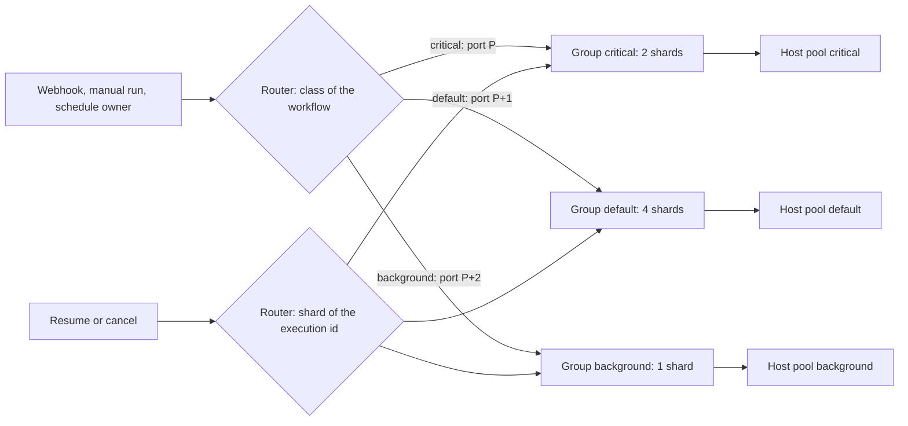

# Workload classes

Goal: a bursty background workflow cannot delay a business-critical workflow.
Each class of workflows gets its own capacity, and each capacity scales alone.
This prototype is off by default: one class, the behaviour of today.

## What the runtime does today

- A shard is one thread with its own memory, slot table, log and outbound tables.
- With `--shards N`, each shard listens on the same port and the kernel gives a
  connection to a shard. No code sends a workflow to a shard by its ID, and no
  message goes from one shard to another.
- The admin API needs one shard, thus n8n starts one `wfrt` with one shard.
  The router is outside the shards: n8n's bridge, or a load balancer.

## The class of a workflow

- `--classes critical,default,background` names the classes: at most 8 names
  of at most 16 bytes. The class `default` (or the first name) is the default.
- n8n sends `"class"` in the load call (`PUT /_admin/workflows/<id>`). No name
  or an unknown name gives the default class. The load never fails for a class.
- `PUT /_admin/workflows/<id>/class` with `{"class":"background"}` changes the
  class without a compile. The log keeps the class of a load, but not this
  change: after a restart the workflow has the class of its last load.

## Shard groups and routing

- `--class-shards critical=2,default=4,background=1` gives each class a group
  of consecutive shard IDs. The shard count is the sum. A class without shards
  uses the group of the default class.
- Class number `c` listens on `--port` + `c`. The router selects the port by
  the class. The kernel spreads the connections of a port in that group only.
- `--class-serve NAME` is for one process for each class (necessary with the
  admin API). The process holds only shards of that class.
- A shard refuses a start for a class of another group with 421 and counts it
  (`misrouted`): an error of the router cannot move load between groups.
- `workload.shardFor(class, idHash(workflowId))` gives one shard of the group,
  for a router that needs one owner shard (schedules, static data).
- Slots, memory, the log and the outbound tables belong to a shard. Thus they
  are separate for each class.

### A workflow changes its class

- New executions go to the new group. A running execution finishes on its
  shard, and a waiting execution resumes there: an ID that `wfrt` made has the
  shard in bits 48 to 63 (`core.ownerShard`); for an ID from n8n, the bridge keeps it.
- The log of the old shard keeps the old executions. No record moves.
- The bridge loads the module into the new group, then changes the route,
  then unloads it from the old group when its executions there end.

## The fallback host

- Reserved workers for each class in one pool: the classes still share the
  pool process and its memory, and the pool and the protocol need new code.
- One pool for each class (the choice): separate processes, sockets and
  heaps, at the cost of idle memory. Each group gets its own `--fallback`
  socket, and the pool needs no change. The share of each workflow and the
  slow lane operate in the pool of the class, as today.

In one shard with many classes, `--class-host-steps background=32` limits the
host steps of a class. A step above the limit waits. No step fails.

## Limits for each class

| Limit | Flag | At the limit |
|---|---|---|
| Executions that hold a slot, for each shard | `--class-slots background=64` | Webhooks and manual runs get 503 with the class name. A schedule fire waits |
| Host steps in flight, for each shard | `--class-host-steps background=32` | The step waits |
| Rate | Not built. The limit of a route (`rate`, `burst`) exists | 429 |

A refusal is for one class only: the other classes see no change (unit test
`the full slots of one class refuse that class only`). A refused start is not
in the log, and a replay refuses no start. A waiting execution holds no slot.

Counters (`GET /_admin/classes`, and one `--stats` line for each class):
`in_flight`, `started`, `refused`, `host_waiting`, and in the admin API also
`misrouted`, `deferred`, `hostInFlight`.

## Independent scaling

- At run time today nothing changes: shard and worker counts are fixed at
  startup. Step 1 (built): a shard count and limits for each class at startup.
- Step 2: one `wfrt` process and one host pool for each class behind the
  bridge. A class then scales by a restart of its own process. The bridge needs:
  1. a table of processes with their class (ports, admin ports, secrets);
  2. to load a workflow into the process of its class;
  3. to forward webhooks and manual runs by class;
  4. to send a resume, a cancel and a service answer to the process that owns
     the execution (stored with the execution);
  5. one event stream and one ack cursor for each process.
- Step 3 (not designed): add or remove a process at run time. Waiting
  executions must then move between logs.

## n8n in this prototype

- `N8N_COMPILED_ENGINE_WORKLOAD_CLASSES` maps workflow IDs to classes
  (`critical=wfA,wfB;background=wfC`). n8n starts `wfrt` with the class names
  and sends the class with each load. `..._WORKLOAD_CLASS_SLOTS` and
  `..._WORKLOAD_CLASS_HOST_STEPS` set the limits.
- n8n still starts one `wfrt` with one shard: the classes have separate
  limits, but they share the thread, the memory and the log of that shard.
- The real design needs a class on the workflow or its project (a database
  field, a UI control), a rule for tags, and the class call on a change.

## Comparison with v1

- v1 queue mode: all workflows share the workers, and each worker has a
  concurrency limit. A burst of one workflow fills the queue for all. There is
  no priority or reserved capacity for a workflow.
- This design exceeds v1 in three points: capacity for each class, a refusal
  for one class only, and a separate host pool for each class.
- A class changes where and when an execution runs, not the module, the inputs
  or the order of steps. Thus it changes no result of a workflow. A caller of
  a full class sees a 503 that v1 does not send.
- Not built: the router in the bridge, a rate for each class, a log record
  for the class call, and a load test. The unit tests prove the rules only.
